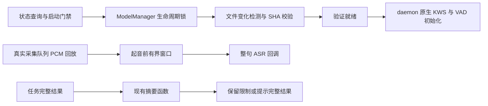

# 语音边界修复与验证 · 2026-10-25

> **状态**：四项修复已实施，定向回归及桌面编译通过；物理音频与原生交互仍未签核。
> **基准**：`feat/voice-next`，接手 HEAD `90e8e2b1943b32cab8e6fab3c94d73bddafde192`。
> **核心原则**：模型通过完整性校验后才进入原生引擎；安装生命周期只有一个任务所有者；起音前静音不占用整句预算；英文播报不能省略失败和禁止操作的语义。

> **本地交付更新**：用户已授权更新文档并提交。四项修复、正式回归测试、本报告及两个入口随同一次本地提交交付，提交主题为 `fix(voice): 修复模型生命周期与语音收音摘要边界`；精确 SHA 以包含本节的 Git 提交为准。未推送。下文“未提交”保留为修复完成、尚未收到提交指令时的历史状态。

## 1. 背景与修复范围

本轮承接当前分支审查的 R1–R4。原审查和失败探针保留在忽略目录 `build.noindex/voice-workspace-display-review/branch-review-20261025/`；本轮新增正式回归，而非以既有测试数量代替反例关闭。

| 编号 | 修复前行为 | 本轮结果 |
| --- | --- | --- |
| R1 | SHA 失败被文件布局完整覆盖为 Ready，重开 manager 同样可绕过校验 | 首次就绪查询执行 SHA；保留失败；文件变化后重新校验；daemon 原生初始化等待验证就绪 |
| R2 | 并发安装可同时受理并覆盖唯一任务句柄，卸载不等待取消完成 | 复用现有生命周期锁串行检查、受理和登记；卸载取消并等待任务退出后删除文件 |
| R3 | 初始倾听积累 31 秒静音后，第一句话刚起音便触发 30 秒截句 | 复用后续倾听已有的 8,000 采样起音窗口，保留起音而限制前导静音 |
| R4 | 英文成功前言掩盖后面的 NOT/failed 等限制或失败 | 识别英文句界和常见否定/失败词；优先保留完整限制句，超长时明确要求查看完整结果 |

修改限于模型管理、daemon 收音和宿主播报摘要；两个旧测试夹具同步提供真实夹具内容的 SHA manifest。未增加依赖，未修改数据库、鉴权、价格、余额、普通会话流程或 Agent loop。

## 2. 调用边界

`get_status` 对首次完整布局执行既有 verifier。校验结果按全部预期文件的大小及修改时间缓存，正常轮询不重复计算模型 SHA；文件变化或离线修复会使缓存失效。验证前后元数据不一致时不返回 Ready；先发布真实校验状态，再缓存该次文件身份，避免查询取消留下错误的就绪缓存。

daemon 在初始化原生 KWS/VAD 前等待 `get_status().state.is_ready()`；未安装时等待安装结束，损坏时保持不可用。正式回放测试使用显式 replay 分支，不向原生 ONNX 传入损坏夹具。

安装和卸载共用原有 `install_task` 锁。锁覆盖 busy 检查、状态变化、spawn 及句柄登记；卸载 abort 后 await 该任务，再处理文件。该保证针对共享同一个 manager 的调用，不宣称跨独立 manager 或跨进程互斥。

初始 Listening 与已有 FollowUpListening 使用相同的起音前 8,000 采样窗口。180 秒等待窗口和 30 秒单句硬上限不变；无识别结果时仍回到倾听。

英文摘要直接复用现有完整结果和纯函数，不额外调用 LLM。英文句号仅在后接空白或文本结束时分句，保留 `1.25` 等数字；失败词按单词匹配，避免将 `notable` 当作 `not`。无法在长度预算内保留限制句时，输出保守提示，完整聊天记录不被覆盖。

## 3. 决策与限制

| 决策 | 采用 | 取舍 |
| --- | --- | --- |
| 完整性查询成本 | 首次 SHA、后续大小/mtime 缓存 | 避免每次状态查询全量读大模型；不防范刻意同时伪造内容与元数据的外部修改 |
| 生命周期互斥 | 复用 manager 现有锁及 JoinHandle | 不引入新的锁文件或进程级安装协议 |
| 起音窗口 | 与已有后续倾听一致 | 不改 VAD 参数、模型或 ASR 方案 |
| 英文摘要 | 限制句优先，超长保守提示 | 规则不等于通用自然语言理解；不为了摘要增加模型请求 |

## 4. 正式验证

本轮证据目录：`build.noindex/voice-workspace-display-review/repair-20261025/`。日志保留失败和最终通过版本。

| 验收项 | 正式用例及证据 | 结果 |
| --- | --- | --- |
| 损坏完整布局、重开、修复恢复、同大小替换 | `nomifun-voice-models/tests/c1_model_lifecycle.rs` | 最终 4/4；初始 3 项为 0/3 RED，见 `models-red.txt` |
| 32 个同时安装与卸载取消 | 同上，使用自建 loopback 等待端点 | 仅 1 个 accepted，卸载后无文件回写 |
| 原生初始化前就绪门禁 | `voice_worker_waits_for_verified_assets_before_native_initialization` | 组合回归通过；缺少资源时 worker 等待且 acoustic_ready 为 false |
| 31 秒静音后完整第一句及空 ASR 继续倾听 | `voice-companion/tests/listening_preroll.rs` | RED→GREEN；经真实采集队列和 worker，16,000 有声采样全部进入一次 ASR |
| 英文限制、否定、大小写、缩写、数字和 No errors | `test_spoken_summary_preserves_english_failure_and_restrictions` | 正式宿主测试通过，包含在下方 93 项中 |
| 模型与 worker 组合回归 | `cargo test -p nomifun-voice-models -p voice-companion --features voice-companion/voice-skeleton --no-fail-fast` | exit 0，129 passed / 0 failed / 11 ignored，见 `models-worker-final.txt` |

模型夹具使用真实文件及显式预期 SHA，未将生产 verifier 改成接受任意文件。新增同大小替换测试曾因 Windows 只读句柄不能设置 mtime 失败，改用写权限句柄后通过，原日志保留。两项旧 worker 用例原来只创建占位内容却断言 Ready，现补对应夹具 SHA，Ready 断言保留。SSE 重复 NotInstalled 事件通过只在状态变化时广播修复，原事件断言未放宽。

### 最终回归补充

| 命令或检查 | 最终结果 | 证据文件 |
| --- | --- | --- |
| `cargo test -p nomifun-app --lib voice_ --no-default-features` | exit 0，93 passed / 0 failed / 3 ignored / 436 filtered | `host-voice-final.txt` |
| `cargo test -p nomifun-app --test voice_dialogue_integration --no-default-features` | exit 0，34 passed / 0 failed | `dialogue-final.txt` |
| `cargo check -p Flowy` | exit 0，25.56 秒；保留既有编译 warning | `desktop-final.txt` |
| 显式启用 rustfmt 的三文件检查 | exit 0，模型 manager 与两个新增集成测试文件 | `format-final.txt` |
| `git diff --check` | exit 0，本轮工作树差异 | 最终命令回执 |

组合回归的 129 项由模型包 25 项、worker 包 104 项组成；11 项忽略为既有测试声明，本轮没有新增忽略。宿主 93 项中的 3 项忽略同样保持原声明；不能将上述定向结果描述为全仓无忽略通过。两个大文件沿用现有格式，仅调整新增函数和语句；没有全文件格式化制造无关差异。根 `rustfmt.toml` 禁用格式化，因此三文件检查明确使用 `--config disable_all_formatting=false`，并非以无操作检查冒充格式验证。

## 5. 验证边界与交付

PCM 回放验证采集、起音窗口和状态流转，使用测试 VAD 与记录型 ASR；不代表 Silero 准确率、物理麦克风/扬声器、原生窗口或 AEC 自然插话已经签核。本轮未接入 AEC、流式字幕或新声学模型。

本轮未修改前端，不把先前 TypeScript 的 61 项基线错误描述为已修复，也不声称全仓测试或跨平台打包通过。代码与文档未提交、未推送；提交状态以 Git 为准。

## 附录：历史证据保留

原审查 `branch-review-20261025/REVIEW.zh.md`、原独立探针及 RED 日志原样保留。本报告新增修复事实，不改写原审查中“当时尚未修复”的历史结论；此前实施状态和执行入口全文保留，本轮只新增最新事实入口。
