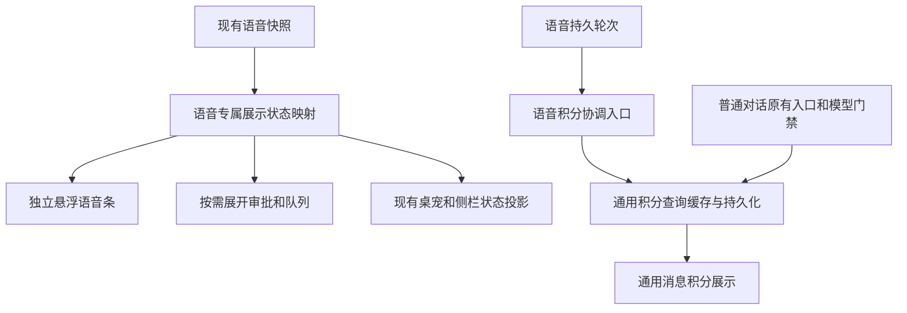

# 独立悬浮语音条与积分归属隔离 · 推荐执行方案

> 状态：待实施，2026-10-25。仅新增方案文档，本轮不修改业务代码。
> 基准：`feat/voice-next`，HEAD `cd5a904af77493faceba1c41a9df85220666b2a5`，叠加上一轮尚未提交的排版与快模型归属修复。执行前须固定该工作区 diff，不能仅按 HEAD 取代码。
> 原则：通话状态是独立的会话能力；输入框只负责输入与提交。新增语音快模型消耗只由语音入口归属，普通对话继续原有计费行为，共用底层查询、缓存和显示能力。

## 1. 问题、事实与目标

当前 `NomiSendBox.tsx` 通过 `statusSlot` 把 `VoiceComposerStatus` 放入通用 SendBox 内部首行。这个组件还承载审批、队列和错误，修改外观时容易影响输入框尺寸与操作空间。将内嵌标签换颜色或继续挪动仍然没有改变职责边界。

积分修复已经把快模型调用包在语音专属 recorder/complete 链路中，但 `fetchTurnCredits.ts` 新增了对 `isVoiceConversation` 的依赖，通用查询资格混入了语音规则。结论是已有功能隔离，尚需收紧结构隔离。普通对话原本就有模型消耗展示；用户要求隔离的是新增 ASR 后理解/短答调用，不能据此移除普通对话原有积分。

目标：状态在输入框之外形成独立、有颜色辨识度和持续活动反馈的组件；不遮挡内容；清楚说明此刻能否说话；保留必要审批、排队和恢复动作；普通对话不会执行新增的语音计费流程。

## 2. 推荐布局与架构

使用会话内局部悬浮条，位于输入框左上方，与边框至少相隔 12px。它与 SendBox 是 DOM 兄弟节点，有独立背景、全边框与结构性阴影，宽度随内容，桌面高度约 40px，文字 13px，图标 18px。聊天底部为它保留安全空间，不盖最后一条消息、滚动到底按钮或输入框。输入框变高时它仍锚定在上方；不得挂到屏幕固定坐标。

```text
聊天记录 / 最后一条回复

  ╭────────────────────────────────╮
  │  音波  正在听，请说话       展开 │   独立悬浮语音条
  ╰────────────────────────────────╯
                 12px 间距
╭────────────────────────────────────────╮
│ 输入消息…                              │
│ 授权模式                 模型   主操作  │
╰────────────────────────────────────────╯
```

悬浮条拥有状态展示和详情展开，原有输入框发送、停止任务、开始/挂断通话的主操作规则保持。条内不再复制一套常驻挂断、发送或停止按钮。点击明确的展开按钮打开锚定详情层，保留审批、队列逐项取消、失败恢复；状态文案本身不冒充可点击按钮。别处通话时提供明确的“返回通话”操作。



图中状态映射不能成为第二个通话 FSM，也不重写桌宠/侧栏逻辑；现有消费者共享权威快照和绑定身份，本轮只整理会话内呈现及计费入口。

## 3. 状态、颜色、动画与交互契约

### 3.1 显示状态

| 条件 | 文案示例（中 / 英） | 颜色及活动反馈 |
|---|---|---|
| 未开始通话，未确认 KWS 就绪 | 未通话 / Not in a call | 中性安静样式；保留输入框开始入口 |
| 确认 KWS 就绪且处于等待唤醒 | 等待唤醒 / Waiting for wake word | 品牌色小标记，低幅慢呼吸；不模拟收音 |
| 正在建立绑定/连接 | 正在连接 / Connecting | 信息色，点状进度 |
| 当前绑定且 acoustic_ready，listening 或 follow_up | 正在听，请说话 / Listening，或 可以继续说 / Go ahead | 活跃品牌青色实体表面，5 条音波；静音时低幅呼吸，有声时使用现有 RMS |
| transcribing / deciding / synthesizing | 正在识别 / Transcribing；正在思考 / Thinking；正在准备语音 / Preparing audio | 信息色，三点依次变化；不显示正在收音的波形 |
| speaking，未确认可插话 | 正在播报 / Speaking | 输出图标与播放活动反馈 |
| speaking 且 audio.barge_in_ready === true，并确认当前采集/绑定可用 | 正在播报，可插话 / Speaking · You can interrupt | 明确的输入/输出提示，不能仅凭 phase 或 acoustic_ready 承诺插话 |
| 正在等待真实工具审批 | 需要确认 / Approval needed | 注意色，突出详情入口；不能被动画或队列数量淹没 |
| 采集不可用/断线/历史加载失败 | 麦克风不可用 / Microphone unavailable 等准确原因 | 对应错误/警告状态，停止持续动画，显示有根据的恢复动作 |
| A 通话，当前浏览语音会话 B | 通话在另一会话进行 / Call active elsewhere | 稳定信息态，加“返回通话”；不能显示 B 正在听，也不能静默抢占 A |

状态优先级：当前绑定/服务故障与审批需要先明确；连接过程不冒充 listening；任务执行状态与声学阶段分开。后台任务运行期间，若声学上允许继续说话，仍可显示 Listening，并用小徽标说明“任务处理中”。挂断后后台任务继续存在，详情中的队列和审批不得随通话条收起而丢失。

### 3.2 视觉和动效

- 用户长时间在桌面阅读与下指令，亮暗环境都会用；沿用 Flowy 的双主题与系统字体。活动条采用有辨识度的品牌青色面，思考使用信息色，审批使用注意色，错误使用危险色，文字与图标共同表达状态。色值来自语义 token，实测文本对比度至少 4.5:1。
- 状态条本体保持位置稳定。进入约 180–240ms 的 opacity/translate，文字交接约 120–180ms；不动画改变宽高、边距或输入框布局。
- 通话有效时有持续反馈：静音等待约 2.4–3s 慢呼吸；处理中约 0.9–1.2s 三点循环；有声时只消费已有音量数据，波形局部更新上限约 10–15Hz，不新增采集或后端轮询。未获得实际幅度时，只表现状态活动，不能伪造音量或识别进度。
- 页面隐藏、组件卸载、非活动状态停止循环；Reduced Motion 显示同样可辨认的静态图标和文字。快照 RMS 更新不得触发 aria-live 高频播报或重渲染整段聊天历史。
- 宽度不足时先隐藏辅助徽标，状态文案仍可读，详情入口至少保持 32px，触屏适配扩大点击区。200% 缩放、中英文长文案、浅深主题都要验证。

### 3.3 组件和行为边界

建议改为 `VoiceCallDock.tsx`（呈现）与一个语音专属的纯状态映射函数。数据订阅和调用命令仍复用现有快照及控制入口。旧 `VoiceComposerStatus` 在调用迁移后删除，不保留双组件开关。

`NomiSendBox` 或语音会话组合层只在语音会话挂载此组件，不传入普通 SendBox 的 statusSlot。确认 statusSlot 全仓零调用后移除废弃插槽，同时保留 `topRightTools` 所需的内部行；不能直接删除整个内部行或改变普通输入框布局。

详情层沿用现有审批/队列组件，按 Conversation 和真实任务身份筛选，展示阶段和任务状态不能混为一谈。用明确按钮支持键盘展开、Escape 关闭、关闭后焦点返回；不要依赖悬浮鼠标操作。展开详情、切换主题和更新 RMS 均不得停止通话、丢草稿、重新创建会话或重新请求 LLM。

## 4. 积分解耦决策

| 决策 | 推荐实现与理由 |
|---|---|
| 语音计算入口 | 后端继续由 `ConversationVoiceDialogueRecorder::billing_attribution` 和 `voice_dialogue::complete` 归属快模型调用；普通 send/runtime 不加语音计费步骤 |
| 通用查询边界 | 从通用 `fetchTurnCredits.ts` 移除 `isVoiceConversation` 依赖，恢复普通入口原有云模型资格判定。抽取其中已有的查询/缓存/持久化工作为通用核心；不是再建一套计费系统 |
| 语音查询协调 | 在 voiceSession 内增加薄的协调入口，由已经确认落盘的语音用户消息 ID 触发查询，调用同一通用核心。旧的普通入口继续原有门禁；通用核心和消息组件不识别 KWS、ASR、phase、voice 或桌宠 |
| 通用展示 | MessageText 继续只消费通用 turn_id 和实际 usage。保留普通对话既有自动查询行为；重复请求由原有 Conversation+turn 去重，不依靠两个入口抢顺序 |
| 失败与身份 | 查询失败只影响积分展示，不中断语音、任务或普通发送。跨会话缓存不能串用；卸载视图可结束其调度订阅，但不能取消或归零已发生的消耗 |
| 实际金额 | 复用真实服务端返回，不估算积分、不增加扣费。快模型理解/短答与任务执行分别按各自轮次展示，不双计；缺归属的历史记录不猜补 |
| 通用后端投影 | 保留通用 turn_id 元数据与既有消息存储，通用服务不识别语音状态。普通调用仍用 None/default 通用行为，回执指纹保持不变；不为了语音复制 Conversation、数据库或 Agent loop |

这里的解耦是“语音决定何时归属和查询，通用层负责如何查询与展示”。共享稳定底层能力不等于让普通对话执行语音逻辑。

上一轮 `transformMessage` 保留消息 position 的修复属于通用消息契约修正，应继续保留；不能为了隔离而撤销用户靠右布局或复制一套语音专用消息列表。

## 5. 实施顺序与验收

1. 固定当前未提交成果和验证证据。先补普通对话不触发新增语音归属/订阅/查询的行为反例，再收紧积分入口，避免与视觉修改混在一次不可定位的回归中。
2. 抽出语音显示状态映射，用现有字段覆盖连接、硬件、绑定、审批和任务边界，再实现独立悬浮条及详情展开。
3. 将挂载从 SendBox 内迁到会话组合层；迁移有意义的旧测试，删除零调用旧组件/样式和插槽，不通过删测或源码字符串断言替代行为证据。
4. 最后加入颜色和动效，运行定向回归、类型检查、i18n/theme/motion/dead-css 门禁、生产前端构建及受影响 Rust 测试。既有失败要逐项对照，不能扩大既有基线。

| 编号 | 必须证明的行为 |
|---|---|
| FD-01 | dock 是 SendBox 外部节点；最后消息、输入区、滚动按钮、技能和工作区菜单没有遮挡；开关详情不移动输入框 |
| FD-02 | 开始、识别、思考、播报、追问、停止及失败准确映射；未确认 KWS/采集/可插话能力时不宣传对应能力 |
| FD-03 | RMS 快照不重复播报无障碍状态、不触发 LLM/积分查询、不重置动画或草稿；隐藏和 Reduced Motion 停止循环 |
| FD-04 | A 通话浏览 B，B 不显示 A 的私密对话或审批，不自动抢占；返回 A 不创建新会话 |
| FD-05 | 审批、队列逐项取消、unknown/恢复仍可操作，挂断后后台任务事实仍可检查；foreign task 不能操作 |
| FD-06 | 普通本地、第三方、Flowy 云模型会话分别保持原查询与展示行为，新增语音 bridge/快模型不运行 |
| FD-07 | 语音主任务模型本地、快模型为云端时仍展示快模型真实消耗；反之本地快模型不能伪造扣费 |
| FD-08 | 普通/流式、空闲/忙时、重载/重放归属一致；同一请求不重复生成，同一 Conversation+turn 查询去重 |
| FD-09 | 中英文、浅深主题、最窄支持宽度、200% 缩放、Tab/Enter/Escape/焦点恢复通过真实组件或 DOM 测量验证；SSR 仅作内容补充 |
| FD-10 | 实现 diff 中通用查询核心和通用消息展示没有新增 voice/KWS/ASR 状态依赖；结构扫描只作补充，FD-06 运行证据为准 |

## 6. 风险、前提与第一步

颜色必须有局部冲击力，但持续动效要代表真实工作阶段；全页面持续闪烁会干扰阅读。输入框外的悬浮感不依赖系统原生窗口，也不引入另一张会话浮窗。保持本地 ASR 与现有模型路径，本轮无需流式字幕或新模型。

第一步是做隔离的布局/状态交互样例，验证 FD-01/02/09，并补 FD-06 的普通对话反例。先确认悬浮条位置、尺寸和颜色方向，再进入生产迁移。本轮仅形成推荐方案，未创建样例、未执行新方案测试，也未提交或推送。

## 附录：依据与历史记录

- 现状代码：`voiceSession/VoiceComposerStatus.tsx`、`voiceCallStatus.css`；`platforms/nomi/NomiSendBox.tsx` 的 statusSlot；`components/chat/SendBox/index.tsx` 的 `hasInternalStatusRow`；`fetchTurnCredits.ts` 与 `MessageText.tsx`。
- 真实能力字段：`ui/src/common/adapter/voiceCompanion.ts` 的 `audio.kws_ready`、`acoustic_ready`、`audio.barge_in_ready`、绑定/任务/队列及错误；字段存在不等于当前设备为 true。
- 设计依据：仓库 `PRODUCT.md`、`DESIGN.md`。用户本轮要求更明显的颜色和持续活动反馈，落实为状态驱动的局部视觉，不扩大到普通对话装饰。
- [上一轮消息左右排版及积分归属修复](VOICE-MESSAGE-LAYOUT-AND-USAGE-2026-10-25.zh.md)。其既有验证成绩不算作本方案已实施或验证通过。
- 本文新增于历史方案旁；不删除、改写或冒充已实施的历史记录。

## 2026-10-25 复审后补修：独立悬浮语音条与积分隔离（追加，不覆盖上文）

基准仍为 `feat/voice-next` 当前未提交工作区；首轮实现与本文历史内容保留。复审发现的三个真实反例已先以失败日志固定：`independent-isolation-red.txt`（9 passed / 2 failed）、`independent-capture-red.txt`（12 passed / 1 failed）。本轮未删除或弱化任何 `independent review:` 测试，未提交、暂存、推送、切分支或派发子 Agent。

### 实际修复

1. **积分门禁与 inflight 竞态**：`runTurnCreditQuery` 先完成 Conversation 资格读取，再发布/复用 inflight；普通本地/第三方门禁拒绝不再占用共享 inflight。云调用仍按 Conversation+turn 去重并复用缓存；未使用 force 绕开。归属入口在普通本地门禁同时进入时会实际查询。
2. **逐轮 session 归属**：`collectVoiceBilledTurns` 现在要求 `turn.session_id === snapshot.session_id`，缺失、旧代次或空 session 的轮次不参与积分归属，与 `liveVoiceTurn` 的严格隔离一致。
3. **真实 no_pcm 状态**：`capture_state = no_pcm` 时，即使 phase 仍为 listening/follow_up/idle 且 acoustic_ready 为真，也不再显示正在听/等待唤醒/波形；显示准确采集故障并停止活动。PCM 恢复后回到真实阶段。`barge_in_ready` 仍要求 acoustic_ready 与 receiving 同时成立。
4. **historyFailed + snapshot=null 恢复面板**：详情面板改为只要存在可恢复详情就挂载（关闭时 hidden），`aria-controls` 始终有目标；打开后历史重试可见、可点，面板获得焦点，Escape 关闭并回焦。未伪造 snapshot。
5. **历史语音积分有界回填**：`useVoiceTurnCredits` 新增从当前已加载持久消息收集 durable assistant turn_id 的回填路径，最多 12 条、按 Conversation 过滤、要求 message_id 与 finish 状态、排除临时/流式行与 task agent 输出；仅语音 dock 使用，复用同一 attributed 查询/缓存/持久化核心，普通发送与计费路径未增加语音逻辑、轮询或 LLM。

### 验证事实

- 复审反例 GREEN：`independent-isolation-green.txt` 15 passed / 0 failed；`independent-capture-green.txt` 13 passed / 0 failed。
- 语音/积分/相关回归：`followup-suite.log` 192 passed / 0 failed。
- 基线四文件：`four-tests-followup.log` 70 passed / 0 failed / 210 assertions。这里 70 是四个文件合计，不是 liveVoiceTurn 单文件；后者单独为 17 passed。
- 真实 Chrome 探针：`browser-probe-result.json`、`browser-probe-run-followup-final.log`，normal 58/58、reduced-motion 58/58；新增 historyFailed+null 的打开/重试/aria-controls/Escape/回焦实测。
- typecheck：`typecheck-followup.log` 61 条错误，与首轮基线逐行一致。i18n/theme/motion 通过；build:ui 退出 0；dead-css 仍为既有未修改文件命中，本轮新增/修改文件无命中。
- 未验收：真实 Flowy 云端扣费金额（无付费探针授权）、200% 原生浏览器缩放、完整 SPA 宿主中的菜单/虚拟列表；独立 DOM 夹具不等同整页验收。

### FD 状态（复审后）

- FD-01、FD-04、FD-05、FD-06、FD-08、FD-10：本轮定向行为/隔离测试通过，FD-01/04/05 的完整宿主点击与真实 API 仍标为部分。
- FD-02、FD-03：状态映射、采集健康、焦点与隐藏/Reduced Motion 探针通过；真实桌宠 daemon 现场阶段未驱动。
- FD-07：服务端 usage 透传路径与 mock 行为通过；真实云端金额未验收。
- FD-09：中英、明暗、360px、焦点、对比度与 Reduced Motion 通过；200% 原生缩放与完整 SPA 未验收，保持部分。
