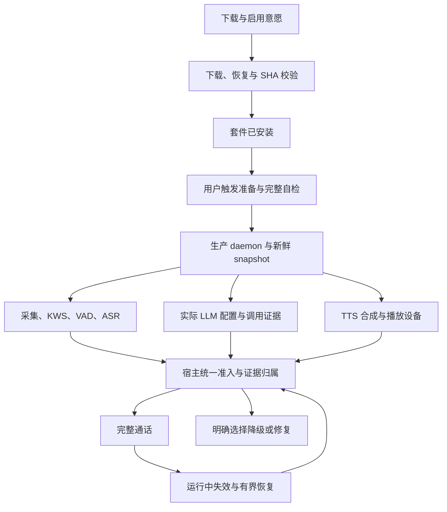

# 语音套件下载、全链路可用性与恢复 · 修复方案 rev2

> **状态**：待实施。现有生产启动与 TTS 故障尚未修复，不能签核语音全链路可用。
> **日期 / 基准**：2026-10-25，`feat/voice-next`，`5875d361b3801a2fa287215c821b24b0e1fa0143`。
> **核心原则**：安装完整、进程存活、引擎可推理和通话可用分别记录；任何绿色状态都有对应当前资源与配置的证据。复用现有 manager、snapshot、adapter 和入口，不增加通用能力框架。
> **范围**：本轮只核查代码、运行隔离反例并完善方案。未改业务源码、实际模型或运行设置，未提交/推送。附录逐字保留首版诊断，正文优先解释新增边界。

## 1. 背景、事实与目标

用户要求下载语音套件后，可以验证、启用，并最终可靠使用 KWS、ASR、LLM 和 TTS。目前不能用一个 `Ready` 承担所有承诺。

| 环节 | 当前代码事实 / 实测证据 | 应承诺的结果 |
| --- | --- | --- |
| 下载 | `.part` 下载完成后按文件改名；206 只解析总长度，没有校验起点 | 文件传输合法且完整，整套校验完成前不供新引擎加载 |
| SHA / 安装 | 本机约 246MB 模型通过真实 SHA；现有 manager 保留校验缓存 | 仅表示固定资源通过安装校验，不表示声音链路可用 |
| daemon | 最新日志主线程栈溢出；真实 provision 在 1MB 栈 RED、8MB GREEN | 正确生产二进制启动、控制链可达、首个有效 snapshot 到达且没有早退 |
| KWS / VAD | `is_initialized()` 与 `vad_ready` 表示引擎加载 | 原生加载通过，再有隔离 PCM 推理证据；KWS 需真实唤醒命中和负样本测试 |
| ASR | SenseVoice 原生识别，语言 auto、2 线程；目前 `asr_ready` 只表示对象存在 | 同一资源版本的中文、英文短句真实识别成功；不以 NullStt / stub 代替 |
| LLM | `QwenVoiceRouter::is_configured()` 仅看 completion 或 endpoint 是否存在 | 区分已配置和最近调用成功，使用实际宿主模型解析及协议解码链 |
| TTS / 播放 | `playback_ready` 只说明 sink 可打开；当前端点实测失败，上游端点对照成功；本机无 tts 资源目录 | provider 实际产生可解码音频、语言覆盖明确，播放设备状态单列 |
| UI | 下载回执未读 accepted/state；多数启动错误显示统一失败；通话键只防重复点击 | 呈现后台权威状态、错误原因和可操作的下一步，发送/停止/挂断不受误伤 |

不可约束事实：文件校验不能证明 ONNX 可初始化、网络和设备可随时失效（物理约束）；验证会占 CPU/内存且 LLM 可能计费（成本约束）；一次只允许一个生产声学会话、icon-only 入口和默认完整通话门禁是本方案选择（产品约定）。

**默认决策**：新建完整语音通话要求输入、理解、合成和播放均通过；缺失 TTS 时不冒充“可通话”，提供明确的“语音输入、文字回复”降级入口，由用户选择。已经建立的通话遇到 TTS 失败，保留输入与文字回复并标降级，不因一次播报失败退出；正常文字会话始终独立可用。

当前本地声学套件是 KWS + VAD + ASR；LLM 使用用户配置，Edge 是在线 TTS。不得把现状称为“全离线语音套件”。纯离线完整通话还需要实际本地 LLM 与中英 TTS 资源；不能在本地模型失败时偷偷切到云端 LLM。音色资源、许可证、SHA 与发包选择未锁定前，不擅自捆绑新资产。

“套件全部就绪”要求所有声明能力通过；具体操作按依赖准入。KWS 失败不能显示全套就绪，但应允许明确标记“唤醒不可用”的手动通话入口，而不是把仍可工作的 ASR 一起关掉。快聊验证实际 effective voice dialogue 模型；任务执行的模型/工具策略继续由 task_ready 单列，快聊通过不等于工具任务可以执行。

## 2. 对抗式审查与架构

### 2.1 结论 (Verdict)

**needs-attention**：首版方向保留，但必须补安装失败闭环、逐级证据与真实生产验证；当前实现 **no-go**，不能宣称已就绪。

事实清单 (Irreducible Facts) 见 §1：文件、引擎、网络、设备不能相互代证；验证有硬件与调用成本；统一准入及可解释降级是产品选择。修改建议 (Changes) 由 §3 契约及 §4 的 S0–S5 明确落实，不新增委派角色。

### 2.2 攻击点 (Attack Points)

1. **[P1][evidence] 各种“存在”被当成全链路成功。** 配置 LLM 入口即可 `dialogue_ready`；扬声器可打开即可 `playback_ready`；SHA 通过后 daemon 仍会栈溢出。证伪：合法文件 + 崩溃进程、合法 endpoint + 401/超时、正常 sink + TTS HTTP 200，完整通话必须全部拒绝而文字发送仍可用。
2. **[P1][evidence] 安装、恢复和运行并非同一安全生命周期。** 新 loopback 反例请求 `bytes=3-`，服务器却回 `bytes 0-2/6`；真实 downloader 返回 `Ok(6)` 并推广 `ABCABC`。独立 Windows 文件锁反例实际文件仍存在，remove 却返回 success=true、freed_bytes=18、NotInstalled。SHA 后续可拦住错误拼接，不能说已绕过 SHA；安装可靠性与卸载事实仍不成立。模型路由直接绑定 manager，未经过宿主停 daemon 的协调。证伪：错误 Range 必须拒绝或受控重下，锁文件必须报告失败，正在通话时重装/卸载不能成功。
3. **[P1][evidence + inference] 测试环境掩盖生产依赖，检查自身又会引入副作用。** 固定 1MB 栈已真实 RED；现有 `standard_audio_replay.rs` 在缺 WAV 时自动调用 Edge 生成样本，不能证明离线 KWS/ASR 独立可用。若在 snapshot/hover 上反复真实检查，可能重复收费、加载多份模型、触发唤醒或污染会话（后三项为推断风险）。证伪：断网并保留固定音频，原生推理仍通过；多入口查询只观察、不收费、不建会话；取消后的旧检查不能发布成功。

### 2.3 幸存结论 (What Survives)

保留首版的低栈修复、Edge 端点/查询参数修复、宿主统一就绪来源、前端提示与服务端准入双层检查；保留现有 request_id、session/turn 绑定、普通会话隔离及 SHA 门禁。不是另造语音 Agent loop。

## 3. 执行契约与稳定性边界

### 3.1 下载、校验与资源占用

- **不接受假下载成功**：206 必须严格匹配 Range 起点、终点、总长及响应体长度；200 则从零覆盖 `.part`；416 重新核验本地文件，不能凭最小大小认定内容有效。总长度未知时最终仍以固定 SHA 为准。HTTP 200 HTML、断流、磁盘满和权限错误都不能发布 Ready。
- **版本固定**：当前 URL 使用 master/main，SHA 已固定；上游变更必须失败关闭、报资源版本不匹配，不能自动相信下载回来的 checksums。优先固定现有来源 revision，实施前确认该 revision 实际可获取，不猜测 commit。当前默认只有 ModelScope，不能承诺尚未配置的全球/CDN 冗余。
- **停止与恢复**：同一 canonical models_dir 写操作排他；先梳理宿主、daemon auto-download、准备脚本的调用关系。复用现有可用锁能力，不能把单个 manager 的内存锁宣称为跨进程互斥。重启后从磁盘实情恢复，不保留无任务所有者的 Downloading；坏 `.part` 可受控从零重试，保留已验证文件，禁止无界重试/每个状态查询自动重下。
- **通话期间不修改资源**：活动通话、审批或语音任务占用时，重装/卸载返回明确 in-use；先让用户结束占用再操作。无活动通话时由宿主协调停止并回收 daemon、关闭资源句柄，再安装/卸载；重启恢复仅在启用意愿仍有效时进行。避免在 `nomifun-voice-models` 反向依赖 app/进程管理。
- **结果如实**：删除失败不可返回 success=true 或虚报 freed_bytes；汇总剩余文件和原因，并让后续状态反映实情。前端读 install/delete 响应内的 accepted/state/success，不能将任意 2xx 覆写成 ProbingSource/NotInstalled。
- **旧结果失效**：安装、卸载、模型内容变化都会使该资源上的运行证据失效。外部离线拷贝需在服务停止时完成；复制中不加载，修改中的元数据/SHA 检查失败关闭。当前大小/mtime 缓存不防刻意保留元数据的篡改，不夸大其保证。

### 3.2 进程启用与主线程小栈

- 修复 SHA 的栈上大数组，必要时在最窄调用边界堆化 Future；验证原 1MB 反例转绿，不删 SHA、不提高全局栈、不用 skeleton 取代生产运行。
- 分离 `requested_enabled`（用户意愿）、`running`、`ready`；开关保存成功或 spawn 成功不等于通话成功。启用期间显示启动/验证阶段，禁用始终可操作；关闭、退出、重新安装必须撤销旧 attempt。
- 正确二进制路径、版本/构建事实与宿主一致；构建成功不代替运行。`/healthz` 是存活证据，不代替当前 instance 的引擎与采集证据。
- 冷启动覆盖原生 DLL 缺失、架构/CPU 不兼容、模型初始化失败、端口占用与控制通道鉴权失败；按真实阶段保留原因，不统一提示“请下载模型”。不跳过本机控制通道校验或绕过通用进程运行边界。
- 连续早退建议采用 2/5/15 秒退避、最多 3 次自动恢复；预算耗尽后显示退出原因并等待显式重试。稳定运行 60 秒后才重置预算。数值是本版实施默认建议，不是已测性能承诺。禁用和宿主 shutdown 后禁止恢复。

### 3.3 KWS、VAD、ASR、LLM、TTS 的验收证据

| 能力 | 通过条件 | 不能冒充通过的证据 | 失效条件 |
| --- | --- | --- | --- |
| 采集 | 当前设备成功打开且最近 2 秒持续有 PCM 帧；允许静音 RMS=0 | 发现设备名称、有音量条或 speech_detected=true | 设备变更、无帧、断流、权限撤销 |
| KWS | 校验后真实原生加载；固定 Hey Flowy 样本推理命中；非唤醒样本不命中 | ASR 文本包含 wake phrase、按钮手动 wake、启发式 fallback | daemon/资产/唤醒词配置变化 |
| VAD | Silero 原生加载；静音与有声样本状态/结束边界合理 | 测试 EnergyVad、只设置 vad_ready | 引擎失败、资源或 instance 变化 |
| ASR | 同一 SenseVoice 实例对固定中、英文及混输样本真实识别，保留否定/关键数字；静音不幻觉为命令 | 对象存在、NullStt、云端文字替代本地推理 | 模型/词表/加载配置变化、推理失败 |
| LLM | 实际冻结的 provider/model/配置经过当前宿主请求与结构化解析；固定无工具自检或最近同配置实际成功响应 | endpoint 配置存在、模型列表加载、只有 HTTP 200 | 配置/密钥引用版本变更、401/403/429/超时/本地模型离线 |
| TTS | 中英文独立样本实际生成并解码为有声 PCM；provider 与语言覆盖匹配 | ws 连通、HTTP 200、编译支持 local-tts、只存在音色目录 | provider/音色/资源/网络变化，合成错误或空音频 |
| 播放 | 当前 sink 打开、系统实际消费有效帧；自动管线证据与物理听觉验收分开 | 仅合成出 WAV、仅播放确认文本事件 | 设备切换、流错误、停止/取消 |

KWS 当前使用英文唤醒词，不等于需要第二套流式 ASR；中文/英文对话的要求落在 ASR/LLM/TTS，若要新增中文唤醒词则另行验收，不直接声称已有支持。

**检查必须无污染**：固定音频是预先准备并校验的测试资产，缺失直接报告缺资产，不能在 KWS/ASR 检查中临时依赖 Edge。现有样本来源/许可证先核对，新增分发资产需另审。诊断只在未通话时独占运行，使用隔离 KWS stream 与诊断 scope，不发送用户 WakeHit、不创建真实会话、不写用户记忆/XP。引擎串行加载、复用已加载 ASR，禁止每个 UI observer 各建一套模型；限制诊断缓存和 PCM 长度，关闭后释放句柄。

**外部调用与成本**：后台状态查询和悬浮不能调用 LLM。首次完整自检是明确的用户动作，说明会使用已配置模型并可能产生少量费用；用固定、无工具、无私有上下文的短请求，单飞且缓存。复用既有供应商计费链，不伪造余额、免费资格或用量，不把自检内容投影到普通聊天。未执行实际调用时，显示“已配置 / 待验证”，不能写“LLM 验证通过”。

### 3.4 就绪 DTO、失效与按钮

在现有宿主 status/snapshot 与 `nomifun-api-types` 追加最小可选字段，保留现有安装 Ready 和旧字段契约。每个能力只需状态、稳定 reason_code、证据类型、checked_at 及相应版本引用，不建立新数据库或通用检查器注册表。

- 能力状态统一为 `unknown/checking/ready/failed/unsupported`；聚合展示 `not_installed/installing/installed/starting/checking/ready/degraded/unavailable`。安装状态与运行状态两轴并存，不能用下载阶段覆盖正在建立的通话。
- 证据绑定已有 host/daemon instance_id、检查 attempt/generation、canonical models_dir + 实际资源身份、相关配置 revision 与设备身份；LLM/音色检查只绑定它依赖的版本。不得把密钥明文放进 DTO 或日志。
- 建议网络能力成功证据有效期 60 秒；设备 PCM 新鲜度沿用 2 秒；引擎推理证据随资源/instance 失效。网络变化及真实失败立即失效，不等 TTL。超时得到 unknown/failed，取消或旧 attempt 返回不得改写当前结果。
- TTL 到期只要求下一次相关操作重验，不挂断已建立的通话，也不触发后台自动付费自检；正常实际请求可刷新对应配置证据。活动 turn 冻结的模型和归属不得被设置页新一轮检查覆盖。
- 启动准备建议总预算 120 秒：本地初始化/自检最多 90 秒、LLM 12 秒、TTS 18 秒；这些是待实测调整的上限，不是实时延迟保证。SSE 连接可继续观察准备结果；调用超时必须区分“确定未受理”和“已受理/未知”，沿用 request_id 恢复，不重复创建或抹掉占位。
- 后台统一派生 `can_prepare/can_start_full_call/can_wake/can_transcribe`；新请求在创建占位前复核，已经受理的旧 request_id 优先按持久回执恢复。start_call、桌宠、托盘、快捷键、KWS 唤醒共用宿主准入，不只修主页按钮。
- daemon 未启动且用户允许启动时，图标可触发“准备并检查”，不能要求先 running=true 才准启动。Idle/静音不等于不可用；没有检测到人声不应禁用通话。
- 完整通话不可用时保留可聚焦的原因说明与修复入口；TTS 缺失只给明确降级选择。通话中能力临时失败不能屏蔽挂断；有字发送、执行中停止、普通会话听写/发送均保持原行为。使用语音专属禁用条件，不复用整个 Composer 的 disabled。
- 设置页显示“套件已安装 / 正在检查 / 可通话 / 不可用原因”；首页、会话、桌宠共用同一结果，icon-only、双语/双主题/Reduced Motion 不变。高级诊断按需展开，不恢复大块诊断面板。

运行中遇到 TTS 失败：标记回复未播出、保留文字和继续输入；播出半句不自动重放整句。遇到 LLM 失败：保留用户原话、提示重试，不因自检重复发送。遇到设备/daemon 丢失：撤销当前 ready，保留后台任务与原会话归属，按预算恢复；不得把 A 的队列、审批或播报投影给新 B。AEC 仍未实现，完整通话 ready 不等于自然插话 ready。

## 4. 关键决策与实施顺序

| 编号 | 决策 | 采用 / 理由 | 不采用 |
| --- | --- | --- | --- |
| D1 | 安装与通话 | 两轴、逐级证据与宿主派生 | 改名覆盖旧 Ready API、前端各自拼就绪 |
| D2 | 当前故障 | 先恢复小栈与 Edge 端点，再全链门禁 | 只置灰按钮、放宽 SHA、盲目重下合法模型 |
| D3 | 本地能力 | 保留 SenseVoice/KWS/Silero，受控串行验证 | 再加 Zipformer 流式字幕、声纹、额外常驻 LLM |
| D4 | 恢复 | 单所有者、有界退避、旧代次结果失效 | 无限两秒重启、前端每次轮询触发重试 |
| D5 | 降级 | 新完整通话严格准入，明确选择文字回复；已建立通话允许如实降级 | 把无 TTS 称为完整通话，或因播报失败丢掉用户输入 |

串行执行，沿用现有模块边界：

1. **S0 反例固化**：将固定小栈、错误 Range、锁文件删除和 TTS HTTP 200 迁为正式回归，保留原 RED。
2. **S1 阻断修复**：低栈 SHA、Edge 端点及参数、错误原因透传、有界进程恢复；先跑同一探针，再构建并运行生产 daemon。
3. **S2 套件生命周期**：修下载恢复、真实删除结果、前端回执读取、运行占用协调与重启恢复。不要在一个提交里夹入价格/权限/数据库变更。
4. **S3 原生检查**：独立固定音频、KWS/VAD/ASR、LLM/TTS 的证据与过期；一阶段失败不得伪造下一阶段通过。
5. **S4 统一门禁与交互**：最小 additive DTO、全入口准入、主页/会话/设置共用状态，保留原普通流程和幂等生命周期。
6. **S5 联合验收**：干净目录完整安装→验证→启用→真实唤醒→ASR→LLM→TTS，故障注入与重启再走一次；分别交付模拟、真实引擎、外网与物理设备证据。

## 5. 验收标准与防假通过

| ID | 场景 | 必须断言 |
| --- | --- | --- |
| VR-01 | 干净目录 / 无网络 | 明确 NotInstalled/下载失败，不启原生引擎，不建会话 |
| VR-02 | 200 / 正确206 / 错误206 / 416 | 合法恢复；偏移/长度错误不推广坏文件；回退有上限 |
| VR-03 | 中断/换源/进程重开 | 不混接不同文件，SHA 未过不可加载；恢复后有真实任务所有者 |
| VR-04 | HTML200/磁盘满/无权限 | 失败原因可达，不能永久显示 100% 或 Ready |
| VR-05 | 损坏/同大小替换/离线修复 | 校验失败保留，变化后重验；修复后可恢复 |
| VR-06 | 同时安装、卸载、检查 | 单 writer；未完成 I/O 不残留回写，取消后不发布旧成功 |
| VR-07 | Windows 锁定文件删除 | 原文件还在时不报成功/虚报空间 |
| VR-08 | 活跃通话/任务/审批中重装卸载 | 明确 in-use，原任务与记录不变 |
| VR-09 | 固定 1MB 栈合法/缺失/损坏资产 | 正式真实 provision 不溢出，坏资源不进入 ONNX |
| VR-10 | 生产 daemon 早退 / 连续失败 | 退出码可见，退避/预算生效，禁用后零重启 |
| VR-11 | 旧 binary / 旧 snapshot / 旧检查晚到 | 不沿用旧 ready，不污染新 instance |
| VR-12 | 原生 KWS 与非唤醒、低音量样本 | 真模型命中/拒绝，不能靠 ASR 关键词判断通过 |
| VR-13 | 原生 VAD 静音/长静音后说话/句尾 | 起音不截断、静音不触发任务、切句完整 |
| VR-14 | 真实中文/英文/混输 ASR | 识别真实样本，关键否定和数字断言，空输入无命令 |
| VR-15 | LLM 401/429/超时/坏结构 | 不写成功证据；自检不触发工具、记忆或普通聊天 |
| VR-16 | 本地 LLM 停止 / 远端配置切换 | 旧证据立即失效，不偷换供应商/云端 |
| VR-17 | TTS 中文/英文/200/429/空音频 | 真解码、有声 PCM，失败和冷却明确 |
| VR-18 | 离线 TTS 缺模型/语言不支持 | 明确 unsupported/failed，不假称纯离线可用 |
| VR-19 | sink 可打开但无 TTS / TTS 可用但 sink 失败 | 两类失败分别处理；完整通话门禁拒绝 |
| VR-20 | 缺固定 WAV且断网 | 自检报缺资产，不静默调用 Edge 生成 |
| VR-21 | 多页/hover/轮询/重复自检 | 无自动计费/反复加载/额外会话；同配置单飞 |
| VR-22 | 静音 PCM / 断麦 / 设备切换 | 静音可以就绪，断帧及时撤销，设备新代次重验 |
| VR-23 | 初次准备 / 总预算超时 / 显式禁用 | 无永远转圈/重复准备，晚返回不能复活 |
| VR-24 | 新建前失败 / 已受理未知结果 | 前者零占位，后者同 request_id 恢复且不误删 |
| VR-25 | 主页/会话/桌宠/托盘/快捷键/KWS | 同一门禁，当前工作区与显式目标不漂移 |
| VR-26 | A 活跃浏览B / 配置切换 / 后台任务 | 旧语音与队列/审批/用量不串台 |
| VR-27 | 有字发送/执行中停止/挂断 | 语音健康失败不禁用这些操作，普通会话无行为变化 |
| VR-28 | 播放前失败/播出半句失败 | 文字保留；半句不重复整句；继续输入不退出 |
| VR-29 | 中英/双主题/键盘/Reduced Motion | 原因可访问，状态不靠颜色/动画独立表达 |
| VR-30 | 冷启动/安装后首次启用/重启恢复 | 用生产 feature 与真实二进制跑全链，不用编译或 skeleton 代替 |

当前本轮实跑仅新增两个下载/删除反例（均 RED），详见下列日志；未跑上述 30 项整体验收，未宣称 KWS/ASR/LLM/物理音频本轮已通过。

证据根目录：`build.noindex/voice-workspace-display-review/startup-tts-diagnosis-20261025/`。

- `download-boundary-red.txt`：真实 downloader 错误 Range 推广、真实 manager 锁文件删除虚假成功；探针 exit 101。
- 首版已有 `provision-stack-1mb.txt` / `provision-stack-8mb.txt`、`edge-current.txt` / `edge-upstream-endpoint.txt`；本轮读取核对，没有冒充再次实跑。
- 隔离探针仅使用 loopback 和自建文件，未动真实模型或当前 Flowy。正式测试需要从这些反例迁入，而非只增加源码字符串断言。

验证梯子：失败反例→修复后同一反例→对应 crate/组件回归→生产 feature 编译→真正 daemon 冷启动→有归属的双语全链→原生/设备单列。不得删除失败测试、增 ignore、弱化断言或把 61 项既有 TS 基线写成零错误。未做跨平台运行、声学准确率统计、AEC、付费供应商真实调用与物理听觉时必须保持未签核。

### 未解疑问 (Open Questions)

本地中英 TTS 的具体合法资源包、CPU 成本与分发方式尚未锁定。其影响明确：现有 Edge 修复可恢复在线合成，但纯离线完整链路仍不能签核；若以全本地语音作为交付目标，此项必须在 S3 前完成资源决策与安装计划，不允许以“有 fallback 类型”关闭。当前先复用既有 Sherpa TTS 接口验证，不预先增加新的 provider、配置页或未经审查的大文件。

## 附录 A：首版诊断与执行方案（逐字历史归档）

以下原文来自同机证据目录 `DIAGNOSIS-AND-REPAIR-PLAN.zh.md`，保持原始事实、时间与当时未锁定决策；当前实施要求以正文为准。

# 语音启动与 TTS 失败诊断、就绪按钮执行方案

日期：2026-10-25。代码基准：`5875d361b3801a2fa287215c821b24b0e1fa0143`，`feat/voice-next`。本轮仅阅读、受限探针和方案；未修改业务源码、模型、设置或 Git 历史。

## 已确认事实

1. 最新 daemon 日志 `D:/tmp/flowy-dev/logs/voice/ai-mate-1792938862234.log` 在 `AI Mate voice pipeline assembled and standing by` 之后出现 `thread 'main' ... has overflowed its stack`。宿主日志对应退出码 3221225725（0xC00000FD），约两秒重启一次。22:31 的启动接口返回 503；这与此前 22:28 的 400 属不同阶段，不能合并为同一错误。
2. 实际模型文件约 246MB，真实 SHA 校验返回 Ready；不是缺模型或 SHA 失败。`model-probe.exe 1`、`model-probe.exe 8` 都正常。无需先重下模型。
3. 真实上层 `check_and_auto_download` 调用在显式固定 1MB 线程栈下复现同类崩溃，在 8MB 下完成。关闭自动下载、没有调用原生声卡。`provision-stack-1mb.txt` 为 RED，退出 -1073741571；`provision-stack-8mb.txt` 为对照 GREEN。生产 main Future 67,648 字节，provision Future 67,080 字节；模型状态 Future 66,592 字节。不能只看 Future 大小推断峰值栈。
4. `verifier.rs::compute_file_sha256` 的 `[u8; 64 * 1024]` 存在于 async 状态机，上一轮 `get_status` 接入真实校验后将其带进 provision 启动链路。固定小栈反例证明该调用链的风险；最终应以堆缓冲/必要的堆化边界修改后同一探针转绿确认根因，不能先宣布具体单行修复已通过。仓库 `RUST_MIN_STACK=134217728` 设置的是 Rust 新线程栈，既有测试没有代表 Windows 二进制主线程小栈。
5. 历史 daemon 的 TTS 错误为 `edge_tts_handshake_rejected status=200`，随后 `primary_tts_failed_attempting_fallback` 和 `tts_failed`。本轮真实 Edge provider 固定短句探针复现 `HTTP error: 200 OK`，退出 101；未播放声音，也未使用聊天内容。尚不能仅凭 200 判定是代理、服务策略还是协议不匹配。
6. 当前默认端点是 `wss://api.msedgeservices.com/tts/cognitiveservices/websocket/v1`；上游 edge-tts 当前 constants 使用 `speech.platform.bing.com/consumer/speech/synthesize/readaloud/edge/v1`。本轮保留现有 Edge provider、TLS、请求头和 GEC 算法，仅在隔离探针换为上游端点及其对应 `TrustedClientToken` 查询参数（代替当前端点的 `Ocp-Apim-Subscription-Key` 组合），真实中英测试短句得到 164,780 字节音频，退出 0，见 `edge-upstream-endpoint.txt`。由此定位端点/参数组合为本次 TTS 的可操作修复点，不需要直接替换模型或新增 TTS 库；该结果不是未来外网可用性承诺。
7. 本机 `D:/tmp/flowy-dev/models/tts` 不存在。当前配置默认 Edge 优先、Sherpa 离线回退，无法在 Edge 出错后提供本地播报。本地 TTS 的编译支持不等于已安装可用音色资源。
8. `playback_ready` 来自物理播放 sink 是否可用，不验证 TTS provider；`start_call` 首先检查进程 running，但未以新鲜声学/合成能力作为新请求准入；主页和会话页把多数错误统一展示为“启动语音通话失败”。通话按钮只用 `isVoiceConnecting` 禁用。

## 执行顺序

### P0：先恢复 daemon 启动

- 将 SHA 流式读缓冲从 async 栈数组改为堆上有界缓冲，保留既有流式 SHA、基准 manifest、缓存失效和失败关闭语义。
- 先复跑本目录真实 provision 1MB/8MB 对照；如仍失败，测量嵌套 Future 的临时移动，必要时只在最窄入口增加堆化边界。不要删 SHA、提高全局栈或开启 voice-skeleton 掩盖生产失败。
- 正式回归以独立进程固定 1MB 栈执行真实 provision，不能依赖测试 runner 的大栈。覆盖完整合法资源、损坏资源、缺失资源；禁止把损坏模型送入 ONNX。
- 宿主记录最近退出码和启动失败原因。连续早退采用有界退避，达到预算后等待显式重试；用户禁用/关闭期间不得重启，不能新增无界 watchdog。
- 新构建需同时更新宿主和生产 voice-companion，验证二进制路径/时间与代码一致。`cargo check -p Flowy` 不运行 daemon；原回归通过未覆盖此次主线程栈问题。

### P1：修复真实 TTS 合成并明确离线边界

- 用现有 provider 的固定中英文短句运行一次真实合成，验证 WebSocket 101、收到音频、解码成功、非空 PCM/采样率，不能只断言 HTTP 成功或 fixture WS 成功。
- 先按本轮已通过的对照修正默认端点及匹配的 token 查询参数，保持现有 GEC 算法、TLS 与解码流程。参考上游 constants、DRM 和 communicate 维护匹配版本，不把所有非 101 响应都泛化为“网络异常”。若实施后的真实探针与本轮对照不一致，再检查时间偏差与路由，不先引入自动多端点轮询。
- 为非 101（包括 200）、超时、429、空音频分别记录脱敏原因；主备皆失败时保留两端原因，避免最后只剩 `tts_failed`。
- 离线可用性至少区分编译支持、资源齐全、引擎加载、实际合成成功。当前缺资源只能明确降级为文字回复；不擅自下载音色或把 Edge 标为本地 TTS。
- 如要求完全本地，需要另行锁定兼容 CPU 的中英音色、许可证、SHA、下载包和安装流程；中/英及混输都验收。不能以中文样本替代双语要求。

### P2：就绪检测和通话主按钮

- 优先扩展现有宿主 status/snapshot 与语音 adapter，保持单一就绪来源。至少输出 `checking/starting/ready/degraded/unavailable`、稳定原因码和能力明细（daemon、模型完整性、ASR/VAD、近期 PCM、dialogue 配置、speaker、TTS）。不要让 renderer 自己拼“可用”。
- 轻量检测只读当前能力，不自动打开麦克风、不自动调用付费 LLM。TTS 实际自检使用固定短句，单飞、有界超时和短期缓存；持续音量快照不能触发重复合成。
- 区分“可以准备”和“已经就绪”：daemon 未启动但允许启动时，按钮可触发准备；不能要求 running=true 才允许启动进程，造成永远无法开始。尊重用户关闭语音的偏好。
- 新请求在创建会话占位前做宿主准入复核；前端检查只是提示。已经接受/状态未知的 request_id 继续按原幂等恢复，不因探测失败删除或重复提交。
- 图标保持原有主键互斥规则：有字发送、执行中停止、无字通话。只增加语音专用 `voiceStartDisabled`/原因呈现，不能复用共享 disabled 把普通发送或任务停止一起禁掉。
- 检测中显示轻量转动；准备中阻止重复启动；未就绪保留可达的 tooltip/aria 和明确操作入口；TTS 不可用但 ASR 可用时标“文字回复”，不得标完整语音已就绪。默认是否允许这种降级需在实施前锁定。
- 保留 icon-only，支持中英、双主题、Reduced Motion；错误不再只给“启动失败”，使用如“语音服务启动异常”“模型安装中”“麦克风不可用”“语音合成不可用，可继续文字回复”等本地化映射。

## 验收门槛

1. 同一真实 provision 1MB 反例从 RED 到 GREEN，原 SHA/损坏/重开/并发测试仍通过。
2. 当前生产 daemon 不再以 0xC00000FD 退出；退出/重启预算、人工禁用与显式重试有宿主行为测试。
3. 固定中、英文实际 TTS 能生成可解码非空音频；纯离线资源缺失与 Edge 不可用时有真实可解释结果。外网探针只证明测试时刻，不能承诺长期可用。
4. 新建前就绪检查失败不产生空会话；存在已接受/unknown 请求时不误清理或重发。
5. 前端与宿主状态过期、断线/重连、多入口并发、跨会话、键盘草稿、停止/挂断均不回归；普通对话的发送/听写流程不被语音就绪检测接管。
6. 运行相应 Rust 测试、前端组件/行为及双语测试、桌面编译和生产 daemon 冷启动验证。既有 61 项 TS 基线、未做原生/物理/AEC 均需如实单列。

## 参考

- https://github.com/rany2/edge-tts/blob/master/src/edge_tts/constants.py
- https://github.com/rany2/edge-tts/blob/master/src/edge_tts/drm.py
- https://github.com/rany2/edge-tts/blob/master/src/edge_tts/communicate.py

本目录探针只写忽略目录。未停止、替换或重启用户当前的 Flowy；未运行共享 Cargo 构建；未安装或改写模型/音色；未提交或推送。
