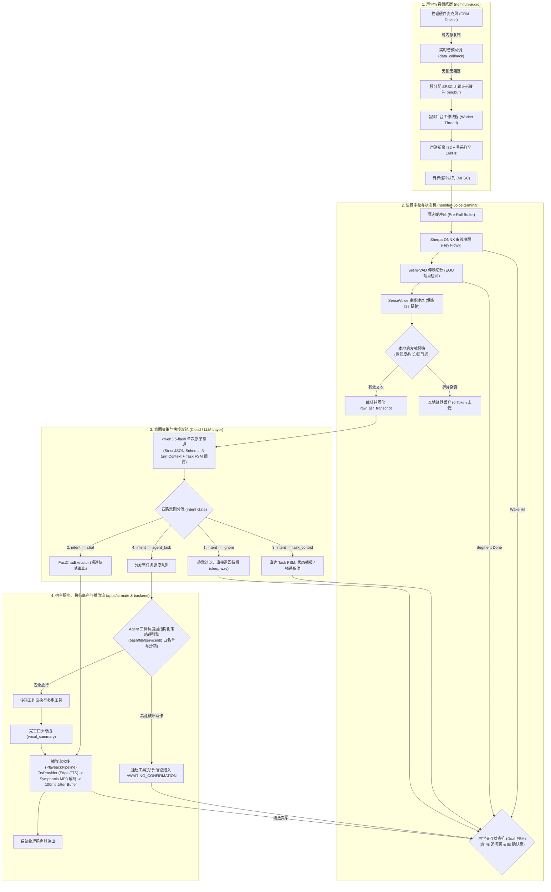
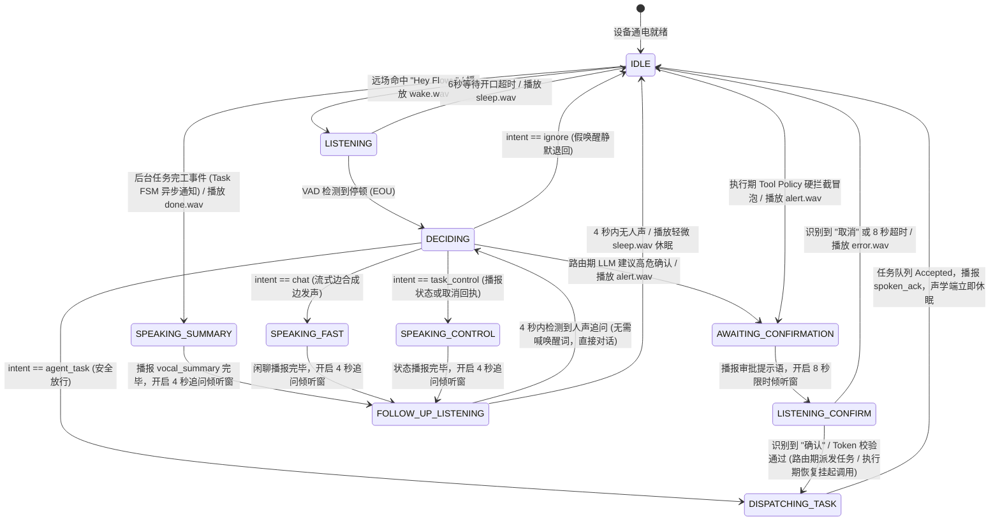
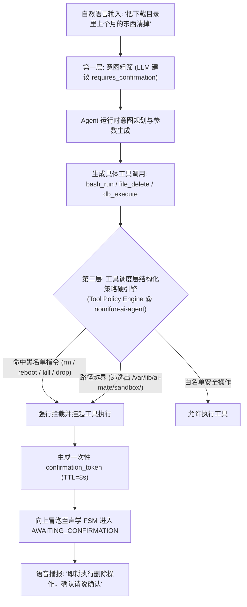
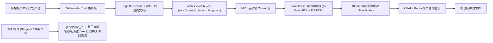

# Flowy AI Mate · 无头伴侣主机语音交互架构方案 (Voice Agent & Headless Host Architecture)

> **状态**：🧊 架构基线 (Ready for Implementation)  
> **核心原则**：**“AI Mate 无屏伴侣主机通电即用，远场唤醒纯语音闭环；无锁声学管线保障实时底座，工具调度层硬策略确立安全红线；云端单次路由极速秒回，流式解耦与事件音效零门槛交付。”**  
> **历史底稿归档**：原始技术调研与历次演进底稿已无损归档至 [interaction.archive.zh.md](interaction.archive.zh.md)。
> **子规范**：[模型资产管理](model-management.zh.md) · [界面与动效](ui-motion.zh.md)（目录索引见 [README.zh.md](README.zh.md)）。

---

## 1. 背景与核心痛点 (Background & Pain Points)

### 1.1 业务定位与目标产品：AI Mate (无屏幕伴侣主机)
Flowy / NomiFun 是一套生产级本地优先自动化与 AI Agent 协作平台。本方案旨在定义并交付其独立硬件化形态——**AI Mate (无头语音伴侣主机)**：
1. **硬件形态与物理定位**：
   - AI Mate 是一台**严肃的无屏幕、无键盘、无物理按键的独立伴侣主机盒子**（Mini PC、工控边缘盒、家庭/办公伴侣节点，或 Mac mini 专属副机）。
   - **绝非“小智式玩具机器人”**：坚决不做玩具级塑料外壳、舵机云台或简易带屏消费级音箱；
   - **绝非“桌面录音插件”**：不依赖前台 GUI 窗口，提供真正脱离键盘鼠标的纯远场自然语音人机交互。
2. **AI SSD 内存扩展存储层的科学定位**：
   - 伴侣主机搭载的高速 **AI SSD** 是**模型权重（mmap 零内存占用加载）与本地数据的高速存储层**；
   - 配合 Linux 的 `zram/zswap`、Windows 的高速 Pagefile 以及 macOS 统一内存换页，大幅缓解小物理内存（2GB / 4GB / 8GB）设备的内存枯竭压力；
   - **严谨科学边界声明**：AI SSD 不能等同于物理 RAM，不作“彻底杜绝 OOM”的过度承诺；由于核心意图路由在云端极速模型，MVP 阶段不涉及本地 LLM 的 KV Cache 磁盘卸载。系统的真实并发稳定性严格以 Phase 1 阶段真实硬件上的 RSS 与 Swap 压力测试为准。
3. **开箱即用与跨平台三端打包**：
   - **Linux（首发主力系统）**：基于定制 Linux 发行版，以 `systemd` 系统守护进程运行，通电自启、配合 `sd_notify` 硬件看门狗与非 root 权限沙箱；
   - **Windows / macOS 统一部署**：通过跨平台 Rust 宿主 `apps/ai-mate`，同时打包为 Windows Service / 托盘静默伴侣与 macOS `launchd` LaunchDaemon。
4. **无屏 OOBE 语音配对码安全机制 (防局域网劫持)**：
   - 设备首次开机若未检测到配置文件 `/etc/ai-mate/config.toml`，启动临时局域网 mDNS (`ai-mate.local`) 受信 Web 配对服务；
   - **安全防劫持设计**：由于无屏幕显示，AI Mate 开机自检完成后，**通过扬声器主动语音播报一次性 6 位动态配对码**（例如：“*AI Mate 已就绪，配对码为：8-3-9-2-0-1*”）；
   - 用户在手机/电脑浏览器打开配对页面，必须输入该 6 位配对码验证通过后，方可配置 Wi-Fi 凭据与云端 API Key；
28:    - 配对码有效期为 10 分钟，连续输错 5 次强制锁定 15 分钟；配对完成后凭据加密存入系统 Keychain / 安全存储，严禁在日志中明文打印；
   - **入网旁路**：纯 Wi-Fi 设备未入网时 mDNS 不可达，支持 U 盘根目录导入 `setup.toml` 预置凭据入网（详见 §3.1 入网前置）。
29: 5. **模型资产分发交付的场景分化：桌面客户端防膨胀 vs 无屏硬件开箱自愈**：
30:    - **桌面端 (Flowy React 19 SPA)**：桌面用户主要使用代码、浏览器、文档等核心自动化能力，语音交互属于增量可选特性。若将 ~249MB 的声学模型硬编入安装包，将导致桌面客户端安装包体积从 ~100MB 飙升至 ~350MB+，造成沉重的下载网络门槛与非必要磁盘浪费。因此桌面端采用“核心轻量交付 + 设置/设备页面按需一键下载与可视化进度管理（支持实时百分比、速度、阶段显示与释放删除）”；
31:    - **无屏伴侣硬件 (AI Mate Appliance)**：无屏无键鼠设备无法依赖人类用鼠标点击 UI 按钮，必须提供“零触控开箱通电即用”体验。系统支持代码/配置声明式开机自启（`/etc/ai-mate/config.toml` 中配置 `auto_download = true`），首次通电自检无模型时自动触发后台下载，并通过 mDNS 配对网页 (`ai-mate.local:8080`) 实时投影下载进度条，同时辅以柔和事件音效与完工语音播报；
32:    - **底层同一性与离线兼容**：无论桌面端按需下载还是无屏端配置自启，均驱动同一个底层 `ModelManager` 状态机，统一落地于规范目录，并在加载前强制执行 SHA256 密码学校验，全面兼容内网/离线手动 `cp -r` 零网直接部署。
33: 
34: ### 1.2 现状痛点剖析与三大历史矛盾清算
35: 在方案的多轮演进中，结合对仓库源码与第三方审查报告的静态核验，必须彻底清算并解决以下痛点与历史设计冲突：
36: 
37: 1. **矛盾清算一：物理按键 vs. 纯语音无头交互（彻底去除按键依赖）**
38:    - *历史冲突*：早期文档曾混杂“物理按键确立安全边界”、“Panic Button 双击急停”、“按键触发打断”等桌面/手持设备残留逻辑，与 AI Mate “无屏幕、无物理按键”的硬件事实产生严重自相矛盾。
39:    - *终版裁决*：**AI Mate 为纯远场语音激活产品，无任何物理按键**。所有会话生命周期、任务打断、高危确认均由纯语音状态机（“Hey Flowy”、纯语音澄清、事件驱动声效）驱动；任何物理按键/全局热键代码仅作为未来桌面端 GUI 可选适配器，绝不作为 AI Mate 必备能力。
40: 2. **矛盾清算二：在线 TTS vs. 离线 TTS（终版收拢为纯在线流式 + 内嵌音效兜底）**
41:    - *历史冲突*：既有文档部分章节宣称“彻底摒弃端侧 TTS”，另一些章节又将“离线 Piper/VITS 本地回退”列为必须实现的阶段任务。
42:    - *终版裁决*：**AI Mate MVP 明确为“Microsoft Edge-TTS 纯在线流式”主干链路**；当网络断开或 TTS 失败时，降级播放编译期内嵌的 CC0 Earcon 音效（`alert.wav` / `error.wav`）提示网络故障，**暂不引入任何本地 TTS 模型**（消除 50MB+ 模型包袱、ONNX 跨平台编译复杂度与发音生硬问题）。Piper/VITS 仅作为未来可选扩展演进项，不阻塞生产发布。
43: 3. **矛盾清算三：KWS 关键词规范纠偏与旧模型名称统一**
44:    - *历史冲突*：旧章节残留虚构的 `@ 1.0 @ 0.25` 伪语法以及旧模型代号 `qwen3.8-flash` 与脱离实际的 500ms 无条件低延迟承诺。
45:    - *终版裁决*：统一模型名称为 **`qwen3.5-flash`**；Sherpa-ONNX KWS 语法严格遵循官方标准：`KEYWORD :boosting_score #threshold @keyword_id`，由官方 `text2token` 工具基于模型词表生成，默认启用唯一标准词 `HEY FLOWY`，并在 Phase 1 建立真实录音测试集实测定标；端到端延迟以真实硬件测试为准，区分 P50 (~850ms) 与 P95 (~1250ms)。
46: 4. **代码级致命痛点：CPAL 实时音频采集回调的线程安全重构**
47:    - 现有 `nomifun-audio` 的 `mic.rs` 在实时音频回调线程中存在锁 Mutex、动态分配、重采样与 `blocking_send()` 调用，且 `read_chunk()` 的 `try_recv()` 导致“暂时无数据”与“通道关闭”语义混淆。必须重构为基于预分配无锁 SPSC 环形缓冲的三级无锁流水线。
48: 5. **矛盾清算四：模型分发“一刀切”引发的桌面包体膨胀与无屏黑盒失联矛盾**
49:    - *历史冲突*：若采用出厂全量死绑打包，桌面端安装包体积膨胀 250MB+ 极大伤害轻量用户体验；若完全依赖运行时静默下载，无屏幕无键盘的主机在断网或慢速网络下成为不可见、不可感知的黑盒死机状态，用户无法判断设备是否存活。
50:    - *终版裁决*：解耦为“统一底座 + 双场景按需分发”：桌面端在“设置/设备”页面提供带细粒度 SSE 进度流的可视化管理面板；无屏主机通过配置自启并在 Web 配对页投影进度、配以阶段音效感知；两者均支持离线文件直接拷贝，开机 100% 校验哈希，兼顾极速开箱与零包袱交付。
51: 
52: ### 1.3 能力对比矩阵
53: 
54: | 评估维度 | 传统录音插件 / 历史初稿 | 竞品玩具方案 (如小智等) | AI Mate 生产级终版标准 (本方案) |
55: | :--- | :--- | :--- | :--- |
56: | **产品形态** | 依赖桌面 GUI 聊天窗口手动操作 | 塑料玩具机器人 / 机械云台 / 小喇叭 | **严肃无屏幕伴侣主机**，开箱即用，Linux / Win / Mac 跨平台 |
57: | **硬件触发** | 鼠标点击 / 依赖键盘全局热键 | 触摸唤醒 / 简易 KWS | **纯远场语音 "Hey Flowy"**，零物理按键，抗噪防误唤醒 |
58: | **声学驱动底层** | CPAL 回调含锁与内存分配，易 xrun | 阻塞式音频线程，高延迟 | **预分配无锁 SPSC RingBuffer** + 独立 Worker 线程声道/采样率转换 |
59: | **意图路由架构** | 全量推给重型 Agent 或多轮 LLM 预处理 | 依赖外部固化云端 SaaS 平台 | **`qwen3.5-flash` 单次推理四路原子路由** (`chat` / `agent_task` / `task_control` / `ignore`) |
60: | **交互延迟感** | 录音停止后等 3~5 秒 | 机械式固定延迟，易中断 | **快轨秒回 (<850ms P50)** + 慢轨先行口头接单回执 (Spoken ACK) |
61: | **连续对话体验** | 每次说话都要重新点击 | 机械固定等待，易误录杂音 | **4 秒温热追问倾听窗 (Follow-up Window)**，闲聊与完工后无需重喊唤醒词 |
62: | **安全审计机制** | 自然语言正则赌用户句式 | 无安全审计，危险指令随意跑 | **nomifun-ai-agent 工具调度层结构化策略硬拦截** + 8秒单次 Token 确认 |
63: | **TTS 与离线保障** | 臃肿离线 Piper 或昂贵商业 API | 仅支持公版云端声音 | **TtsProvider 抽象 + Edge-TTS 首发 (Symphonia MP3 解码)** + 内嵌 CC0 音效兜底 |
64: | **系统守护可靠性** | 普通控制台前台运行，进程崩溃退出 | 简单 Shell 脚本死循环 | **Linux systemd + sd_notify 硬件看门狗** + Win/Mac 系统级服务 |
65: | **模型分发与运维** | 安装包硬绑几百兆模型膨胀，或静默黑盒下载无进度感知 | 依赖厂商私有云固件，脱网即瘫痪，无法自行替换模型 | **双场景分发架构**：桌面 GUI 设置页按需下载与可视化 SSE 进度；无屏伴侣配置自启 (`auto_download`) + Web/听觉双投影；全平台统一目录 + 离线 `cp -r` 拷贝兼容 + 开机 SHA256 强校验自愈 |
| **界面与动效体验** | 无界面或粗糙弹窗进度条 | 玩具无界面或跑马灯装饰 | **Quiet Kinetic 状态驱动动效**（120/180/240ms 三档令牌 + ease-out-expo，仅 opacity/transform）：设置行内进度投影 + 移动优先配对页，reduced-motion 全量降级（§3.10） |

---

## 2. 方案全景与架构设计 (Architecture & Topology)

### 2.1 端到端系统拓扑 (End-to-End Topology)
遵循 Mermaid 规范，系统由四个严格解耦的分层子系统构成：



### 2.2 模块权责划分矩阵 (Module Boundaries Table)

为防止多个 Agent 在实施时代码职责错位，严密界定五个核心模块的边界：

| 模块路径 | 承担职责 (Responsibilities) | 严禁行为 (Forbidden Boundaries) |
| :--- | :--- | :--- |
| **`crates/backend/nomifun-audio`** | 麦克风硬件采集、CPAL SPSC 无锁环形缓冲、KWS 唤醒检测、Silero-VAD 切分、SenseVoice 离线 ASR、内置 Earcon 静态音效资产。 | 严禁在此处编写 LLM 调用、HTTP 请求、Agent 工具或跨进程业务逻辑。 |
| **`crates/backend/nomifun-voice-terminal`**<br/>*(新建核心 crate)* | 声学交互状态机（Acoustic FSM，含追问窗与确认窗）、Task FSM 消息桥接、单次原子路由客户端、`TtsProvider` 抽象接口、MP3 解码与扬声器播放流水线（`PlaybackPipeline`）、本地启发式预筛器。 | 严禁直接依赖平台特有 GUI API（如 Tauri 窗口句柄）；保持 100% Headless 纯异步库。 |
| **`crates/backend/nomifun-voice-models`**<br/>*(新建模型管理 crate)* | `ModelManager` 生命周期状态机、双源探针与断点续传下载器、SHA256 校验器、统一目录落盘，并向桌面端 / 无屏端宿主暴露 `/api/voice/models/*` REST 与 SSE 契约。 | 严禁触碰音频采集与推理运行时；对下游只交付"已校验就绪"的模型目录路径与状态流。 |
| **`crates/backend/nomifun-ai-agent`** | Agent 运行时任务队列、多步 Tool 执行、**工具调度层结构化策略硬引擎（Tool Policy Engine）**、沙箱路径隔离。 | 严禁在此处直接读取麦克风或直接驱动扬声器发声。 |
| **`apps/ai-mate`**<br/>*(新宿主二进制)* | 跨平台宿主守护进程编排（Linux `systemd` + `sd_notify`、Windows Service、macOS `launchd`）、无屏 OOBE 语音配对码播报与 Web 配对服务、全局配置加载。 | 仅做启动装配与宿主胶水代码，核心算法与状态机一律调用上述三个底层 crate。 |

### 2.3 隐私与数据安全边界 (Privacy & Data Boundaries)
1. **永不离机数据 (Strictly Local)**：
   - 麦克风原生音频 PCM 数据流、VAD 音频切片、KWS 模板波形；
   - 原始转录文本 `raw_asr_transcript`：由 Rust 声学管线原生固化，仅存入本地 SQLite 审计表，永不离机。
2. **受限上云数据 (Minimal Cloud Egress)**：
   - 仅经过本地启发式预筛的有效用户指令文本发往 `qwen3.5-flash`；
   - 待合成的播报文本发往 Edge-TTS。
3. **本地启发式预筛 (Local Heuristic Pre-filter)**：
   - 在 ASR 转录完成后、调用云端 LLM 之前，本地执行快速启发式初筛：
     - 若 ASR 转录文本为空，或有效发音时长 $< 0.4\text{s}$；
     - 或 ASR 置信度分数 $< 0.35$；
     - 或文本仅由无意义助词/吞音构成（如“呃”、“啊”、“哎”）；
   - 系统**在本地直接归为 `ignore` 丢弃并播放 `sleep.wav`**，0 字节网络上云、0 Token 消耗，杜绝背景杂音碎语泄漏；
   - 被预筛丢弃的杂音碎片**仅递增本地统计计数器**（供误唤醒/漏唤醒分析），不留存全文、不写入审计表，最小化隐私留存面。

### 2.4 核心目标 vs. 明确的非目标 (Scope & Non-Goals)

| 核心目标 (What We Do) | 明确的非目标 (Explicit Non-Goals) |
| :--- | :--- |
| 交付面向 Linux/Win/Mac 的纯远场语音伴侣主机 `apps/ai-mate` | ❌ **AI Mate 主机本身坚决不做任何屏幕 UI、Tauri 前台窗口或 Web 复杂控制台**（桌面客户端内的模型管理设置行属既有桌面应用的设置页扩展，不在此列，见 §3.10） |
| 修复 CPAL 实时音频回调，构建基于 `ringbuf` 的无锁声学管线 | ❌ **坚决不做舵机云台、避障雷达等玩具机器人机构** |
| 规范 Sherpa-ONNX KWS 生成语法，落实精准单词 `Hey Flowy` | ❌ **坚决不在未测试前硬编码启用一堆拼音/谐音别名** |
| 实现 `qwen3.5-flash` 单次原子结构化四路分流与快慢双轨 | ❌ **MVP 坚决不引入本地 Piper/VITS 等重型离线 TTS 模型** |
| 在工具调度层建立结构化安全硬拦截与 `AWAITING_CONFIRMATION` | ❌ **坚决不在自然语言层拿 Regex 赌用户口语表达** |
| 半双工主干交互 + 4秒追问窗 + 纯事件驱动听觉反馈（零干扰） | ❌ **MVP 阶段不做依赖硬件参考信号的复杂 AEC 全双工打断** |

### 2.5 架构不变量 (Architectural Invariants)
1. **纯语音闭环不变量**：AI Mate 是独立的无屏幕伴侣主机，所有正常控制路径均为纯语音与听觉闭环，绝不强行依赖物理按键。
2. **音频实时线程不变量**：CPAL `data_callback` 线程内**严禁分配内存、严禁持有互斥锁（Mutex）、严禁调用阻塞通道或执行计算密集型重采样**。违者直接引发音频欠载卡顿。
3. **工具层硬安全不变量**：破坏性操作（`rm`, `drop table`, `kill`, `reboot`, 沙箱逃逸）必须在 **nomifun-ai-agent 工具调度层结构化拦截**，绝不依赖大模型的判决布尔值，也绝不拿自然语言正则当安全防线。
4. **单源真理不变量**：经预筛判定为有效的语音指令，其 ASR 原始文本必须由 Rust 声学管线原生截获命名为 `raw_asr_transcript`，永久固化用于审计，绝不允许经过 LLM 润色后覆盖真值（预筛丢弃的杂音碎片仅计数、不留存全文，见 §2.3）。
5. **接单回执因果性不变量**：口头接单反馈（`spoken_ack`）必须在底层任务队列返回 `Accepted` 后方可发声播报，若提交失败直接播报错误音效，杜绝“嘴上答应了却未进入队列”的虚假承诺。

---

## 3. 核心设计与模块规范 (Subsystem Design)

### 3.1 跨平台三端打包与宿主架构 (`apps/ai-mate`)
新建独立的跨平台守护进程 `apps/ai-mate`，统一编排声学链路与 Agent 交互：
- **Linux 部署基准 (开箱即用首发)**：
  - 作为 `systemd` 系统服务开机常驻：`/etc/systemd/system/ai-mate.service`；
  - 运行于专用非特权用户 `aimate`，工作目录固定于 `/var/lib/ai-mate/`；
  - 接入 `systemd` 看门狗机制：每隔 15 秒通过 `libsystemd` / `sd_notify` 发送 `WATCHDOG=1` 心跳（心跳周期须显著小于 `WatchdogSec`，取约 1/2 安全水位，防止调度抖动误杀），主循环死锁或线程崩塌由系统级看门狗自动杀掉并重启恢复：
    ```ini
    [Unit]
    Description=Flowy AI Mate Voice Companion Daemon
    After=network.target sound.target

    [Service]
    Type=notify
    User=aimate
    Group=aimate
    WorkingDirectory=/var/lib/ai-mate
    ExecStart=/usr/local/bin/ai-mate --config /etc/ai-mate/config.toml
    Restart=always
    RestartSec=5s
    WatchdogSec=30s

    [Install]
    WantedBy=multi-user.target
    ```
- **Windows / macOS 伴侣打包**：
  - Windows：支持编译为 Windows Service（通过 `windows-service` crate 注册），或普通用户登录启动的无窗口托盘伴侣；
  - macOS：注册为 `launchd` LaunchDaemon（`/Library/LaunchDaemons/com.flowy.aimate.plist`），在 Mac mini 等设备上无显示器静默常驻；
- **守护进程升级策略**：
  - **MVP 阶段**：采用**脚本化二进制热替换**机制。替换二进制文件后，向进程发送 `SIGHUP` 或通过 `systemctl restart ai-mate` 平滑重启；
  - **未来演进**：带签名校验的 A/B 双分区 OTA 升级方案明确留待 Post-MVP (Phase 5) 实现，不阻塞当前发布；
- **AI SSD 存储层与虚拟内存协同**：
  - 模型权重文件（Sherpa-ONNX、Silero-VAD、SenseVoice 等）直接放置于 AI SSD 高速分区，以只读内存映射（`mmap`）方式加载，零堆内存拷贝占用；
  - 配合 Linux 的 `zram` / `zswap`、Windows 快速 Pagefile，系统只将冷数据置换到 AI SSD，确保物理 2GB~4GB RAM 伴侣设备稳定运行；
- **无屏幕首次开机配对 (OOBE 详细流程)**：
  - **入网前置（鸡生蛋防线）**：mDNS 配对的前提是设备已接入局域网。MVP 提供两条零触控入网通道：**有线优先**（检测到 Ethernet 插入即 DHCP 自动入网）与 **U 盘预置**（开机检测 U 盘根目录 `setup.toml`，含 Wi-Fi 凭据与可选 API Key，导入后立即写入系统安全存储并删除明文副本）；纯 Wi-Fi 无屏配网（AP 热点自广播模式）明确列为 Post-MVP 演进，MVP 不承诺；
  1. 设备通电启动，若未读取到有效的网络与凭据配置，自动广播 mDNS (`ai-mate.local`) 并启动局域网 HTTP 配对服务；
  2. 随机生成 6 位数字动态配对码（例如 `839201`，有效期 10 分钟）；
  3. 扬声器自动播报：“*AI Mate 已开机，请在局域网网页输入配对码：8-3-9-2-0-1*”；若用户在旁未听清，再次对着设备说“*配对码*”，系统重新播报一次；
  4. 用户在同一局域网下访问 `http://ai-mate.local:8080`，页面要求输入配对码，校验通过后进入配置页面提交 Wi-Fi 与 API Key；
  5. 防爆破机制：连续 5 次输错配对码锁定 15 分钟。

### 3.2 麦克风采集与声学驱动无锁流水线 (`nomifun-audio`)
针对 `nomifun-audio` 中 `mic.rs` 与 `capture.rs` 的彻底重构，确立三级生产流水线：

```rust
// 采集源抽象状态枚举：彻底消除 try_recv() 歧义
pub enum CaptureReadResult {
    /// 成功读取到 16kHz 单声道 f32 PCM 音频切片 (如 160 采样点 / 10ms)
    Chunk(Vec<f32>),
    /// 队列暂时无数据 (非阻塞微等待，可继续轮询)
    TemporarilyEmpty,
    /// 音频采集流已正常关闭
    StreamClosed,
    /// 底层音频硬件严重异常 (如 USB 麦克风拔出)
    DeviceError(String),
}
```

1. **第一级：CPAL 实时音频回调 (Real-time Audio Callback)**
   - 使用预分配有界 SPSC 无锁环形缓冲（基于 `ringbuf` crate，容量固定为 1 秒采样数据）；
   - 在 `data_callback(&[T])` 中，仅执行零分配的内存搬运，将原生采样以 f32 写入 SPSC 生产者端；
   - 绝不调用重采样算法，绝不分配堆内存，绝不获取 Mutex。
2. **第二级：音频后台工作线程 (Audio Worker Thread)**
   - 独立 OS 线程，从 SPSC 消费者端批量 `pop` 原始采样；
   - 执行多声道平均（Mono Fold）与立体声下混；
   - 执行高质量无锁重采样至 16000 Hz（使用 `rubato` 或高效线性内插）；
   - 积压溢出守护：检测到队列积压超过 100ms 时，主动丢弃最旧数据帧，并递增原子溢出计数器 `overflow_count`；
   - 将处理后的 16kHz f32 数据推入有界 MPSC 管道供消费。
3. **第三级：消费与端点检测**
   - 消费线程从 MPSC 拉取音频帧，推入循环 Pre-Roll 缓冲区，并发喂入 KWS 与 VAD。

### 3.3 唤醒词 KWS 与 SenseVoice ASR 契约
1. **KWS 模型选型与演进路线**：
   - **Phase 0 锁定基准**：选用 Sherpa-ONNX 官方预训练的英文 BPE 模型 **`sherpa-onnx-kws-zipformer-gigaspeech-3.3M-2024-01-01`**（发布包约 17MB，含 fp32 与 int8 量化变体，参数量 3.3M；下载自官方 GitHub `kws-models` Release 或 ModelScope 镜像），专门用于英文标准唤醒词 **`Hey Flowy`**；
     - *合规备注*：该模型的上游训练工程（icefall）为 Apache-2.0，但 Release 模型资产尚无显式许可证声明（上游跟踪 issue：k2-fsa/sherpa-onnx#3802），商用发布前须完成许可证确认；
   - **未来演进路径**：若后续版本需要支持中文唤醒词（如“小流同学”），首选在架构中**并行运行双 KWS 引擎实例**（1 个英文 BPE 实例 + 1 个中文 CJKChar 实例，各占用约 15MB 内存，多核 CPU 增量开销 $< 2\%$），无需推翻已有声学管线；亦可评估官方中英双语单模型 `sherpa-onnx-kws-zipformer-zh-en-3M-2025-12-20` 作为双实例之外的备选，届时以唤醒召回率实测数据裁决；
   - **关键词源语法规范**：
     ```text
     # keywords_source.txt (由模型 text2token 工具编译生成 keywords.txt)
     HEY FLOWY :1.0 #0.25 @hey_flowy
     ```
     - `:1.0`：解码集束搜索加权分数（Boosting Score）；
     - `#0.25`：触发敏感度阈值（0.0 ~ 1.0，根据 Phase 1 实测定标）；
     - `@hey_flowy`：触发回调绑定的唯一事件标识。
   - **防误唤醒准则与中文口音覆盖**：
     - 在 Phase 1 阶段，仅启用标准单词 `HEY FLOWY`；
     - 鉴于 "Flowy" 为品牌自造词，Phase 1 测试集必须显式采集覆盖**中国开发者常见的英语口音发音样本**（如 `/floʊi/`、`/fləʊi/`、汉式轻读 `/fə-lou-yi/`），以此为基准标定 Boosting Score 与 Threshold；
2. **误唤醒率双重判定口径 (统一标准)**：
   - **实验室测试集标准 (Gate 1 / TC-AM-002)**：在标准办公室/家庭背景环境（播放电视新闻、日常中文交谈、会议音频）连续运行 2 小时，**误唤醒次数严格为 0 次**；
   - **长期挂机压测标准 (Gate 4)**：在真实办公/生活环境下连续运行 72 小时，**误唤醒次数 $\le 1$ 次 / 24 小时**。
3. **SenseVoice ASR 离线转录**：
   - 复用既有 `nomifun-audio` 的 `stt/sherpa.rs`，模型直接走 AI SSD 上的只读内存映射；
   - 全链路保持 f32 精度音频，转录结果直接固化为只读字段 `raw_asr_transcript` 存入本地审计表。

### 3.4 本地模型资产统一布局、多源自愈与强校验规范 (Unified Model Layout & Dual-Source Probing)

为了兼顾“整机出厂预置”、“轻量在线包按需自愈下载”以及“纯内网/离线环境手动直接拷贝统一资源”的多重诉求，确立全平台统一的模型存储拓扑与多源降级校验体系：

#### 契约摘要（完整规范见 [model-management.zh.md](model-management.zh.md)）
1. **统一布局与免提权选径**：全平台模型资产必须且只能存放于统一 `models_dir` 拓扑（`kws/`、`vad/`、`asr/`、`checksums.sha256`）；桌面 GUI 一律落用户态目录，严禁为写模型文件请求 UAC / sudo 提权，系统级目录仅供服务身份宿主；
2. **状态机唯一事实源**：新建 crate `nomifun-voice-models` 的 `ModelManager` 以 `ModelInstallState`（`NotInstalled / ProbingSource / Downloading / VerifyingSha256 / Ready / Failed / Removing`）统一驱动桌面 GUI 按需下载、无屏主机 `auto_download = true` 开箱自愈与离线 `cp -r` 直接拷贝三场景；
3. **强校验唯一权威**：Rust 二进制内嵌只读基准清单为发布锚定的唯一权威基准；7 个下载分发产物计入 `checksums.sha256` 与下载进度分母，`keywords.txt` 由 `text2token` 本机编译、仅做存在性检查；自检通过后绝不发起任何网络探测，支持纯内网脱网运行；
4. **多源降级与接口契约**：ModelScope（国内极速）→ GitHub Releases / HuggingFace（海外原生）→ 官方冗余 CDN 的探针降级链（并发 HEAD 1500ms 超时、首包 $< 800\text{ms}$、HTTP Range 断点续传）；对外暴露 `GET /api/voice/models/status`、`POST /api/voice/models/install`、`GET /api/voice/models/progress`（SSE）、`DELETE /api/voice/models` 与 `/etc/ai-mate/config.toml` 的 `[models]` 声明式配置。

### 3.5 极速单次决策路由与四路结构化契约 (Single-Pass Quad-Route)
麦克风切出 ASR 文本后，直接向 `qwen3.5-flash` 发起单次请求，输出严格遵循的 JSON Schema 契约：

```json
{
  "$schema": "http://json-schema.org/draft-07/schema#",
  "title": "VoiceDecisionContract",
  "type": "object",
  "properties": {
    "intent_type": {
      "type": "string",
      "enum": ["ignore", "chat", "agent_task", "task_control"]
    },
    "task_control_action": {
      "type": "string",
      "enum": ["query_status", "cancel_task"],
      "description": "当 intent_type 为 task_control 时的具体控制动作"
    },
    "reply_tts": {
      "type": "string",
      "description": "当 intent_type 为 chat 时的直接口语回答 (≤60字)"
    },
    "spoken_ack": {
      "type": "string",
      "description": "当 intent_type 为 agent_task 时的先行接单回执 (≤25字)"
    },
    "task_goal": {
      "type": "string",
      "description": "当 intent_type 为 agent_task 时的纯净规整执行目标"
    },
    "requires_confirmation": {
      "type": "boolean",
      "description": "模型建议的是否需要用户口头确认"
    }
  },
  "required": ["intent_type"]
}
```

#### 动态 Prompt 注入与四路行为准则：
- **Prompt 动态状态注入**：在向 `qwen3.5-flash` 发起请求的 System Prompt 中，动态注入 Task FSM 的 1~2 行实时状态：
  ```text
  [当前后台任务状态]: ID=task_104, 目标="分析最近日志", 运行耗时=25s, 状态=Executing
  （若当前无任务正在运行，则注入: [当前后台任务状态]: 空闲，无正在运行任务）
  ```
- **四路分流严格行为**：
  1. `intent_type == "ignore"`：假唤醒或无意义环境杂音，播放 `sleep.wav` 静默退回休眠；
  2. `intent_type == "chat"`：日常打招呼、常识问答，提取 `reply_tts` 直推播放流水线，**声学处理延迟 $\le 850\text{ms}$（口径锚点见 §3.9）**，完全不惊动 Agent 底座；
  3. `intent_type == "task_control"`：控制正在运行的后台任务：
     - 若 `task_control_action == "query_status"`：直接从 Task FSM 提取当前进度，合成口头播报（如：“*当前正在分析第二份日志，预计还需 20 秒*”）；
     - 若 `task_control_action == "cancel_task"`：向 Task FSM 发送中止信号强制杀死任务，播放 `error.wav` 并播报：“*已为您停止当前任务*”；
  4. `intent_type == "agent_task"`：提交慢轨任务异步派发执行；执行期内每次工具调用均经工具调度层策略引擎结构化拦截（见 §3.7）。
- **上下文预算与质量指标**：
  - 滑动 3 轮（6 条消息）且总 Token $\le 600$；上下文中仅存口头摘要（Zero Log Contamination）；
  - **验收指标**：JSON Schema 解析成功率 $\ge 99.5\%$；**四分类意图准确率 $\ge 95.0\%$**（在 200 条标注基准测试集上验证）。

### 3.6 双解耦状态机与追问免唤醒闭环 (Dual-FSM with Follow-up)
为了提供行云流水的语音体验，声学交互状态机（Acoustic FSM）正式支持**4 秒温热追问免唤醒倾听窗（Follow-up Window）**与**8 秒安全确认倾听窗**：



- **确认回路双触发源**：`AWAITING_CONFIRMATION` 有两个入口——路由期（`DECIDING`，LLM 建议 `requires_confirmation`）与执行期（`IDLE`，Tool Policy 硬拦截冒泡）。执行期场景下，用户说出“确认”且单次 Token 校验通过后，**恢复被挂起的工具调用继续执行**，而非重新派发任务；两种场景共享同一个 8 秒限时倾听窗与单次 Token 熔断机制。
- **追问免唤醒设计价值**：
  - 用户问完“*今天天气怎么样*”，设备回答后，用户可在 4 秒内直接追问“*那明天会下雨吗*”，**无需每次重复喊叫 "Hey Flowy"**；
  - 4 秒超时未开口，设备播放极柔和的休眠提示音后平稳关闭倾听，避免持续收录环境无关噪音。

### 3.7 工具调度层不可越狱安全硬策略 (Tool-Level Sandboxing)
彻底纠正“在自然语言层用正则表达式赌用户句式”的缺陷。系统建立**双层立体安全防御体系**：



1. **第一层（粗粒度前置预筛）**：`qwen3.5-flash` 在路由阶段基于语义进行初步风险标记（`requires_confirmation`）；
2. **第二层（不可越狱绝对防线：Tool Policy Engine）**：
   - 部署在 `nomifun-ai-agent` 工具调用派发点，拦截结构化入参；
   - 检查工具类型与参数（如 `bash_run` 的命令、`file_delete` 的路径）；
   - **硬性禁止与强管控策略**：
     - 命令包含系统重启关机 (`reboot`, `shutdown`)、磁盘格式化 (`mkfs`)、数据库级销毁 (`drop database`, `truncate`)、系统文件级删除 (`rm -rf`)；
     - 目标路径超出沙箱工作目录（`/var/lib/ai-mate/sandbox/`）；
   - **无论 LLM 返回的布尔值为何**，一旦触发规则，工具派发立即挂起，生成带 8 秒 TTL 的单次 `confirmation_token` 并向上冒泡，由声学 FSM 驱动口头确认；
3. **声纹防御 (Post-MVP 演进预留)**：利用 `nomifun-audio` 既有的声纹识别能力，可在高危确认阶段校验发音人声纹是否匹配设备注册主人，防止房间内其他人代喊“确认”。

### 3.8 播放流水线与 TtsProvider 抽象架构 (Playback Pipeline)
彻底消除对 Edge-TTS 逆向接口的单点硬绑定，并补齐完整的音频解码与扬声器播放流：



1. **`TtsProvider` Trait 抽象定义**：
   ```rust
   #[async_trait]
   pub trait TtsProvider: Send + Sync {
       /// 流式合成语音，返回接收 MP3/PCM 字节流的异步 Receiver
       async fn synthesize_stream(
           &self,
           text: &str,
           voice: &str,
       ) -> Result<mpsc::Receiver<Vec<u8>>, TtsError>;
   }
   ```
   - 首发实现：`EdgeTtsProvider`（纯 Rust `tokio-tungstenite` 实现，免 API Key、多语言神经音色）；
   - 预留扩展实现：云端商业 TTS（DashScope/CosyVoice）与未来轻量离线 TTS；
2. **音频解码与播放驱动流水线 (`PlaybackPipeline`)**：
   - 采用纯 Rust 编写的 `symphonia` 解码器，在内存中将 Edge-TTS 返回的 MP3 分块解码为 16kHz/48kHz 单声道 f32 PCM；
   - 经由 100ms Jitter Buffer 抵抗网络包抖动后，推入系统默认音频输出设备的 CPAL 播放流；
3. **毫秒级打断机制 (Generation Flush)**：
   - 维护原子代际编号 `generation_id: AtomicU64`；
   - 只要检测到用户再次唤醒或说出“停止/取消”，代际号立即自增，播放流水线在 **$<50\text{ms}$ 内清空扬声器队列并强断网络连接**，瞬间静音；
4. **编译期内嵌 CC0 Earcon 音效体系**：
   - 彻底废除 4 秒周期滴答呼吸音（消除听觉污染）；
   - 仅保留 6 个精炼、超短的事件驱动音效（采用 `include_bytes!` 静态嵌入，总大小 $<40\text{KB}$）：
     - `guide.wav`（60ms，温和上行双音）：开机自检通过、模型就绪流程开始（OOBE / 自愈下载引导）；
     - `wake.wav`（20ms，短促上扬）：远场唤醒成功；
     - `alert.wav`（100ms，双短蜂鸣）：高危操作等待用户确认；
     - `done.wav`（120ms，明亮和弦）：后台任务成功完成；
     - `sleep.wav`（60ms，下沉轻音）：超时或无意图休眠；
     - `error.wav`（80ms，低频警示）：网络脱网或操作取消。

### 3.9 延迟预算分解公式与端到端口径 (Latency Benchmark)
消除所有延迟口径歧义，建立严格可测的基准分解公式：

$$T_{\text{Speaker_Output}} = T_{\text{VAD_Silence}} + T_{\text{SenseVoice}} + T_{\text{LLM_FirstChunk}} + T_{\text{TTS_FirstChunk}} + T_{\text{MP3_Decode}} + T_{\text{JitterBuffer}}$$

| 分段指标 | 典型测量范围 (Range) | 测量说明与优化策略 |
| :--- | :--- | :--- |
| **$T_{\text{VAD_Silence}}$** | $300\text{ms} \sim 400\text{ms}$ | Silero-VAD 确认人声结束所需的尾随静音判定窗 |
| **$T_{\text{SenseVoice}}$** | $120\text{ms} \sim 180\text{ms}$ | 离线 SenseVoice 在 16kHz f32 下完成 ASR 转录 (RTF < 0.2) |
| **$T_{\text{LLM_FirstChunk}}$** | $150\text{ms} \sim 250\text{ms}$ | `qwen3.5-flash` 云端首字到达时间 (TTFT，3 轮上下文 $\le 600$ Token) |
| **$T_{\text{TTS_FirstChunk}}$** | $150\text{ms} \sim 220\text{ms}$ | Edge-TTS 首个 MP3 音频切片推流到达时间 |
| **$T_{\text{MP3_Decode}}$** | $5\text{ms} \sim 10\text{ms}$ | Symphonia 解码首个 MP3 帧至 f32 PCM |
| **$T_{\text{JitterBuffer}}$** | $80\text{ms} \sim 100\text{ms}$ | 抖动缓冲区预填充阈值，确保播放连续不撕裂 |

- **严格测量锚点规范**：
  1. **声学处理延迟 (Audio Pipeline Latency)**：**从 VAD 确认静音点 ($T_{\text{VAD_Silence}}$ 结束) 起算**，至物理扬声器产生声压：
     - **P50 预期目标**：$\le 850\text{ms}$；
     - **P95 预期目标**：$\le 1250\text{ms}$；
  2. **用户感知端到端延迟 (User-Perceived Latency)**：**从用户嘴巴停止说话起算**（包含 VAD 静音窗）：
     - **P50 预期目标**：$\approx 1250\text{ms}$；
     - **P95 预期目标**：$\approx 1650\text{ms}$；
  3. **唤醒反馈发声延迟 (Wake Earcon Latency / TC-AM-001)**：**从唤醒词 "Hey Flowy" 尾音结束（KWS 命中回调触发）起算**，扬声器在 **$\le 200\text{ms}$** 内发出 `wake.wav`。

### 3.10 交互界面与动效设计规范 (UI Surfaces & Motion Design)

本方案仅存两块人机界面：**桌面端“语音伴侣”设置详情页**与**无屏配对 Web 页**。二者统一继承 Flowy 既有设计体系（PRODUCT.md “Quiet Kinetic Workspace” 基调与 DESIGN.md 设置壳契约），只允许状态驱动的克制动效，严禁任何一次性视觉发明。

#### 契约摘要（完整规范见 [ui-motion.zh.md](ui-motion.zh.md)）
1. **动效令牌总线**：全场只允许 `motion.feedback` 120ms / `motion.state` 180ms / `motion.spatial` 240ms 三档时长与 `cubic-bezier(0.16, 1, 0.3, 1)`（ease-out-expo）曲线（退场恒为入场 75%）；仅 `opacity` / `transform` 两通道，进度条一律 `transform: scaleX()` 驱动；`prefers-reduced-motion` 生效时全量降级为即时切换且语义完整；
2. **设置页行契约**：严格遵守设置壳 `Page Header → Section → List → Row`；模型管理为一行标准设置行（右侧 220~280px 控制槽，严禁卡片容器），行高全状态恒定，行底部 2px 发丝进度轨道常驻渲染，数字文本走 `font-variant-numeric: tabular-nums`；【释放空间】行内两步确认，严禁 Modal；
3. **状态视觉三要素与工程门禁**：任何状态由图标 + 文案 + 语义色共同表达（不单靠颜色），与 `ModelInstallState` 一一对应；全部文案 i18n 双字典对称（zh-CN / en-US），颜色仅用语义令牌，验收过 `bun run check:theme` / `check:i18n` 并人工核查明暗双主题；
4. **无屏配对页契约**：设备自托管极简页，360px 移动优先，正文对比度 ≥ 4.5:1、触控目标 ≥ 44px，`Accept-Language` 自动协商；`OtpCodeInput` 6 格 3+3 分组、输满自动校验、连续 5 次失败锁定 15 分钟；配对 Web 服务寿命与配对码 10 分钟有效期解耦，持续至 `ModelManager` 终态；页面状态与设备听觉反馈由同一 `ModelInstallState` 驱动。

---

## 4. 关键决策与权衡矩阵 (ADR Matrix)

| 编号 | 决策点 | 选定方案 | 放弃的替代方案与理由 |
| :--- | :--- | :--- | :--- |
| **D1** | **产品硬件定位** | **AI Mate 无屏幕伴侣主机** (纯语音远场交互，Linux 开箱即用，Win/Mac 打包) | ❌ **小智式玩具机器人**：带屏幕/塑料云台舵机与边缘计算定位脱节；<br/>❌ **纯桌面插件**：无法脱离屏幕与键鼠，失去独立硬件伴侣价值。 |
| **D2** | **物理触发方式** | **纯远场语音 "Hey Flowy" 驱动**，无任何物理按键 | ❌ **物理按键/全局热键强绑定**：与无屏幕独立主机硬件形态直接冲突；按键代码仅保留为桌面可选适配器。 |
| **D3** | **AI SSD 存储定位** | **高速模型与 OS 虚拟内存 (zram/swap) 扩展层** | ❌ **宣传为“等同物理 RAM / 彻底杜绝 OOM / KV Cache 磁盘卸载”**：不符合现代操作系统内存分页原理，脱离硬件科学客观事实。 |
| **D4** | **麦克风音频采集** | **预分配无锁 SPSC RingBuffer + 独立 Worker 线程** | ❌ **既有 CPAL 回调内加锁重采样**：实时音频回调内分配内存和持有 Mutex 会导致 xrun 杂音、严重卡顿甚至死锁。 |
| **D5** | **KWS 语法与模型选型** | **Sherpa-ONNX 官方 text2token 规范**：`KEYWORD :boosting #threshold @id`。<br/>**选型与演进固化**：MVP 锁定 Gigaspeech 英文 BPE 模型（3.3M 参数）专跑 `Hey Flowy`；**架构演进明确：未来若增加中文唤醒词，无需推翻现有管线，而是并行拉起第二个独立中文 KWS 引擎实例**（各 ~3.3M 参数 / 15MB 内存，CPU 增量 <2%）；备选为官方中英双语单模型 `zh-en-3M-2025-12-20`，以 Phase 1 实测裁决。 | ❌ **手写伪格式 `@ 1.0 @ 0.25`**：不符合 Sherpa 词表编译逻辑，导致加载失败或参数无效；<br/>❌ **单模型强行兼容汉英混读**：破坏词表分离度，增加漏唤醒率；<br/>❌ **将双唤醒词误当架构重构**：提前明确双实例演进路径，杜绝未来将其当做推倒重来的新需求争议。 |
| **D6** | **意图路由调度** | **`qwen3.5-flash` 单次推理四路原子路由** (含 `task_control` 与实时状态注入) | ❌ **多轮逐步 LLM 调度**：首字延迟叠加到 2~4 秒以上；<br/>❌ **全量丢给底层 Agent**：日常打招呼也启动工具扫描，资源浪费且极慢。 |
| **D7** | **TTS 架构与播放解耦** | **`TtsProvider` Trait 抽象 + Symphonia MP3 解码 + Edge-TTS 首发** | ❌ **单点死绑 Edge-TTS 逆向接口**：缺乏更换弹性与 SLA 保障；<br/>❌ **强制集成离线 Piper/VITS**：增大包体积 50MB+，跨平台 C++ 依赖复杂，中文机械感重。 |
| **D8** | **安全拦截抽象层** | **nomifun-ai-agent 工具调度层结构化策略硬引擎** | ❌ **在自然语言层跑 Regex 黑名单**：无法识别语义变形（如“帮我清理上月文件”），且容易在常规对话中误伤。 |
| **D9** | **听觉反馈体系** | **纯事件驱动 Earcon (6 个内嵌音效)，彻底删除 4s 滴答音** | ❌ **每 4 秒播放一次思考呼吸音**：用户实测反馈严重噪音污染与心理烦躁感。 |
| **D10**| **打断与全双工** | **MVP 采用半双工语音控制，Phase 4 探索参考信号 AEC** | ❌ **MVP 强行做无硬件 AEC 的麦克风全双工**：扬声器声音回采自激死循环，Agent 自己跟自己疯狂对话。 |
| **D11**| **追问免唤醒窗口** | **支持闲聊与任务完工后 4 秒温热追问倾听窗 (Follow-up Window)** | ❌ **每次对话必须喊叫唤醒词**：连续追问体验破碎，人机交互极度机械僵硬。 |
| **D12**| **无屏 OOBE 安全配对**| **首次开机语音播报 6 位动态配对码，Web 端凭码配置；入网以有线直连 / U 盘 `setup.toml` 预置为先** | ❌ **5 分钟局域网完全裸露开放**：同局域网任何人均可抢先劫持配对设备并注入恶意配置；<br/>❌ **MVP 自造 AP 热点配网**：provisioning 复杂度高，有线直连 + U 盘预置已覆盖首发入网场景。 |
| **D13**| **模型分发与校验策略**| **统一目录布局 + 双场景分发治理 (桌面端 GUI 可视化按需下载 vs 无屏伴侣配置自启与 Web/听觉双投影) + 双源智能降级探针 (ModelScope/GitHub) + 离线直接拷贝兼容 + 开机 SHA256 强校验自愈** | ❌ **桌面端一刀切死绑打包**：强塞 250MB 模型导致轻量自动化用户安装包体积翻倍膨胀；<br/>❌ **无屏端强求图形界面**：无屏幕设备缺少鼠标点击入口导致无法初始化；<br/>❌ **黑盒静默下载**：无进度反馈导致用户在断网或慢速时误判为死机；<br/>❌ **单源死绑与不校验加载**：下载中断或损坏导致底层 ONNX Runtime Segfault 崩溃。 |
| **D14**| **界面与动效策略** | **Quiet Kinetic 三档动效令牌（120/180/240ms + ease-out-expo + 仅 opacity/transform）+ 设置行内进度投影 + 移动优先配对页（§3.10）** | ❌ **装饰性循环动画与弹跳曲线**：造成动效疲劳，与"克制、精确"的品牌人格直接冲突；<br/>❌ **卡片式设置页与 Modal 确认**：违反 DESIGN.md 设置壳 Row 契约与 Modal 末位原则；<br/>❌ **无降级的动效**：忽视 `prefers-reduced-motion` 属无障碍违规。 |

---

## 5. 验收标准与验证矩阵 (Acceptance Criteria & Ladder)

### 5.1 验收测试用例 (Acceptance Test Cases)

| 用例编号 | 场景分类 | 操作输入路径 | 预期断言口径与测量起点 |
| :--- | :--- | :--- | :--- |
| **TC-AM-001** | 声学唤醒 | 在距设备 1~3 米处清晰读出 `Hey Flowy` | **从唤醒词尾音结束起算**，扬声器在 200ms 内播放 `wake.wav`，进入 `LISTENING` |
| **TC-AM-002** | 误唤醒防守 | 播放环境电视新闻与日常对话音频连续 2 小时 | 设备误唤醒次数严格为 **0 次** |
| **TC-AM-003** | 假唤醒休眠 | 唤醒后保持静音或仅轻声哼一声 | 6 秒超时后播放 `sleep.wav`，状态机平稳退回 `IDLE` |
| **TC-AM-004** | 快轨闲聊秒回 | 唤醒后说出日常问候：“今天天气怎么样？” | 不调用 Agent 工具队列，从 VAD 静音起算 Edge-TTS 在 **$\le 850\text{ms}$ (P50)** 内发声播报 |
| **TC-AM-005** | 连续免唤醒追问 | 闲聊播报完毕后 2 秒内直接说：“那明天呢？” | **无需再喊唤醒词**，设备直接进入识别与路由，给出明天天气回答 |
| **TC-AM-006** | 运行状态查询 | 后台任务正在执行时，唤醒并说：“刚才的任务跑完没？” | 路由为 `task_control: query_status`，直接口头播报当前任务进度，不生成新任务 |
| **TC-AM-007** | 紧急取消任务 | 后台任务正在执行时，唤醒并说：“取消当前任务” | 路由为 `task_control: cancel_task`，Task FSM 强制中止，播放 `error.wav` 确认取消 |
| **TC-AM-008** | 高危破坏拦截 | 指令涉及删除系统目录：“清空下载目录并删除所有临时文件” | 工具调度层策略硬拦截，播放 `alert.wav` 并口头提示“即将执行删除，确认请说确认” |
| **TC-AM-009** | 确认超时熔断 | 进入待确认状态后，用户静音等待 8 秒 | 8 秒超时后播放 `error.wav`，口头说明“等待超时已取消”，原任务彻底销毁 |
| **TC-AM-010** | 脱网错误反馈 | 拔掉设备网线后进行语音唤醒与提问 | ASR 本地转录完成，TTS 连接失败立即播放内嵌 `error.wav`，状态机不卡死 |
| **TC-AM-011** | 麦克风拔插自愈 | 设备运行中拔出 USB 麦克风再重新插入 | 看门狗捕获断开并在 2 秒内重新绑定系统默认输入源，日志无 panic |
| **TC-AM-012** | 三端服务常驻 | Linux `systemd`、Windows Service、macOS `launchd` | 开机自启，待机内存常驻 RSS $< 250\text{MB}$，CPU 待机占用 $< 1.5\%$ |
| **TC-AM-013** | 完工播报与追问 | 后台任务执行完毕，声学端处于 IDLE | 自动播放 `done.wav` 并播报 `vocal_summary`，随后开启 4 秒追问窗，追问无需重喊唤醒词 |
| **TC-AM-014** | 桌面端可视化模型管理 | 打开设置/伴侣设备页面，点击“下载并启用”，监听 SSE 进度流，下载完成后点击删除释放空间 | SSE 实时返回百分比、实时下载速度与阶段提示；下载完成后 SHA256 校验 100% 通过，状态自动切换为 Ready 并显示绿灯；删除后安全清理模型文件并重置为 NotInstalled |
| **TC-AM-015** | 无屏主机配置自启与投影 | 在 `/etc/ai-mate/config.toml` 配置 `auto_download = true`，开机启动 | 检测无模型后自动启动后台下载，Web 配对页 (`http://ai-mate.local:8080`) 实时投影进度条；下载完成校验通过播放 `done.wav` 并主动语音播报就绪；下载失败播放 `error.wav` 并口头告警 |
| **TC-AM-016** | 模型多源与离线脱网直接拷贝 | 离线手动拷贝统一模型目录至设备，或在线轻量包开机自动探测双源下载 | 手动拷贝后脱网开机校验 100% 通过且 0 字节网络请求；在线轻量包开机根据网络测速自动选源 (ModelScope/GitHub)，下载后 SHA256 强校验通过方可交付声学引擎 |
| **TC-AM-017** | 设置面板状态可视化与动效降级 | 桌面端遍历 `NotInstalled → Probing → Downloading → Verifying → Ready → Removing` 全状态流转 | 行高恒定无布局抖动；进度条 `transform` 驱动且 60fps；状态切换 180ms 交叉淡化；开启系统 `prefers-reduced-motion` 后全部转为即时切换且语义完整；`check:theme` 与 `check:i18n` 通过，明暗双主题人工核查通过 |
| **TC-AM-018** | 配对页移动端闭环 | 360px 手机浏览器访问配对页，完成输码并观察下载投影直至就绪 | 6 位码输满自动校验；错误局部提示不抖动布局；连续 5 次失败锁定并显示倒计时；下载进度实时投影且页面服务持续至 `Ready` 终态；设备就绪语音播报与页面完成态同步出现 |

### 5.2 渐进式阻断验证梯子 (Phase S ~ Phase 4 Blocking Gates)

严格遵循六阶段落地阶梯，**前一阶段验收门（Blocking Gate）未通过，坚决不允许进入下一阶段编码**。执行层波次拆分、多 Agent 分工与纵向测试集规范见 [execution/README.zh.md](execution/README.zh.md)：


#### Phase S: 契约冻结与全流程骨架 (Contract Freeze & Walking Skeleton)
* **核心动作**：冻结全部跨模块契约（`ModelInstallState` 线格式、REST/SSE DTO、路由 JSON Schema、FSM 迁移表、earcon 清单、i18n 键名、配置 schema，清单详见 [execution/README.zh.md](execution/README.zh.md) §4）；以最薄哑管线打通“回放音频 → 桩路由 → 发声 → 播放”端到端骨架与两块 UI 壳；全部骨架代码置于 dev feature flag 之后，桩逻辑严禁进入生产路径。
* **阻断验收门槛 (Gate S)**：`cargo check --workspace` 通过；契约快照测试全部锁定；VT-0 骨架竖切测试绿；bsk 冒烟剧本通过。

#### Phase 0: 现状核验与声学管线重构 (Status Quo & Ringbuffer Refactor)
* **核心动作**：
  1. 重构 `nomifun-audio` 的 `mic.rs`，引入基于 `ringbuf` 的 SPSC 无锁环形缓冲区，将重采样与声道折叠移入独立 Worker 线程；
  2. 改造 `AudioCaptureSource` 导出显式枚举 `CaptureReadResult`，修复 `try_recv()` 语义混淆；
  3. 固定 Sherpa-ONNX 英文 BPE KWS 模型版本，确定 `text2token` 编译工具链；
  4. 扩充 `nomifun-model-invoke` 支持传入 JSON Schema 结构化约束；
  5. 定义 `ModelInstallState` 状态枚举与统一模型存储路径，确定双源镜像地址与校验基准。
* **阻断验收门槛 (Gate 0)**：`cargo test -p nomifun-audio` 全部通过；模拟连续 10 分钟音频采集，SPSC 环形缓冲 0 阻塞、0 内存增长、0 xrun 报警；完成模型统一目录结构规范与权威 `checksums.sha256` 清单定义，通过 `ModelInstallState` 单元测试。

#### Phase 1: 本地声学纵向切片 (Local Acoustic Slice CLI)
* **核心动作**：
  1. 编译运行本地声学测试 CLI；
  2. 以 `keywords_source.txt` 为源文件，借助 KWS 模型 `tokens.txt` 词表经 `text2token` 编译生成标准 `keywords.txt`（仅含单词 `HEY FLOWY`）；
  3. 构建包含中文口音（/floʊi/, /fləʊi/, /fə-lou-yi/）的发音样本集进行校准定标；
  4. 打通本地管线：`CPAL 麦克风 -> 无锁 RingBuffer -> Worker (16kHz f32) -> KWS ("Hey Flowy") -> Silero-VAD -> SenseVoice ASR`；
  5. 验证双场景模型管理逻辑：桌面端 REST/SSE 进度流契约与无屏硬件主机 `auto_download = true` 开箱自愈下载链路。
* **阻断验收门槛 (Gate 1)**：在目标主机上本地 CLI 稳定运行，`Hey Flowy` 召回率 $\ge 95\%$；**标准背景噪音下连续 2 小时误唤醒严格为 0 次**；ASR 转录 RTF $< 0.25$；基线内存 RSS $< 180\text{MB}$；手动拷贝统一模型目录后离线脱网开机 SHA256 校验 100% 通过且 0 报错；双源网络探测与断点续传逻辑跑通；SSE 进度事件流能正确计算并推送下载百分比与实时速度。

#### Phase 2: 决策与流式发声闭环 (Decision & FastChat Loop)
* **核心动作**：
  1. 实现 `crates/backend/nomifun-voice-terminal`，接入 `qwen3.5-flash` 单次结构化四路意图路由；
  2. 实现本地启发式预筛（过滤短碎杂音）；
  3. 实现 `TtsProvider` Trait、`EdgeTtsProvider` 与基于 `symphonia` 的 MP3 播放流水线；
  4. 打通快轨日常闲聊秒回与 4 秒温热追问免唤醒闭环；
  5. 实现桌面端“语音伴侣”设置详情页前端（状态行 + 发丝进度投影 + 动效令牌与降级），遵循 §3.10 规范。
* **阻断验收门槛 (Gate 2)**：单次路由 JSON 解析成功率 $\ge 99.5\%$；**意图四分类准确率在测试集上 $\ge 95.0\%$**；从 VAD 静音切分点起算闲聊首音延迟实测 **P50 $\le 850\text{ms}$，P95 $\le 1250\text{ms}$**；断网情况下稳定播放内嵌 `error.wav` 音效；桌面设置页通过 `bun run check:theme` 与 `check:i18n`，reduced-motion 降级人工验收通过。

#### Phase 3: Agent 任务调度与安全闭环 (Agent Bridge & Safety State Machine)
* **核心动作**：
  1. 实现声学交互状态机与任务状态机解耦运行；
  2. 接入 `task_control` 意图（支持状态查询与强杀取消）；
  3. 在 `nomifun-ai-agent` 构建工具调度层结构化策略硬引擎（Tool Policy Engine）；
  4. 声学 FSM 补齐 `AWAITING_CONFIRMATION` 显式确认状态（8 秒限时倾听窗 + 单次 Token）。
* **阻断验收门槛 (Gate 3)**：破坏性工具调用 100% 触发二次口头确认（无法通过提示词绕过）；确认超时 100% 熔断取消；长耗时任务执行期间不阻塞后续唤醒与状态查询；任务 Accepted 后再播报接单回执。

#### Phase 4: 三端打包与生产级可靠性加固 (Cross-Platform Packaging & Hardening)
* **核心动作**：
  1. 实现新宿主 `apps/ai-mate`：
     - Linux 打包：编写 `systemd` 配置文件，集成 `sd_notify` 看门狗与专用用户隔离；
     - Windows / macOS 打包：集成 Windows Service 与 macOS `launchd` 服务描述符；
  2. 实现 OOBE 入网前置（Ethernet 直连检测 + U 盘 `setup.toml` 预置导入）、语音播报 6 位配对码与局域网 Web 配对服务（配对页前端遵循 §3.10 移动优先与动效规范，Web 服务生命周期持续至 `ModelManager` 终态）；
  3. 实现 USB 麦克风拔出重插热插拔自愈看门狗；
  4. 72 小时长周期真实环境挂机压测；
  5. 验证无屏伴侣开箱通电通过 Web 配对页投影模型下载进度，以及完工播放 `done.wav` 和语音就绪播报的端到端闭环。
* **阻断验收门槛 (Gate 4)**：Linux / Windows / macOS 三端安装并开机自启验证通过；**72 小时挂机压测误唤醒率 $\le 1$ 次 / 24 小时**且无内存泄漏；USB 麦克风拔出后插回 2 秒内自动恢复唤醒监听。
