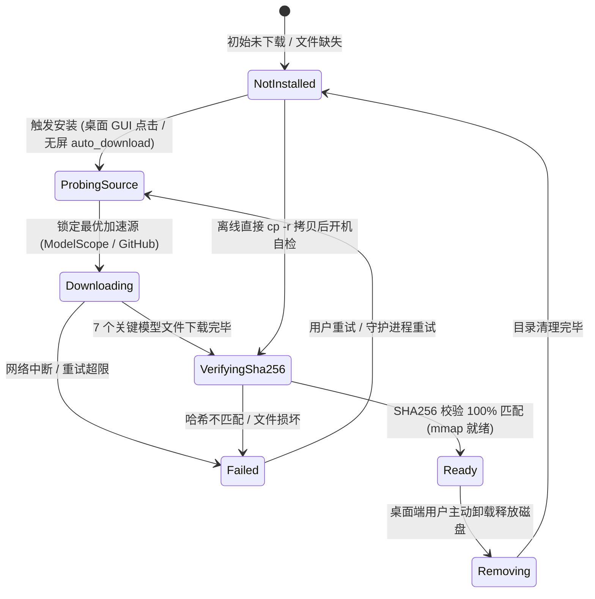

# AI Mate 本地模型资产管理规范 (Model Asset Management & Distribution)

> **状态**：📦 子规范 · 实施契约级
> **上游基线**：本文档是架构基线 [interaction.zh.md](interaction.zh.md) §3.4 的完整展开；与其余子系统共享同一状态机定义与 Phase 验收门禁，冲突时以基线文档为准。
> **适用范围**：新建 crate `nomifun-voice-models`（`ModelManager` 状态机、双源下载器、SHA256 校验器、`/api/voice/models/*` REST + SSE 接口）、`apps/ai-mate` 宿主、桌面端设置页与无屏配对页的模型下载/校验/卸载全生命周期；界面视觉与动效细则见 [ui-motion.zh.md](ui-motion.zh.md)。

---

为了兼顾“整机出厂预置”、“轻量在线包按需自愈下载”以及“纯内网/离线环境手动直接拷贝统一资源”的多重诉求，确立全平台统一的模型存储拓扑与多源降级校验体系：

## 1. 全平台统一目录拓扑规范 (Unified Storage Layout)
无论是出厂镜像预刷、现场运维通过 U 盘直接拷贝（`cp -r` / 拖放），还是轻量在线包启动下载，所有本地模型资产**必须且只能存放于统一规范的根目录下**：
- **Linux 伴侣主机 / 系统级服务基准**：`/var/lib/ai-mate/models/`（可在 `/etc/ai-mate/config.toml` 中配置 `models_dir`）；
- **Windows 系统服务**：`%ProgramData%\Flowy\ai-mate\models\`（安装期提权创建并授权服务账户）；**Windows 桌面用户态**：`%LOCALAPPDATA%\Flowy\models\`（免提权）；
- **macOS LaunchDaemon（系统级）**：`/Library/Application Support/Flowy/ai-mate/models/`；**macOS 桌面用户态**：`~/Library/Application Support/Flowy/models/`；
- **桌面端选径规则**：场景 A（桌面 GUI 用户态按需下载）一律落用户态目录，严禁为写模型文件请求 UAC / sudo 提权；系统级目录仅供以服务身份运行的宿主使用；
- **开发与便携式覆盖**：通过环境变量 `AI_MATE_MODEL_DIR` 或项目根目录 `./assets/models/` 覆盖。

统一内部目录树结构：
```text
<models_dir>/
├── kws/
│   ├── encoder.int8.onnx
│   ├── decoder.int8.onnx
│   ├── joiner.int8.onnx
│   ├── tokens.txt
│   └── keywords.txt
├── vad/
│   └── silero_vad.onnx
├── asr/
│   ├── model.int8.onnx
│   └── tokens.txt
└── checksums.sha256
```
- **文件口径说明**：7 个为下载分发产物（计入 `checksums.sha256` 与下载进度分母）；`keywords.txt` 由 `text2token` 在本机编译生成（见 Phase 1），仅参与存在性检查，其一致性由编译工具链保证。
- **离线直接拷贝兼容性**：不采用任何专有压缩格式或私有二进制打包，运维人员只需将准备好的标准 `models` 文件夹直接拷贝至对应路径，即可实现零外网依赖的离线交付。

## 2. 双重强校验与离线自检门禁 (Two-Tier Integrity Verification)
设备开机初始化时，严格执行两级自检流程：
1. **第一级：结构与文件存在性检测 (Layout Check)**：
   - 检查全部 8 个关键文件是否存在且字节大小 $> 0$（7 个下载分发产物 + 1 个本机编译产物 `keywords.txt`）；
2. **第二级：SHA256 密码学哈希校验 (Cryptographic Checksum)**：
   - 读取目录下的 `checksums.sha256`，并与 Rust 二进制中静态内嵌的只读基准清单比对：**内嵌清单为发布锚定的唯一权威基准**（随二进制版本更新，模型升级必须随二进制发布），目录文件仅作传输完整性参考，两者不一致时以内嵌清单为准；
   - 逐个校验文件哈希。若全部匹配，标记模型池就绪（`Status: Ready`），进入只读 `mmap` 推理加载；
   - **离线无网保护**：自检通过后**绝对不发起任何网络探测或上报**，完全支持纯内网脱网运行；
   - 若任一文件哈希不匹配或损坏，标记为 `Status: Corrupted`，严禁盲目调用底层 ONNX Runtime（防止 C++ 层 Segmentation Fault 崩溃引发看门狗重启循环），触发自愈下载或错误报警。

## 3. 海内外双源智能探针与平滑降级链 (Dual-Source Smart Probing & Failover)
在轻量在线包模式或检测到本地文件损坏时，`apps/ai-mate` 启动轻量自愈下载模块：
- **多源加速资源池**：
  - **国内极速源 (Primary Domestic)**：ModelScope (魔搭社区) 官方资产镜像，千兆高速 CDN，免翻墙，带宽充裕；
  - **海外原生源 (Primary Global)**：GitHub Releases (`k2-fsa/sherpa-onnx`) 与 HuggingFace 官方仓库；
  - **官方冗余 CDN (Fallback Mirror)**：Flowy 官方对象存储加速源。
- **智能探针测速选源 (Probing Mechanism)**：
  - 下载前发起并发轻量 `HTTP HEAD` 探针（超时 1500ms）；
  - 优先探测 ModelScope 节点：若连通且首包响应 $< 800\text{ms}$，直接锁定国内极速源；
  - 若处于海外环境或探测超时，无缝切换至 GitHub Releases / HuggingFace 源；
  - 若下载过程中发生突发网络中断，自动回退到官方冗余 CDN，支持 `HTTP Range` 断点续传；
  - 下载完成后重新执行 SHA256 校验，校验通过后再交付声学引擎。

## 4. 双场景触发机制与模型生命周期状态机 (Dual-Scenario Triggers & Lifecycle Management)

为彻底解决“桌面 GUI 防安装包体积膨胀”与“无屏硬件主机通电即用”的场景矛盾，系统在新建 crate `nomifun-voice-models` 中构建全平台统一的 `ModelManager` 生命周期状态机，上层驱动双场景分发交互：



```rust
#[derive(Debug, Clone, Serialize, Deserialize, PartialEq)]
#[serde(tag = "status", content = "detail")]
pub enum ModelInstallState {
    /// 未安装：本地模型文件缺失或不完整
    NotInstalled,
    /// 探针选源中：正在并发探测 ModelScope / GitHub 等镜像源
    ProbingSource,
    /// 下载中：包含正在下载文件、字节数进度、百分比、实时下载速度
    Downloading {
        current_file: String,
        file_index: usize,
        total_files: usize,
        downloaded_bytes: u64,
        total_bytes: u64,
        progress_percent: f32,
        speed_bytes_per_sec: u64,
    },
    /// 密码学哈希自检中：7 个下载分发文件逐个 SHA256 校验
    VerifyingSha256 {
        current_file: String,
        verified_files: usize,
        total_files: usize,
    },
    /// 完全就绪：校验 100% 匹配，可供声学引擎 mmap 安全加载
    Ready {
        models_dir: PathBuf,
        total_size_bytes: u64,
    },
    /// 安装或校验失败：包含错误原因与可重试标志
    Failed {
        reason: String,
        recoverable: bool,
    },
    /// 正在卸载释放磁盘空间 (桌面端按需触发)
    Removing,
}
```

### 场景 A：桌面端 GUI 可视化管理面板 (Desktop Settings / Device Page)
- **设计背景与体验考量**：Flowy 桌面用户大多使用代码、浏览器与文档等核心自动化功能，语音交互属于增量高级特性。为避免让所有桌面用户强制背负 ~249MB 的模型网络流量与磁盘包袱，桌面端安装包保持轻量（~100MB）。
- **REST API 契约**：
  - `GET /api/voice/models/status`：获取当前状态（返回 `ModelInstallState`、各模型文件明细与磁盘总占用）；
  - `POST /api/voice/models/install`：触发按需下载任务（异步启动并幂等防重）；
  - `GET /api/voice/models/progress`：基于 Server-Sent Events (SSE) 的长连接进度流，向前端实时推送 `ModelInstallState::Downloading` / `VerifyingSha256` 细粒度 DTO（含当前文件名、已下载字节数、百分比 `progress_percent`、实时速度 `speed_bytes_per_sec`）；
  - `DELETE /api/voice/models`：卸载模型文件并释放磁盘空间（安全删除并重置为 `NotInstalled`）。
- **前端 Arco / React 19 交互闭环**（视觉与动效细则见 [ui-motion.zh.md](ui-motion.zh.md)）：
  - 落位于“设置 → 能力与扩展组 → 语音伴侣”详情页（`form` 型，内容上限 960px），遵循设置壳 `Page Header → Section → List → Row` 契约：未安装时以标准设置行呈现“AI Mate 语音交互套件（约 249MB）”，右侧 220~280px 控制槽放置主操作按钮【下载并启用】，严禁独立卡片容器；
  - 用户点击后，按钮原地进入加载态，行底部 2px 进度发丝线淡入并以 `transform: scaleX()` 推进，控制槽同步显示百分比、实时速度（如 `4.8 MB/s`，以 tabular-nums 防数字抖动）与阶段提示文案（如“正在下载 ASR 声学模型 3/7”、“正在校验完整性”）；
  - 安装就绪后，控制槽切换为“已就绪”（图标 + 文案 + 语义成功色三要素，不靠颜色单通道）、“语音伴侣启用开关”与【释放空间】文本按钮（行内两步确认，不用 Modal）；
  - 若突发断网中断，行内展示重试按钮与本地化错误说明，杜绝用户在黑盒中盲目等待。

### 场景 B：无屏伴侣主机开箱自动触发与 Web/听觉双重投影 (Headless Auto-Provisioning & Dual Projection)
- **设计背景与体验考量**：AI Mate 硬件盒子无显示屏、无鼠标键盘，无法由人类通过点击 UI 按钮来触发安装。系统必须具备“零触控开箱通电即用”的开箱全自动履约能力。
- **代码/配置声明式驱动**：
  - 在伴侣主机系统配置文件 `/etc/ai-mate/config.toml` 中支持声明式选项：
    ```toml
    [models]
    models_dir = "/var/lib/ai-mate/models"
    auto_download = true           # 首次开机检测无模型时自动触发后台下载
    probe_timeout_ms = 1500        # 多源探测超时时间
    prefer_mirror = "auto"         # "auto" | "modelscope" | "github"
    ```
  - 宿主服务 `apps/ai-mate` 开机自检：若本地模型缺失或损坏，且 `auto_download = true`，系统自动切入 `ProbingSource` 并进入下载流，无需任何人工干预。
- **双重感知投影通道 (Web 投影 + 听觉反馈)**：
  - **通道 1：Web 配对页面投影**：在首次开机 OOBE 局域网配对页面 (`http://ai-mate.local:8080`) 上挂载实时进度挂件。用户在手机浏览器输入 6 位配对码配网时，配对页面通过同一组 SSE 接口无缝投影显示模型下载与校验进度条；
  - **通道 2：事件驱动听觉反馈**：
    - 开机开始下载时：扬声器播放一次短促温和的引导音（`guide.wav`）；
    - 下载完成并通过 SHA256 校验时：扬声器播放 `done.wav`，紧接着**主动语音播报**：“*AI Mate 语音引擎准备就绪，请说 Hey Flowy 唤醒*”；
    - 下载失败或重试超限时：扬声器播放 `error.wav`，并播报：“*语音模型下载失败，请检查网络连接*”，设备进入待机重试状态。

### 场景 C：纯内网/离线交付与直接拷贝兼容性 (Air-gapped Direct Copy)
- 无论是桌面环境还是无屏硬件主机，在涉密局域网、机房离线环境或研发调优时，运维人员可直接将预置完整的 `models/` 目录通过 U 盘或 `scp` 直接复制到统一规范路径；
- 系统检测到文件存在后，触发 SHA256 校验，校验 100% 通过后瞬间转为 `Ready`，**全过程 0 字节发起外部网络请求**，实现完全脱网即用的企业级离线交付。

## 5. 验收映射 (Acceptance Mapping)

本规范的生效验收锚定在基线文档 §5 的以下条目（测试执行与门禁判定以基线为唯一入口）：

| 条目 | 验收要点 |
| :--- | :--- |
| **TC-AM-014** 桌面端可视化模型管理 | SSE 实时返回百分比、实时下载速度与阶段提示；下载完成后 SHA256 校验 100% 通过并自动切换 `Ready`；删除后安全清理并重置 `NotInstalled` |
| **TC-AM-015** 无屏主机配置自启与投影 | `auto_download = true` 开机自动后台下载；配对页实时投影进度；就绪播 `done.wav` + 语音播报，失败播 `error.wav` + 口头告警 |
| **TC-AM-016** 多源与离线脱网直接拷贝 | 手动拷贝后脱网开机校验 100% 通过且 0 字节网络请求；在线轻量包按测速自动选源，SHA256 强校验通过方可交付声学引擎 |
| **Gate 0** | 完成统一目录结构规范与权威 `checksums.sha256` 清单定义，`ModelInstallState` 单元测试通过 |
| **Gate 1** | 手动拷贝离线脱网开机校验 100% 通过且 0 报错；双源探测与断点续传跑通；SSE 进度事件正确计算并推送百分比与实时速度 |
| **Gate 4** | Linux / Windows / macOS 三端安装并开机自启验证通过（含模型目录落位与自检） |
