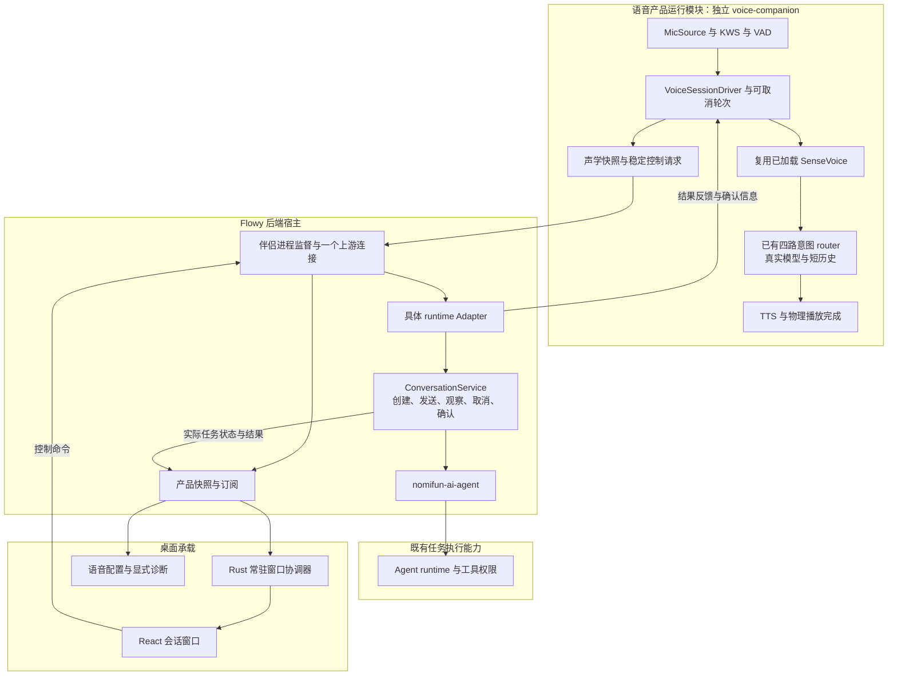
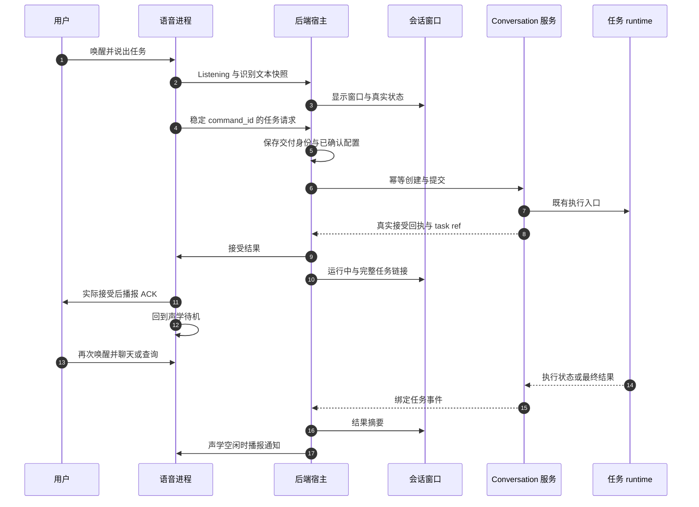

# 语音伴侣产品整合与 runtime 对接 · 技术方案

> **状态**：📋 设计提案，仅文档交付，尚未实现。  
> **核心原则**：语音伴侣集中维护用户交互；独立进程拥有声学和短对话；宿主连接现有任务服务；runtime 保留执行、权限和结果权威。  
> **产品规格**：[详细 PRD](PRD-voice-companion.zh.md)。  
> **探索快照**：2026-10-14，`feat/xiaozhi-voice`，HEAD `50f8ecb86070a9807ed57704ace070cc6748422e`。  
> **文档关系**：本方案整合上轮 [Handoff](execution/2026-10-14-desktop-voice-session-handoff.zh.md)，补充产品独立性、任务适配与恢复细节；旧文原样保留。新桌面功能实施按本方案和 PRD 对照，既有无屏行为仍由原架构基线约束；未实测指标保持未签核。

## 1. 背景与核心痛点

### 1.1 整合目标

已有分支解决了模型资产和独立进程的重要基础问题。缺少的是一个能够被唤醒、看见识别、得到真实回复、继续追问并控制实际任务的产品流程。整合时以用户会话为中心组织现有能力，不把语音设置页继续扩展成执行中枢。

| 当前结构 | 整合后的责任 |
|---|---|
| 设置页自身采集、识别、触发 wake、解析事件、写日志 | 设置页只配置与诊断，读取宿主的产品状态 |
| daemon 内联识别、路由、播报并暂停消费音频 | 持续 worker 管理命令/超时；独立可取消轮次管理识别/路由/播报 |
| 私有事件枚举且只有瞬时事件 | 共享 DTO、原始状态快照、宿主合成产品快照 |
| 语音本地 TaskManager 与工具策略模块有单测 | 实际任务状态来自既有 Conversation/runtime；真实派发验证工具策略 |
| 进程 running 即前端开关开启 | 用户意愿、进程状态、声学就绪、对话可用、任务可用分别投影 |

### 1.2 在 E1–E10 之外补查到的证据

| 编号 | 文件与位置 | 发现 | 设计影响 |
|---|---|---|---|
| N1 | `crates/backend/nomifun-conversation/src/service.rs:5545`、`:8717`、`:9169` | 已有幂等创建、幂等发送和只读回执观察；回执包含 replayed/completed/result | 适配这些入口，创建和发送分别保持稳定身份；不用新的任务队列或 receipt 表 |
| N2 | `service.rs:8502`、`:14004`；`nomifun-api-types/src/confirmation.rs:9` | 确认和取消检查 Conversation 所有者；确认 DTO 包含 always_allow | 语音宿主传真实 owner 与 call identity，强制本次确认，保留 runtime 权限规则 |
| N3 | `nomifun-voice-terminal/src/driver.rs:144` | 进入 AwaitingConfirmation 时已经开始 8 秒 deadline，PromptDone 后不重设 | 本地确认听取计时与物理提示播放完成对齐；runtime 授权有效期另外校验 |
| N4 | `ui/src/renderer/pages/nomi/workspace/tabs/OverviewTab/ModelsSection.tsx:26`；`components/model/taskModelSelectState.ts:55` | 已有模型引用/失效状态/选择控件；桌宠声学配置已存在另一条产品路径 | 复用控件与 provider 解析，不复制桌宠 Profile 或依赖 companion_id |
| N5 | `apps/desktop/src/memory_panel_window.rs:123` | 已有 `webui_init_script` 注入后台端口和信任信息、主线程创建窗口的模式 | 会话窗使用同样初始化和 platform adapter 约定，不绕过 auth |
| N6 | `voice_companion_manager.rs:76`；`apps/desktop/tauri.conf.json`；`apps/desktop/resources/bin/` | resolver 搜索同目录和开发目录；bundle 资源映射到 bin；当前资源目录没有 ai-mate 产物，脚本检索未找到其桌面打包接线 | 开发启动不能作为安装交付证明；发布切片单独验证二进制与 native 库定位 |
| N7 | `PRODUCT.md` 与 `ui-motion.zh.md` | 产品要求可见可控工作；已有 UI 子规范仅覆盖设置和无屏配对 | 新增会话窗契约，保留已有设置层级和设计令牌 |

这些是静态检查结果。N6 没有检查外部已发布安装包，不据此断言所有发布产物都缺文件；发布前必须实测。

## 2. 方案全景与架构设计

### 2.1 目标结构



图中的 Adapter 是连接已存在服务的具体适配模块，第一版没有通用 runtime 插件框架、runtime selector 或动态能力注册。独立部署没有该 Adapter 时，语音仍可在模型配置有效时聊天，任务请求返回明确 unavailable。

### 2.2 Module 与 Interface

| Module | 小型 Interface | 内部 Implementation | 放置位置 |
|---|---|---|---|
| 语音会话 | 接受 wake/stop 与任务结果；输出真实状态、文本、任务请求 | PCM 生命周期、计时、VAD、ASR、router、短历史、播放 | 现有 voice-terminal 库与 ai-mate 装配 |
| 产品投影 | snapshot、subscribe、执行明确控制命令 | 一个 daemon 连接、过期事件屏蔽、合并真实任务状态 | nomifun-app 伴侣管理及小型配套模块 |
| runtime Adapter | submit、observe、cancel、confirm 及事件映射 | 调用 ConversationService，owner/幂等/回执/任务身份处理 | nomifun-app 的具体 `voice_runtime_bridge.rs` |
| 窗口宿主 | 显示/隐藏、取当前快照、向后端提交控制 | 原生窗主线程操作、位置、权限与首次握手 | apps/desktop |

模块的 Interface 必须包含错误、取消、身份和回执语义，不能只有一个 `send(text)`。执行能力通过现有服务接入；测试使用同一 Interface 的替身验证调用，不测试私有状态枚举后就宣称接通。

`nomifun-audio` 不增加任务依赖；`nomifun-voice-terminal` 不依赖 Tauri/ConversationService/runtime registry；后端跨 Agent 引擎仍经过 `nomifun-ai-agent`。不增加新的 shared crate。

### 2.3 适用形态

| 形态 | 采集所有者 | 交互承载 | runtime 接入 | 本轮规划 |
|---|---|---|---|---|
| Flowy 桌面 | 被监督 voice-companion | 原生单例会话窗 | 宿主具体 Adapter | 首要完整实现 |
| 已有无屏主机 | voice-companion | 耳标/播报，配对页只做配对配置 | 仅在部署真实接入时可用 | 保持无头兼容，不能假接单 |
| Web 控制页面 | 对应主机上的 voice-companion | 配置和主机状态投影 | 主机已有连接 | 复用状态消费，不暗中采集客户端麦克风 |

浏览器远程麦克风和客户端音频播放需要独立传输设计，不在本期默认支持。上轮 Handoff 中“浏览器宿主根级会话面板”仅适用于主机状态投影，不能据此承诺远程客户端语音端到端。

## 3. 核心设计与模块规范

### 3.1 启用、模型与凭据装配

1. 用户启用意愿以现有 `config/voice_companion.json` 为起点，兼容保留 autostart 字段；新增字段采用明确默认值，配置写失败返回错误，不只在前端改开关。
2. 声学模型目录取已验证的 `ModelManager::models_dir()`，明确传入子进程；引擎 Ready 后加载并复用。安装/删除期间与声学消费者协调，释放模型前停止持有权重的消费者。
3. 桌面对话模型保存现有 provider/model 引用，凭据由现有宿主解析。使用已有 router 接口装配真实 endpoint、model 与认证；不在 renderer 中维护 API key，不复制桌宠 Profile。
4. 首期沿用已有受监督子进程启动及环境配置机制传递有效配置，不把 token 放进命令行、日志或 SSE。配置/身份变化结束旧轮次并刷新子进程装配；退出旧用户停止旧身份请求，不能仅清空窗口。
5. 无屏部署继续读取现有 TOML cloud 与环境覆盖；桌面配置和环境覆盖都要显示有效模型来源。现有 base URL 路由沿用，不新增指定云域名的专用逻辑。
6. 生产默认关闭 voice-skeleton；测试显式 fixture 配置。缺少真实模型依赖输出相应不可用，不调用启发式固定成功回复。

原始 TOML/schema 和已有配置字段属于外部可用格式，不在本期直接删掉。无调用方的页面重复采集、解析和模拟接单路径可在替代路径完成后删除。

### 3.2 唤醒与可取消处理

收拢 `handle_wake`、`handle_wake_keyword` 和 worker KWS 命中到同一命令处理路径。所有进入 Listening 的迁移在一个地方初始化时钟、缓冲、VAD 和 session_id；实际接受后再发事件和 HTTP 回执。

持续 worker 同时处理音频、wake/stop、设备错误、轮次完成和计时器。阻塞 native 识别在既有 blocking 执行方式中进行，HTTP/TTS 保持异步；取消不强行中止 unsafe native 调用，取消标记与 turn_id 让完成结果失效。

有限短预滚覆盖 KWS 与指令交界。级联 ASR 已识别出同句指令时复用结果，不把它仅作为 keyword 丢弃，也不重复请求 ASR/LLM。Earcon/TTS 使用半双工策略；消耗播放期音频，不把积压 PCM 当新一轮。单句最大时长先按 PRD 建议 30 秒验证，6 秒静默超时独立于有没有收到新 PCM。

复用已加载 ASR，输出阶段化错误；调用现有预筛，缺失 confidence 不编造。有效短历史调用 append_turn，快轨对话不构建 Agent runtime。任务进行中向 route_with_status 注入真实摘要，不能默认写“空闲，无正在运行任务”。

### 3.3 服务、会话和任务的状态

| 状态域 | 所有者 | 关键字段/状态 | 禁止推断 |
|---|---|---|---|
| 模型安装 | ModelManager | 既有七态 | Ready 不等于引擎已加载 |
| 服务就绪 | supervisor 与各依赖实际检查 | enabled、process、acoustic、dialogue、playback、tasks | running 不等于全功能可用 |
| 声学会话 | daemon worker | idle/listening/transcribing/deciding/speaking/follow_up/awaiting_confirmation/listening_confirm/dispatching/error | UI 不自行迁移到成功 |
| runtime 任务 | Conversation/runtime | submitting/running/awaiting_confirmation/cancelling/completed/failed/cancelled/unknown | cancel 请求成功不等于 cancelled |
| 窗口展示 | 桌面壳 | hidden/loading/visible，用户停留状态 | hidden 不等于任务结束 |

声学和任务 FSM 分开。一个活动任务不占用 Listening/Deciding；任务完成通知可以等待当前语音轮次结束。任务未知状态要求核对，不降级为“无任务”。

### 3.4 共享契约与单一产品快照

所有跨进程/HTTP DTO 放在 `nomifun-api-types/src/voice.rs`。以下是新契约草案，不是现有代码。

```typescript
interface VoiceTaskRef {
  conversation_id: ConversationId;
  message_id: MessageId;
  runtime_turn_id: string | null; // 后台权威回执返回，不能用声学 turn_id 代替
}

interface VoiceProductSnapshot {
  instance_id: string;       // 宿主投影实例，宿主重启后更换
  seq: number;               // 宿主投影单调序号
  enabled: boolean;
  availability: {
    acoustic: 'starting' | 'ready' | 'unavailable';
    dialogue: 'ready' | 'unavailable';
    playback: 'ready' | 'unavailable';
    tasks: 'ready' | 'unavailable';
  };
  session: {
    session_id: string;
    turn_id: string | null;   // 声学轮次身份
    phase: VoiceSessionPhase;
    user_text: string | null;
    assistant_text: string | null;
    recent_turns: Array<{ user_text: string; assistant_text: string }>;
    follow_up_deadline_ms: number | null;
  } | null;
  task: {
    command_id: string;
    ref: VoiceTaskRef | null;
    state: VoiceTaskState;
    summary: string | null;
  } | null;
  error: { stage: string; code: string; retryable: boolean } | null;
}
```

宿主是公开产品快照的单一写入者，合并 daemon 的声学快照和真实任务状态。内部另核对 daemon 实例和序号，屏蔽已停止子进程的消息。前端只消费宿主 instance_id/seq；宿主重启重新握手，不能因旧 seq 较大就拒绝新实例快照。

daemon 上游连接在订阅后取得原始快照，后续事件按序合并；对外 SSE 首帧是完整产品快照，事件落后时重新取快照。状态更新、序号递增和事件发布通过同一锁/写入路径保证顺序。连接关闭/Lagged 不转成 Idle。

窗口创建后先注册监听并拉取最新快照，按 seq 丢弃旧事件；`apps/desktop` 缓存当前快照供初次 renderer 握手。设置页与窗口共享这一来源，不各自重建状态机。现有 status 可增加就绪字段，existing events 可增加快照帧；具体兼容更新需同步项目内所有调用方和 golden 测试。

最小控制动作：试用 wake、停止指定 session/turn、取消明确 task ref、确认明确 call ref。控制携带 expected instance/session/turn，身份改变时返回冲突；按钮不可用由真实状态决定，不能仅让前端“先变成功”。

### 3.5 runtime Adapter 与任务因果链

Adapter 只在后端宿主实现，复用现有服务：

| 语音操作 | 现有能力 | 适配要求 |
|---|---|---|
| 建立任务会话 | `ConversationService::create_idempotent` | 每个语音任务建立专属 Conversation；稳定 creation_key，owner 从宿主身份取得 |
| 提交目标 | `send_message_with_idempotency_key`/按初始消息契约选择 initial 入口 | 稳定 idempotency_key，不能每次重试生成新 key；先持久化交付身份再发送 |
| 核对交付 | `public_turn_delivery_state` 与既有会话运行状态 | Accepted、Completed、Missing 分别处理；观察不重新创建 runtime |
| 接收结果 | 既有用户作用域会话 stream/状态 | 按 owner/conversation/message/runtime_turn 限定，不消费其他聊天页的广播 |
| 取消 | `ConversationService::cancel` | 专属 Conversation 与当前任务绑定，保留正在取消状态直到真实终态 |
| 确认 | `list_confirmations`、`confirm` | 当前 pending call，匹配 msg_id/call_id，always_allow=false |

创建与提交请求使用现有类型和配置解析，不透传 daemon 提供的权限/执行设置。`task_goal` 只能作为用户输入，不能让 LLM 输出 owner_id、权限或任意 runtime 句柄。工作区/模型/预设由已确认配置解析，没有有效配置先返回错误或追问。

语音路由保留四分类：ignore、chat、task_control、agent_task。Chat 快轨直接使用路由产生的真实短回复；AgentTask 只向 runtime 交付目标，不再额外生成另一份闲聊回复。

daemon 对任务请求分配稳定 command_id，在 pending 状态快照中保留到宿主回执。宿主收到后保存单个待交付/活动任务的记录，再按稳定 creation_key/idempotency_key 调用真实服务；重连重复收到相同 command_id 只核对/恢复同一交付，不执行第二次。

交付记录复用项目已有配置/原子文件写入惯例，放在用户隔离的本地状态文件，不新增数据库表。记录包含 owner、command、创建/发送身份、目标和已知 task ref，不含 API key/token。写入失败不能继续提交。已完成的完整历史归 Conversation，语音记录只保留恢复所需的当前映射，不形成第二套任务库。

后台回执区分：

- fresh accepted：绑定真实 task ref，再播报模型生成的短 ACK。
- replayed in flight：恢复已接受任务状态，不再播报“新任务已开始”。
- replayed completed：展示已保存结果，不重新执行或重播新接单。
- rejected/failed：明确错误，不发 TaskAccepted，不展示 running。

宿主重启后已有 task ref 优先只读观察。发送结果未知时读取回执；无法确认则显示 unknown。创建结果未知且缺少 conversation_id 时不得自动生成新身份：保留原 command，提示用户确认重试，使用同一 creation_key 核对/恢复。只有用户明确重试才继续原交付，不能以 daemon 重启作为新任务授权。

### 3.6 工具确认与计时

语音功能只确认自身绑定任务的一个真实挂起调用。runtime 的 pending confirmation 和工具硬拦截是执行权威；本地声学计时不创建或延长权限。

确认提示先播放，收到物理 PromptDone 后才启动本地最多 8 秒听取窗。如果 runtime 授权已过期，则不能因“本地还有 8 秒”放行；提示失效并重新走既有合法确认流程。产品可用等待时间取本地剩余时限与 runtime 剩余有效期的交集。

识别到确认/拒绝后，宿主核对 owner、task ref、msg_id、call_id、有效期和单次消费，再调用既有 confirm。拒绝、超时、关窗结束会话和功能关闭都不能自动允许。执行期拦截恢复原挂起调用，不重新提交一个任务。

`nomifun-voice-terminal::ConfirmationManager` 和 `nomifun-ai-agent::ToolPolicyEngine` 已有局部逻辑；现有 Conversation 确认也存在。必须先核对真实工具派发路径，采用一个执行侧权威，避免同时维护两套互不关联的“确认成功”。没有实际调用方的重复内部路径在证明替代覆盖后删除，公共格式保持兼容。

### 3.7 播放、窗口和通知

ChannelAudioSink 的 flush 必须传递到物理 sink，并使排队与后续旧 generation 帧失效。播放完成不等于 HTTP 合成结束或写入 channel 结束；实际 sink 消耗完成后才发 PlaybackDone/PromptDone。

TTS 或扬声器失败时保留真实文字，并在状态中标明 playback unavailable；没有物理播报时，从文字回复交付完成进入明确的文字追问模式，不假造物理 PlaybackDone。重试播报不能重新请求 LLM 或提交任务。

`voice-session` 窗口使用后台端口和现有信任初始化脚本，经 platform adapter 消费快照。窗口显示不依赖主窗口 React effect。自动 show 不 focus；实际用户点击后按正常窗口行为操作。定位遵守当前显示器工作区和缩放，用户正在复制文本时不自动收起。

关闭会话窗映射 stop_current_session；关闭功能映射结束采集与语音进程。两者都不调用 task cancel。取消后台任务独立按钮/意图请求。任务完成通知由 task ref 去重，在声学空闲时呈现一次；语音功能关闭时保留完整任务页可查看，不再自动打开语音窗播报。

### 3.8 时序



## 4. 关键决策与权衡矩阵

| 决策 | 选定方案 | 未采用方案及理由 |
|---|---|---|
| 产品独立性 | 独立启用、会话、故障和验收，随 Flowy 首发 | 本轮拆成新发行应用：需要新增安装、身份、发布与运营范围 |
| 进程和核心 | 保留独立 voice-companion；库保持无头 | GUI 回迁 daemon：破坏现有解耦和无屏部署 |
| runtime 连接 | 后端具体 Adapter，复用 ConversationService | 通用 runtime 插件框架或第二套 TaskManager：当前无必要，会复制任务事实与权限 |
| 对话路径 | 真实四分类一次路由，Chat 快轨不初始化任务 runtime | 所有语音都建 Agent task：普通聊天被执行基础设施故障阻断 |
| 任务作用域 | 首版一个活动语音任务，每任务专属 Conversation | 借用任意当前聊天：取消或确认可能控制不相关任务 |
| 状态投影 | 宿主单一产品快照，分别核对声学和任务来源 | 页面各自解析瞬时事件：丢唤醒、状态分叉，无法恢复 |
| 同句输入 | 有界预滚与级联识别结果复用 | 只转发 keyword：丢掉用户命令；要求重说会掩盖缺口 |
| ASR/TTS | 复用现有模型和 provider，正确完成/取消语义 | 引入新流式 ASR 或本地 TTS：不能帮助先解决承载缺口 |
| 权限 | runtime 保留硬拦截和确认权威，语音只是一次性输入 | 以 requires_confirmation 或本地 token 单独决定放行：缺少真实工具调用校验 |
| 记录 | 聊天短历史内存；任务沿用 Conversation；单条交付恢复记录 | 新增永久 ASR 审计数据库：扩大持久化范围，且当前隐私表述需重新裁决 |
| 浏览器形态 | 先复用设备状态与配置 | 默认借客户端麦克风：改变采集与网络边界，属于新增产品需求 |

隐私口径补充：已有基线“raw_asr_transcript 永不离机”和“有效指令上云”必须向用户解释清楚。本期原音频本地处理，实际有效指令会发到已选模型，回复文本会发给现有 TTS；去唤醒词不等于匿名化。实施时补充基线说明并保留历史原文，不能复用旧文字作不准确宣传。

## 5. 实施计划、验收与验证

### 5.1 工作包与交付顺序

| 工作包 | 主要修改位置 | 具体交付 | 验收/依赖 |
|---|---|---|---|
| W1 真实装配 | voice-companion/config/main/voice；voice companion manager；voice-terminal/Cargo | 目录/配置生效、Ready 后加载、默认无 skeleton、真实就绪 | R0；自定义目录、缺 endpoint、native 引擎失败测试 |
| W2 可取消会话 | voice-terminal driver；audio stt/playback/speaker；voice-companion worker | 统一 wake、预滚、ASR 复用、短历史、6 秒静默、发言上限、真实完成/flush | R0；回放覆盖真实 worker，控制和音频消费不阻塞 |
| W3 产品快照 | api-types/voice；voice-companion server；nomifun-app 伴侣管理 | snapshot、seq、连接状态、pending command、过期事件屏蔽 | R0；晚订阅、Lagged、重连、实例变更测试 |
| W4 窗口和设置整合 | apps/desktop 新 voice_session_window；ui platform/adapter；会话路由；VoiceSettings/i18n | 常驻显示、握手、状态与控制、删除页面常驻录音、三类就绪配置 | R1；AC-01–10/18/19，主窗口隐藏真机验证 |
| W5 真任务连接 | nomifun-app 小型 voice_runtime_bridge；必要的 Conversation/ai-agent 调用处 | 幂等创建/发送/观察、映射恢复、真实 ACK、查询/取消/摘要 | R2；AC-11–13/16/17，runtime 不可用时 Chat 继续 |
| W6 实际确认 | runtime 实际工具派发接线；Conversation confirm；声学确认消费 | 一个权限权威、真实 call 绑定、交集时限、单次确认、拒绝/超时 | R2；AC-14/15，真实高危工具测试，未通过拒绝高危请求 |
| W7 安装交付 | 桌面 build/bundle 配置、既有资源准备与解析路径 | 正确编译分发 voice-companion/native 库、无额外控制台、完整退出 | R1 发布前 AC-20；不改签名/updater，必要发布文件修改按项目规则处理 |

W1–W4 形成首个可用端到端切片；W5–W6 完成任务闭环；W7 是发布前必要门禁。本表是实施分工，不授权自动派发多 Agent，也不包含日历承诺。后续用户启动实施时仅按必要目录修改。

### 5.2 验证梯子

1. **契约和状态**：DTO golden、真实回执映射、非法迁移/取消/超时、snapshot 序号、身份与任务作用域测试。
2. **真实调用链的替身验证**：利用 `MicSource::from_replay_chunks` / `VoiceCapturePipeline::from_replay` 接入 worker；测试替身 ASR/router/sink 和真实 Adapter 函数调用，不只验证 enums。需要证明同句输入一次消费、过期结果不污染、重放不执行。
3. **受影响 Rust crate**：`cargo check -p <crate>`、`cargo test -p <crate>`；`cargo tree -p voice-companion -e features` 确认生产无 skeleton；`cargo fmt --check`。确认/取消用例需经过实际服务权限路径。
4. **前端行为与门禁**：快照 reducer、首次挂载握手、控制回执与双语断言；`bun run gen:i18n`、`bun run typecheck`、`bun run check`、`bun run build:ui`；提交前 `cargo check --workspace` 和受影响桌面构建。
5. **真机功能与性能**：PRD AC-01–AC-20，录音、真实模型请求、扬声器完成、原生窗口和实际任务分别留证；记录窗口冷/热延迟和既有基线首音延迟分布，不用空样本百分位签核。
6. **安装包和平台**：干净 Windows 机器安装验收；Mac/Linux 各自实测后才列入支持清单。现有 72 小时规程仍是待执行门禁，不写成已完成报告。

### 5.3 本轮文档验收

- PRD 的用户、场景、功能、控制语义、数据使用、分期和 AC 相互对应。
- W1–W7 与产品需求对应，任何“已接受/已完成/已取消”都有明确权威来源。
- 原始 E1–E10 和本轮 N1–N7 可定位到现有源码；无额外依赖、数据库迁移或新 runtime 的默认要求。
- Markdown 相对链接、Mermaid 图和历史保护检查；只新增文档和导航，不删除旧正文。

本轮未运行新功能代码、Rust 测试、全量类型检查或构建，因为没有业务改动。上轮 25 项设置结构/双语断言通过但有文件读取告警，不能代表新 PRD 验收。尚无真机语音闭环或安装包证明。

本轮文档检查结果：4 份相关文档中的 27 个相对文件链接存在；PRD 功能表 26 行、验收表 20 行，编号连续且无重复；3 张 flowchart 使用仓库 Mermaid 的原生语法解析器校验，2 张 sequenceDiagram 经 Mermaid parse 校验。图表检查仅覆盖语法，不包含 DOM 净化、排版或浏览器渲染；完整 Mermaid 流程图 parse 在无 DOM 的命令行环境出现 DOMPurify 初始化错误，因此另行隔离语法层验证，未修改库或产品安全配置。`git diff --check` 通过；既有 README 仅增加导航，历史方案仅追加后续记录。

---

## 附录：原始技术底稿与历史归档

最新物理解耦与真实联合链路验收技术规范见 [2026-10-30-voice-runtime-decoupling-and-joint-trace.zh.md](execution/2026-10-30-voice-runtime-decoupling-and-joint-trace.zh.md)，记录了子模块拆分架构、守护进程域与宿主进程域的锁模型与端到端单命令联测规范。

本文件首次新增。上轮方案全文保留在 [2026-10-14-desktop-voice-session-handoff.zh.md](execution/2026-10-14-desktop-voice-session-handoff.zh.md)，既有基线与完整底稿保留在 [interaction.zh.md](interaction.zh.md) 和 [interaction.archive.zh.md](interaction.archive.zh.md)。没有替换、概括后删除或重构旧正文。

与旧提案相比，本次明确：产品独立与发行形态的区别、宿主投影的序号权威、普通对话与任务连接的可用性分离、幂等创建/发送两个身份、任务映射持久恢复、执行侧确认权威、物理播放完成和安装包门禁。上述增补均来自本次用户要求或源码证据，尚待业务实施。
