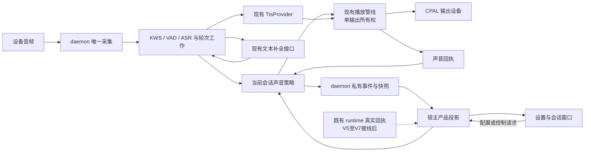
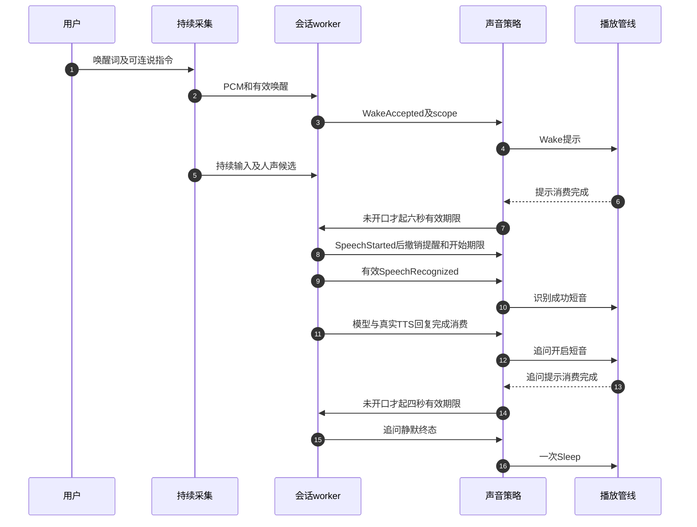

# 语音伴侣离屏声音反馈 · 技术方案

> **状态**：📋 规划，2026-10-14；未实施新反馈。  
> **核心原则**：daemon 是唯一发声者，宿主是公开产品快照唯一写入者；提示音不阻塞采集，不制造执行事实。  
> **上游**：[v0.2 PRD](PRD-voice-companion-v0.2.zh.md)。  
> **实施入口**：[R 串行计划](execution/R-auditory-feedback-plan.zh.md)。

## 1. 背景、现状与阻断点

原声音系统具备六件静态WAV和物理输出端，但缺少覆盖所有出口的策略、完成回执和等待调度。不能在前端监听 phase 后直接播放声音：窗口重连会重播，托盘与无屏部署会漏播，而且多个消费者可能同时发声。

| 代码位置 | 当前事实 | 需要的最小改变 |
| --- | --- | --- |
| `nomifun-audio/src/earcon.rs:11–74` | 六件资产、枚举及对应WAV | 保留资产与音频底层；声音语义不变成音频crate业务状态机 |
| `apps/ai-mate/src/voice.rs:250–273` | accept_wake 发事件后调用Wake | 统一反馈请求，声音完成锚点/连说处理 |
| `voice.rs:288–386`、`voice_events.rs:100–106` | SpeechRecognized直接转Deciding | 仅有效内容安排识别成功音；不得把纯唤醒词当成功 |
| `voice.rs:404、473、480` | Ignore/失败分支零散播放Sleep/Error | 按明确退出原因归一，错误与结束反馈去重 |
| `voice.rs:684–724、974–979` | watchdog及追问超时发Idle，未统一播放Sleep | 每种正常超时闭环；无PCM故障与正常静默分开 |
| `voice.rs:164–180` | stop_session reset/interrupt后Idle | 取消旧提示timer、清理输出后明确终止原因 |
| `nomifun-voice-terminal/src/playback.rs:230–241` | play_earcon只write_frame，没有drain/不可用前置检查 | 提示音完成、失败及取消可观测，输出所有权保护 |
| `nomifun-audio/src/speaker.rs:178–224` | PCM入队、flush清队列、buffered_samples | 继续用现有输出，不新增系统语音；明确回调消费与实际声压的区别 |
| `nomifun-api-types/src/voice.rs`、`voice_events.rs` | 状态/错误/作用域/原文和回复已有 | 追加兼容的声音诊断与设置字段，宿主按既有seq投影 |
| `nomifun-app/src/voice_companion_manager.rs:633–674` | config/status/events/wake/session/stop路由已存在 | 复用设置持久化与受控daemon通道；不新增音频服务或权限体系 |

以上为本轮工作区行号，不是不可变Git提交证据；当前HEAD继续为 `50f8ecb86070a9807ed57704ace070cc6748422e`，分支领先40提交，已有未提交实现全部保留。

关键风险：等待声音与真实TTS混播；提示音引起VAD假人声；停止后旧timer发声；计时被提示音占用；没有runtime回执却播接单。策略必须跨生产worker验证，枚举或源码字符串测试不足以签核。

## 2. 架构全景与边界



在 `apps/ai-mate` 内用一个会话级 `voice_feedback` 模块集中“事件→音类型/次数/取消”的业务规则；复用 `PlaybackPipeline` 和 `AudioSink`。使用已有Tokio timer，不建通用事件总线、全局调度器、插件系统或第二任务队列。宿主/UI只发用户配置与控制请求、读快照，不产生产品提示音。

保持现有 `VoiceCompletionClient` 与 `TtsProvider`；固定错误短语也调用后者，不问LLM。无需新增模型、key、SDK或第三方依赖；没有本地TTS时，不声称离线能朗读详细原因。

宿主控制daemon继续走已有受保护的回环通道；不把该本机临时控制凭据与Flowy用户token混为一谈，不要求用户维护第二份凭据。

非目标仍包括全双工AEC、流式ASR、无限口头打断、远程音频及新runtime。声音反馈本身不能解决处于Speaking/Deciding时没有命令听取入口的问题。

## 3. 核心模块与契约

### 3.1 策略输入与退出原因

策略从生产worker的真实事件/显式结果消费，不从UI呈现phase推断。每次轮次/会话保留有界状态：当前scope、已发事件身份、最多一个等待timer、已用等待次数、当前输出所有者。闲置会话不保留timer，提示请求不跨重启持久化。

输入至少覆盖 WakeAccepted、SpeechStarted、人声候选、SpeechRecognized、处理阶段开始/结束、ReplyConsumed、ListenEnded、TurnFailed、ScopeStopped、OutputUnavailable；未来runtime通过已核对回执接 TaskAccepted/Terminal/Confirmation。每条结束路径给出原因：`initial_silence`、`follow_up_silence`、`no_intent`、`user_stop`、`window_close`、`feature_disabled`、`shutdown`、`capture_failed`、`asr_empty`、`model_failed`、`tts_failed`、`speaker_failed`、`runtime_unavailable`。不改变公开Idle语义，不把这些原因全部映射成“正常休眠”。

处理等待时间从句末进入Transcribing起连续计时：3/9/15秒，最多三次。模型或TTS阶段切换不重置；回复开始、失败、停止、实例/用户变化撤销。提示音不能延长ASR、HTTP或30秒合成预算。

### 3.2 输出仲裁与取消

- 现有播放管线集中控制输出，增加局部提示请求/完成结果，不允许各调用点绕过直接write。只在实际写入/消费期间占用输出；不在等待TTS网络期间锁死提示通道。
- 优先级：显式停止/关功能 > 当前危险动作说明与确认提示 > 当前回复/必要故障说明 > 单次状态短音 > 倾听提醒/处理轻音。任务结果在声学空闲后提示，不抢用户发言。
- 低优先级提醒是可丢弃请求，不堆积排队；每次最多一个待播提醒。当前scope已变化或阶段已结束，直接skip，不能几秒后补响。
- 每个输出请求携带scope和request_id。取消提醒只能清理该请求；不可拿旧提醒flush当前新回复。完整停止仍使用现有generation fence和flush，并阻止迟到音频。
- `play_earcon`补输出可用性、有效PCM、开始/消费完成/失败回执；不再吞错。不得为了声音drain持有driver锁、阻塞采集worker。
- 提示试听是独立显式preview scope；活动语音/确认时禁用试听。关闭试听或换设置不取消已接受任务。试听不调用wake或麦克风入口。

消费完成指输出端按现有CPAL回调消耗样本并完成约定的设备缓冲边界，不是TTS网络结束或write返回。软件回执无法证明空气中实际声压，验收另做真实听测；必要的硬件缓冲尾部校准记录到证据，不能靠任意固定sleep签核。

### 3.3 倾听、追问与提示音污染



必须维护同一driver计时权威；快照deadline从该权威投影，不各自用墙钟起另一份倒计时。六秒/四秒计的是有效可听取时间；轻提醒播放占用的短区间不侵占开口时限，休眠尾音不再延长收音。若用户在起始/追问提示期间已经开口，则直接撤销开始期限，保留原PCM并允许整句，不等待下一轮。

在已有半双工约束下：

1. 采集持续消费，提示音不能暂停采集、清空全部预滚或删掉整段重叠语音。
2. 倾听提醒仅在未有speech_started且最近500ms无候选人声时触发；弱音量证据也优先抑制提醒，不只依赖最终VAD判定。讲话到来撤销尚未开始的提醒；已开始的可中断低优先级音不影响后续TTS所有权。
3. 已知短音输出区间标记到诊断中，禁止该短音导致重复Wake或“无人声”期限提前结束；标记不是声学AEC，也不能作为丢弃用户重叠PCM的理由。
4. 真实VAD/KWS/ASR需要验证六件素材与固定短语的回收音，以及它们与人声混合的输入。若出现误唤醒或丢字，先修正短音响度/长度/触发规则；仍不满足则阻断增强发布，不靠扩大唤醒词白名单或降低文字断言掩盖问题。
5. 无PCM时仍有墙钟安全退出，等待声音回执也必须有界；输出失败不能让会话永久停在“准备倾听”。设备失效撤销playback_ready，适当退出或文字降级，而非无限补音。
6. TTS失败但输出可用的TextFollowUp，在本地错误/追问提示完成后计四秒；输出不可用或提示静音时按明确文字追问入口计时，不依赖缺失的回执。此路径不伪造TtsSpeaking。

### 3.4 配置与诊断DTO（提案，尚未写代码）

复用 `/api/voice/companion/config`，保留现有dialogue模型引用字段；增加可选feedback段。老请求省略feedback时保持已有反馈配置，老持久化文件缺段时按产品默认初始化。保存使用原持久化锁/原子合并，不能把模型、启用意愿或未知已有字段覆盖掉。类型放在 `nomifun-api-types`，不新建数据库。

```typescript
type FeedbackMode = 'light' | 'essential' | 'off';
interface VoiceFeedbackSettings {
  mode: FeedbackMode;             // 初始 light
  cue_volume_percent: number;     // 整数0..100，初始70
  speak_replies: boolean;         // 初始true，关闭不关闭文字聊天
}
interface VoiceFeedbackDiagnostic {
  request_id: string;
  instance_id: string;
  session_id: string | null;
  turn_id: string | null;
  kind: string;                   // 产品语义，非文件路径
  status: 'pending' | 'started' | 'completed' | 'cancelled' | 'skipped' | 'failed';
  reason_code?: string;
  at_ms: number;
}
```

Volume百分比乘以类别数字增益，无自动突增；配置参数校验拒绝无效模式、范围外数值，不静默改成默认。回复静音需要正常文字完成/追问语义，不能伪造TtsSpeaking或错误。

快照追加可选feedback诊断，旧客户端仍可读取旧字段。daemon记录私有状态，宿主生成公开instance_id/seq；不得把daemon seq误当宿主seq或把客户端参数当权威。诊断记录只保留最新项/有界内存流水，不保存正文、PCM、provider key、私有控制凭据或敏感任务参数。

声音去重身份是daemon实例、会话/轮次、事件种类及语义事件ID的组合；在turn_id还未产生的Wake阶段使用session_id。在后台通知中使用当前用户、task_ref、runtime_turn_id及真实终态事件ID，不能用ASR turn_id替代。重连仅恢复投影，不重播声音；重启的旧请求直接失效。

### 3.5 runtime衔接保持原权威

本阶段 `runtime_unavailable` 只给Error及固定拒绝短语，不消费模型 `spoken_ack`。未来V5保存交付后幂等创建Conversation/发送，Accepted经真实回执校验再触发ACK；V6终态通知去重并等待声学空闲；V7用现有ToolApprovalManager挂起与确认，不建第二确认token库。

固定拒绝说明合成失败时只保留本地短音和文字。危险确认动作说明失败/静音时，不开启口头批准窗，现有桌面确认仍可使用；最后期限取runtime剩余有效期与最多8秒的较小值。等待音、重复通知或设置改变不能续期。用户停止声音不等于取消任务。

## 4. 决策与取舍

| 编号 | 决策 | 选定方案 | 不采用及原因 |
| --- | --- | --- | --- |
| D-A1 | 常驻状态感 | 用户已选轻量反馈：单次倾听提醒、最多三次等待音 | 持续背景音/固定4秒滴答，干扰讲话且违背用户选择 |
| D-A2 | 发声所有权 | daemon真实事件驱动，UI只显示 | renderer phase监听播放，离页漏播/重连重播/多窗重复 |
| D-A3 | 声音来源 | 复用六件内嵌WAV与Edge TtsProvider | Windows系统声音不跨平台；新增本地TTS非当前必要条件 |
| D-A4 | 完成锚点 | 输出消费回执，采集不被声音等待阻塞 | write返回/网络合成结束算播放完成，会抢占追问时间 |
| D-A5 | 策略范围 | 一个会话级模块、已有timer和播放管线 | 全局调度/插件/第二状态机，超出当前需求 |
| D-A6 | 任务声音 | 既有runtime真实接受/终态/挂起事实 | LLM意图/布尔值/ACK正文，无执行或授权证明 |
| D-A7 | 离线原因说明 | 本地错误音；正文保留，TTS可用才读固定短语 | 递归调用故障TTS；默认新增录音/离线TTS资产没有验收或授权依据 |
| D-A8 | 历史兼容 | 公共字段追加并保留旧配置/历史正文 | 重命名旧API、删除原D9/底稿或迁移数据库 |

## 5. 验收与检查梯子

PRD AF-AC-01–16为声音验收权威；原AC-01–20和既有性能门禁继续保留。对应测试和证据位置在R计划中逐项维护，不把新增用例标成已通过。

顺序：生产worker失败回放 → 最小实现 → 确定性输出/取消/时间轴测试 → 真实KWS/VAD/ASR输入及提示音混合回放 → 双语/设置行为 → 完整桌面feature图/构建 → 实机麦克风与扬声器回收音 → Owner离屏剧本 → 其他平台和安装包。

软件测试记录实际输出请求、音频数量、完成/取消、原文、模型调用次数、身份及状态序列；实机另记录可听性、误触发、说话被打断、时间窗和设备距离。网络合成与固定对话探针按显式测试执行，不默认消耗真实模型额度或开启录音。

生产图必须包含宿主与daemon共同解析，沿Q的 `-p ai-mate -p Flowy` 检查TLS组合；生产不启用voice-skeleton。自动检查不能替代物理播放，健康探针不能替代用户旅程，正文显示不证明runtime接单。

---

## 附录：原始资料与规则继承

本文件新增，未重构旧技术方案，旧全文保存在 [整合方案](voice-companion-integration.zh.md) 与 [架构基线](interaction.zh.md)。新用户原文及选项答案完整保存在 [v0.2 PRD附录](PRD-voice-companion-v0.2.zh.md#附录本轮原始需求与历史来源)。原六音效和D9记录保留；新增轻量模式按当前用户指令限定覆盖D9的绝对禁止重复反馈部分，其他部署不因此自动获得新能力。

引用 [Q验证报告](execution/Q-full-flow-tts-closure.zh.md) 与 [P声学回放](execution/P-post-wake-asr-panel.zh.md) 时保留原“模型/输出为替身”和“Owner未签核”的历史上下文；当前基本链路的Owner反馈按最新实施记录追加，不能回写为过去已经实机通过。
