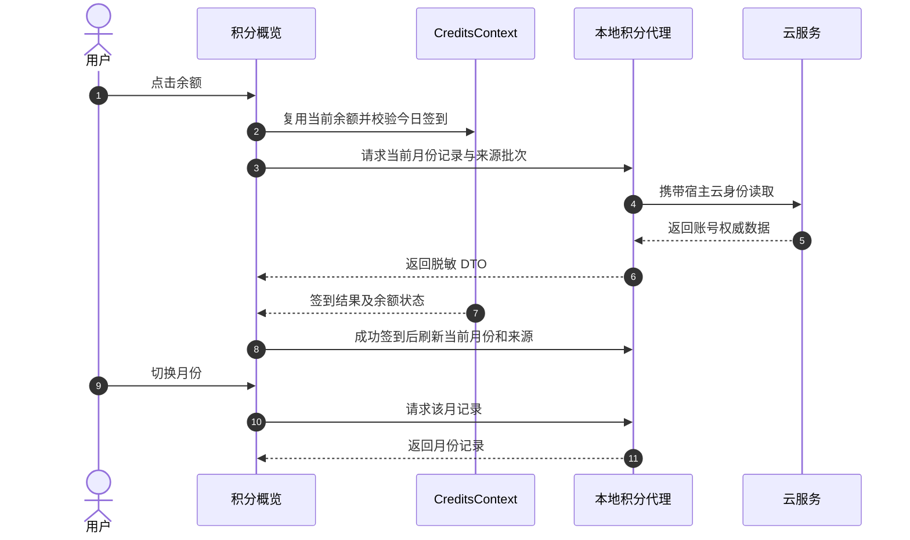

# 积分与购买 · HTML Demo 和最终方案

> **最新方案（2026-10-12）**：根据用户购买页截图与交付要求，以单文件 HTML Demo 为设计依据。下方初版双页签方案已归档，不作为实施依据。

## 正式页面实施记录（2026-10-12）

已在 `feat/credits-panel-redesign` 实施两组变更：积分页面与本地云数据代理、Auto 默认经济挡位。正式入口分别定位 `billing-checkin`、`billing-purchase`、`billing-packs`；保留原订单与支付流程，不增加数据库迁移、不修改云端发放政策。套餐权益使用目录双语说明，加量包展示单次发放和目录有效期；当前套餐仍不可重复购买。旧 Demo 的“续费”仅为历史设计演示，不代表本次新增购买能力。

签到日键、累计次数、实际到账及到期批次经配置的云客户端代理；未认证结果不写签到成功，账号切换与月份切换丢弃旧请求。动画仅消费新的服务端签到凭据；滚动可被用户输入打断，减少动态效果时直接定位。生产运行时未添加示例账户、余额或模拟批次。

验证：相关前端行为/渲染/结构测试与新增 Rust 测试通过（随审查补充修复持续增加，不在此固化计数），`cargo check --workspace` 和 `bun run build:ui` 通过。i18n、主题、动效及其余独立质量门禁通过。全量 `bun run check` 被基点已有的 TypeScript 基线错误阻挡（本次文件无命中）；独立 dead-css 检查也存在非本次文件中的基线问题，未扩大范围修改。详细日志位于忽略目录 `target/credits-*.log`。

仍需验收：真实登录账户的签到记录、批次和到账；浅深色、窄屏、两个入口与可打断滚动的实际浏览器交互。本地正式 Vite 页面打开后，在到达积分页前因现有“browser storage generation has not been initialized”错误进入错误边界，因此这些浏览器验收未完成。没有真实付费下单。此限制不能由 Demo 或静态渲染测试替代。

---
## 第二版 Demo：入口锚点与官网权益（当前实施依据）

本节取代下文有关 15 天有效期未核实的设计描述。用户确认 15 天尚未实装，以其提供的官网截图为当前方案依据：Free 每日签到 1,000 积分、当日清零；Pro 每日签到 3,000、每月加赠 10,000；Ultra 每日签到 5,000、每月加赠 50,000。Pro/Ultra 两类积分均为 1 年有效。

邮箱下方积分右侧改为日历按钮，定位同页 `#checkin`；账户气泡“充值”定位 `#purchase`，首先呈现会员套餐。页面“补充积分”定位 `#packs-section`。所有用户采用相同入口语义，不再根据 Free/订阅身份自动分流。Demo 顶栏提供两个入口快捷体验及 Free/Pro/Ultra 示例账户切换，桌面侧栏可点击演示邮箱打开账户气泡。

套餐卡片分别展示每日签到、每月加赠、各自有效期和客服权益，按钮明确开通、续费或变更套餐。加量包单独标注一次到账、每次价格，不开通或升级会员；每类购买均可查看演示订单摘要。未知年付价格不编造金额，年付选中时提示报价待加载，保留套餐权益说明。

滚动使用 280–450ms quint 缓出曲线，用户滚轮、触摸、指针或导航键操作可中断；支持减少动态效果设置、重复点击取消前一次滚动、动态顶栏间距与锚点焦点。账户和月历状态更新不触发重新滚动。签到成功、失败、空记录、日历失败仍可切换。

检查：内联 JavaScript 语法、45 个唯一 ID、脚本元素引用和所有入口锚点静态检查通过；Demo 已去除 15 天旧文案。浏览器视觉与实际交互尚未验收，本地 `file://` 自动打开仍受先前浏览器安全策略限制。样例数据仅在独立 HTML 中，生产代码未修改。

## 最终页面方案

**在点击个人积分图标进入的现有 `/billing` 购买页面内展示签到和积分说明。** 不新增页面或概览/购买页签。

- 顶部：可用积分、更新时间、今日签到到账金额与时间；未到账和失败提供重试入口。
- 中部：左侧签到月历，展示本月与累计签到天数，点击日期查看到账明细；右侧展示近期到期批次、积分来源和折叠的有效期说明。
- 下部：保留个人套餐、积分包、币种、月付/年付及原结账流程；顶部“购买积分”滚动到该区域。
- 延续截图的深色界面与紫色强调色，同时提供浅色主题和窄屏上下排列。

### 可复用 Demo

[打开单文件 HTML 源码](../demos/credits-panel.html)。保存后可直接用浏览器打开；Tailwind 通过浏览器 CDN 加载，需要联网。页面 CSS、样例数据和交互脚本均内联，无账户请求或真实支付。

可操作：主题切换、月历翻页、回到本月、日期明细、签到状态切换、签到/月历重试、刷新反馈、来源与规则展开、币种和套餐周期切换、购买演示反馈。样例数据仅存在于隔离的 `docs/demos/` 文件中。

### 数据和业务决策

复用现有自动签到与余额链路，补充相对路径 `credits/checkinRecords?month=YYYY-MM` 的服务端代理和类型；沿用现有 `.com` 服务根地址及本地环境变量替换。`credits/consumptionStats?dim=day` 已记录，消费统计不挤进本次签到首屏。

到账以服务端金额、时间与日键为凭据；累计次数直接读取服务端统计，历史签到记录与当前可用余额分开表达。展示积分批次实际到期时间，不通过签到天数推算余额。

“充值 365 天、付费签到 15 天”的统一口径尚未核实；当前 `.com` 公开套餐文案与 15 天存在差异。实施前核对真实到账批次与业务规则，届时补齐说明文案。未登录的签到记录请求返回 401，尚无真实账户验收证据。

Auto 模型另作最小行为修复：首次初始化以及从普通模型进入 Auto 时优先经济挡，保留用户当前明确选择的 Auto 挡位。经济挡缺失时明确提示，避免静默提升到高消费挡位。

### 交付与验证边界

工作分支为 `feat/credits-panel-redesign`；当前仅设计文档与独立 Demo，业务页面和账户状态尚未修改。Demo 的内联脚本语法、32 个唯一元素 ID、26 个脚本引用与页面锚点检查通过；2026 年 10 月为 31 天、1 日周四，月历基准正确。现有 30 项测试通过是既有代码证据，不是 Demo 的浏览器验收。

自动浏览器预览的 `file://` URL 被浏览器安全策略拒绝，因此实际视觉和浏览器交互验证尚未完成；用户可自行双击 HTML 打开。

## 历史参考：首次设计方案（已由上方方案取代）

# 积分面板重新设计 · 页面与技术方案

> **状态**：📋 设计方案，业务实现未开始。
> **日期与基线**：2026-10-12，`origin/main` / `ea5213bef41f13835e7e5cef057255163dc13ba4`。
> **工作分支**：`feat/credits-panel-redesign`。
> **核心原则**：首先证明签到是否到账，再解释余额与到期时间。所有账号事实来自云端，页面不推算到账，不承诺未经核对的有效期。

## 一、背景与核心痛点

用户从工作中的对话或创作页面进入积分面板，希望快速确定今天领到了多少、还能用多少、何时失效，然后返回原工作。用户可能在明亮办公室或夜间桌面环境使用，因此页面继承应用当前主题，浅色和深色保持完全相同的信息层级。

三个现有缺口：

1. 签到自动静默执行，响应的 `grantedPoints` / `checkInAt` 未在页面中形成到账凭据。
2. 余额旁目前主要提供购买入口，没有云端签到月历和累计签到天数。
3. 总余额不能解释来源与到期时间。套餐赠送、积分包和签到的期限应独立显示。

| 现状 | 设计目标 |
| --- | --- |
| 看见一个总余额 | 看见有效余额、更新时间和来源明细 |
| 自动签到没有明确反馈 | 今日到账状态、金额、时间直接可读 |
| 无账号积分签到月历 | 按月查看真实签到日期和每次发放积分 |
| 购买页面承担所有入口 | 同一页面分为积分概览与购买积分 |
| 有效期容易依靠宣传文案理解 | 展示实际到期批次，规则说明作为辅助 |

### 已核实与仍需核实

- Allo 的 `CreditsContext.tsx` 已负责自动签到和余额更新；`ipcBridge.media.checkin` 有到账金额、时间及服务端日期字段。
- 本地 FlowyClaw 云端源码存在按月签到记录、累计天数、消费统计和积分来源到期批次。该仓库版本较旧，仅作为接口线索，不等于当前线上部署证明。
- `.com` 公开套餐目录当前文案为 Free 签到当日清零、Pro/Ultra 签到一年有效，与用户提出的 15 天有差异。此差异需要核对真实到账批次和运营规则，设计不把任何数字写成普遍政策。
- 未携带登录凭据读取 `.com` 的签到记录及消费统计接口返回 401。尚未验证真实账号响应、实际到期时间或线上签到到账。
- 相关已有测试 30 项通过，覆盖目录排序、计费倍率解析、签到日期辅助函数和购买入口契约；这些测试不等于新页面验收。

## 二、方案全景与架构设计

### 页面结构

复用现有 `/billing` 隐藏路由，形成一张积分页面，顶部采用文字页签和细下划线：**积分概览 / 购买积分**。余额入口定位概览，购物车和积分不足场景定位购买。新增页签参数只表达这两个视图，既有入口默认仍是购买；直接打开页面默认概览。

```text
我的积分                                      刷新  [购买积分]
积分概览       购买积分
────────
可用积分 [服务端余额]                         更新于 [时间]
✓ 今日签到已到账  +[本次积分]          [时间] · 自动签到

签到记录                                近期到期
‹  2026年10月  ›    本月 N 天 · 累计 M 天    [日期]  [积分]
一   二   三   四   五   六   日            [日期]  [积分]
        七列月历，真实已签到日带 ✓          查看积分来源 ↓

选中日期：[日期] · 已到账 [积分] · [时间]

积分来源                   可用积分              最近到期
签到积分                   [积分]                [日期]
购买积分包                 [积分]                [日期]
套餐赠送                   [积分]                [日期]

积分规则  ›
```

首屏的重点是签到凭据和日历。余额采用正常的数据字号，不采用大数字宣传横幅。来源明细在下方，规则默认折叠。购买页面继续使用现有套餐、积分包、订单和支付流程。

### 静态视觉示意

以下保留首次示意图的历史引用文本。用户改为要求 HTML Demo 后，图片文件已撤下：

```markdown

```

此图使用内置 `image_gen` 生成，用于对照布局和信息层级，不是运行中页面截图。文字、日期状态与交互以本文规范为准；今天轮廓、选中日期和签到勾选在实际组件中独立表达。颜色在实现中映射到现有主题令牌。右侧窄窗口视图只示意首屏，来源与规则继续向下滚动查看。

### 端到端边界


- 云 JWT 留在 Rust 侧；页面通过已有桥接和本地代理读取数据。
- 路径相对于配置的服务根地址。生产当前为 `.com`，本地开发继续使用既有环境变量替换。不硬编码用户示例中的 `.cn`。
- 日历、到账金额和累计天数以云端记录为准，`lastCheckInDayKey` 只作为签到去重缓存。
- 不改积分发放、扣减、支付、云登录或数据库结构。若最终要调整有效期政策，作为独立云端工作处理。
- 本步交付设计文档和静态示意，不接入生产页面。Auto 经济档默认策略仍属于此前需求，另行实施，不在这次设计步骤中修改。

## 三、核心设计与模块规范

### 3.1 视觉与空间

使用 `impeccable` 的 product register，遵循仓库 `PRODUCT.md` / `DESIGN.md`：克制、精确、有响应。参考现有 Flowy 设置页的分节布局、日历软件的月导航与日期选择、Stripe 账务界面的来源分组；不引入这些产品的品牌配色。

- 继承语义主题令牌。强调色用于页签选择、当前日期与主操作，成功和警告同时配文字及图形。
- 页面宽度约 980px，24px 内边距；标题 24px、分节 16px、正文 14px、次要信息 12px。数字对齐使用 tabular numerals。
- 桌面日历与到期栏比例约 2:1，留 24px 间隔。无需为每个数字做卡片，分节靠留白和细分隔线组织。
- 内容区域足够宽时双列，窄于约 768px 时依次排列：余额、今日状态、月历、近期到期、来源、规则。采用内容容器宽度判断，避免侧栏占宽时挤压日历。
- 360px 内容中月历仍为七列，日期点击区域至少 40px，触屏操作按 44px 目标验收。小尺寸日期格隐藏积分副文案，选中后在下方展示完整详情。
- 保留一个页面滚动区域。规则按需展开，日期详情为日历下方固定位置的一行或两行，不叠加弹窗。
- 仅用 120–180ms 的颜色、透明度反馈，遵守 reduced motion；无庆祝动画、页面入场编排或持续动效。

### 3.2 日历语义与交互

- 周一至周日；月份、周标签、数字及日期按当前语言格式化，中英文对称覆盖。
- 月导航提供前后按钮和“回到本月”。未来月份禁用；历史月份范围依服务端真实可用范围，不设任意固定截断。
- **今天**是日期轮廓，**已签到**是勾选与文字/金额，**选中日期**是背景或焦点处理，三者可以同时出现且不混淆。
- 今日未完成显示“今日签到尚未完成”，保持自动签到，并提供“重试签到”；正在执行时禁用重复操作。
- 点击或键盘选择日期，在固定详情区域显示发放积分、签到时间；没有记录的日期显示“该日无签到记录”。未来日期显示“尚未到该日”。
- 已签到积分即使已消费或过期，历史月历仍保留“当时已到账”；历史发放与当前余额不能混用。
- 本月天数取该月云端签到记录数，累计天数使用 `totalCheckInDays`。没有连续天数字段时不额外展示连续签到。
- “查看积分来源”滚动到来源列表并将标题置于可访问焦点；“购买积分”切到购买页签。

### 3.3 数据契约与复用路径

| 相对云端接口 | 内容与责任 | 本地接入 |
| --- | --- | --- |
| `GET /credits/balance` | 当前余额 | 复用现有 CreditsContext / media 路由 |
| `POST /credits/checkin` | 幂等自动签到及即时反馈 | 继续由 CreditsContext 唯一编排 |
| `GET /credits/checkinRecords?month=YYYY-MM` | 日期、发放积分、时间、累计天数 | 新增薄代理及 DTO，实际响应先核对 |
| `GET /credits/usageByType` | 来源及仍有效的到期批次 | 复用云客户端方法，补齐丢失的 buckets / serverTime 字段 |
| `GET /credits/consumptionStats?dim=day` | 按日消费统计 | 后续需要时再接；不阻塞签到与到期解释的第一版 |

消费统计暂不占首屏，也不作为签到到账证据。第一版把签到、来源和到期做完整；已有逐回合消费展示继续使用。

现有云端源码的签到记录结构线索：

```ts
type CreditCheckInMonth = {
  month: string;                 // YYYY-MM
  totalCheckInDays: number;      // 服务端历史累计
  list: Array<{
    date: string;               // YYYY-MM-DD，按服务端签到日
    dayKey: number;
    day: number;
    grantedPoints: number;
    checkInAt: string;
    timeZone: string;
  }>;
};
```

此结构是接入前的核对清单，不代表已经确认线上字段。HTTP DTO 放在 `nomifun-api-types`，跨云读取逻辑放在 `nomifun-cloud`，既有 media 服务负责本地积分路由，不新增通用账务框架。

“近期到期”只统计服务器确认仍有效且 `remaining > 0` 的批次，按真实到期时间排序，最多展示三组，完整信息在来源展开行中查看。使用服务端时间和签到日语义，不把浏览器当前日期当作发放证明。若仅有日历历史记录而缺少到期批次，该日显示到账金额，不编造到期日期。

### 3.4 刷新与账户隔离



数据查询按账号和月份区分；请求序号或取消机制忽略旧账号、旧月份响应。切号清空旧账号内容；同账号刷新可保留旧数据并标记“更新中”。并发失败只影响对应分节，消费或签到成功后使相关查询失效刷新。

现有 `checkIn` 对 `authenticated: false` 的本地代理响应也会写入今日日期。接入明确签到状态时，应先验证鉴权成功再认定签到完成，同时防止旧账号在途请求更新新账号的余额或签到状态；这些属于积分可信反馈链的必要修正。

### 3.5 状态矩阵

| 状态 | 展示 | 可执行操作与迁移 |
| --- | --- | --- |
| 未登录 | 登录后查看积分与签到记录，余额为未知 | 登录后进入加载 |
| 初次加载 | 余额占位、日历骨架；不显示假零余额或未签到结论 | 成功进入可用，失败进入局部错误 |
| 签到执行中 | 正在确认今日签到，保留已有有效余额 | 禁用重复签到，等待权威结果 |
| 已签到且金额已知 | 今日签到已到账、发放金额和时间 | 刷新、选择日期、购买 |
| 已签到但金额待取 | 今日已签到，到账明细更新中 | 查询日历；不显示“到账 0” |
| 今日未完成 | 今日签到尚未完成 | 重试签到；成功后刷新相关分节 |
| 签到失败 | 未能确认签到到账、简短原因 | 手动重试，不用弹窗打断 |
| 月历为空 | 本月暂无签到记录，保留月历与导航 | 选择历史月份，今日仍允许重试 |
| 月历请求失败 | 签到记录加载失败，保留月份及重试按钮 | 局部重试，不伪装空记录 |
| 刷新失败但有缓存 | 保留上次数据、上次更新时间及更新失败提示 | 重试，不宣布数据是最新 |
| 余额为零 | 已确认可用积分为 0，明确购买入口 | 仍可查看已签到、已消费的历史 |
| 到期信息缺失 | 到期信息暂不可用 | 重试，不承诺永久或任意天数 |

### 3.6 文案与规则

首屏只呈现用户需要的事实：“今日签到已到账”“可用积分”“近期到期”。不显示 API、ledger、bucket、缓存去重等技术术语。

折叠规则区解释自动签到触发、每日一次、签到日所用时区、按到账批次过期及来源差异。只有权威政策已确认时才展示具体天数。用户提出的“积分包 365 天、付费签到 15 天、Free 签到当天”作为待核对业务规则保留，不改写成当前事实。

若文字政策与实际到期批次矛盾，页面优先展示已到账积分的实际日期，运营文案差异在发布前解决。买过积分包不自动等于当前付费会员，规则应使用云端实际权益。

## 四、关键决策与权衡矩阵

| 编号 | 决策 | 原因与取舍 |
| --- | --- | --- |
| D1 | 现有 billing 路由采用概览与购买两个文字页签 | 复用支付流程；同时让查看到账和购买两个目的都有明确入口 |
| D2 | 日历为主体，近期到期为次级侧栏 | 直接回应签到反馈；窄屏顺序仍能保留语义 |
| D3 | 自动签到保留，手动按钮仅为失败/未完成补救 | 降低日常负担，不用新步骤替代现有自动化 |
| D4 | 到账、可用、到期分开表达 | 已到账积分可能已用完或失效，不能由余额差推断签到是否成功 |
| D5 | 消费曲线不进入第一版首屏 | 它无法证明签到到账；现有接口留待需要消费分析时接入 |
| D6 | 规则折叠，真实到期日期显式展示 | 避免长说明挤压日历，也避免硬编码未核实的政策 |
| D7 | 使用既有主题和组件，日期详情就地展示 | 减少陌生操作、嵌套卡片及弹窗；不新增 UI 依赖 |

## 五、验收标准与验证矩阵

| 编号 | 操作路径 | 可断言结果 |
| --- | --- | --- |
| C01 | 点账号余额、点购物车、点积分不足入口 | 分别打开概览、购买、购买；原支付流程可完成 |
| C02 | 新签到、其他设备已签到、日历延迟返回 | 状态与云端一致；金额未知时不显示到账 0 |
| C03 | 日历切月、闰年、六周月份、跨时区 | 日期位置正确，服务端归属日不被浏览器重新分桶 |
| C04 | 账号 A 请求未完成时切到 B | 不显示 A 的余额、日期、次数或错误 |
| C05 | 日历、来源任一路请求失败 | 该分节可重试，其他成功数据仍可读；错误与空状态区分 |
| C06 | 已消费或已过期的签到积分 | 历史签到保留到账事实，当前余额只含有效批次 |
| C07 | Free、有效会员、仅购买过积分包、团队权益 | 有效期按云端权益和批次解释，不以“是否充值”推断 |
| C08 | 1440/1280/900/768/360px 与 200% 缩放 | 日历不溢出，按钮与来源金额完整；窄窗口合理堆叠 |
| C09 | 全部内置浅深主题、中英文、键盘、减弱动态 | 对比度、焦点、图标与文字语义一致，色彩不是唯一状态线索 |
| C10 | 鉴权失效、重试、余额零、重复刷新 | 不写入虚假签到成功，重复请求不重复发放或串写 |

实施后的验证顺序：核心行为测试 → DTO 与代理测试 → 双语言检查 → 类型检查、主题/按钮/图标/CSS 门禁 → UI 构建 → 受影响 Rust crates 的测试与编译 → 桌面与浏览器真实双主题验收。正式 PR 再执行 `cargo check --workspace` 与 `bun run check`，既有基线失败与本次新增失败分开报告。

本设计阶段仅新增此文档；设计示意图中的数字为明确标注的示例数据，不进入任何生产 Context、Hook、运行时或翻译默认值。

## 附录：原始需求与接口补充

> 新建文档，没有被替换或删除的历史方案。以下逐字保留本轮与积分设计有关的用户输入，后续变更以新增修订说明处理。

### 原始任务

可以回到主分支拉取最新，接下来是新的需求和修改：1.用户反馈第一次选择模型列表的自动挡位，会自动选择最贵的挡位，我希望改为切换到auto模型是自动切换到最经济的挡位，避免用户不懂然后消费了过多预期之外的积分；2.用户不清楚签到积分是否到账，我建议在点击个人积分跳转的页面，做好一个签到日历表示签到次数等信息，还可以展示积分规则，充钱的积分有效期365，签到积分的15天，没充钱的free用户签到积分有效期当天;先探索上述问题的情况是否属实，然后给出你的建议和方案，不要马上执行

### 用户补充接口

https://server.flowyaipc.cn/claw/credits/consumptionStats?dim=day
和https://server.flowyaipc.cn/claw/credits/checkinRecords?month=2026-10
是签到表格可能用得上的接口，你可以记录一下

### 环境澄清

当前项目是.com的接口，我刚发的只是示例，本地开发会有环境变量替换

### 本次授权范围

先创建分支，然后经过 [$impeccable](C:\Users\38788\\.codex\skills\impeccable\SKILL.md) 重新设计积分面板页面，再给我汇报最后的方案

### 示意图生成提示词

生成方式：内置 `image_gen`，非 CLI。最终提示词完整记录如下：

```text
Use case: ui-mockup. Create one polished, front-facing flat design review board for the Flowy desktop app's Chinese credit account panel. This is a proposed interface, no real account data. Wide landscape canvas, with a large light-theme desktop screen on the left 75% and a smaller dark-theme narrow-window screen on the right 25%. Label above both: '积分面板 · 设计示意（示例数据）'. No photographic device frame. Product register: calm precise native working surface, system Segoe UI / Chinese sans, existing Flowy restrained teal accent, pale blue-gray canvas and ink text in light; opaque deep blue-gray neutral surfaces and teal semantic highlights in dark. No gradients, glass, shadows, hero metrics, identical card grids, decorative art. Typography 24px title, 16px sections, 14px body. Desktop page max width 980px with 24px gutters. Header '我的积分' left, small '刷新' and solid restrained teal '购买积分' right. Text tabs below '积分概览' selected with thin underline, '购买积分' inactive. A compact full-width balance row '可用积分 18,600' and quiet '更新于 10:32'. Beneath it a pale semantic-success inline status strip with check icon reading '今日签到已到账  +3,000 积分' and metadata '10:32 · 自动签到'. Main content has larger monthly calendar on left and smaller '近期到期' information rail on right, sections divided by whitespace and hairlines, not nested cards. Calendar heading '签到记录', month nav '‹  2026年10月  ›', secondary '本月 8 天 · 累计 114 天'. Correct October 2026 calendar Monday-first: October 1 is Thursday, 12 is Monday. Seven columns labelled 一 二 三 四 五 六 日, dates 1-31. Checked dates 1,2,5,6,8,9,11,12, each with a small check and subdued '+3,000'; 12 additionally outlined as today, other earlier days unfilled, future muted. Footer legend '✓ 已签到  ○ 今天'; selected-date detail below '10月12日 · 已到账 3,000 积分 · 10:32'. Right rail shows '近期到期', rows '明日到期 1,200' and '10月20日到期 800' with quiet '查看积分来源'. These are explicitly fictitious sample values. Below entire main region show compact table '积分来源' with columns '来源 / 可用积分 / 最近到期', rows '签到积分 / 6,600 / 10月13日', '购买积分包 / 12,000 / 2027年9月30日'. Bottom collapsed disclosure '积分规则  ›' and a quiet '按到账时的规则与实际到期时间计算'. Narrow dark screen should show same hierarchy with header, compact balance row, success status, calendar above expiry list, no different meaning or extra navigation. Use generous rhythm and dense enough useful calendar, clear accessible contrast, readable exact Chinese. Keep the right narrow design cropped after expiry list if needed. Do not assert universal 15-day or 365-day policies. This is a high-fidelity illustrative design, not an implementation screenshot.
```
