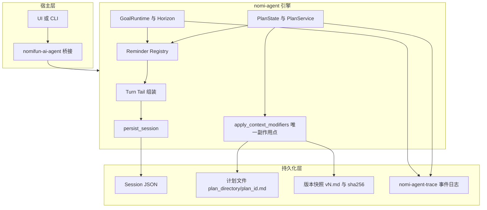
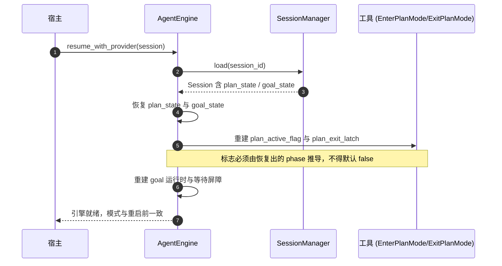

# Plan / Goal 模式与 Kimi Code 对齐 · 技术方案

> **状态**：📋 计划
> **核心原则**：**动态上下文只走 turn tail 且按 variant 去重注入；计划以文件为唯一事实源并可版本追溯；引擎是唯一副作用点；目标判定保留独立验证者但补齐硬预算。**

---

## 一、背景与核心痛点

### 1.1 业务背景

`nomi-agent` 是 allo 的 agent 引擎，`plan` 与 `goal` 是两个长任务模式：

- **Plan 模式**：把 agent 限制为只读，先产出可验证的实施计划，用户批准后才解锁写工具。
- **Goal 模式**：一个跨多轮持续存在的目标，引擎在自然终止点自动续跑，直到目标完成、阻塞或触顶。

Kimi Code 的 `agent-core-v2` 用 `features/plan/`（约 900 行）与 `features/goal/`（约 2400 行）实现了同类能力，并在若干机制上更成熟。本方案的目标是**有选择地对齐**，而非整体移植。

### 1.2 现状与痛点

以下每一条都经过实查，附证据行号。

**P1 · 动态上下文每轮全量追加，陈旧块永久累积且被前缀缓存锁死**

`engine/mod.rs:1934-2044` 组装 `turn_tail_extras`（resource 通知、当前日期、plan 指令、coding harness、context contributor、working set、goal context、round facts），**没有任何去重或分档**，全部合并后由 `context_contributor.rs:179-220` 的 `persist_turn_tail_context` 写进 transcript。清理逻辑只有一处——`engine/mod.rs:3028-3035` 的截断重启路径，且 `while self.messages.last()` **只弹尾部的同轮块**，跨轮次的旧块一概不清。

压缩也救不了它：`compact/auto.rs:238-258` 的 `is_pinnable_user_turn` 对"纯文本且估算不超预算"的 user 消息一律保留，而 `[Context]` + 短用户文本正好命中这个条件，因此这类块**永远不会被 snip 删除**。这些块位于冻结前缀内，删除需要付一次缓存 miss。

**P2 · 计划文件模块是死代码，计划只活在内存**

`plan/file.rs` 的 `plan_file_path` / `write_plan` / `read_plan` **零生产调用**（仅自身测试与 `tests/plan_prompt_file_test.rs` 引用）。计划内容实际只存在于 `plan_state.pending_plan` 这个内存字段，以及 `ExitPlanMode` 返回的工具结果文本里——既不可 diff，也不可审计，还会永久占用上下文。

**P3 · plan / goal 状态不持久化，重启即丢**

`session.rs` 的 `Session` 结构体字段为 `id` / `created_at` / `updated_at` / `provider` / `model` / `cwd` / `total_usage` / `messages` / `owner_token` / `activated_deferred_tools` / `editable_turn` / `last_turn_ended_at`——**没有任何 plan 或 goal 字段**。`goal/state.rs:1` 自述 "P0: not persisted, no SQLite"。重启后计划模式与目标全部丢失。

**P4 · 退出计划没有真正的审批交互**

`plan/tools.rs:183-234` 的 `ExitPlanModeTool::execute` 只做两件事：校验计划文本（长度 ≥ `MIN_PLAN_CHARS`=40 且含验证命令，见 `plan/tools.rs:101-112`）、返回一段提示文本。真正的状态迁移由 `context_modifier_for` 产出的 `PlanModeTransition::Exit` 触发，引擎在 `apply_context_modifiers` 里把 `phase` 置为 `AwaitingApproval` 并置起 `plan_exit_latch`。此后**引擎把"下一条用户消息"直接当作批准**——无法修订、无法拒绝、无法在多个方案间选择。

**P5 · goal 缺硬预算，只有续跑计数上限**

`GoalState` 的闸门是 `max_auto_continuations`（`goal/state.rs:117`）与 `should_continue()`（`goal/state.rs:239-241`）。`horizon/budget.rs` 仅 97 行，没有 token 预算，也没有墙钟预算。模型一旦进入低效循环，只能在续跑次数用尽后停下，中间没有任何成本刹车。

**P6 · 路径锁不按 cwd 解析，阻塞 P2 的写保护判定**

`tool_execution.rs:1405` 的 `normalize_lock_path` 只做分隔符替换、去尾斜杠与小写化，不按会话 cwd 解析相对路径；而 Edit/Write/Read/ApplyPatch 内部走 `nomi-tools/src/path_guard.rs:76` 的 `resolve_against_cwd`。结果是 `Edit{"a.rs"}` 与 `Edit{"<abs>/a.rs"}` 被判为不相交，进入同一并发批。

这一点**必须先修**：Phase 2 要引入"只允许写计划文件"的判定，该判定本身就依赖正确的路径归一，否则 `Write{"plan.md"}` 与 `Write{"<abs>/plan.md"}` 会被当成两个不同文件而绕过保护。

**P7 · 工具面不对齐：模型无法自建、自查、自恢复目标，也无法设预算**

kimi 向模型暴露 6 个工具（plan 域 `EnterPlanMode` / `ExitPlanMode`，goal 域 `CreateGoal` / `GetGoal` / `SetGoalBudget` / `UpdateGoal`）。allo 只注册了 3 个：

| 工具 | kimi | allo | 差距 |
|---|---|---|---|
| `EnterPlanMode` | ✅ 无参数 | ✅ 无参数（`bootstrap.rs:1091`） | 一致 |
| `ExitPlanMode` | ✅ 只收 `options`，**自己读计划文件** | ⚠️ 收 `plan` / `plan_content` **全文**（`bootstrap.rs:1094`） | 参数语义不同 |
| `CreateGoal` | ✅ | ❌ 全仓 0 命中 | 缺 |
| `GetGoal` | ✅ | ❌ 仅有 `goal_state()` Rust 方法 | 缺 |
| `SetGoalBudget` | ✅ | ❌ 全仓 0 命中 | 缺 |
| `UpdateGoal` | ✅ `active` / `complete` / `blocked` | ⚠️ `update_goal` 只有 `complete` / `blocked`（`engine/mod.rs:929`、`:949`） | 缺 `active` |

后果：allo 的目标只能由宿主 `set_goal()` 注入，模型既不能主动创建目标、查询目标状态，也不能设定预算；`update_goal` 缺 `active` 意味着**模型无法自行恢复一个暂停的目标**，只能等用户 `/goal resume`。这比缺预算更根本——它是能力缺口，不是体验问题。

### 1.3 能力对比矩阵

| 维度 | 现状行为 | 本方案目标 |
|---|---|---|
| 注入去重 | 每轮全量追加，无 variant 概念 | 按 variant 注册，full / sparse / 静默三档 |
| 陈旧注入块 | 跨轮次永久保留，被缓存锁死 | 分档后不再产生冗余块；压缩路径可回收 |
| 计划存储 | 仅内存字段 + 工具结果文本 | 磁盘文件为唯一事实源，路径可配置 |
| 计划版本 | 无 | 每次提交存一版 `v<n>.md` + sha256 |
| 状态持久化 | 无，重启即丢 | `Session` 持久化并可在 resume 时恢复 |
| 退出计划 | 只能批准（下一条消息即批准） | 批准 / 修订（保持激活）/ 拒绝并退出 / 忽略 |
| 写保护 | 引擎在 dispatch 拒写 | 保持，并在路径归一修正后收紧到"仅计划文件" |
| 目标预算 | 仅续跑次数上限 | token / turn / 墙钟三维硬预算 + grace turn |
| 目标判定 | 外部 judge 独占判定权 | 保留 judge 为可选验证器，新增模型自评路径 |
| 审计能力 | 无 | 复用 `nomi-agent-trace` 记录 plan / goal 事件 |
| 目标工具面 | 仅 `update_goal`（complete / blocked） | 补 `CreateGoal` / `GetGoal` / `SetGoalBudget`，`update_goal` 增 `active` |
| 计划提交参数 | `ExitPlanMode` 传计划全文 | 只传 `options`，计划由引擎从文件读取 |
| 阻塞判定 | 提示词约定（"连续 3 轮"） | **工具层机械强制**（evidence hash 计数）——保持 allo 现状 |

---

## 二、方案全景与架构设计

### 2.1 端到端拓扑



### 2.2 核心目标

1. 建立 **Reminder Registry**，让所有动态注入按 variant 注册、按注入历史分档。
2. 让**计划文件成为唯一事实源**，并支持版本快照与 sha256 追溯。
3. 让 **plan / goal 状态可持久化、可恢复**，且恢复后原子标志与状态一致。
4. 让**退出计划成为真正的审批交互**，支持修订与拒绝。
5. 为 goal 补齐**三维硬预算**与 grace turn。
6. 补齐 **goal 工具面**，让模型能自建、自查、自恢复目标并设定预算。

### 2.3 明确的非目标

| 非目标 | 理由 |
|---|---|
| 完整事件溯源（durable event + replay + undo） | allo 的持久化模型是"会话快照 JSON"，改成事件溯源等于重写持久化层；审计需求用 trace 日志低成本满足 |
| 删除外部 judge | judge 是独立验证者；kimi 以"模型自评 + 提示纪律"替代，是成本优化而非可靠性升级 |
| 移植 DI + Feature 注册体系 | TS 侧的组织方式；Rust 侧已有 `ToolRegistry` + bootstrap，强行对齐无收益 |
| 引入 actor 模型或 XState 等价物 | 引擎是 `&mut self` 的单线程 turn 循环；墙钟预算用边界检查的软中断即可满足本地优先场景 |
| 改动 plan 模式的写保护策略本身 | 现有"dispatch 拒写 + 原子标志"与 kimi 的钩子方案大致等价，不在本次范围 |

### 2.4 架构不变量

1. **system prompt 字节稳定**：任何动态内容一律不进 system prompt，只走 turn tail，以保住前缀缓存。
2. **注入必须持久化**：写进 transcript 的内容与实际发送的请求必须一致，否则下次请求前缀分叉、缓存命中塌缩到 system + tools。
3. **引擎是唯一副作用点**：工具只产出 `ContextModifier`，落盘、状态迁移、事件记录统一在 `apply_context_modifiers` 完成。
4. **恢复后标志一致**：`plan_active_flag` / `plan_exit_latch` 必须与恢复出的 `plan_state` 严格一致，不允许出现引擎与工具认知分裂。
5. **向后兼容的 wire 契约**：`nomi-types` 与 `Session` 的新字段一律 `#[serde(default)]`，老数据必须能反序列化。

---

## 三、核心设计与模块规范

### 3.1 Reminder Registry（Phase 1）

**新增** `crates/agent/nomi-agent/src/reminder.rs`。

```rust
/// 一次注入请求的上下文。`injected_positions` 由扫描 transcript 得出，
/// 用于实现"分档注入"（full / sparse / 静默）。
pub struct InjectionContext<'a> {
    /// 本 variant 在 transcript 中出现过的消息下标（升序）。
    pub injected_positions: Vec<usize>,
    /// 最后一次注入的下标；从未注入过为 `None`。
    pub last_injected_at: Option<usize>,
    /// 本轮是否为新的用户轮次（而非同一轮内的又一次 provider pass）。
    pub is_new_turn: bool,
    /// 供 provider 只读访问 transcript 长度，用于自行判断间隔。
    pub message_count: usize,
}

#[async_trait]
pub trait ReminderProvider: Send + Sync {
    /// 稳定标识，用于在 transcript 中定位历史注入点。
    fn variant(&self) -> &str;
    /// 数值越大越先注入。默认 0。
    fn priority(&self) -> i32 { 0 }
    /// 返回本轮要注入的文本；`None` 表示本轮不注入。
    async fn content(&self, ctx: &InjectionContext<'_>) -> Option<String>;
}
```

**为按 variant 定位注入点，需要给消息加来源标记。** 当前所有注入块共用 `nomi-types/src/message.rs:12` 的 `TURN_TAIL_CONTEXT_PREFIX = "[Context]\n"`，无法区分来源。新增：

```rust
// nomi-types/src/message.rs
#[derive(Debug, Clone, PartialEq, Eq, Serialize, Deserialize)]
pub struct InjectionOrigin {
    pub variant: String,
}

// Message 新增字段
#[serde(default, skip_serializing_if = "Option::is_none")]
pub injection: Option<InjectionOrigin>,
```

`TURN_TAIL_CONTEXT_PREFIX` 保持不变（兼容现有解析逻辑与 `is_turn_tail_context_text`）。`persist_turn_tail_context` 需要扩展为接受一组 `(variant, text)`，把 variant 写进 `Message.injection`；同一消息内多个 variant 的块合并为一个 `[Context]` 文本块，但 variant 取**首个**（其余 variant 的注入点在下一轮会重新计算，不影响分档正确性）。

**分档规则**（对齐 `planModeInjection.ts:60-80`）：

| 条件 | 输出 |
|---|---|
| 首次进入该 variant 的活跃态 | full |
| 活跃态且计划文件已非空（reentry） | reentry 版 |
| 从活跃转为非活跃（此前活跃过） | exit 提醒，仅一次 |
| 活跃期间：`last_injected_at` 之后出现过 user 消息 | full |
| 活跃期间：间隔 ≥ 5 个 assistant turn | full |
| 活跃期间：间隔 ≥ 2 个 assistant turn | sparse |
| 其余 | 不注入 |

常量：`DEDUP_MIN_TURNS = 2`、`FULL_REFRESH_TURNS = 5`。

**改造点**：`engine/mod.rs:1934-2044` 的 `turn_tail_extras` 组装改为遍历 registry。各来源注册为独立 variant：

| variant | 现位置 |
|---|---|
| `system_resource` | `engine/mod.rs:1935-1939` |
| `current_date` | `engine/mod.rs:1940-1943` |
| `plan_mode` | `engine/mod.rs:1946-1948` |
| `office_plan` | `engine/mod.rs:1949-1957` |
| `coding_harness` | `engine/mod.rs:1958-2001` |
| `context_contributor` | `engine/mod.rs:2002-2007` |
| `office_working_set` | `engine/mod.rs:2008-2011` |
| `goal` | `engine/mod.rs:2012-2014` |
| `round_facts` | `engine/mod.rs:2040-2042` |

`current_date` 与 `round_facts` 建议**不分档**（前者每天才变一次，后者是重启账本，必须每轮携带）——它们的 provider 恒返回内容。

### 3.2 计划文件与版本快照（Phase 2）

**路径契约**：由按 session 命名改为按 **plan id** 命名，使一个 session 可容纳多个计划。

```
{plan.plan_directory}/{plan_id}.md          # 当前计划
{plan.plan_directory}/{plan_id}/v{n}.md     # 历史版本快照
{plan.plan_directory}/{plan_id}/revisions.json
```

`plan.plan_directory` 复用 `nomi-config/src/plan.rs` 的既有配置（默认 `.nomi/plans`）。

**`PlanState` 扩展**（`plan/state.rs`）：

```rust
pub struct PlanState {
    pub is_active: bool,
    pub pre_plan_allow_list: Vec<String>,
    pub phase: PlanPhase,
    pub pending_plan: Option<String>,
    /// 新增：当前计划 id，进入计划模式时生成。
    pub plan_id: Option<String>,
    /// 新增：已记录的版本号，用于生成下一个 v<n>。
    pub revision_count: u32,
}
```

**副作用落点**：唯一正确的位置是 `engine/mod.rs:4406-4429` 的 `apply_context_modifiers`——它已经是 `PlanModeTransition::Exit` 的唯一处理点，且符合不变量 3（引擎是唯一副作用点）。**不要**给 `ExitPlanModeTool` 注入文件系统：它当前只持有两个 `Arc<AtomicBool>`，让它写盘会破坏"工具不改外部状态"的现状。

```rust
PlanModeTransition::Exit { plan_content } => {
    self.plan_state.phase = PlanPhase::AwaitingApproval;
    self.plan_state.pending_plan = plan_content.clone();
    self.plan_state.is_active = true;
    if let Some(ref latch) = self.plan_exit_latch {
        latch.store(true, Ordering::Release);
    }
    // 新增：落盘 + 版本快照。失败不阻断状态迁移，但要向用户告警。
    if let Some(ref content) = plan_content
        && let Some(ref plan_id) = self.plan_state.plan_id
    {
        if let Err(e) = self.persist_plan(plan_id, content) {
            self.output.emit_warning(&format!("Failed to persist plan: {e}"));
        }
    }
}
```

**`revisions.json` 契约**：

```json
{
  "plan_id": "brave-otter-7f3a",
  "revisions": [
    { "version": 1, "sha256": "…", "bytes": 1832, "recorded_at": "2026-10-20T07:41:02Z" }
  ]
}
```

### 3.3 状态持久化与恢复（Phase 3）

**`Session` 新增字段**（`session.rs`）：

```rust
#[serde(default, skip_serializing_if = "Option::is_none")]
pub plan_state: Option<PlanState>,

#[serde(default, skip_serializing_if = "Option::is_none")]
pub goal_state: Option<GoalState>,
```

两个类型都需要 `Serialize + Deserialize`：`PlanState` 目前只有 `Debug + Clone + Default`（`plan/state.rs:15-16`），需补派生；`GoalState` 已具备（`goal/state.rs:109-110`）。

**恢复时序**：



**关键约束**：`plan_active_flag` / `plan_exit_latch` 是 bootstrap 时创建、由工具持有并读取的 `Arc<AtomicBool>`。恢复路径必须按恢复出的 `phase` 推导两者：

| `phase` | `plan_active_flag` | `plan_exit_latch` |
|---|---|---|
| `Idle` | `false` | `false` |
| `Exploring` | `true` | `false` |
| `AwaitingApproval` | `true` | `true` |

三者不一致会导致"引擎认为在 plan 模式、但 `EnterPlanMode` 工具认为不在"的分裂状态。恢复后应加一条 `debug_assert` 校验一致性。

**审计**：不引入事件溯源，改用已有的 `nomi-agent-trace` 记录 plan / goal 生命周期事件（`plan.enter` / `plan.revision` / `plan.exit` / `goal.create` / `goal.status` / `goal.budget`），获得可追溯性而不动会话格式。

### 3.4 退出计划的交互式审批（Phase 4）

复用现有审批通道：`tool_execution.rs:1039` 的 `execute_tool_calls_with_approval_timeout` 与 `nomi_protocol::ToolApprovalManager`。

**审批响应契约**（扩展 `ApprovalResponse`，或新增并行的 plan 专用结构）：

```rust
pub struct PlanReviewResponse {
    pub decision: PlanReviewDecision,   // Approved | Rejected | Cancelled
    pub selected_label: Option<String>, // 用户在 options 中选中的方案
    pub feedback: Option<String>,       // 修订意见
}
```

**四类结果的映射**：

| 结果 | plan 模式 | 工具返回 | 附加行为 |
|---|---|---|---|
| 批准（可带选中方案） | 退出 | `Exited plan mode. Selected approach: …` + 计划全文 | 写工具解锁 |
| 修订 / 带 feedback | **保持激活** | `User rejected the plan. Feedback:\n\n…` | 状态回到 `Exploring`，清 latch |
| 拒绝并退出 | 退出 | `Plan rejected by user. Plan mode deactivated.` | `stop_turn` |
| 忽略（cancelled） | 保持激活 | `Plan approval dismissed. Plan mode remains active.` | 无 |

**多方案支持**：`ExitPlanMode` 的 input schema 增加可选参数：

```json
{
  "options": {
    "type": "array",
    "minItems": 2,
    "items": {
      "type": "object",
      "properties": {
        "label": { "type": "string" },
        "description": { "type": "string" }
      },
      "required": ["label"]
    }
  }
}
```

计划提示词同步补充约束（对齐 kimi `plan-mode-full-reminder.md`）：计划里写多个方案时**必须**传 `options`，否则用户看不到选择入口。

**跨层影响**：`nomifun-ai-agent`（审批事件透传）与 `ui/`（计划卡与选项渲染）都要改，需 e2e 覆盖。

### 3.5 三维硬预算与 grace turn（Phase 5）

**预算契约**（扩展 `horizon/budget.rs`）：

```rust
pub struct GoalBudgetLimits {
    pub token_budget: Option<u64>,
    pub turn_budget: Option<usize>,
    pub wall_clock_budget_ms: Option<u64>,
}

pub struct GoalBudgetReport {
    pub limits: GoalBudgetLimits,
    pub tokens_used: u64,
    pub turns_used: usize,
    pub wall_clock_ms: u64,
    pub over_budget: bool,
    /// 已给出收尾机会的轮次标记，用于 grace turn。
    pub grace_granted: bool,
}
```

**墙钟预算用软中断**：引擎是 `&mut self` 的单线程 turn 循环，没有 actor 与定时器。可行的做法是在 `execute_turn_inner` 的两个边界检查 deadline：

1. **provider 边界**：`'provider_attempt` 循环开始处；
2. **tool 边界**：`execute_tool_calls_*` 调用前。

超时后**不立即掐断**，而是：

1. 发一条 `goal_budget_stop` 提醒（"立即停止、不要再调工具、写简短总结"）；
2. 置 `grace_granted`，允许本轮剩余步骤完成收尾；
3. grace 用尽后，在 `tool_execution` 的 veto 钩子里拒绝所有工具调用，并把 goal 置为 `Blocked`。

这一设计直接对齐 kimi 的 `budgetGraceTurns`（`goalService.ts:562-596`）：直接掐断会让用户看不到任何收尾信息。

**判定权改造**：保留 `goal/judge.rs`，但降级为**可选验证器**。

| 路径 | 触发条件 | 判定者 |
|---|---|---|
| 主路径 | 模型调用 `update_goal(complete)` 且 `satisfies_complete_gate()` 通过 | 模型自评 |
| 兜底路径 | 模型未宣告完成但证据显示已完成，或模型宣告完成但 `satisfies_complete_gate()` 不通过 | judge |

现有 `GoalState::satisfies_complete_gate()`（`goal/state.rs:257-263`）已经是机械证据闸门，可直接作为主路径的前置条件，无需新增机制。

### 3.6 状态机矩阵

**Plan 生命周期**：

| 当前状态 | 事件 | 前置条件 | 次态 | 不可逆 |
|---|---|---|---|---|
| `Idle` | `PlanModeTransition::Enter` | 不在计划模式 | `Exploring` | 否 |
| `Exploring` | `PlanModeTransition::Exit` | 计划文本 ≥ 40 字符且含验证命令 | `AwaitingApproval` | 否 |
| `Exploring` | `PlanModeTransition::Exit` | 计划文本不满足校验 | `Exploring` | 否（工具报错） |
| `AwaitingApproval` | 审批批准 | 审批通道返回 approved | `Idle` | 否 |
| `AwaitingApproval` | 审批修订 | 返回 feedback | `Exploring` | 否 |
| `AwaitingApproval` | 审批拒绝并退出 | 返回 Reject and Exit | `Idle` | 否 |
| `AwaitingApproval` | 审批忽略 | 返回 cancelled | `AwaitingApproval` | 否 |
| `AwaitingApproval` | 用户发送新消息 | 旧行为（Phase 4 之前） | `Idle` | 否 |

**Goal 生命周期**（现有枚举见 `goal/state.rs:21-34`）：

| 当前状态 | 事件 | 前置条件 | 次态 | 不可逆 |
|---|---|---|---|---|
| `Active` | 自然终止且 `should_continue()` | 未触预算、未达续跑上限 | `Active`（续跑） | 否 |
| `Active` | `update_goal(complete)` | `satisfies_complete_gate()` 通过 | `Complete` | **是** |
| `Active` | `update_goal(blocked)` | 同一阻塞条件连续 ≥ `blocked_threshold` 轮 | `Blocked` | 否（可 resume） |
| `Active` | 预算触顶 | 任一维度 over_budget | `Active` + grace → `Blocked` | 否 |
| `Active` | 用户中断 | turn 被 cancel | `Paused` | 否 |
| `Paused` | `/goal resume` | — | `Active` | 否 |
| `Blocked` | `/goal resume` | — | `Active` | 否 |
| `Waiting` | 屏障释放 | pid 退出 / 截止时间到达 / 会话触发 | `Active` | 否 |
| 任意 | `/goal clear` | — | `Cleared` | **是** |

---

### 3.7 工具面对齐（Phase 5.6）

**目标工具面**（对齐 kimi `features/goal/tools/`）：

| 工具 | 参数契约 | 落点 |
|---|---|---|
| `CreateGoal` | `{objective: string(≥1), completionCriterion?: string, replace?: bool}` | 新文件 `goal/tools/create_goal.rs` |
| `GetGoal` | `{}`（无参数） | 新文件 `goal/tools/get_goal.rs` |
| `SetGoalBudget` | `{value: number(>0), unit: "turns" / "tokens" / "milliseconds" / "seconds" / "minutes" / "hours"}` | 新文件 `goal/tools/set_goal_budget.rs` |
| `UpdateGoal` | `{status: "active" / "complete" / "blocked", evidence?: string}` | 扩展既有 `goal/tool.rs` |

**`GetGoal` 必须剥掉内部 `goal_id`**（对齐 kimi 的 `goalForModel`）：模型拿到 id 后可能把它写进用户可见文本，或试图跨目标引用。返回值只保留 `objective` / `completion_criterion` / `status` / `turns_used` / `tokens_used` / `wall_clock_ms` / `budget` / `terminal_reason`。

**`SetGoalBudget` 的校验规则**（对齐 kimi `setGoalBudgetTool.ts`）：

- `turns` / `tokens`：`max(1, round(value))`；
- 时间单位：换算为毫秒后必须 `≥ MIN_REASONABLE_TIME_BUDGET_MS`（1000 ms）且有限，否则**不设置**并返回"不是合理的预算"；
- 设置后若已超预算，返回 `stop_turn`（对齐 kimi 的 `stopBatchAfterThis`）；
- 提示词层约束：**不要发明预算**，只在用户明确给出运行时限制时设置（"20 轮内"、"不超过 500k tokens"、"30 分钟内"）；复合时间先归一到单一单位。

**`update_goal` 增加 `active`**：让模型能在用户明确要求继续时恢复暂停/阻塞的目标。`GoalRuntime` 已有恢复路径（`goal/runtime.rs`），只需把它接到工具上。

**保留 allo 的 evidence-hash 阻塞闸门。** `goal/tool.rs` 现在用 `evidence_hash` + `blocked_evidence_repeats` 在**工具层**强制"同一阻塞条件重复到 `blocked_threshold` 次"才放行。kimi 的 `UpdateGoalTool` 没有这个校验——它的"连续 3 轮"只写在 schema description 与提示词里，实现上是直接 `markBlocked`。**这是 allo 更强的地方，对齐时不得简化掉**：模型自评路径本来就依赖模型的诚实度，再用提示词而非闸门约束阻塞判定，等于把这个模式唯一可靠的机械约束也交出去。

**主代理门禁**：kimi 的 4 个 goal 工具都过 `mainAgentOnlyExecution`，子代理调用返回 "Goal tools are only supported by the main agent."。allo 的 goal 工具由 `engine/mod.rs:929` / `:949` 在有 goal 时注册到引擎自己的 registry，而子代理使用独立的 `CHILD_TOOL_CATALOG`（不含 goal 工具），**结构上已经隔离**。实施时只需补一条断言测试锁定这一点，无需新增门禁逻辑。

**`ExitPlanMode` 参数收敛**：改为只接收 `options` 后，与 Phase 2 的计划文件落盘天然衔接——计划内容由引擎从文件读取并送审批，工具本身不再承载正文。**这两处改动应合并为同一批提交**，否则会出现"文件已落盘但工具仍在传全文"的中间态。

**易混淆项**（实施时勿改错文件）：

| 名字 | 真实身份 | 是否本方案范围 |
|---|---|---|
| `TowerPlan`（kimi `features/tower/tools/plan/`） | 把 tower 目标拆成 mission + 隔离 git worktree | 否 |
| `plan` 子代理 profile（kimi `features/plan/profile/plan.ts`） | 只读规划 agent，工具表固定为 NotifyUser/Read/ReadMediaFile/Glob/Grep/WebSearch/FetchURL | 否（可作后续独立提案） |
| `update_plan`（allo `nomi_tools::update_plan::UpdatePlanTool`，`bootstrap.rs:1253`） | coding harness 的待办清单 | 否 |

---

## 四、关键决策与权衡矩阵

| 编号 | 决策点 | 选定方案 | 放弃的替代方案与理由 |
|---|---|---|---|
| **D1** | 是否整体移植 kimi 的事件溯源持久化 | **不移植，改用状态快照 + trace 事件日志** | ❌ 完整事件溯源：allo 持久化是"会话快照 JSON"，改造等于重写 `session.rs` 与全部恢复路径；收益（审计、撤销）可由 trace 日志低成本获得 |
| **D2** | 注入分档如何定位历史注入点 | **给 `Message` 加 `injection: Option<InjectionOrigin>` 字段** | ❌ 解析 `[Context]` 文本前缀猜 variant：多个来源合并进同一文本块时无法区分，且字符串解析脆弱；❌ 在引擎内存里记注入历史：与"注入必须持久化"冲突，重启后失效 |
| **D3** | 计划文件命名按 session 还是 plan id | **按 plan id** | ❌ 按 session id（现状）：一个 session 只能有一个计划，重新规划会覆盖上一份，无法版本追溯 |
| **D4** | 计划落盘的副作用放在哪里 | **`apply_context_modifiers`** | ❌ 给 `ExitPlanModeTool` 注入文件系统：破坏"工具不改外部状态"的现状，且工具持有 `Arc<AtomicBool>` 的轻量设计被迫加重 |
| **D5** | 状态持久化用什么载体 | **`Session` 新增两个可选字段** | ❌ 新增 SQLite 表：命中 AGENTS.md 的 DB migration 高风险区，需 migration 测试与模型/仓储同步改动，收益不足；❌ 独立 sidecar 文件：与 `Session` 的生命周期（删除、索引）不同步，易产生孤儿 |
| **D6** | 墙钟预算如何中断 | **在 provider / tool 边界检查 deadline 的软中断** | ❌ 引入定时器做硬中断：引擎是 `&mut self` 单线程循环，需要改 `abort_current_turn` 的触发通道并引入并发，成本远高于本地优先场景所需 |
| **D7** | 预算触顶是否立即停止 | **先给一个 grace turn 写总结，再拒绝工具** | ❌ 立即掐断：用户看不到任何收尾信息，且模型无法汇报进度（kimi 的 `budgetGraceTurns` 同样选择不立即掐断） |
| **D8** | goal 判定权是否交给模型 | **保留 judge 为可选验证器，主路径为模型自评** | ❌ 完全删除 judge：把完成判定从独立验证者降级为被验证者自己，是可靠性降级而非升级；❌ 保持 judge 独占：每次自然终止都多一次 LLM 调用，延迟与成本翻倍 |
| **D9** | 退出计划的审批结果如何表达 | **扩展为 `{decision, selected_label, feedback}` 三字段** | ❌ 只加一个布尔 approved：无法表达"修订并保持激活"与"拒绝并退出"的区别，用户会被迫走"拒绝→重新规划"的笨路径 |
| **D10** | Phase 顺序 | **路径锁 → 注入分档 → 计划文件 → 状态持久化 → 审批交互 → 预算与判定权 → 工具面对齐** | ❌ 先做判定权改造：它是产品行为变更，风险最高，且缺少硬预算兜底时会放大"模型自评不可靠"的后果；❌ 先做持久化：没有去重与文件事实源时，持久化只是把内存里的冗余原样写盘 |
| **D11** | goal 工具面是否补齐到 kimi 的 4 个 | **补齐 `CreateGoal` / `GetGoal` / `SetGoalBudget`，`update_goal` 增 `active`** | ❌ 只保留 `update_goal`：模型无法自建目标、查状态、设预算、恢复暂停目标，goal 模式实际退化为"宿主注入 + 模型只能宣告终态"；❌ 让子代理也能建目标：目标归主代理所有，子代理建目标会绕过主代理的预算与进度记账 |
| **D12** | 阻塞判定用提示词还是工具闸门 | **保留 allo 的 evidence-hash 工具层闸门** | ❌ 改为纯提示词（即 kimi 现状）：模型自评路径本就依赖模型诚实度，再用提示词约束阻塞判定等于放弃唯一的机械约束；kimi 的 3 轮规则只存在于描述文本中，实现直接 `markBlocked` |
| **D13** | `ExitPlanMode` 是否继续接收计划全文 | **收敛为只收 `options`，正文由引擎读文件** | ❌ 保留全文参数：与 Phase 2 的"计划文件为唯一事实源"冲突，会出现工具参数与磁盘文件两份真相，且用户审批看到的内容取决于模型传参而非文件 |

---

## 五、验收标准与验证矩阵

### 5.1 验收用例

**Phase 0 · 路径归一**

| 编号 | 操作路径 | 断言 |
|---|---|---|
| `TC-P0-001` | 同一轮内发起 `Edit{"a.rs"}` 与 `Edit{"<abs>/a.rs"}` | 两者落入**同一串行批**（`is_concurrent == false`） |
| `TC-P0-002` | 发起 `Edit{"a.rs"}` 与 `Edit{"./a.rs"}` | 同上 |
| `TC-P0-003` | 发起 `Read{"."}` 与 `Edit{"a.rs"}` | `Read` 的占用为 workspace-wide，与 `Edit` 冲突 |
| `TC-P0-004` | Windows 下 `Read{"."}` 与 `Read{".\\"}` | 均判为 workspace-wide |

**Phase 1 · 注入分档**

| 编号 | 操作路径 | 断言 |
|---|---|---|
| `TC-P1-001` | 构造含 3 个不同 variant 注入块的 transcript | `injected_positions` 各自正确，互不串台 |
| `TC-P1-002` | plan 模式连续 10 轮（每轮 1 次 provider pass，无用户插话） | full 提醒出现次数 ≤ 3，其余为 sparse 或空 |
| `TC-P1-003` | plan 模式中途插入一条用户消息 | 下一轮立即回到 full |
| `TC-P1-004` | 退出 plan 模式 | 下一轮出现 exit 提醒；再下一轮不再出现 |
| `TC-P1-005` | 无任何 provider 注册 | transcript 与改造前**逐字节一致**（零回归） |
| `TC-P1-006` | 老会话（`Message.injection == None`）恢复 | 正常反序列化，分档降级为"全部 full"而不 panic |

**Phase 2 · 计划文件与版本**

| 编号 | 操作路径 | 断言 |
|---|---|---|
| `TC-P2-001` | 调用 `ExitPlanMode` 且计划合法 | `{plan_directory}/{plan_id}.md` 存在且内容等于提交的计划 |
| `TC-P2-002` | 同一 plan_id 连续提交两次 | 生成 `v1.md` 与 `v2.md`，`revisions.json` 有两条记录且 sha256 不同 |
| `TC-P2-003` | 计划目录不可写（只读挂载） | 状态仍迁移到 `AwaitingApproval`，且 `emit_warning` 被调用一次 |
| `TC-P2-004` | 计划文本 < 40 字符 | 不落盘、不迁移，工具返回错误 |
| `TC-P2-005` | 重新规划（新 plan_id） | 旧计划文件保留，新计划写入新文件 |

**Phase 3 · 状态持久化**

| 编号 | 操作路径 | 断言 |
|---|---|---|
| `TC-P3-001` | 进入 plan 模式 → 持久化 → 重启引擎 → 恢复 | `phase == Exploring`，且 `plan_active_flag == true`、`plan_exit_latch == false` |
| `TC-P3-002` | 处于 `AwaitingApproval` 时重启 | `phase` 与两个标志与重启前一致 |
| `TC-P3-003` | 恢复后尝试 `Write` 非计划文件 | 仍被拒绝 |
| `TC-P3-004` | 恢复后 `EnterPlanModeTool` 的行为 | 报 "Already in plan mode"，与引擎认知一致 |
| `TC-P3-005` | 恢复含 goal 的会话 | `goal_state` 完整还原，`turns_used` / `auto_continuations` 不归零 |
| `TC-P3-006` | 反序列化无这两个字段的旧会话 | 成功，两字段为 `None` |

**Phase 4 · 审批交互**

| 编号 | 操作路径 | 断言 |
|---|---|---|
| `TC-P4-001` | 审批返回 approved | plan 模式退出，写工具解锁 |
| `TC-P4-002` | 审批返回 approved + `selected_label` | 工具结果包含 "Execute ONLY the selected approach" 与选中方案名 |
| `TC-P4-003` | 审批返回修订 + feedback | plan 模式**仍激活**，`phase == Exploring`，`exit_latch == false`，feedback 进入工具结果 |
| `TC-P4-004` | 审批返回 Reject and Exit | plan 模式退出，turn 被停止 |
| `TC-P4-005` | 审批返回 cancelled | plan 模式保持，`phase == AwaitingApproval` |
| `TC-P4-006` | 计划含多个方案但未传 `options` | 提示词层面的约束生效（由 e2e 验证模型行为） |

**Phase 5 · 预算与判定权**

| 编号 | 操作路径 | 断言 |
|---|---|---|
| `TC-P5-001` | 设 `turn_budget = 3`，让目标跑满 | 第 3 轮后进入 `Blocked`，且已给出一次 grace turn |
| `TC-P5-002` | 设 `token_budget`，累计用量触顶 | 同上，且 `GoalBudgetReport.over_budget == true` |
| `TC-P5-003` | 设 `wall_clock_budget_ms`，在 provider 边界触顶 | 当前轮不再发起新的 provider 调用 |
| `TC-P5-004` | grace turn 期间调用工具 | 工具被 veto，返回预算耗尽提示 |
| `TC-P5-005` | 模型调用 `update_goal(complete)` 且 `satisfies_complete_gate()` 通过 | 进入 `Complete`，**不调用 judge** |
| `TC-P5-006` | 模型调用 `update_goal(complete)` 但 gate 不通过 | 保持 `Active`，judge 被调用 |
| `TC-P5-007` | 连续 3 轮同一阻塞条件后 `update_goal(blocked)` | 进入 `Blocked`；第 2 轮时被拒 |

**Phase 5.6 · 工具面对齐**

| 编号 | 操作路径 | 断言 |
|---|---|---|
| `TC-P56-001` | 模型调用 `CreateGoal` | 目标被创建，`objective` 与 `completionCriterion` 正确落库 |
| `TC-P56-002` | 已有活跃目标时再调用 `CreateGoal` 且不传 `replace` | 返回错误，提示需用 `replace` |
| `TC-P56-003` | 调用 `GetGoal` | 返回值**不含** `goal_id` 字段 |
| `TC-P56-004` | 无目标时调用 `GetGoal` | 返回 `{ "goal": null }` |
| `TC-P56-005` | `SetGoalBudget{value: 3, unit: "turns"}` | 目标 turn 预算为 3，后续按 `TC-P5-001` 触顶 |
| `TC-P56-006` | `SetGoalBudget{value: 500, unit: "milliseconds"}` | 拒绝设置，返回"不是合理的预算"（低于 1000 ms 下限） |
| `TC-P56-007` | `SetGoalBudget{value: 1.6, unit: "turns"}` | 归一为 2（`round` 后不小于 1） |
| `TC-P56-008` | 目标处于 `Paused`，模型调用 `update_goal(active)` | 目标恢复为 `Active` |
| `TC-P56-009` | 同一阻塞 evidence 连续调用 `update_goal(blocked)` | 阈值前被拒，达到阈值后放行（**回归锁定 evidence-hash 闸门**） |
| `TC-P56-010` | 子代理尝试调用任一 goal 工具 | 工具不可见（`CHILD_TOOL_CATALOG` 不含），或返回"仅主代理支持" |
| `TC-P56-011` | `ExitPlanMode` 只传 `options`，计划文件已存在 | 审批展示计划文件内容，且 `options` 透传给宿主 |
| `TC-P56-012` | `ExitPlanMode` 传保留标签（如 `Revise`） | 参数校验拒绝 |

### 5.2 验证梯子

按最小成本递增，每一阶段都应能从第一级开始逐级通过：

| 级别 | 命令 | 覆盖范围 |
|---|---|---|
| L1 单元 | `cargo test -p nomi-agent --lib` | reminder 分档算法、路径归一、revision 编号、预算计算、状态机迁移、goal 工具 schema 与阻塞闸门 |
| L2 集成 | `cargo test -p nomi-agent --tests` | 注入零回归（逐字节对比）、持久化往返、审批四类结果、goal 工具面端到端 |
| L3 编译 | `cargo check --workspace` | 跨 crate 影响（`nomi-types`、`nomifun-ai-agent`） |
| L4 前端 | `bun run typecheck` + `cd web && bun run typecheck` | `Message.injection` 的消费点、审批 UI |
| L5 端到端 | `bun run dev:web` 手工回归 | plan 模式进入/修订/批准全链路，goal 预算触顶的 grace 收尾 |

**注意**：L1 当前在本机是**红的**——`cargo test -p nomi-agent --lib` 实测 937 passed / 3 failed（`context.rs:433`、`context.rs:510`、`skill_tool.rs:1059`，均与 skills 目录解析相关）。实施任一 Phase 前应先修这 3 个环境相关失败，否则无法用 L1 作为回归基线。

**新增测试的落点约定**：Phase 1 的分档单测放 `src/reminder.rs` 内联；Phase 2/3 的往返测试放 `tests/`（当前 `tests/` 不进 CI，需同步在 `.github/workflows/ci.yml:242` 追加 `cargo test -p nomi-agent --tests`）。

---

## 附录：现状证据索引

本方案为新建文档，无历史底稿需要归档。以下是正文引用的现状证据，便于实施时快速定位。

| 引用 | 位置 | 说明 |
|---|---|---|
| 注入组装 | `crates/agent/nomi-agent/src/engine/mod.rs:1934-2044` | `turn_tail_extras` 全量追加，无去重 |
| 注入持久化 | `crates/agent/nomi-agent/src/context_contributor.rs:179-220` | `persist_turn_tail_context` |
| 注入前缀 | `crates/agent/nomi-types/src/message.rs:12` | `TURN_TAIL_CONTEXT_PREFIX = "[Context]\n"` |
| 同轮清理 | `crates/agent/nomi-agent/src/engine/mod.rs:3028-3035` | 仅截断重启路径，仅弹尾部 |
| snip 保留规则 | `crates/agent/nomi-agent/src/compact/auto.rs:238-258` | `is_pinnable_user_turn` |
| 计划文件（死代码） | `crates/agent/nomi-agent/src/plan/file.rs` | `plan_file_path` / `write_plan` / `read_plan` 零生产调用 |
| 计划状态 | `crates/agent/nomi-agent/src/plan/state.rs:15-26` | `PlanState` 字段 |
| 计划工具 | `crates/agent/nomi-agent/src/plan/tools.rs:183-234` | `ExitPlanModeTool::execute` 只置 latch |
| 计划校验阈值 | `crates/agent/nomi-agent/src/plan/tools.rs:101-112` | `MIN_PLAN_CHARS = 40` |
| 状态迁移唯一副作用点 | `crates/agent/nomi-agent/src/engine/mod.rs:4406-4429` | `apply_context_modifiers` |
| 会话持久化 | `crates/agent/nomi-agent/src/engine/mod.rs:4529` | `persist_session` |
| 会话恢复 | `crates/agent/nomi-agent/src/engine/mod.rs:749` | `resume_with_provider` |
| 会话结构 | `crates/agent/nomi-agent/src/session.rs` | `Session` 无 plan/goal 字段 |
| goal 状态 | `crates/agent/nomi-agent/src/goal/state.rs:109-181` | `GoalState` 字段 |
| goal 续跑闸门 | `crates/agent/nomi-agent/src/goal/state.rs:239-241` | `should_continue()` |
| goal 完成闸门 | `crates/agent/nomi-agent/src/goal/state.rs:257-263` | `satisfies_complete_gate()` |
| 预算 | `crates/agent/nomi-agent/src/horizon/budget.rs` | 97 行，无 token / 墙钟预算 |
| 路径锁 | `crates/agent/nomi-agent/src/tool_execution.rs:1405` | `normalize_lock_path` |
| 工具侧路径解析 | `crates/agent/nomi-tools/src/path_guard.rs:76` | `resolve_against_cwd` |
| 审批通道 | `crates/agent/nomi-agent/src/tool_execution.rs:1039` | `execute_tool_calls_with_approval_timeout` |
| 计划配置 | `crates/agent/nomi-config/src/plan.rs` | `plan_directory`，默认 `.nomi/plans` |
| CI 测试范围 | `.github/workflows/ci.yml:242-243` | 仅 `cargo test -p nomi-agent --lib` |
| plan 工具注册 | `crates/agent/nomi-agent/src/bootstrap.rs:1091`、`:1094` | `EnterPlanMode` / `ExitPlanMode` |
| goal 工具注册 | `crates/agent/nomi-agent/src/engine/mod.rs:929`、`:949` | `update_goal`，仅在有 goal 时注册 |
| 阻塞闸门（allo 强项） | `crates/agent/nomi-agent/src/goal/tool.rs` | `evidence_hash` + `blocked_evidence_repeats` 工具层强制 |
| coding 待办工具（易混） | `crates/agent/nomi-agent/src/bootstrap.rs:1253` | `nomi_tools::update_plan::UpdatePlanTool`，非 plan 模式 |
| 子代理工具表（易混） | `crates/agent/nomi-agent/src/local_agent_invocation.rs` | `CHILD_TOOL_CATALOG`，不含 goal 工具 |
| kimi goal 工具门禁 | `…/features/goal/goalFeature.ts` + `…/agent/tools/mainAgentOnly.ts` | 4 个 goal 工具均过 `mainAgentOnlyExecution` |
| kimi `GetGoal` 剥 id | `…/features/goal/tools/serialize.ts` | `goalForModel` 解构剔除 `goalId` |
| kimi `ExitPlanMode` 保留标签 | `…/features/plan/tools/exit-plan-mode/exit-plan-mode.ts` | 禁止 `Approve` / `Reject` / `Reject and Exit` / `Revise` |
| kimi 预算校验 | `…/features/goal/tools/set-goal-budget/setGoalBudgetTool.ts` | `MIN_REASONABLE_TIME_BUDGET_MS = 1000`，超预算则 `stopBatchAfterThis` |

**外部参考（Kimi Code，仅供对照，不作为依赖）**：`C:\Users\15165\Documents\workbuddy_data\_repos\kimi-code\packages\agent-core-v2\src\features\{plan,goal,reminder}\`。
