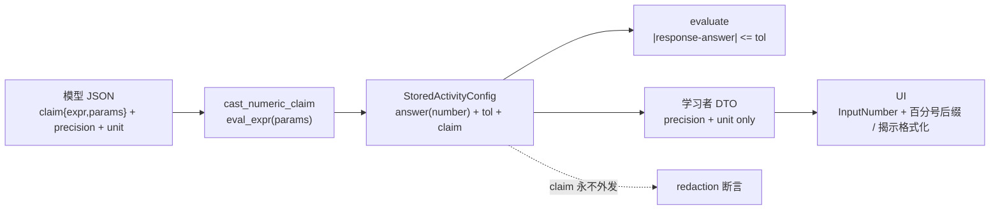

# 数值题答案键工具铸值（w2）· 技术方案与影响面

> **状态**：📋 计划（2026-11-02 复核）
> **核心原则**：数值答案键由系统按 `claim` 铸出，模型不再报数；`answer` 保持 JSON number，判分通道不动；`claim` 只进服务端配置，永不进学习者 DTO；零迁移。

---

## §1 背景与核心痛点

### 1.1 业务背景

w1 已交付 `verify_math` 工具 op（生成面 + 修复面双面，Pratt 求值器 + eval/identity 采样 + 计数 + finish warning）。但练习线的判分底面仍是模型自报：numeric 题的 `answer` 由模型口算，`tol` 由模型自报或缺失；q3 变式单次 LLM 调用同时给题面与答案，参数与答案键不可分离。w2 要把「计算归工具」教义落到判分底面——答案键由系统实算，模型只给可核验的表达式与参数。

### 1.2 现状与三个阻断点

1. **答案键无确定性背书**：`ActivityKind::Numeric` 的 `answer` 是模型给的 JSON number；生成面没有任何算术自检。模型口算错 = 学习者的正确答案被判错。
2. **变式 tol 硬编码**：`service/quiz.rs:880` 的 `tol: None` 让变式 numeric 走 `progress.rs:526` 的 `1e-9` 绝对容差；模型/学习者的舍入误差直接判错。手工编辑路径同样在 `service/lesson.rs:2763` 丢 `tol`。
3. **显示精度/单位无契约**：题面可能写「41.5%」，答案键可能是 `0.415`；没有 `precision/unit` 语义，UI 只能裸 `String(number)`，题面数值与答案键是否同源也无机械抓手。

### 1.3 能力对比矩阵

| 能力 | 现状（w1 后） | 本方案目标（w2） |
|---|---|---|
| numeric 答案键来源 | 模型 `answer` | 系统 `cast_numeric_claim(eval(claim))` |
| 参数化/变式 | 单次 LLM 同时给题面+答案 | `claim{expr,params}`；变式换参后系统重铸 |
| tolerance | 模型自报 / `None` → `1e-9` | 系统按 `precision` 铸（半显示位），显式 legacy `tol` 仍容旧 |
| 显示精度/单位 | 无 | `precision 0–10` + `unit raw|percent` |
| 判分通道 | `response.as_f64()` vs `answer.as_f64()` | 不变（`answer` 仍是 number） |
| 零迁移 | — | 只加 `config_json` 键，旧行 serde default |
| `claim` 脱敏 | 无此字段 | 仅生成面/服务端结构（`ActivityPack` + `config_json`）；学习者 DTO 零 `claim` |

---

## §2 方案全景与边界

### 2.1 端到端拓扑



### 2.2 架构不变量

1. **`answer` 永远是 JSON number**：`progress.rs` 的 numeric 判分臂、smoke 的 `item_answer`、编辑回传全部按 number 工作；不改成显示字符串。
2. **`claim` 只进服务端/生成面结构（`ActivityPack` + `StoredActivityConfig`）**：`ActivityView` / `DiagnosticItem` / `ReviewQuestion` / `QuizRoundQuestionView` / `QuestionEntry` / `GeneratedLessonActivity` 一律不加 `claim`。
3. **零迁移**：`learning_activities.config_json` / `learning_custom_questions.config_json` / `learning_quiz_rounds.plan_json` 只加键；不新增列、不改已应用迁移。
4. **模型面 claim 轨禁写 `answer`/`tol`**：系统铸值；legacy 无 claim 行继续信任手写 `answer` 与 `tol`。
5. **判分 tol 由系统铸**：`precision` 决定显示粒度，`tol = 半个显示位`；不把模型自报的 tol 当作 claim 轨的判分容差。

### 2.3 目标与非目标

**目标**

- numeric 生成（整课、单题加题、agent 草稿、课程导入、变式）统一走 claim → 系统铸值。
- 变式换参后答案键重铸，`tol` 不再 `None`。
- 学习者面显示 `precision/unit`，揭示答案按同口径格式化。
- 真机 smoke 有 numeric 种子 + 判分断言 + 变式断言。

**非目标**

- 多步题型 + 部分分（已于 2026-10-31 剥离，触发条件在 map 雾区）。
- 手工/自定义 numeric 题的 claim 作者面（UI 目前不支持 numeric 作者；v0 保留 legacy 路径）。
- 题面模板渲染（见 §4 D7：v0 只保证答案键同源，不保证题干措辞与 claim 机械同源）。
- claims 围栏（w1.5 暂不立；learnhub 自己也把它降为过渡脚手架）。
- `%` 词法/Unicode 归一化（模型可写 `41.5` 配合 `unit=percent`；不扩求值器语法）。
- 迁移、新表、新 API 版本。

---

## §3 核心设计

### 3.1 数据契约

新增两个类型（建议落 `crates/backend/nomifun-learning/src/verify_math.rs`，与求值器同源）：

```rust
#[derive(Debug, Clone, PartialEq, Serialize, Deserialize)]
pub struct NumericClaim {
    /// ASCII 表达式；支持现有 eval_expr 文法（显式 *、^、函数、pi/e）。
    pub expr: String,
    /// 参数绑定；表达式里的标识符按此求值（BTreeMap 保证序列化稳定）。
    #[serde(default)]
    pub params: std::collections::BTreeMap<String, f64>,
}

#[derive(Debug, Clone, Copy, PartialEq, Eq, Serialize, Deserialize)]
#[serde(rename_all = "snake_case")]
pub enum NumericUnit {
    Raw,
    Percent,
}
```

`ActivityPack`（`models.rs:1430`）新增：

```rust
#[serde(default, skip_serializing_if = "Option::is_none")]
pub claim: Option<NumericClaim>,
#[serde(default, skip_serializing_if = "Option::is_none")]
pub precision: Option<u8>,
#[serde(default, skip_serializing_if = "Option::is_none")]
pub unit: Option<NumericUnit>,
```

`StoredActivityConfig`（`models.rs:3355`）新增同三键，全部 `#[serde(default, skip_serializing_if = "Option::is_none")]`。

**模型面 JSON 示例**（numeric 轨）：

```json
{
  "kind": "numeric",
  "prompt": "某资产年化收益率 12.5%，持有 2 年后按单利计息，收益率是多少（百分数）？",
  "claim": { "expr": "rate*years", "params": { "rate": 0.125, "years": 2 } },
  "precision": 1,
  "unit": "percent",
  "explanation": "单利：0.125 × 2 = 0.25，即 25.0%。",
  "section_key": "s2",
  "evidence": "……"
}
```

不写 `answer`、不写 `tol`。

**单位语义（关键裁决）**：`unit = percent` 时，`answer` 存的是**显示单位**的值——`eval(claim) × 100`；上例存 `25.0`，UI 显示 `25.0%`，学习者输入 `25` 或 `25.0`。不存 `0.25` 再在判分时换算。理由：判分臂、smoke、编辑回传都按 number 直比；存显示单位让「所见即所判」成立，且 `precision` 的容差公式直接落在显示位上。

**舍入口径**：`answer` 存**未预先舍入的完整显示值**（如 `3.14159`），UI 按 `precision` 格式化；`tol = 半个显示位` 保证任何**正确舍入的显示值**都落在容差内（显示值距真值 ≤ 半位）。不在落库时先舍入，避免 Rust/JS 平局舍入规则差异造成「显示值判错」。

### 3.2 铸值函数

```rust
pub struct CastNumeric {
    pub answer: f64,   // 显示单位（percent 已 ×100）
    pub tol: f64,      // 系统判分容差
}

pub fn cast_numeric_claim(
    claim: &NumericClaim,
    precision: u8,
    unit: NumericUnit,
) -> Result<CastNumeric, String> {
    // 1. precision <= 10；params 值有限；expr 非空。
    // 2. eval_expr(&claim.expr, &params_vec) —— 复用 h1 后的长度/深度预算。
    // 3. 非有限 → Err("表达式结果非有限……")。
    // 4. display = Raw => value, Percent => value * 100.0。
    // 5. tol = 0 if display 是整数且 precision == 0
    //          else 0.5 * 10f64.powi(-(precision as i32))。
    // 6. 返回 CastNumeric { answer: display, tol }。
}
```

精确整数规则：`(display - display.round()).abs() < 1e-9 && precision == 0` → `tol = 0.0`。其余按半显示位。`progress.rs` 的 `.max(1e-9)` 保留，因此 `tol = 0` 实际是「1e-9 浮点噪声」而非宽松。

### 3.3 接线点（按数据流）

| 层 | 落点 | 动作 |
|---|---|---|
| 整课生成 | `generation/activities.rs:203-215`（parse 后、`validate_lesson_activities` 前） | 对每条 `ActivityPack` 调 `cast_numeric_claim`；失败进重试反馈 |
| 单题加题/重出 | `generation/activities.rs:313-315`（parse 后、`validate_generated_activity` 前） | 同上 |
| agent 草稿 | `lesson_draft.rs:770-790`（`AddActivity`/`UpdateActivity` apply） | 在 push/replace 前铸值；`refresh_audit` 对存量草稿做幂等兜底，并出 `activity_shape_invalid` finding |
| 整课落库 | `service/lesson.rs:2154-2168`（`StoredActivityConfig` 构建） | 写入 `claim/precision/unit`，`tol` 用铸值结果 |
| 课程导入 | `service/course.rs:162-190` | claim 在场 → 强制重铸并覆盖 answer/tol；claim 缺席 → 保留 legacy answer/tol |
| 变式 | `service/quiz.rs:875-890` | 传入 bank 的 `StoredActivityConfig`；铸值后写 `claim/precision/unit/tol`，不再 `tol: None` |
| 手工加题/自定义题 | `service/lesson.rs:2733-2785`、`review.rs:812-905` | v0 不加 claim 字段；legacy `answer` + `tol: None` 维持；编辑时**保留**原 claim/precision/unit/tol（见 §3.6） |
| 题库编辑 | `service/review.rs:531-592` | claim 轨的 `answer` 不可手改；重建 config 时保留三键与 `tol`；若必须改，走重生成 |

### 3.4 校验与 legacy 语义

`ActivityPack::validate_shape`（`models.rs:1524`，numeric 分支 `:1671-1686`）增补：

- `claim` 在场：
  - `precision` 必填且 `0..=10`；`unit` 缺省 `Raw`。
  - `answer` 必须是 number（已由铸值填入；若为 null = 门漏，报错）。
  - `tol` 必须是有限非负（系统铸值，模型面不应出现；出现在模型面 → 重试反馈）。
- `claim` 缺席：
  - 保持现状：`answer` 必须 number；`tol` 可选、有限非负。旧行/手工题不受影响。
- `precision/unit` 在 claim 缺席时出现 → 报错「precision/unit 只在 claim 轨使用」。

**strict 模式**：模型生成/agent 草稿路径调用 `cast_numeric_claim` 时，若检测到 `answer` 非空或 `tol` 非空，直接返回可读错误「数值轨不要写 answer/tol，系统会按 claim 铸值」；导入路径用 force 模式（claim 在场时覆盖，claim 缺席时保留）。

### 3.5 变式与防雷同池

- `generate_quiz_variant`（`quiz.rs:829-913`）签名增加 `bank_config: &StoredActivityConfig`；把 bank 的 `claim/precision/unit` 写进 focus 提示词，要求「同模板、换参数、系统铸值、不要写 answer」。
- 变式生成走独立 `GenerationPurpose::Variant`（或等价 flag），**跳过题面相似门**：q3 的设计目的就是同考点换面；当前复用 `generate_lesson_activity` 的相似门会把「同模板换数」误杀。课时加题/重出仍保留相似门，防雷同池语义不变。
- 既往变式不落 `learning_activities`、不进防复用池（现状），不变。
- `VariantPayload.config_json` 内嵌完整 config；`QUIZ_ROUND_DOC_VERSION=1` 不 bump，新键 serde default，旧回合成读兼容。

### 3.6 DTO、脱敏与编辑面

**学习者面**（只加 `precision/unit`，绝不加 `claim`）：

| DTO | 落点 | 变更 |
|---|---|---|
| `ActivityView` | `models.rs:2588`；构建 `service/mod.rs:449-481` | 加 `precision: Option<u8>`、`unit: Option<NumericUnit>` |
| `ReviewQuestion` | `models.rs:2707`；构建 `review.rs:113-192` | 同上 |
| `QuizRoundQuestionView` | `models.rs:2846`；构建 `quiz.rs:293-348` | 同上 |
| `QuestionEntry` | `models.rs:3222`；构建 `review.rs` 四处 | 同上（管理面已带 answer；claim 仍不出） |
| `GeneratedLessonActivity` | `models.rs:3326`；构建 `lesson.rs:2425-2432` | 同上；draft 预览不暴露 claim |
| `QuizGradeFeedback` | `models.rs:2884`；构建 `quiz.rs:456-464` | 加 `precision/unit` 供揭示格式化 |
| `ReviewAnswerResult` | `models.rs:2732`；构建 `review.rs:1138-1148/1671-1681` | 同上（或用 question 对象携带） |

**编辑面**：`update_question`（`review.rs:531`）目前用 `validate_question_payload` 整块重建 config，只保留 `evidence`——`tol` 今天就被抹掉；w2 必须把 `claim/precision/unit/tol` 一并保留。claim 轨的 `answer` 提交 → `AppError::BadRequest`「数值轨 answer 由系统铸值，不可手改」。管理 UI 的 numeric 完整编辑器**延后**（现状 `QuestionDialogs` 把 numeric 落进 true/false 分支，是存量 UI 缺口）；v0 只保证 API 层字段不丢、claim 轨 answer 手改被拒。手工/自定义 numeric 题（无 claim）仍可手改 answer。

**UI**：
- `ActivityInput.tsx:205-214`：numeric 加 `unit === 'percent'` 的 `%` 后缀；`precision` 用于揭示格式化，不四舍五入学习者输入。
- `reviewAnswerText.ts`：`answerText(value, kind, options, translate)` 增加可选 `precision/unit`；numeric 输出 `toFixed(precision)` + `%`。
- `types.ts:291-301`、`:367-373`、`QuestionEntry`/`GeneratedLessonActivity` 类型同步。
- i18n：`%` 符号不是文案；若只加后缀**不加新 key**。若管理面显示「精度/单位」标签，才新增 `learning.numericPrecisionLabel` 等双语 key（`zh-CN`/`en-US` 对称 + `bun run gen:i18n`/`check:i18n`）。

### 3.7 判分、XP 与 smoke

- `progress.rs:515-528` numeric 臂**语义不变**：`response.as_f64()` vs `config.answer.as_f64()`，`tol = config.tol.unwrap_or(1e-9).max(1e-9)`。claim 轨的 `tol` 已在落库时铸好。
- `settle` 权重不变（numeric = 2 分钟当量）；XP 只随判对/判错变化。
- `learning_smoke.rs`：
  - 种子：numeric 题 `kind='numeric'`，`config_json` 带 `claim/params/precision/unit`，`answer` 由铸值函数生成；prompt 里的参数值与 claim 一致。
  - `item_answer`（`:2040-2052`）：bank 题不再硬编码 `"B"`；numeric 返回 `config.answer`（number）。
  - 判分：答 `answer` → correct；答 `answer + 2*tol` → incorrect；揭示 `graded.answer == answer`。
  - 变式：从 `payload.config_json.claim` 重算，断言 `variant.answer == cast(...)` 且 `variant.answer != bank.answer`；不再用 `"__wrong__"` 字符串。
  - 泄漏：`:2085-2089` 的 start JSON 断言从 `"answer"`/`"explanation"` 扩到 `"claim"`/`"tol"`。
  - XP：`full_xp = 2 + per_node_items`（`:2181`）假设单选权重 1；numeric 权重 2，改按 `question_equivalent(kind)` 求和，`per_node_items` 只用于题数。
  - 建议：新增 `learning-smoke quiz-numeric` 场景，避免把现有 single_choice 场景的答案/XP 断言全部改写；若复用 `quiz` 场景，则按 kind 计算答案与 XP。

### 3.8 测试清单（红绿样）

| 层 | 用例 |
|---|---|
| `verify_math` | cast：raw/percent、precision 0/2、精确整数 tol=0、非整数 tol=半显示位、params 绑定、非有限/未绑定变量/超预算 → Err；legacy `MathClaim` 回归不动 |
| 生成 | claim-only numeric 过；带 answer → 重试并进反馈；缺 precision → 重试；params 未绑定 → 重试；整课/单题两路 |
| agent 草稿 | `ls_patch_activities` add/update claim-only numeric → audit 前铸值、无 `activity_shape_invalid`；带 answer → 拒绝 |
| 变式 | bank numeric → 变式 claim 换参 → 新 answer ≠ bank answer、tol=Some；同模板换数在课时加题路仍被相似门拒绝 |
| 判分 | exact、within tol、just outside tol、legacy `tol=None` 1e-9、非数字 response → BadRequest |
| 落库/编辑 | 旧 config_json 无三键可读；update 保留 claim/precision/unit/tol；claim 轨 answer 手改被拒 |
| DTO | quiz start / review question / lesson activity 序列化无 `claim`/`tol`；precision/unit 在场 |
| UI | `InputNumber` 百分号后缀；`answerText` 精度/单位；i18n 对称（若有新 key） |

---

## §4 关键决策与权衡矩阵

| 编号 | 决策点 | 选定方案 | 放弃的替代方案与理由 |
|---|---|---|---|
| **D1** | `answer` 形态 | **保持 JSON number（显示单位）** | ❌ 存显示字符串（learnhub 式）：`progress.rs:521`、smoke `item_answer`、编辑回传全按 number；改字符串会破坏判分臂与既有测试。 |
| **D2** | claim 形状 | **`{expr, params}`** | ❌ 只存单表达式（learnhub 式）：无法表达「同模板换参」；参数槽位是 w2 的原始动机。 |
| **D3** | percent 语义 | **answer 存显示单位（×100）** | ❌ 存 raw + 判分时换算：判分臂、smoke、编辑都要分叉；「所见即所判」更难保证。 |
| **D4** | tol 归属 | **系统按 precision 铸** | ❌ 模型自报 tol：违反「答案键系统所有」；模型可放宽容差。legacy 行仍容旧 tol。 |
| **D5** | 变式防雷同 | **变式路跳过题面相似门** | ❌ 改相似门阈值：会放松课时加题的防雷同；❌ 改池语义：会把变式误判成重复题。 |
| **D6** | 手工/自定义 numeric | **v0 保留 legacy 手写 answer** | ❌ 同时上 claim 作者面：UI 只支持 3–4 种题型，扩 UI 会把票撑大；后端保留字段兼容即可。 |
| **D7** | 题面/答案同源 | **v0 只保证答案键同源；题干同源靠提示词条款 + smoke 抽验** | ❌ 模板渲染题干：需要新 `prompt_template` 契约 + 前端渲染，属于独立票；learnhub 也未做。 |
| **D8** | claims 围栏 | **不吸收（w1.5 暂不立）** | ❌ 照搬 #187：learnhub ADR-0038 增补已把「自报+事后核验」降为过渡脚手架；allo 的工具 op + 调用账已是终态形态。 |
| **D9** | 预算硬化顺序 | **h1 先行，w2 紧随** | ❌ 先 w2 后 h1：w2 的 claim 表达式直接进求值器，长/深表达式可爆栈；h1 是输入防护前置。 |

---

## §5 验收标准与验证梯子

### 5.1 验收用例

| 编号 | 用例 | 断言 |
|---|---|---|
| W2-1 | 整课生成含 numeric claim | `answer == cast_numeric_claim(claim)`；`tol` 非 None；题面无 `answer` 写入 |
| W2-2 | 单题加题 claim-only | 同上；带 answer 的回复被重试 |
| W2-3 | agent 草稿 claim-only | `ls_patch_activities` 通过；audit 无 `activity_shape_invalid` |
| W2-4 | 变式换参 | 变式 answer ≠ bank answer；`tol=Some`；重算一致 |
| W2-5 | 百分数 | `unit=percent`：eval 0.125×2=0.25 → answer 25.0；显示 25.0%；答 25.0 判对 |
| W2-6 | 容差边界 | 设 cast 结果 3.14、`precision=2` → tol=0.005：答 3.14 对、3.135 对（差 0.005）、3.13 错（差 0.01 > 0.005） |
| W2-7 | legacy | 无 claim 旧行：answer/tol 原样可读可判；quiz start 无 `claim` |
| W2-8 | 编辑保留 | update 后 claim/precision/unit/tol 不丢；claim 轨 answer 手改被拒 |
| W2-9 | 泄漏 | `QuizRoundQuestionView`/`ReviewQuestion`/`ActivityView` 序列化无 `claim` |
| W2-10 | 真机 smoke | numeric 种子判分、变式、泄漏、XP 全过 |

### 5.2 验证梯子

1. `cargo test -p nomifun-learning verify_math`（cast/预算/legacy）。
2. `cargo test -p nomifun-learning`（生成、判分、编辑、DTO）。
3. `cargo test -p nomifun-ai-agent lesson_content_loop`（agent 草稿/提示词条款）。
4. `cargo test -p nomifun-app learning_smoke`（若 smoke 有单测）。
5. `bun run typecheck`；若新增 i18n key：`bun run gen:i18n && bun run check:i18n`。
6. 真机：`nomicore learning-smoke quiz --data-dir …`（或 `quiz-numeric`）+ 记录读数。
7. 零迁移核对：`git diff -- crates/backend/nomifun-db/migrations` 必须为空。

---

## 附录 A：learnhub 参考归档（b6a8c4e，2026-11-02）

> 基线：`bd31277`（e2e-fixes 波引用 tip）。本次新增 21 提交 / 66 文件 / +5742 −241。以下为 w2 相关原文摘录与机制摘要，供实施会话逐条对照。

### A.1 提交清单（数学线 13）

| 提交 | 主题 |
|---|---|
| `dab31a6` | docs(#186-#189): ADR-0038 + GLOSSARY + 三张施工图 |
| `6bbd6ac` | feat(#186): verify_math 底座——手写 Pratt 求值器 + eval/identity 采样 |
| `0e2d370` | feat(#187): 内容闸算式核验——claims 自报围栏 + `cc.math.shape/verified` + 装配剥离 + 报告读数 + `smoke-math-claims` |
| `fee32bc` | feat(#188): 题库数值臂——短答数值判等 + `claim/tol` 字段 + `qb.math.claim`/`qv.math.claim_required` |
| `c14467e` | fix(#186-#188): 求值器长度/深度预算（P0 防爆栈）+ 容差量纲 + 节外围栏报红 + 大小写围栏 + strip 字节守恒 |
| `b59ae04` | docs(ADR-0038): 增补「计算归工具」教义 |
| `2d5c656` | docs(#187/#188): 真机验收落档 |
| `a423d49` | docs(GLOSSARY): 「铸值」词条 |
| `267dec8` | feat(#195): 题库数值题铸值——answer 由系统按 claim 铸出 |
| `d5886ba` | feat(#196): 内容写侧工具 op——verify_math 计算器进 content-write |
| `5a6d937` | docs(#196): 真机验收落档（89 次工具调用 / 55 条 claim 全核） |
| `514b368` | style(#195): prettier |
| `b6a8c4e` | chore(#196): bindings 导出 `math_tool_calls` |

### A.2 ADR-0038 关键裁决（原文要点）

1. **正确性面，不是质量面**：算术断言是事实错误，可硬闸；文风/溯源仍只写作纪律。
2. **断言接口优先于解算器**：产品是 `verify_math(claim) -> Verdict`；解算器可换（v0 手写 Pratt → sympy sidecar 是 v3 决策门）。
3. **数值采样优先于 CAS**：identity 固定种子 N=8、`[-10,10)`、跳过奇点、可求值点 <4 → unverifiable；kind 闭集 `eval/identity`，扩 kind 须契约 bump。
4. **三值 verdict**：`true/false/unverifiable`；unverifiable 永不构成违约（fail-open）。
5. **硬闸铁律（收窄）**：只有确定性 oracle 可硬闸；非确定性检查（检索/网络/模型判事实）只出 findings；评审线豁免。
6. **容差/精度语义**：eval 按显示位数四舍五入感知、整数精确、显式 `tol` 覆盖；identity 相对 ε + 绝对地板；**不解析 LaTeX**。
7. **落位 `domain/verify_math/`**：零 LLM/IO/clock。
8. **四层事实核验版图**：① 数学 = 本地确定性 oracle 硬闸；② 自一致 = R13 + claims；③ KB 溯源 = N/A；④ 网络质证 = 暂不做。
9. **接线原则**：内容面自报 claims + `cc.math.*`；quiz 面短答数值臂；判分仍 ① 级。
10. **增补 2026-11-02「计算归工具」**：模型无计算能力，凡可算领域一律交工具；决策 9 的「v0 不写侧工具 op」被撤销；「自报+事后核验」降为过渡脚手架；终态 = 写侧工具 op + 判底铸值；核验账 = 工具调用账。

### A.3 数据契约（learnhub 实码）

```rust
#[serde(tag = "kind", rename_all = "lowercase")]
pub enum Claim {
    Eval { expr: String, expect: String, #[serde(default)] tol: Option<f64> },
    Identity { lhs: String, rhs: String, vars: Vec<String> },
}

pub struct BankEntry {
    // ...
    pub claim: Option<String>,       // ASCII expression; numeric-track switch
    pub precision: Option<u32>,      // 0–10 display decimals
    pub unit: Option<Unit>,          // 原值 | 百分数
    pub tol: Option<f64>,            // explicit absolute tolerance, > 0
}
```

`cast_display(value, unit, precision)`：

```rust
Unit::Raw     => format!("{value:.precision$}"),
Unit::Percent => format!("{:.precision$}%", value * 100.0),
```

默认容差：`decimals == 0 && scale == 1.0` → `0.0`；否则 `0.5 × 10^-decimals × scale`。`within_tol = |a-e| <= tol + 1e-9`。

### A.4 求值器预算（`c14467e`，P0）

| 常量 | 值 | 执法 |
|---|---|---|
| `MAX_EXPR_LEN` | 512 字符（归一化前 chars） | `parse_expr` 前检查 |
| `MAX_DEPTH` | 64 | parser `parse_bp` + eval `eval_depth` 双护 |

测试：2000 层嵌套括号、2000 个一元负号、601 字符表达式、100 层嵌套（201 字符）均报错不崩。

### A.5 判分/变式/管理面（learnhub #188/#195）

- 数值轨 = `claim + precision(0–10) + unit(原值|百分数)`，`answer` 禁入；`qb.math.claim` 只查形状/可求值；旧「eval(claim) ≈ answer」互钉删除。
- `qv.math.claim_required`：变式/重出站短答无 claim 且 answer 是数值字面量 → 红。
- 铸值：`cast_answer = cast_display(eval(claim), unit, precision)`；三条生成路径（bank/variant/replace）共用；失败 = `Broken` fail loud。
- 管理面：`QuestionEdit` 增四键；提交 answer = 拒；`validate_maintained_entry` 重算铸值。
- 判分：`short_answer_eq` 两侧 `eval_str` 成功才走数值臂；默认 tol 按 key 显示位数；`entry.tol` 覆盖。
- 脱敏：`sanitize.rs` 把 `claim` 按 answer 同等扣押；`PublicBankEntry` 不暴露 claim。

### A.6 真机读数

- `#187` 首跑：`smoke-math-claims` EXIT=0；declared 25 / verified 25 / unverifiable 0 / uncovered 0；content-write calls 2；唯一拒绝是 `cc.no_schedule`，数学门零误伤。
- `#196` 重跑：EXIT=0；计算器调用 89 / claim 55；verified 55 / unverifiable 0；正文 7825 字符。
- 限制：`false → 打回 → 自修改` 生产路径两次都没自然触发；claims 围栏、`math_tool_calls`、`uncovered_sections` 是读数面非硬门。

### A.7 不照抄的 learnhub 瑕疵

1. `prompts/questions/question-generate.md:35`（及 golden）仍写「数值答案短答可加 claim…与 tol」，与数值轨「answer 禁入」矛盾；allo 的提示词要从一开始就单一口径。
2. `cast_answer` 对显式 `"claim": null`、admin 字面量 claim、`answer: "1/2"` 逃逸等边界未收口；allo 用 `Option<NumericClaim>` + 严格校验，不复制 `Value` 判空。
3. 生成的 `math_claims` 汇总、`cast_answer`、`complete_text_with_tools` 默认 Err 等 seam 无单测；allo 按 §3.8 的红绿样补。
4. learnhub 的「自报+事后核验」是过渡形态；allo 已有工具 op，不把 claims 围栏作为 w2 前置。

---

## 附录 B：本仓影响面明细（2026-11-02 HEAD）

> 行号为当前快照；实施时以符号名为准（w1 票面已有行号漂移先例）。

### B.1 生成/模型面

| 落点 | 现状 | w2 变更 |
|---|---|---|
| `crates/backend/nomifun-learning/src/generation/mod.rs:114` | numeric: answer JSON number + tol | 改为 claim{expr,params}+precision+unit；answer/tol 禁入；:129 自检同改 |
| `generation/mod.rs:142-166` | `LESSON_ACTIVITY_SYSTEM` 无 numeric 形状条款 | 增 numeric 条款 + 换参条款 |
| `generation/activities.rs:175-238` | 整课 parse → 防雷同 → validate | parse 后逐题铸值；失败进 `last_error` 重试 |
| `generation/activities.rs:269-324` | 单题 parse → validate_generated_activity | parse 后铸值；validate 前 |
| `generation/activities.rs:330-386` | 单题 prompt 列 existing answer；防雷同 | 变式路传 bank claim；相似门按 purpose 跳过 |
| `crates/backend/nomifun-ai-agent/src/lesson_content_loop.rs:134` | CN 题型答案形状：numeric 是数字（可带 tol） | 改为 claim+precision+unit、answer 禁入 |
| `lesson_content_loop.rs:1153` | `ls_patch_activities` 字段规则 | 同上；补 claim 示例 |
| `lesson_content_loop.rs:164` | REPAIR 表提到容差 | 补 claim/形状不符反馈 |
| `lesson_content_loop.rs:1552/1582/1598/1719` | 条款/白名单断言 | 加 numeric claim 条款断言 |

### B.2 模型/存储/校验

| 落点 | 现状 | w2 变更 |
|---|---|---|
| `models.rs:1430-1462` | `ActivityPack` answer/tol | 加 `claim/precision/unit`（serde default）；会打断约 20 处测试字面量，统一补 `None` 或测试构造器 |
| `models.rs:1524` / `:1671-1686` | numeric validate_shape | 加 claim 轨校验；legacy 分支保留 |
| `models.rs:3355-3382` | `StoredActivityConfig` | 加三键；五处构造统一用 constructor |
| `lesson_draft.rs:770-790` | Add/Update activity 直接 push/replace | 铸值后再存；`refresh_audit` 幂等兜底 |
| `lesson_draft.rs:1255` | audit 调 validate_shape | claim 轨铸值后校验；失败出 `activity_shape_invalid` |
| `service/lesson.rs:2154-2168` | 整课 config 构建 | 写入 claim/precision/unit；tol 用铸值 |
| `service/course.rs:162-190` | 导入 config 构建 | claim 在场强制重铸；缺席保留 legacy |
| `service/course.rs:877` / `tutorial.rs:260` | 其余 `validate_shape` 调用点 | claim 轨先铸值再校验；静态种子/无 claim 行不变 |
| `service/lesson.rs:2733-2785` | `validate_question_payload`（手工/自定义） | v0 不加 claim；编辑保留三键与 tol |
| `service/review.rs:531-592` / `:864-905` | update 重建 config，只保 evidence | 保留 claim/precision/unit/tol；claim 轨 answer 手改拒 |

### B.3 判分/变式/XP

| 落点 | 现状 | w2 变更 |
|---|---|---|
| `service/progress.rs:515-528` | numeric 臂，tol default 1e-9 | 语义不变；加 exact/within/outside/legacy 测试 |
| `service/quiz.rs:829-913` | 变式单次 LLM，`tol: None`（:880） | 传 bank config；铸值；tol=Some；变式 purpose 跳相似门 |
| `service/quiz.rs:293-348` | quiz start 投影 | 加 precision/unit；无 claim/tol |
| `service/quiz.rs:456-464` | grade 揭示 | 加 precision/unit |
| `settle.rs:58-76` | numeric 权重 2 | 不变 |
| `service/xp.rs` / `learning_graph.rs` | 由 attempts.passed 消费 | 不变 |

### B.4 DTO/脱敏/UI

| 落点 | 现状 | w2 变更 |
|---|---|---|
| `models.rs:2588` `ActivityView` | 无 precision/unit | 加；构建 `service/mod.rs:449-481` |
| `models.rs:2707` `ReviewQuestion` | 无 precision/unit | 加；构建 `review.rs:113-192` |
| `models.rs:2846` `QuizRoundQuestionView` | 无 precision/unit | 加；构建 `quiz.rs:293-348` |
| `models.rs:3222` `QuestionEntry` | 无 precision/unit | 加；claim 不出 |
| `models.rs:3326` `GeneratedLessonActivity` | 无 precision/unit | 加；claim 不出 |
| `models.rs:2884` `QuizGradeFeedback` / `:2732` `ReviewAnswerResult` | 揭示值裸 number | 加 precision/unit 供格式化 |
| `ui/src/.../ActivityInput.tsx:205-214` | InputNumber 裸输入 | percent 后缀；precision 只用于揭示 |
| `ui/src/.../reviewAnswerText.ts` | `String(number)` | `toFixed(precision)` + `%` |
| `ui/src/.../types.ts:291-301/367-373` | 无 precision/unit | 同步 |
| `service/tests.rs:8237-8270` | 只断言无 answer/explanation | 扩 claim/tol；加 review/lesson DTO 断言 |

### B.5 测试/smoke

| 落点 | 现状 | w2 变更 |
|---|---|---|
| `generation/tests.rs:1062-1120` | numeric fixture answer 9.8/tol 0.1 | 改 claim/params；加铸值断言 |
| `generation/tests.rs:561-598` | 提示词条款断言 | 加 numeric claim 条款 |
| `service/tests.rs:530-544` | 无 numeric evaluate 测试 | 加 exact/within/outside/legacy |
| `service/tests.rs:1707-1761` | numeric custom create | 加 legacy 回归；claim 轨不适用 |
| `service/tests.rs:327-341` | 旧 config serde 容缺 | 扩 claim/precision/unit 缺省 |
| `service/tests.rs:8648-8738` | 变式 single_choice | 加 numeric 变式换参/同模板拒绝 |
| `learning_smoke.rs:1916` | 单选 config | 加 numeric 种子或新场景 |
| `learning_smoke.rs:2040-2052` | `item_answer` 硬编码 "B" | 按 config answer |
| `learning_smoke.rs:2085-2089` | 泄漏断言 answer/explanation | 扩 claim/tol |
| `learning_smoke.rs:2090-2124` | 单选判分/变式 | numeric 判分/变式重算 |
| `learning_smoke.rs:2150-2172` | wrong 用 "A"/"__wrong__" | numeric wrong = answer ± 2*tol |
| `learning_smoke.rs:2180-2181` | `full_xp = 2 + per_node_items` | 按 `question_equivalent(kind)` 求和 |

### B.6 零迁移证据

- `learning_activities.config_json` / `learning_custom_questions.config_json`：`json_valid` + object，无 schema 版本（`070_learning_domain_rebuild.sql:141-142/746`）。
- `learning_quiz_rounds.plan_json`：`json_valid` 数组；`QUIZ_ROUND_DOC_VERSION=1`，新键 serde default。
- `docs/contributing/data-and-identifier-standards.md:187-207`：已应用迁移不可改；新键不加列。
- 结论：**零迁移**；`git diff -- crates/backend/nomifun-db/migrations` 必须为空。
