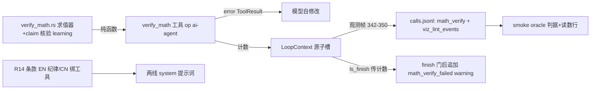

# 施工图 · w1 verify_math 断言核验接口 v0

## 1. 元信息

- **目标**：课时内容引擎新增 verify_math 工具 op——模型把数学翻译成 claim JSON，确定性核验器执行 eval/identity 采样核验；R14 条款双宿随批；smoke 种子预埋 oracle 对账；顺带修复 f3 viz_lint_events 读数写端缺陷
- **版本**：v1
- **状态**：草稿
- **日期**：2026-10-31
- **票**：[tickets/w1-verify-math-v0.md](../tickets/w1-verify-math-v0.md)（Resolution 已记裁决与勘误）

<!-- 状态流转：草稿 → 定稿（用户确认后，守图协议生效）→ 施工中 → 已完成 -->

## 2. 现状摘要

- **依赖方向**：nomifun-ai-agent → nomifun-learning 单向（两 Cargo.toml 核实）——求值器放 learning，ai-agent 工具 handler 直调，零新依赖；「确定性逻辑单源在 learning」分层先例 = SectionPack/LessonOp/validate_body 全部跨用（lesson_content_loop.rs:24-28 导入表、7-10 分层契约注释）
- **工具机制**：OneShotTool{name, description, input_schema, handler}（one_shot.rs:38-42）；**工具数组即白名单**（lesson_content_tools，lesson_content_loop.rs:798-812，按 face 组装）；精确向量测试 `lesson_loop_exposes_exactly_the_whitelist`（1565-1635）；无 ls_ 前缀执法代码；一轮 turn 可多次工具调用（loop_core.rs:242-253、385-401）；handler Ok(String)→正常结果、Err(String)→error ToolResult 原文回模型（loop_core.rs:390-401）；参数解析 = 严格 serde_json::from_value，失败 Err 带前缀串（924-925 模子）；白名单外工具 fail-closed（loop_core.rs:385-388）
- **轮预算**：生成 50 轮 / 修复 20 轮 / 修复环 3 圈 / 总超时 600s（loop_core.rs:23-37）
- **R10–R13 双宿**：EN `CONTENT_DISCIPLINE_V2_BLOCK`（generation/lesson.rs:818-823，开关 `NOMI_LEARNING_CONTENT_DISCIPLINE_V2` :801，进传统线三条 stage prompt）+ 中文孪生 `CONTENT_DISCIPLINE_V2_CN`（lesson_content_loop.rs:63-68，经 GENERATE_LESSON_AGENT_SYSTEM `{discipline_v2}` 插槽 :125）；条款覆盖断言两处（lesson_content_loop.rs:1414-1434、generation/tests.rs:1448-1543 开关双臂）；**课时线无金样**（1438-1439 注释自证）
- **传统线无工具循环**：learning 侧 stage prompt 管线是纯 completer 调用——EN 版 R14 只能写纪律，中文版才绑 verify_math
- **REPAIR 对照表**：lesson_content_loop.rs:153-162 纯文本无测试钉住；含 stale 行 `section_binding_unknown`（160 行，全仓无产生点）
- **审计 findings**：LessonFinding{severity, kind: String, message}（lesson_draft.rs:387-392）；`audit_findings` 是无状态纯函数、refresh_audit 整表重算（806-822）；仅 SEV_DANGER 挡 finish 门（service/lesson_draft.rs:131-140）；finish 后追加的唯一先例 = `viz_block_lint_dropped`（sweep 在 refresh 之后，service:126-130）
- **f3 读数真缺陷（本票顺带修）**：smoke 读 calls.jsonl `lesson_agent_publish` 行的 viz_lint_events（learning_smoke.rs:2697-2704），但写端观测帧（lesson_content_loop.rs:342-350）只含 capacity_note/estimated_minutes；字段只进 WS `publish_ok` 帧（481 行）不进 calls.jsonl——读数结构性恒 0
- **publish_frame**：FlowCycle 关联函数（467-487），拿不到 LoopContext，签名牵三流——计数不能照抄 viz_lint_events 走 LessonDraft 私有字段（verify_math 不落库）
- **数值代码现状**：全仓无表达式求值器/解析器（grep 零命中、无 evalexpr/meval 依赖）——从零手写；容差先例 = ActivityKind::Numeric 绝对容差、缺省/下限 1e-9（progress.rs:482-494）
- **测试基建**：假 LLM = ScriptedProvider（learning_loop.rs:580-740 test_support，含开流故障注入）；handler 直调样 1641-1714；全循环红绿样 1718-1778（ScriptedProvider 逐轮 tool_use+done 脚本）；预算尽留痕样 1868-1902
- **smoke**：run_content 在 nomifun-app（learning_smoke.rs:2336-2770）；种子零 LLM 直插（2350-2492：两课时/概念 α β/挂接/已会声明锚/L1 stub 节 body 在 :2453-2488 写死）；generate_lesson_content 真跑（2513-2522）；calls.jsonl 读档 2554-2560；读数行群 2660-2754
- 语言/惯例：Rust edition 2024；测试内嵌模块；零迁移零新依赖

## 3. 总体结构



- **关键流程**：模型起草 → 调 verify_math（claim JSON）→ 核验器确定性执行 → 失败 error 回灌自修改（不占轮预算）→ ls_finish 携失败计数 → finish 门后 warning 留痕 → 观测帧带计数 → smoke oracle 对账
- **全局不变量与禁区**：
  - 零迁移；零新依赖（不引 evalexpr/rand/任何解析 crate）
  - ls_* 既有 op 语义零改动；白名单精确向量随批更新（两 face）
  - CONTENT_DISCIPLINE_V2 开关语义不变（R14 同命退场，不新增开关）；传统线不加工具
  - 发布面不做 danger 拦截（Q1 裁决）；w2 的 quiz/settle 面**零触碰**
  - 真机臂严格串行（quality-fixes 教训）
  - learnhub 无对应物——域中立自研，票内记档即可

## 4. 分块图纸

### 4.1 · 求值器与 claim 核验（nomifun-learning 新模块 `src/verify_math.rs`，lib.rs 导出）

- **接口契约**（契约层，serde 形状）：

```rust
#[derive(Deserialize)] #[serde(tag = "kind", rename_all = "snake_case")]
pub enum MathClaim {
    Eval      { expr: String, expected: Option<f64>, tolerance: Option<f64> },
    Identity  { lhs: String, rhs: String, variables: Vec<String>, tolerance: Option<u8 采样数省略于 schema>, samples: Option<u8> },
}
pub enum ClaimVerdict { Pass { value: Option<f64> }, Fail { reason: String, computed: Option<f64>, counterexample: Option<String> } }
pub fn verify_claim(claim: &MathClaim) -> ClaimVerdict              // 永不 panic
pub fn eval_expr(expr: &str, bindings: &[(String, f64)]) -> Result<f64, ExprError>  // ExprError 带位置
```

- **求值器（手写 Pratt，零依赖）**：
  - 文法：数字（整/浮/科学计数）、标识符（变量、常量 `pi`/`e`）、一元 `−`、二元 `+ − * / ^`（^ 右结合、高于一元负号）、括号、函数 `sqrt sin cos tan ln log exp abs`（log = 以 10 为底）；**不支持隐式乘法与 `%` 字面量**（模型必须写显式 `*` 与小数——红绿样钉住报错文案）
  - 求值 f64；除零/ln 负数/溢出 → 非有限值按失败路径处理，不 panic
- **核验语义（伪代码）**：

```
Eval:    v = eval(expr, bindings)
         expected 缺省 → Pass{value:v}
         有 expected  → |v−expected| ≤ tol·max(1,|expected|) ? Pass : Fail{computed:v}
         tol 缺省 = 相对 1e-9，绝对地板 1e-12（对齐 Numeric 先例精神）
Identity: 确定性 LCG 伪随机（固定种子，零 rand 依赖）逐变量取默认域 [−3,3) 内
          samples 缺省 7 点；任一点两侧非有限 → 跳过并补采（上限 3×samples）
          全部点 |lhs−rhs| ≤ tol·max(1,|lhs|,|rhs|) → Pass
          任一点违背 → Fail{counterexample: 该点变量值与两侧值}
          有效点不足 3 → Fail「无有效采样点」
解析失败 → ClaimVerdict::Fail{reason: 位置+原因}（对模型可读，非 Err——解析错也算
          核验结论，模型据此改 claim；仅 claim JSON 本体损坏才由 op 层 Err）
```

- **红绿样（内嵌 tests）**：全运算符/优先级/右结合 ^/一元负号/函数表；a3 病例
  `1/(4-1)*((3.0-0.0)^2+(1.0-0.0)^2+...)` 型平方和 = 10；Identity `x^2` vs `x*x` 过、
  `x^2` vs `(x+1)^2` 出 counterexample；奇点（1/x 于 0 附近）补采；隐式乘法报错文案

### 4.2 · verify_math 工具 op（ai-agent lesson_content_loop.rs）

- **接口契约**：

```rust
// 新 fn verify_math_tool(ctx) -> OneShotTool
// name: "verify_math"；description 中文（对齐既有工具风格）；
// input_schema = MathClaim 的 JSON Schema（json! 内联，照 ls_set_section_manifest 模子 889-915）
// handler: serde_json::from_value::<MathClaim> 失败 → Err("verify_math: claim 必须是 "
//   + "{kind:eval|identity,...} 形状——{error}")；成功 → nomifun_learning::verify_claim
//   → Ok(serde_json::to_string 序列化 verdict)；同时 ctx.math_verify 计数槽 bump
```

- **注册**：`lesson_content_tools` 两 face 各 push（**不** require_draft——与 ls_start 同族的无草稿只读 op）；白名单测试两向量加 `"verify_math"`
- **失败路径**：claim JSON 损坏 → Err（模型下一轮改 claim）；核验 Fail → **Ok**（verdict JSON 内含 reason/computed/counterexample——核验失败是正常结论不是工具故障）；无任何路径触库

### 4.3 · 计数接线 + f3 读数修复（ai-agent）

- **计数槽**：LoopContext 增 `math_verify: Arc<MathVerifyCounters>`（calls/passed/failed 三个 AtomicUsize，构造于 run_loops 入口）；handler 从 lesson_content_tools 闭包捕获
- **观测帧（342-350，本票顺带修 f3）**：加 `"viz_lint_events": output.viz_lint_events`（f3 缺的字段，output 在该点已可用）与 `"math_verify": {calls, passed, failed}`——smoke 实际读的汇点从此真实
- **WS publish_ok 帧（481 行）**：viz_lint_events 保留不动；math_verify 不进此帧（ LoopContext 不可达，不加签名——禁区）
- **失败路径**：计数仅观测面，任何丢失不影响生成正确性

### 4.4 · R14 条款双写（非对称，决策卡 A4）

- **learning EN**（CONTENT_DISCIPLINE_V2_BLOCK 追加，无工具可调——纪律版）：
  `R14 Computable quantities are computed, never guessed: any number derivable from data printed in the section (sums, means, unit conversions, counts, date spans) is calculated explicitly with the intermediate steps shown; a contrast column gets the same step-by-step expansion as the worked column (never jump from the mean straight to the sum); "≈" is reserved for the final root/limit step.`
- **ai-agent 中文**（CONTENT_DISCIPLINE_V2_CN 追加，绑工具）：`R14 可算量必须实算：凡能从本节已印数据直接推算的量（和、均值、单位换算、计数、日期差），先调 verify_math 实算再写入正文，并展示可复核的中间步骤；对照列与精确列同等展开，禁止从均值直接跳到和；「≈」只许用在最后开方/极限步。`
- **条款覆盖断言随批**：lesson_content_loop.rs:1414 加短语；generation/tests.rs:1448 开关双臂加条款
- **失败路径**：V2 开关 off = R14 同灭（工具 op 仍在，无害）；传统线消费 EN 版（纯纪律，v0 无机械背书——记档）

### 4.5 · 发布面留痕（learning service + ai-agent handler）

- **接口契约**：`service.finish_lesson_draft(...)` 增参 `math_verify_failed: u32`；ls_finish handler 从 ctx 槽读取传入
- **行为**：`finish` 门 refresh 之后（viz_block_lint_dropped 同位）`failed > 0` → `findings.push(warning("math_verify_failed", "本课 verify_math 失败 {n} 次，未必已全部修正"))`；不挡发布
- **失败路径**：failed = 0 → 零痕迹；calls.jsonl 观测面与 findings 面相互独立

### 4.6 · smoke oracle（nomifun-app learning_smoke.rs run_content）

- **种子预埋**（2453-2488 邻域，**双保险**）：
  1. L1 s2 stub 例题正文写死固定序列「四个交易日的日对数收益（%）：+3.0, −1.0, +2.0, −4.0」（先例摘要引用节标题，标题不动——判据⑤安全已核实）
  2. L2 `summary` 字段与概念 β 定义各带同序列（L2 概念面/summary 必进生成上下文——**施工步走查项**：确认 LessonGenerationContext 消费 summary；若不消费，概念定义通道兜底）
  - 期望值算死：均值 0、平方和 30、/3 = 10、**σ = √10 ≈ 3.1623**
- **判据**（新增，非门禁读数之外）：`calls.jsonl` 含 verify_math 调用 ≥1 且 math_verify.failed == 0（发布帧）**且** 正文包含期望值变体之一（`"3.16"` / `"3.2"`）；未命中 → 判据红如实退非零
- **读数行**：`math_verify read-out: calls=N passed=P failed=F`（2660-2754 群追加，从修复后的观测帧取数）；`viz_lint read-out` 行保留（从此真实）
- **失败路径**：模型未采用预埋序列 → oracle 红（如实报，首跑后若证明误导再复议为软——未决事项挂账）

## 5. 决策卡片

### A1 · 求值器单源 learning，零依赖手写 Pratt

- **类型**：模块边界
- **决策**：求值器+claim 核验落 `nomifun-learning/src/verify_math.rs`；手写 Pratt 解析器，零外部依赖。
- **理由**：ai-agent → learning 单向依赖（Cargo.toml 核实），handler 直调零新边；「确定性逻辑单源在 learning」既有分层（validate_body/SectionPack 跨用先例）；w2 quiz 线与未来传统线复用最近。被否备选：ai-agent 落点（learning 侧降级管线/quiz 看不见，分层相悖）；新共享 crate（AGENTS「Keep new shared crates rare」，单消费方向收益零）；evalexpr/meval crate（外部依赖+语法不可控，AGENTS 依赖纪律）。
- **代价**：解析器约 300-400 行自维护（文法固定后稳定）；无 CAS 能力（v3 决策门）。
- **推翻条件**：出现第二个非学习消费方（如前端/其他 crate 需要同款求值），或语法需求超出 Pratt 舒适区（矩阵/符号微积分）。

### A2 · claim 两 kind v0，确定性采样

- **类型**：接口契约
- **决策**：v0 只做 eval 与 identity（采样 5–10 点）；采样用固定种子 LCG（零 rand 依赖、可复现）；相对容差 1e-9、绝对地板 1e-12。
- **理由**：票面裁决；生成错误非对抗构造，采样必中；确定性使测试可钉、真机可复跑对账。
- **代价**：周期函数/奇点邻域需补采逻辑；恒真但采样点恰好重合的极端构造检测不到（非目标）。
- **推翻条件**：真机出现采样漏检病例。

### A3 · 失败语义：工具层硬反馈 + 发布面信息性留痕，无 danger

- **类型**：失败模式
- **决策**：见 4.2/4.5。核验 Fail 是 Ok 结果（正常结论）；仅 claim JSON 损坏是 Err；finish 后 `math_verify_failed` warning；不做 danger 拦截、发布面不重放。
- **理由**：Q1 裁决——发布面无法重放核验（claim 时效性），danger 会把「一道题改不对」放大成整课失败；viz lint 判例同形（操作层拒绝/反馈 + 发布面 warning）。
- **代价**：模型无视核验结果硬写错数，发布面无二次拦截（v0 接受，smoke oracle 与真机抽验兜底）；「未调用 verify_math」不可机械检测。
- **推翻条件**：真机出现无视 error ToolResult 硬写错数的复现案例 → 议「失败未修正升级 danger」。

### A4 · R14 双宿非对称

- **类型**：接口契约
- **决策**：EN（传统线）纯纪律版（实算+展示步骤+对照列同展开），中文（图线）绑 verify_math 工具；同进 V2 块随开关同命。
- **理由**：传统线无工具循环，写「调工具」是指望不上的空话；图线有 op。两宿文本孪生是 R10-R13 既有形状（lesson.rs:783-785 注释明说两处手写各随其风格）。
- **代价**：两处手写措辞漂移风险（条款覆盖断言双份钉住缓解）；传统线无可算量机械背书（记档）。
- **推翻条件**：传统线接工具循环时合并。

### A5 · 计数走 LoopContext 原子槽 + 观测帧（不进 WS 帧/不走 LessonDraft）

- **类型**：数据结构
- **决策**：见 4.3。verify_math 不落库 → 无 LessonDraft 载体；publish_frame 拿不到 ctx 且牵三流 → WS 帧不加；观测帧（342-350，有 ctx、smoke 实读）为唯一汇点，顺带补 viz_lint_events 修 f3。
- **理由**：最小穿出路径；f3 缺陷与 math_verify 同槽一次修。
- **代价**：WS publish_ok 帧看不到 math_verify（前端暂无此消费面）。
- **推翻条件**：前端要展示核验统计时，再议 LessonOutput 穿出。

### A6 · smoke oracle：字符串包含 + 调用计数 + 预埋双保险

- **类型**：验收设计
- **决策**：见 4.6。期望值字符串变体匹配（3.16/3.2）；verify_math 调用 ≥1 且 failed==0 为硬判据；序列预埋 L1 例题正文 + L2 summary + 概念 β 定义三处双保险。
- **理由**：数值抽取器脆弱易误报（Q4 裁决）；多通道预埋保证模型必然见到序列（context 消费面在实现期核实，双保险消未决）。
- **代价**：模型弃用预埋序列自编数字时 oracle 红（真机首跑观察，误伤则复议为软）；「包含 3.16」理论上可能被无关文本误中（概率极低，实算对照兜底）。
- **推翻条件**：首跑 oracle 红但正文数学实际正确（误报）。

## 6. 施工顺序

| # | 施工步 | 图纸位置 | 验收 |
|---|---|---|---|
| 1 | verify_math.rs：Pratt 求值器+claim 核验+红绿样 | 4.1, A1, A2 | cargo test -p nomifun-learning；a3 病例/奇点/隐式乘法报错样全绿 |
| 2 | 工具 op+白名单+计数槽+观测帧（含 f3 修复） | 4.2-4.3, A5 | 白名单两向量断言过；handler 直调样（解析边界/Fail 是 Ok/Err 形状）；观测帧字段断言 |
| 3 | R14 双写+条款断言 | 4.4, A4 | 两处覆盖断言绿；V2 off 双臂 R14 同灭 |
| 4 | finish 留痕：ls_finish 传计数→service 追加 warning | 4.5, A3 | failed>0 warning 在场、failed=0 零痕迹；不挡发布断言 |
| 5 | smoke：种子预埋（含 summary 消费面走查）+判据+读数行 | 4.6, A6 | 无凭据臂编译+读数行目验；预期值常量与求值器单测对账 |
| 6 | 全量验证 | 全图 | cargo test -p nomifun-learning -p nomifun-ai-agent 全绿；fmt -p 三包；cargo check --workspace |
| 7 | 真机（单飞） | 4.6 | smoke content EXIT=0、math_verify 读数在场、oracle 判据真机核；viz_lint 读数恢复真实性 |

## 7. 未决事项

- **L2 summary 是否进 LessonGenerationContext**：施工步 5 走查核实；图上已按「summary+概念定义双保险」设计，无论走查结果如何判据不裸奔。
- **采样域与点数**（[−3,3)、7 点）：实现可调常量；触发重议 = 真机漏检病例。
- **工具 description 文案**：中文对齐既有工具风格，实现定。

## 8. 变更记录

| 日期 | 类型 | 位置 | 变更 | 根因/触发 |
|---|---|---|---|---|
| 2026-10-31 | 修订（定稿前） | 全图 | v1 成图：六问裁决入图（失败语义/f3 缺陷顺带修/接线包/oracle 形态/w2 收窄/编排）；票面三处勘误（smoke 宿主/R14 双宿/f3 读数恒 0） | grilling 2026-10-31 + 双代理影响面核查 |
