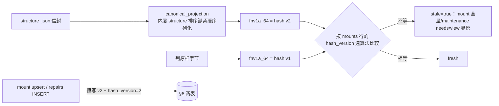

# 施工图 · x06+x07 结构活文档锚点——规范化 hash 与 seq 水位

## 1. 元信息

- **目标**：`structure_hash` 从「列原样字节 FNV-1a」改为「规范化投影 + hash_version」；`findings_watermark` 从自增 id 改锚每课程单调 `seq`——重序列化不再误判 stale，备份还原不再漂移水位
- **版本**：v1
- **状态**：定稿（用户确认 2026-11-02；施工按本图，变更走 §8 记录）
- **日期**：2026-11-02
- **覆盖票**：x06、x07；依赖图 1（基线 §6 节）

## 2. 现状摘要

- **hash 现状**：`fnv1a_64`（mounting.rs:46-53，导出名 `learning_graph_hash` lib:81）。五个生产调用点全部「读 `structure_json` 列原样字符串 → hash 原样字节」：mount svc:469、repair old svc:742、maintenance_needs svc:1169、view svc:3478；唯一写侧 repair new svc:956-957 是**对刚构造信封的重序列化结果**求 hash（该字符串随即落列，因此自我一致）。stale 比较三处同式 `stored(as u64) != current`：mount svc:505-520、maintenance svc:1179-1210、view `structure_view.rs:52`。u64↔i64 位转换读写各半（svc:545/641/671/834-835/983-984 与 svc:514/1206、sv:52）。
- **信封**：`snapshot_envelope`（structure_gen.rs:289-296）`{version:1, generated_at, structure, terrain}` + `lexicon` 旁键（lexicon.rs:71-87，`carry/attach`）。落列仅两处：svc:253-262（生成）、svc:960-966（修补，仅 !noop）。所有读者都先 `from_str::<Value>` 解析信封再取键——**四个 stale 读点全部已持有解析后的 Value**，改投影不需要新解析。
- **水位现状**：findings INSERT 单点 svc:1031-1066（`source='concept-review'` 字面量，issue 空跳过，失败 warn 不阻断）；读 `findings_watermark()` svc:1071-1087（stored 缺省 0，**clamp 到 MAX(id)**）；推进 `advance_findings_watermark` svc:1091-1118（upsert `MAX(列, excluded)`，through clamp）。消费查询两处均 `WHERE course_id=? AND id > ?`（svc:752-760、计数 svc:1158-1166）。推进时机：repair 到 applied/noop 终态后 svc:997-1001，`through = 本轮回合读到的最后一行 id`。开关 `NOMI_LEARNING_FINDINGS_WATERMARK`（svc:17-29，off=全量重读不推水位）。
- **还原**：`rebuild_v3_database_contents`（backup_bundle.rs:945-1036）按 PRODUCT_TABLES 逐表 `SELECT * ORDER BY id` 重插、清 `sqlite_sequence`、`findings_watermark` 作为普通列原值复制；**nomifun-db 内无任何水位修正代码**（grep 零命中）——漂移全靠读侧 clamp 兜底（这正是要删的东西）。
- **迁移**：082 mounts（structure_hash INTEGER NOT NULL）+ findings；083 repairs（old_hash/new_hash）；087 maintenance_state（findings_watermark >= 0）。均在基线 §6，图 1 已折。
- **smoke 锚点**：mount 档 smk:2965-2982 用 `learning_graph_hash(raw)` 断言行 hash；:2989-3004 二次 skipped；repair 档 smk:3189-3202 级联 stale EXIT=3；maintenance 档 smk:3424-3446 水位 `Some(2)`/off 臂 None、二回合幂等。
- **契约文档**：`learning-structure-artifacts.md:318-325`（§9.1：hash=对列原样字节）与 :397-399（repairs 行）需改写；`mnt:708-719` 互钉测试只钉条款码，不受影响。

## 3. 总体结构



- **数据流**：hash 计算单源化为一个 helper（4.1），三个 stale 比较点与 smoke 全部改走它；seq 水位改两个查询 + INSERT（4.2）。
- **全局不变量与禁区**：
  - **GET 路径不写库**：view/maintenance 只按存量 hash_version 比较，不回写升级（A2）。
  - `structure_json` 信封 `version` 本票**不动**（x08 才 bump 2）；hash_version 与信封 version 是两个独立代际。
  - `terrain/lexicon/generated_at/信封 version` 一律不进 hash 输入（投影只取内层 `structure`）——x14 的 `ext` 天然被排除。
  - 不改 `NOMI_LEARNING_FINDINGS_WATERMARK` 开关语义；不改 mount/repair 回合的取消/任务闸逻辑。
  - u64→i64 位转换口径不变。

## 4. 分块图纸

### 4.1 · hash 单源 helper（mounting.rs）

- **接口契约**：

```rust
pub const STRUCTURE_HASH_VERSION_V1: i64 = 1;  // 列原样字节（历史 dev 库）
pub const STRUCTURE_HASH_VERSION: i64 = 2;     // 规范化投影（现行）

/// 解析失败（信封缺 structure / 非 JSON）→ None，调用方回退 v1 对原样字节求 hash
pub fn canonical_structure_hash(envelope: &serde_json::Value) -> Option<u64>
//   = envelope.get("structure") → serde_json::to_string(紧凑) → fnv1a_64(bytes)

/// 三个 stale 比较点共用的「当前列 → (hash, version)」：
pub fn hash_structure_column(raw_column: &str) -> (u64, i64)
//   from_str::<Value>(raw) Ok 且含 object 形 structure → (v2, 2)
//   否则（空/坏/无 structure 键）→ (fnv1a_64(raw.as_bytes()), 1)

/// 按存量行的 hash_version 比较是否 stale：
pub fn mounts_stale(stored_hash: i64, stored_version: i64, raw_column: &str) -> bool
//   stored_version <= 1 → stored(as u64) != fnv1a_64(raw)
//   else               → stored(as u64) != hash_structure_column(raw).0
```

- **调用点改造**：mount svc:469 改 `hash_structure_column`（写库时 `hash_version: 2` 恒定）；repair svc:742/956-957 同（old/new 恒 v2，repairs 行写 `hash_version: 2`）；maintenance svc:1169 与 view sv:52 改 `mounts_stale(...)`，mounts 行 SELECT 增取 `hash_version` 列。smk:2977 改用 `hash_structure_column`。
- **失败路径**：信封解析失败的列（理论不存在，CHECK 只保证 object）→ v1 口径比较，行为与今日一致，不新增错误面。

### 4.2 · seq 水位（基线 §6 编辑 + svc 改造）

- **基线 §6 数据形状**（编辑图 1 折出的 CREATE）：

```sql
-- learning_structure_findings：course_id 后加一列
seq INTEGER NOT NULL CHECK (seq > 0),
-- 索引：idx_learning_structure_findings_course 由 (course_id, ts) 改为
CREATE INDEX idx_learning_structure_findings_course ON learning_structure_findings(course_id, seq);
-- learning_structure_mounts / learning_structure_repairs 各加
hash_version INTEGER NOT NULL DEFAULT 1,
```

- **接口契约（svc）**：

```rust
// record_review_findings：进入时
let mut next_seq: i64 = SELECT COALESCE(MAX(seq), 0) + 1 FROM learning_structure_findings WHERE course_id = ?;
// 每行 INSERT 绑 next_seq 后自增；单写者（generation slot + SQLite 单写）无竞态
// findings_watermark(course_id) -> i64：SELECT findings_watermark ... ；删 clamp（MIN 0 保留）
// advance_findings_watermark：删 through clamp；upsert MAX(列, excluded) 不变
// repair 输入查询 / needs 计数：id > ? → seq > ?；consumed_through = 最后一行 seq
```

- **失败路径**：`MAX(seq)+1` 与 INSERT 之间无并发写者（回合同持 generation slot；维护回合串行）；若未来出现并发源，把「取号+插入」包进同一事务即可（现 fn 已在事务语义内执行多条 INSERT，加 `BEGIN` 边界由实现按现有事务包裹方式落）。

### 4.3 · 文档与 smoke

- 契约文档：`§9.1`（doc:318-325）改写为「hash = 内层 structure 规范化投影的 FNV-1a 64，`hash_version` 标算法代际（v1=历史原样字节，读侧按存量版本比较，写侧恒 v2）；lexicon/ext/terrain/generated_at 不进 hash」；`:397-399` repairs 行补 hash_version。§9.1 的水位描述改 seq 口径。
- smoke：mount 档断言改 `hash_structure_column`；maintenance 档水位断言数值不变（同课程两条 findings → seq 1,2）；`learning_graph_hash` 导出名保留（v1 函数，测试向量测试 mnt:565-569 不动）。

## 5. 决策卡片

### A1 · 规范化 = 解析后紧凑序列化，不手写键排序

- **类型**：算法
- **决策**：`canonical_structure_hash` = 对解析后的内层 `structure` 做 `serde_json::to_string`（紧凑）再 FNV-1a，不引入排序/规范化 JSON 库。
- **理由**：serde_json 默认 Map 为 BTreeMap（键序稳定），解析-再序列化天然消灭键序与空白差异；四个 stale 读点全部已解析信封（现状摘要），零新增解析成本。
- **代价**：**依赖 serde_json 未开 `preserve_order` feature**——这是环境假设，施工步 1 必须核对 Cargo.lock；一旦仓库他处开启该 feature，键序=插入序，规范化失效。
- **推翻条件**：Cargo.lock 出现 `preserve_order`（届时换 `BTreeMap` 重建中间 Value 或引入 canonical 序列化小函数，接口不变）。

### A2 · 读侧按存量版本比较、不回写；写侧恒 v2

- **类型**：失败模式
- **决策**：三处 stale 比较「按 mounts 行的 hash_version 选算法」；只有 mount upsert 与 repairs INSERT 写 v2。不做「读时发现 v1 匹配就顺手升级」。
- **理由**：view 是 GET（structure_view 路由只读），读路径写库破坏幂等语义且引入写权限需求；v1 行只要结构没变就永远 v1-fresh，直到该课程下一次 mount/repair 回合自然升级——语义正确且零额外写。
- **代价**：v1 行的 freshness 判定要多算一次 v1 hash（微不足道）；repairs 历史里 old_hash 可能与旧 mounts 行的 v1 值不同算法（不可直接互比——契约文档写明 repairs 行内自洽即可）。
- **推翻条件**：出现「必须把存量 v1 全量迁到 v2」的运维需求（届时一条 UPDATE 式回填回合，走 generation_tasks）。

### A3 · findings 每课程单调 seq，索引随查询走

- **类型**：数据结构
- **决策**：`seq` 每课程从 1 单调递增；索引由 `(course_id, ts)` 改为 `(course_id, seq)`，不保留 ts 索引。
- **理由**：消费查询只有「seq > 水位」两处（repair 输入 + needs 计数），seq 索引精确覆盖；seq 是业务列随 bundle 原值复制（`ORDER BY id` 重插保序、列值不重算），还原后水位不漂移——这是换锚的全部目的；ts 索引无任何查询使用（findings 无时间线读面）。
- **代价**：放弃按 ts 检索 findings 的能力（当前不存在该面；将来要时间线再加 `(course_id, ts)` 索引，纯加索引零迁移）。
- **推翻条件**：出现按时间浏览 findings 的读面需求。

### A4 · 水位列名不改、语义改 seq 并记档

- **类型**：接口契约
- **决策**：`learning_maintenance_state.findings_watermark` 列名不动，存量含义从 findings.id 改为 findings.seq；契约文档与 x20 登记写明。
- **理由**：列名本就无 `_id` 后缀（v3 命名禁忌无关）；改名牵动 id_schema_contract 登记与 SQL 面但无语义收益；列上 `>= 0` CHECK 对 seq 同样成立。
- **代价**：「watermark」一词在文档里从 id 语义换到 seq 语义，历史提交里的语义与现行不同——靠本图与契约文档锚定。
- **推翻条件**：无（列随 §6 建表尚未发布，无兼容包袱；改名纯收益为零故不做）。

## 6. 施工顺序

| # | 施工步 | 图纸位置 | 验收 |
|---|---|---|---|
| 1 | 环境核对：Cargo.lock 无 serde_json `preserve_order` | A1 | grep Cargo.lock 确认；有 → 停下按 A1 推翻条件改设计 |
| 2 | 基线 §6 编辑：seq 列 + 索引更换 + hash_version ×2 | 4.2 | `cargo test -p nomifun-db`（含表数契约不变）；Q8 fixture 升级通过 |
| 3 | mounting.rs 三 helper + 五调用点 + sv:52 + smk:2977 | 4.1 | 新增单测：同结构不同键序/空白 hash 相等、改一 block 名不等、v1 存量比较 fresh、v2 写入；`cargo test -p nomifun-learning` |
| 4 | seq 取号 + 两查询 + 删 clamp + 推进口径 | 4.2 | 单测：还原模拟（改 id 重插、seq 不变）→ 水位不漂、不重跑已消费 findings；`learning-smoke mount/repair/maintenance` 三档 EXIT=0 |
| 5 | 契约文档 §9.1/:397-399 改写 | 4.3 | `mnt:708-719` 互钉测试过；doc 内「原样字节」字样归零 |

## 7. 未决事项

- **`mounts_stale` 对 `hash_version > 2` 的行为**：推荐默认按「不识别的更高版本 → 视为 fresh 并 warn」（未来版本降级运行时不应误报全量 stale）。触发重议：x14/ext 或后续引入 v3 时。
- **`repairs.old_hash` 与旧 v1 mounts 行的可比性**：本图口径「repairs 行内自洽」；x20 登记时写明「跨表比较必须经 hash_version」。无需动作。

## 8. 变更记录

| 日期 | 类型 | 位置 | 变更 | 根因/触发 |
|---|---|---|---|---|
| 2026-11-02 | 修订 | 2 | 「还原钳位在 backup_bundle」勘误：nomifun-db 内无水位修正代码，clamp 全在 learning 读侧（svc:1086/1103）；本票动作 = 删读侧 clamp，还原路径零改动 | 图 3 读码底稿 F 节 |
| 2026-11-02 | 守图裁决 | 4.1/A2 | **票面 x07「v1 相等则静默升级写回」与图 A2「读路径不回写」冲突**：按定稿图执行 A2——三处 stale 比较按存量 `hash_version` 选算法、不回写；v1 行保持 fresh 直到下一次 mount/repair 回合自然升级（GET 幂等不被破坏）。票面该句作废。 | 图优先于票（六图定稿，用户 2026-11-02 确认） |
| 2026-11-02 | 施工记录 | 4.1/4.2 | 落地：`mounting.rs` 新增 `STRUCTURE_HASH_VERSION(_V1)` / `canonical_structure_hash` / `hash_structure_column` / `mounts_stale`（未知更高版本 fresh + warn）；mount upsert、repairs 行写 v2；maintenance_needs 与 structure_view 改按存量版本比较（view 签名收 `stale: bool`）。基线 §6 加 `findings.seq`（索引改 `(course_id, seq)`）与 mounts/repairs 的 `hash_version`；`record_review_findings` 取 `MAX(seq)+1` 单写者自增；repair 输入/needs 计数改 `seq > 水位`；水位读写删 clamp。 | 图 3 施工 |
| 2026-11-02 | 施工记录 | 4.3 | 测试：hash 键序/空白相等、改块名不等、旁键不进 hash、v1/v2/未来版本比较三态；原「越界水位钳到 MAX(id)」用例替换为**还原重编号模拟**（改 id 重插、seq 不变 → 水位不漂、回合 skipped 零 LLM）。散落的 findings 直插（service tests + smoke 三处）补 `seq`。 | 图 3 施工 |
| 2026-11-02 | 勘误 | 4.1 | `structure_view::build_structure_view` 的 `current_hash: u64` 参数改为 `stale: bool`（stale 单源在 service 的 `mounts_stale`），避免 view 层重复实现版本选择；view 测试同步改 `false`。 | 施工时签名收敛 |
