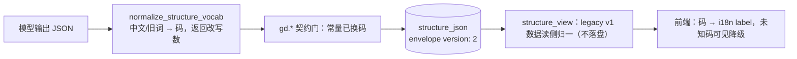

# 施工图 · x08 structure_json 稳定码统一

## 1. 元信息

- **目标**：`structure_json` 内的中文取值（stage/domain_type/source_tier）改为落库码，`EDGE_TIERS` 的 `use` 合一为词汇表钉死的 `apply`；模型输出中文、落库前机械归一（CONTEXT.md「Stored Code」）
- **版本**：v1
- **状态**：定稿（用户确认 2026-11-02；施工按本图，变更走 §8 记录）
- **日期**：2026-11-02
- **覆盖票**：x08（+ x14 阶段二回写位）；依赖图 1（基线 §2）

## 2. 现状摘要

- 常量（structure_contract.rs）：`STAGES` 入门/进阶/高级（:107，`stage_rank` :110-115 按 position 排序）、`EDGE_TIERS` know/**use**/teach（:119，:118 注释自称「两套词」）、`DOMAIN_TYPES` 理论/工程/历史/技能（:121）、`SOURCE_TIERS` 名录/章节（:123）；GOAL_TYPES/QUALITY_STATUS/DOOR_KINDS 已是英文码。消费：`validate_structure` 各 gd.* 条款（:270-293/:448-456/:558-571/:586-598/:641-647）、`structure_schema` enum 钉（:999-1062）、`validate_ops`（structure_ops.rs:371-384，ST_OPS_SHAPE）、`stage_rank`（structure_view.rs:362 矩阵三格/:502,520 参考行）。
- **产出侧**：提示词 P-GOAL:22-38（四字 domain_type、stage 三档、tier `know、use、teach`、入门档纪律散文）、P-REPAIR:27、两份金样提示词同款；`PROMPTS:402-446` 测试断言提示词含 `理论 / 工程 / 历史 / 技能` 与 `know、use、teach`。
- **归一先例**：`growth_contract::normalize_proposal`（growth_contract.rs:61-107）——概念 tier 中文（知道/会用/能教）+ 英文大小写 → 码，作用于 `nodes[].teaches/assumes[].tier`，在 `parse_coach_reply` 内先于校验执行（LGMOD:655）。**structure_json 无对应归一函数**——本图补。
- **读侧**：投影原样透传（structure_view.rs:238/258-259/408-410）；stage 进教练上下文（render_reference_lines :517）与修补回合快照行（svc:855-856）、声明 target_lines（basis_declaration.rs:175）；前端 `TYPES:751-801` 中文/`use` union、`BlockDetail.tsx:32-41` stageLabel 中文 switch、`:113,117` tier 裸插值、`MatrixView` 已是英文键、`RelationNet/RouteMap/palette` 只读 edge_type；`domain_type/source_tier` 前端**零消费**。
- **种子/夹具面**（改码清单，实现时逐个过）：SMOKE:2895-2896/:3019/:3037/:3039/:3059-3061/:3571-3572；CONTRACT:1144-1177 金样 + :1267/:1576 等 fixture；GEN:304-326/:615-621；VIEW:541-576/:733；OPS:811-1020 各 fixture；SVCTEST:3332-3383/:3598-3652/:4145-4152；BASISTEST:79-111；`mindmapLayout.test.ts:39`；`use` 字面量全集 = TYPES:801 + CONTRACT:1176/:1267 + VIEW:575 + OPS:842/967/996/1003 + SMOKE:3060 + P-GOAL:38/P-REPAIR:27/金样 + PROMPTS:421 + `generation/lesson.rs:791`（英文散文里的概念 tier 误写 `use`，一并改 `apply`）。
- envelope `version: 1` 现无任何读者分支（structure_gen.rs:289-296 构造，读侧只 `get("structure")`）。

## 3. 总体结构



- **全局不变量与禁区**：
  - 取值集只有三个换码 + tier 合一；`EDGE_TYPES`/`GOAL_TYPES`/`QUALITY_STATUS`/`DOOR_KINDS`/terrain 键不动。
  - 模型**仍输出中文**（A2）；落库与机面（教练上下文、修补快照行、声明 target_lines、投影 DTO）只出现码。
  - 中文档名（知道/会用/能教）与 stage 中文名只住展示面（CONTEXT.md「Tier Vocabulary Boundary」原条款不变）。
  - 不改 `stage_rank` 语义（position 序）；矩阵三格键 entryway/intermediate/advanced 不动。
  - 基线 §2 的 lesson_concepts.tier（已是 apply）不动。

## 4. 分块图纸

### 4.1 · 常量与映射（structure_contract.rs）

- **接口契约**：

```rust
pub const STAGES: &[&str] = &["basic", "advanced", "expert"];
pub const DOMAIN_TYPES: &[&str] = &["theory", "engineering", "history", "skill"];
pub const SOURCE_TIERS: &[&str] = &["catalog", "chapter"];
pub const EDGE_TIERS: &[&str] = &["know", "apply", "teach"];   // :118 注释删除

/// 中文/旧词 → 码；返回改写数。作用于 frontmatter 两标量、blocks[].stage、edges[].tier。
/// 映射表：入门/进阶/高级 + basic/… 大小写折叠 → STAGES；
///         理论/工程/历史/技能 → DOMAIN_TYPES；名录/章节 → SOURCE_TIERS；
///         use（旧词）/知道/会用/能教 + 大小写 → EDGE_TIERS。
pub fn normalize_structure_vocab(value: &mut Value) -> usize
```

- **数据形状**：落库取值 = 码；`STRUCTURE_ENVELOPE_VERSION: 1 → 2`（structure_gen.rs `snapshot_envelope` 与修补侧 `json!` 两处写点同步）。

### 4.2 · 调用点

| 点 | 位置 | 动作 |
|---|---|---|
| 生成验收 | structure_gen 生成循环内模型 JSON 解析后、`validate_structure_artifact` 前；`run_structure_generation` 落列前复验同 | `normalize_structure_vocab(&mut v)`，改写数进审计/日志 |
| 修补验收 | `run_repair_round` 返回的 `{ops:[...]}` 解析后、`from_json/validate_ops` 前 | 同上（ops 的 stage/tier 字段被覆盖） |
| 读侧（仅视图） | `build_structure_view`（structure_view.rs:32-43）对克隆的信封执行 | legacy v1 中文数据可见降级为码显示，**不落盘**；v2 数据归一零改写 |
| 其余读点（mount/repair/maintenance/coach 上下文/声明 target） | 不归一 | 它们消费的生产行必是 v2 码；dev 旧数据经 regenerate 自然升级 |

### 4.3 · 提示词与文档

- P-GOAL:22 `domain_type（只允许填 theory / engineering / history / skill——理论/工程/历史/技能——四值之一，不带「型」后缀）`；:24-27 四型分支指引保留中文散文；:30 `stage 只允许 basic / advanced / expert（入门/进阶/高级）`；:38 与 P-REPAIR:27 `tier 只允许 know、apply、teach`；入门档散文（:31/33/34/37）改「basic 档」。两份金样提示词同步。PROMPTS:557/566 金样夹具 `入门`→`basic`。
- DOC：:63/:65/:84/:89 取值行、:100-102/:113-114/:122/:128/:136/:172-181/:373 条款行改码；:136「两套词」括注删除。
- 前端：`TYPES:751-755` 改码 union；`:787-788` `stage: 'basic'|'advanced'|'expert'`；`:800-801` `tier: 'know'|'apply'|'teach'`；`BlockDetail.tsx:32-41` switch 改码、`:113,117` tier 走 `t('learningGraphTier_' + tier)`（未知码回退原样显示）；i18n 补 `learningGraphTier_teach`（双语）；`mindmapLayout.test.ts:39` fixture 改码。

### 4.4 · 失败路径

- 归一后仍出中文/未知码 → gd.* 红条照常打回（归一只收编已知同义词，不造值——机械消化律边界）。
- v1 信封在读侧归一失败（非 JSON）→ 现有 `unwrap_or(Null)` 口径不变，不新增错误面。

## 5. 决策卡片

### A1 · 码值取英文 snake_case 四组

- **类型**：数据结构
- **决策**：`basic|advanced|expert`、`theory|engineering|history|skill`、`catalog|chapter`、tier `know|apply|teach`。
- **理由**：与 `CONTEXT.md:104`「DB 存 locale 无关代码」及全部既有枚举（kind/status/source/tier）命名一致；`apply` 是词汇表钉死的第三档名，`use` 是偏离（裁决 Q5）。
- **代价**：历史 dev 库与既有 smoke/夹具全量换码（§2 清单，一次性）；提示词略长（码 + 中文注）。
- **推翻条件**：无——码值本身可机械替换，唯一约束是「英文、snake_case、与 Tier 同族」，任何满足者皆可，开工不 fuss。

### A2 · 模型输出中文、落库前归一（而非改提示词让模型直出码）

- **类型**：算法
- **决策**：提示词仍给中文词（附码），`normalize_structure_vocab` 在契约门前收编。
- **理由**：直接先例 `normalize_proposal`（growth_contract.rs:61-107）已验证「模型吐中文、机械归一」比「逼模型吐英文码」稳；中文是该分类法的自然面（四型分支指引本就是中文散文）；CONTEXT.md:192 机械消化律的正例。
- **代价**：多一个映射表要随常量维护（与常量同文件、同测试钉）；模型偶尔直出码也要能吃（大小写折叠已覆盖）。
- **推翻条件**：真机连续出现归一表外的新中文变体（≥2 次/周）→ 改为提示词硬性英文码 + 红条。

### A3 · envelope version 1→2，v1 读侧仅视图归一

- **类型**：接口契约
- **决策**：写侧恒 `version: 2`；v1 信封只在 `build_structure_view` 归一显示，不落盘、不阻塞 mount/repair（其生产行必为 v2）。
- **理由**：信封 version 落地两周零消费者，本票给它第一个真实语义（「取值集代际」），也是 x19 懒再生的样板；dev 数据量趋零，不值得写迁移或写路径。
- **代价**：mount/repair 读 v1 旧数据时不归一——stage 中文会原样进教练上下文（仅 dev 残留课程，regenerate 即愈）。
- **推翻条件**：dev 旧课程被用于真机验收且要求数据面干净（届时对这三个读点补同一归一调用，一行/点）。

## 6. 施工顺序

| # | 施工步 | 图纸位置 | 验收 |
|---|---|---|---|
| 1 | 常量换码 + `normalize_structure_vocab` + 映射表单测（红绿样：中文/`use`/大小写/表外值不动） | 4.1 | `CONTRACT:1745` schema 钉测试自动过；归一单测绿 |
| 2 | 生成/修补两验收点接线 + envelope version 2 | 4.2 | `structure` smoke 档 EXIT=0（种子已改码）；改写数日志在场 |
| 3 | 提示词 ×4 + PROMPTS 测试断言 + 金样夹具 | 4.3 | `PROMPTS:402` 断言改码后绿 |
| 4 | 视图读侧归一 + smoke/夹具全量换码（§2 清单） | 4.2/4.4 | `learning-smoke structure/mount/repair` 三档 EXIT=0；`rg '"use"' crates/backend/nomifun-learning` 仅剩知识库无关命中 |
| 5 | 前端 types/BlockDetail/i18n/夹具 | 4.3 | `bun run typecheck && bun run check:i18n`；结构图四视图人工过目（matrix/net/route/mindmap） |
| 6 | DOC 取值行与条款行 | 4.3 | `mnt:708-719` 互钉测试过；doc 内「入门 \| 进阶 \| 高级」字样归零 |

## 7. 未决事项

- **`learningGraphTier_teach` 之外的展示键**：`domain_type/source_tier` 前端零消费，不预造 label 键。影响 4.3。推荐默认：等有 UI 露出再补（届时走 gen:i18n）。触发重议：任一视图要展示两标量。
- **growth 提示词散文里的「入门档」措辞**（LGMOD:595 等）：指结构 stage 的 prose，随步 3 顺手改「basic 档（入门）」；不改也不影响契约。触发重议：无。

## 8. 变更记录

| 日期 | 类型 | 位置 | 变更 | 根因/触发 |
|---|---|---|---|---|
| 2026-11-02 | 修订 | 2/4.3 | `use` 字面量清单落定（13 处 + `generation/lesson.rs:791` 概念 tier 误写一处）；x14 的 ext 阶段二回写位挂在本图（等 x07 合入后补 §ext 键条款） | 图 4 读码底稿 C4/B 节 |
| 2026-11-02 | 施工记录 | 4.1/4.2 | 常量换码（STAGES basic/advanced/expert、DOMAIN_TYPES theory/engineering/history/skill、SOURCE_TIERS catalog/chapter、EDGE_TIERS know/apply/teach）；`normalize_structure_vocab` 单函数覆盖顶层两标量 + `blocks[].stage` + `edges[].tier` + 修补产物 `ops[].stage/tier`（表外值不造值）。接线：structure_gen 解析后、structure_ops 修补产物解析后、structure_view 读侧克隆归一（不落盘）。`STRUCTURE_ENVELOPE_VERSION=2` 同时用于生成快照与修补重写信封。 | 图 4 施工 |
| 2026-11-02 | 施工记录 | 4.3 | 提示词两份资产（goal-decomposition / structure-repair）改码并保留中文注；金样快照用 `LEARNING_UPDATE_GOLDEN=1` 重生成；Rust 夹具全量换码（含 structure_gen/ops/view/contract/smoke/basis/service tests 与 `mod.rs` 参考行）；前端 `types.ts` union、`BlockDetail.tsx` stage switch + tierLabel（未知码原样降级；`learningGraphTier_*` 双语键已存在，无需新增）；`mindmapLayout.test.ts` 夹具改码。 | 图 4 施工 |
| 2026-11-02 | 勘误 | 4.3 | `gd_edges_resolve_against_block_names_only` 原用 `tier="apply"` 造违约——`apply` 从本票起是合法码，改 `bogus`；`envelope_carries_both_artifacts` 版本断言 1→2。 | 施工实测 |
| 2026-11-02 | 施工记录 | 4.4 | 文档 `learning-structure-artifacts.md` 取值/条款行改码（含「两套词」括注删除，改为「与概念网 tier 同集」）；`generation/lesson.rs` 英文散文 `use`→`apply`。 | 图 4 施工 |
| 2026-11-02 | 勘误 | 4.1 | 归一闭包初版捕捉 `rewrites` 造成借用冲突，改为两次内联循环；`current` 先 `map(str::to_owned)` 再 `insert`（避免持有 map 借用）。 | 施工编译 |
