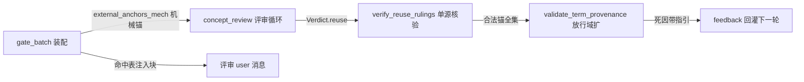

# 施工图 · f1 评审挂号表批外概念锚定

## 1. 元信息

- **目标**：生长批评审的 term_provenance 挂号表放行本批复用命中的 registry 概念锚——声明概念复用批评审不再两连死降级；死因反馈带存量指引
- **版本**：v1
- **状态**：草稿
- **日期**：2026-10-30
- **票**：[tickets/f1-provenance-external-concepts.md](../tickets/f1-provenance-external-concepts.md)（Resolution 已记裁决与勘误）

<!-- 状态流转：草稿 → 定稿（用户确认后，守图协议生效）→ 施工中 → 已完成 -->

## 2. 现状摘要

- 评审输出 `Verdict` 两个独立顶层键：`reuse`（模型裁决复用）与 `term_provenance`（挂号表），各自独立校验（learning_graph/mod.rs:1120-1136）
- 挂号表校验纯函数 `validate_term_provenance(rows, pass, batch, known_names)`（provenance.rs:105-234）；行 concept 合法域 = `batch.mints.canonical ∪ batch.new_aliases.name`（114-131）；**行 concept ∉ 提名即 Err「不在批内提名」（145-149）——本票死点**
- 已教行 ref 对照域 = `known_names` 合并池（小写折叠，179-195）；gate_batch 已把声明概念并网进 `provenance_known`（service/learning_graph.rs:2990-3009）——**ref 锚声明概念今天已合法**
- 重试环 `concept_review`（mod.rs:1098-1399）：max_attempts=2（1209）；死因经 feedback 回灌（1218-1234）；首败 continue（1342-1350）、再败 `degraded_outcome`（1352-1354）；**attempt 预算挂号面与碎片面（m9）共享（1207-1209）**
- `degraded_outcome`（1169-1201）：零 problems、模型 reuse 清空（1197）、findings 留痕；机械复用（auto_reusals/direct_host）不受影响
- reuse[] 机械核验在 service 调用方（service/learning_graph.rs:2019-2057）：name 不在本批→warn 丢弃；concept_id 不在活跃 registry→warn「编造」丢弃；宿主在候选集外但 registry 合法→接受
- gate_batch（service:2719-3019）可复用原料：活跃名/宿主映射（2770-2814）、auto_reusals（2844-2881）、direct_host=`definition_exact_host`（2949-2953）；调用点 1989-1999（known_names=outcome.provenance_known）
- 候选集渲染已带真实 concept_id（service:2352-2377）；评审 user 消息装配 mod.rs:1211-1234（candidates_block 模式 1112-1116）
- 评审提示词为 mod.rs 内联常量（TABLE_OUTPUT_CONTRACT 838-849 等），非 prompts/ 资产——无金样牵动；开关 `NOMI_LEARNING_REVIEW_PROVENANCE`（921-936）；`REVIEW_PROVENANCE_ATTEMPTS=2`（974-978）
- learnhub 核实（2026-10-30）：validator 同臂存在（node_growth/reviewer.rs:401-404）无解；learnhub 靠 prompt 禁重教 declared（node-growth.md:13/30）+ 撞池 refuse 打回（facade.rs:2036-2050）结构性回避——**allo 首创缝补，无参考可抄**
- smoke 读数行已含 `[provenance: rows/invalid/retried/degraded]`（learning_smoke.rs:1428-1452），非门禁
- 语言/惯例：Rust edition 2024；learning crate 测试内嵌于模块文件；零迁移

## 3. 总体结构



- **关键流程**：gate_batch 装配机械锚 → 评审输入注入命中表 → LLM → 同一响应内：reuse 单源核验 + 挂号表校验（放行域=提名∪锚）→ 败则死因带指引回灌（≤1 轮）→ 再败降级（语义不动）
- **全局不变量与禁区**：
  - 零迁移；评审输出 JSON 行 schema 零变更（review_schema() 无生产消费者且不动；TERM_SOURCES 与互钉测试 growth_contract.rs:813-829 零触碰）
  - 降级语义（fail-open）、degraded 清空 reuse、j04 编造静默丢弃语义全部保留
  - `known_names` / ref 对照域不动（已教 ref 锚声明概念现状已合法，勿动）
  - 不新增 LLM 调用（重试预算维持 ≤2）；碎片面（m9）行为零变化
  - learnhub 参考已核实无解——不再读 learnhub 新码，域中立自研

## 4. 分块图纸

### 4.1 · ExternalAnchor 数据形状与 gate 装配

- **职责**：把「本批复用命中的 registry 概念」变为评审前后都可机械判定的集合
- **数据形状**（契约层，元素形状以实码为准）：

```rust
enum AnchorSource { MintCollision, DirectHost, ReviewReuse }
struct ExternalAnchor {
    concept_id: String,   // ULID 文本，与 registry_concept_ids 同形
    canonical: String,    // registry 正名
    source: AnchorSource,
}
// GateOutcome 增字段：external_anchors_mech: Vec<ExternalAnchor>  ← 评审前已知（前两源）
```

- **核心算法（伪代码）**：

```
gate_batch 末尾（service:2990 邻域）：
  external_anchors_mech =
      auto_reusals 每条 → {concept_id, canonical, MintCollision}
    ∪ direct_host 命中  → {concept_id, canonical, DirectHost}
```

- **失败路径**：概念重名/多宿主沿用 gate 现行撞池语义，不新增裁决

### 4.2 · reuse 核验单源提取

- **职责**：service:2019-2057 的核验逻辑提为函数，concept_review 与 service 调用点共用（同一 reuse 两处判定必须一致，禁止复刻）
- **接口契约**（mod.rs，GateOutcome 同文件）：

```rust
fn verify_reuse_rulings(reuse: &[/* 现行 Verdict.reuse 元素类型（j04 所落） */], gate: &GateOutcome) -> Vec<ExternalAnchor>
// 过滤规则与现行逐条一致：name 不在批内→弃；concept_id 不在活跃 registry→弃；其余→Anchor{ReviewReuse}
```

- **失败路径**：service 原调用点改为调本函数，行为零变化（既有 reuse 测试全绿即证）

### 4.3 · 挂号表校验放行

- **接口契约**：

```rust
fn validate_term_provenance(rows, pass, batch, known_names,
    external_anchors: &[ExternalAnchor]) -> Result<TableOutcome, String>
// 行 concept 合法域 = 提名（现状） ∪ external_anchors 的 canonical（小写折叠，对齐 known_names 风格）
// ProvenanceReadout 增字段：external_hits: usize  ← 行 concept 命中锚的行数（真机可观察）
```

- **核心算法（伪代码）**：

```
per row:
  concept ∈ nominees          → 现行分支不动
  concept ∈ anchors.canonical → 合法（external_hits += 1）；
                                该行 source/ref 沿现行校验（taught 行 ref 走 known_names）
  其余 → Err（「行 concept 「X」不在批内提名，也不在本批复用命中——
             登记表存量概念不得作为行 concept（本批未复用它）：删除该行，
             或改锚本批实际铸造/提名的概念」）
```

- **失败路径**：凭空概念（两域皆无）走同一条死因——统一文案已含处置指引，无需区分 registry-only（短路作废后无需该判据）

### 4.4 · concept_review 接线

- **接口契约**：签名增 `gate: &GateOutcome` 单参（定死；核验与注入都在函数内取）
- **核心算法（伪代码）**：

```
concept_review:
  user 消息 = 现行装配 + 【本批复用命中】块（gate.external_anchors_mech，
            每行「{canonical}（{撞名机械绑定|定义直定复用}）」）
  verdict = LLM(...)
  anchors = gate.external_anchors_mech + verify_reuse_rulings(verdict.reuse, gate)
  validate_term_provenance(..., anchors)
  → 失败走现行重试环（死因即 4.3 文案）；再败降级（degraded_outcome 现行语义）
```

- **失败路径**：重试环/降级/碎片面共享预算全部不动；签名变更波及 mod.rs 内 12 处测试调用点 + service:1989

## 5. 决策卡片

### A1 · 放行域：本批复用命中集（三源）

- **类型**：接口契约
- **决策**：行 concept 合法域 = 批内提名 ∪（auto_reusals ∪ direct_host ∪ 核验通过 reuse[]）的 canonical。未复用的 registry 存量概念不放行。
- **理由**：法证案例（声明概念被 defnear 直定复用）恰在前两源内；机械可判（gate 已有原料 service:2844-2955）；不稀释 j04「编造静默丢弃」语义——全 registry 放行（被否备选）会让模型可锚与本批无关的存量概念，挂号表锚定语义失真。
- **代价**：模型 reuse 编造 concept_id 时该概念不入锚集，其挂号行会被拒一轮（死因指引可救）；三源拼集比单一池多一处装配代码。
- **推翻条件**：真机出现「模型合理锚定未复用存量概念被拒且指引救不回」的复现案例。

### A2 · 短路 belt 作废，死因指引替代

- **类型**：失败模式
- **决策**：不加「跳过重试直接降级」短路；死因文案含处置指引（4.3）。重试预算维持 ≤2。
- **理由**：重试环 attempt 预算与碎片面（m9）共享（mod.rs:1207-1209），短路会顺带掐掉碎片面第二轮；指引让重试可满足（模型可删行），belt 的「不白烧」目的由可满足反馈达成；原短路案还缺 registry-only 判据原料（校验器只收合并池）。
- **代价**：最坏情形（指引后模型仍写同错）仍白烧 1 次评审调用。
- **推翻条件**：真机出现指引后仍同指纹两连死且碎片面无一家得救的复现案例。

### A3 · 注入块只含机械锚

- **类型**：接口契约
- **决策**：【本批复用命中】块只注入 external_anchors_mech（评审前已知）；reuse 锚不入块，由校验侧核验放行。来源注记用锚来源（撞名机械绑定/定义直定复用），registry source 列（declaration/历史批）不进注入。
- **理由**：reuse 是响应后才可核验的量，时序上无法预注入；声明/历史批区分对模型无操作语义（操作语义只有「存量可锚」），审计面由 concept_id 可回查。
- **代价**：模型只 reuse 不看块时，锚的合法性全靠校验兜（已覆盖）。
- **推翻条件**：真机显示模型需来源细节才能锚准时。

### A4 · 行语义零扩展

- **类型**：数据结构
- **决策**：不新增行类型/字段；复用概念的挂号行走现有 source=taught + ref=正名 路径。review_schema()、TERM_SOURCES、互钉测试零触碰。
- **理由**：ref 对照域（known_names）今天已含 registry 活跃名+别名+声明概念（service:2990-3009）——行四字段全数合法，只差 concept 字段放行；最小改动面。
- **代价**：挂号表里「本批铸造」与「本批复用」在行形状上不可区分（靠 external_hits 读数与 ref 指向间接可辨）。
- **推翻条件**：出现需按行区分铸造/复用的下游消费方（目前无）。

### A5 · 观察位：ProvenanceReadout.external_hits

- **类型**：数据结构
- **决策**：readout 增 external_hits 计数；smoke provenance 读数段追加打印。
- **理由**：票面真机判据「挂号行锚定 registry 概念」需要可观察信号，否则只能翻日志；读数非门禁，零判据风险。
- **代价**：readout_merges_accumulate 测试随批。
- **推翻条件**：无（观察位可闲置）。

## 6. 施工顺序

| # | 施工步 | 图纸位置 | 验收 |
|---|---|---|---|
| 1 | ExternalAnchor 类型 + GateOutcome 字段 + gate_batch 装配 | 4.1 | cargo test -p nomifun-learning；新增 gate 锚集形状单测（auto_reusals+direct_host 两源） |
| 2 | verify_reuse_rulings 单源提取，service 调用点改调 | 4.2 | 既有 reuse 测试（service/tests.rs 6309/6373/6466/6530）全绿零改断言 |
| 3 | validate_term_provenance 加参+放行+死因文案+external_hits | 4.3, A1, A5 | provenance.rs 全表绿 + 新红绿样：批外锚放行 / 凭空仍拒（新文案）/ 复用锚行（taught+ref）全绿 / external_hits 计数 |
| 4 | concept_review 接线：注入块+签名变更（12 处测试调用点随批） | 4.4, A3 | mod.rs 全绿；missing_table_retries_once_then_degrades（2288）语义不变 |
| 5 | 端到端：basis_tests 加「声明概念被复用批评审非降级」；smoke 读数段补 external_hits | A5 | service 端到端绿；learning_smoke.rs 编译+读数行目验 |
| 6 | fmt + cargo check --workspace + 票面状态翻转 | 全图 | 全绿；零迁移确认 |

## 7. 未决事项

- 死因指引文案最终措辞：图上给骨架（4.3），实现会话可在不丢「存量概念/删除该行/改锚」三要素下润色；测试只钉「不在批内提名」前缀（现有锚）。
- 注入块标题措辞（【本批复用命中】）：低影响，实现定。

## 8. 变更记录

| 日期 | 类型 | 位置 | 变更 | 根因/触发 |
|---|---|---|---|---|
| 2026-10-30 | 修订（定稿前） | 全图 | v1 成图：裁决 Q1（命中集）/Q2（指引替代短路）入图；票面勘误随票 Resolution | grilling 2026-10-30 + 三代理影响面核查 |
