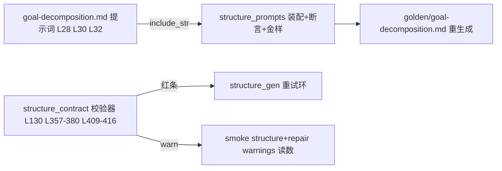

# 施工图 · f2 结构生成模型面打磨（三小项）

## 1. 元信息

- **目标**：door_list 输出形状示例+措辞修正、one_name 交卷自检句+出路指引、块数下限 25 硬/40 参考档 warn+smoke warnings 读数——结构生成首轮违约面收敛
- **版本**：v1
- **状态**：草稿
- **日期**：2026-10-30
- **票**：[tickets/f2-structure-prompt-polish.md](../tickets/f2-structure-prompt-polish.md)（Resolution 已记裁决与勘误）

<!-- 状态流转：草稿 → 定稿（用户确认后，守图协议生效）→ 施工中 → 已完成 -->

## 2. 现状摘要

- 提示词资产 prompts/structure/goal-decomposition.md（48 行）：L28 domain 条款「逐字全收——编号与清单顺序照抄」为歧义源、无输出示例；L30 blocks「40–80 条、硬上限 100」；L32 one_name 条款（无自检句）；L47 输出契约门；L15-16 door_list 注入槽
- 装配/闸 structure_prompts.rs：GOAL_DECOMPOSITION spec（L80-87，4 占位符）；FENCE_DEV_FACE 含 "gd."（L47-75，正文禁条款码）；条款覆盖断言（L402-443：L414「40–80」/L439「逐字全收」/L440「判据原文见输入门口清单」/L420「与」）；无重复段落闸（L508-523，>20 字符行不可重）；金样测试（L527-591），重生成 `LEARNING_UPDATE_GOLDEN=1`（L574-578）
- 校验器 learning_graph/**structure_contract.rs**（票面笔误 growth_contract.rs，已勘误）：L130 常量 BLOCKS_MIN=40/SOFT=80/MAX=100；L28-43 ContractViolation{red()/warn()}；L357-380 count（>100 红/<40 红/80<n≤100 warn）；L387-416 one_name（**已一次报全**，逐块循环 push）；L142-162 判据（七字符含全半角逗号斜杠、「」段豁免、词边「和」豁免）；L695-710 domain.doors（「必须是 G<数字> 形」=真机指纹出处）；L729-811 reconcile_doors；L1016 schema minItems=BLOCKS_MIN；L1568-1607 schema↔validator 互钉
- 注入 structure_gen.rs：door_list_markdown（L146-169，`- [G1]（硬前置）判据` 行——被整行照抄的源头形状）；L17 MAX_ATTEMPTS=3；L266-272 **只收红条进 retry_feedback（warn 不进反馈）**；L106-120 同指纹早停（j03 单源）
- smoke learning_smoke.rs：run_structure（L1088-1220）独立复跑全量 gd.*+reconcile，红条打印 EXIT=2（L1173-1179，warn 不打印）；OK 读数行 L1212-1215（spines/blocks/edges/doors/labeled）；repair 档 L3060-3072 同构
- 契约文档 docs/contracts/learning-structure-artifacts.md：L127 gd.blocks.count 行 / L142 警告级汇总 / L130 one_name 行 / L124 domain.doors 行 / L73 JSON 示例（已是 ["G1","G2"]）/ L224 §6 逐字全收行文 / L5 版本 v1.7
- learnhub 参考：goal-decomposition.md L30（逐字全收同文）/L32（count）/L34（one_name，多「拿不准就在名字里写作『求和』」出路半句）/L39（quality 五句「直接抄用」自检句先例）/L46（输出契约）；validator.rs L441-465（<MIN 红「低于量级档下限」；>SOFT 进 warnings「超目标档（硬上限内合法，提示分批）」=warn 文案模板）/L568-578（one_name 报全，与 allo 同构）
- 测试面：structure_contract.rs L1285-1294（domain 两非法形）、L1313-1357（count 仅 84 warn/104 红，**无下限边界测试**）、L1360-1378（one_name 豁免）；structure_gen.rs L546-574/L580-609 用 blocks:[]（0<25 仍红，③ 不破）；金样结构体 42 块（L1117 注释写「40 块」，不符）

## 3. 总体结构



- **关键流程**：三小项互相独立可分步施工；唯一共享产物 = 提示词模板与金样（①②③ 改完后重生成恰一次）
- **全局不变量与禁区**：
  - 零迁移；零 ai-agent 触碰（structure 全在 nomifun-learning）
  - gd.domain.doors 形态红样与 reconcile 双臂不动（整行抄写必须仍被拒——f2 验收面即校验器行为）
  - 早停/重试语义不动；反馈文本禁掺轮次号/时间戳（击穿 j03 指纹比对）
  - FENCE_DEV_FACE：提示词正文禁 gd.* 条款码；无重复段落闸：>20 字符新行不得与既有行重复
  - learnhub 40–80 不回移；只重生成 golden/goal-decomposition.md 一份金样

## 4. 分块图纸

### 4.1 · ③ 块数下限 25 硬 + 40 参考档 warn

- **接口契约**（structure_contract.rs）：

```
L130: BLOCKS_MIN = 40 → 25；新增 BLOCKS_DENSITY_FLOOR = 40
count 伪代码：
  n > 100         → red「blocks {n} 条超过硬上限 100——…」（现行文案不动）
  25 ≤ n < 40     → warn("gd.blocks.count", 「blocks {n} 条低于 40 参考档
                      ——小目标课如实精简，密度抽验兜底」)
  80 < n ≤ 100    → warn（现行越档文案不动）
  n < 25          → red「blocks {n} 条不足下限 25——把宽泛块拆成可独立教学的单元」
```

- schema minItems 自动跟随常量（L1016/L1579 互钉测试自动过，零改）
- 提示词 L30 改写（骨架，三档齐）：「`blocks`（知识块总表，底层）25–80 条、硬上限 100：…；40 条以下仅限小目标课如实精简（密度抽验兜底），不足 25 拒收」
- 断言随批：L414「40–80」→ 新短语（如「25–80」）
- smoke：run_structure 红过滤（L1173 `!violation.warning`）自动放行 31 块；**OK 读数行追加 ` warnings={n}`**（n = 复验所得 warning 违约计数）；repair 档同构追加
- 契约文档：L127 改「条数 < 25 红、25 ≤ n < 40 记『低于 40 参考档』警告（不拒收）、> 100 红；80 < n ≤ 100 越档警告」；L142 汇总行并入两 warn；L5 v1.7→v1.8
- **失败路径**：blocks:[] 既有测试 0<25 仍红不破；金样 42 块在 25–80 档内照过

### 4.2 · ① door_list 输出形状

- **提示词 L28 改写**（骨架）：

```
prerequisite_doors（门口编号列表：只写编号本身，如 ["G1","G2"]——G 加数字形；
不带 [ ] 类别标注、不带（硬前置）等字样、不带判据文字；编号与顺序
逐字取自输入门口清单，不得自创、不得省略）
```

- 断言随批：L439「逐字全收」→ 新短语；L47 输出契约门条款「门口编号逐字取自输入门口清单」保留不动
- **校验器零改动**：gd.domain.doors 红样保留；**新增红样固化验收**——把注入行形状 `- [G1]（硬前置）…` 整行作 door 字符串 → 断言 gd.domain.doors 红（防措辞回归）
- 契约文档：L224 §6「逐字全收」行文同步；L73 JSON 示例已同形零改

### 4.3 · ② one_name 自检句 + 出路指引

- **校验器消息**（L409-416）加出路半句：「…多个主题须拆条；官方术语本身含并列形的以「」包裹，或改用无并列的规范名」（参照 learnhub L34 与 ng.aliases.atomic_name 先例 growth_contract.rs:348-356）
- **提示词 L32 条款尾加交卷自检句**（骨架，须与既有行措辞错开过无重复段落闸）：「交卷前扫**全部**块名：不含『与/和/及』等并列标记（词边『和』与「」内官方术语豁免）；拿不准就改用无并列的规范名」
- **新增红绿样固化「一次报全」**：两个含「与」的块名 → 断言报告恰两行各提一名（校验器已如此，防回归）
- 断言 L420「与」保留字样则不断

## 5. 决策卡片

### A1 · 下限三档：25 红 / 40 warn / 100 红

- **类型**：接口契约（契约文档同批）
- **决策**：BLOCKS_MIN=25（红），新增 BLOCKS_DENSITY_FLOOR=40（25–39 warn「低于 40 参考档」），SOFT=80/MAX=100 不动。
- **理由**：E2E 两轮对照 31 条与 51 条内容密度无差、硬凑 40 产出「底数与指数」类边缘块（票面法证）；learnhub 40–80 按其大课设计（validator.rs:451-465 消息即「量级档」心智）；warn 先例同构（count 越档 L375-380）。
- **代价**：25–39 档失去机械打回力，密度靠既有抽验兜底；三档比两档多一个常量与一处文案。
- **推翻条件**：真机 25–39 档课程出现密度塌陷（抽验/读数劣化）。

### A2 · warn 可见性：smoke 读数，不进重试反馈

- **类型**：失败模式
- **决策**：warn 维持「不进 retry_feedback、不触发重试」；smoke structure/repair OK 行追加 warnings={n}。
- **理由**：warn 进反馈=变相打回，与「预算让给真实违约」矛盾；smoke 读数是 k04「读数行在场」既有惯例，验收面可见性零风险补齐。
- **代价**：smoke 行多一字段。
- **推翻条件**：出现需要按 warn 联动调度/打回的产品需求。

### A3 · ② 走提示词面，校验器只加出路指引

- **类型**：算法（反馈工程）
- **决策**：one_name 校验器已一次报全（L387-416），不再改报全逻辑；改=违约消息出路指引+交卷自检句+「多块同报」防回归样。
- **理由**：打地鼠真因=模型全量重生成时别处新冒并列名→各轮指纹互异→早停正确不触发（真机三连败指纹各异佐证）；learnhub 同构报全（L568-578）且有同款打地鼠史——校验器侧无差距可消。
- **代价**：自检句效果依赖模型遵循度，无机械保证（真机判据兜底）。
- **推翻条件**：真机重试轮仍复现「逐轮换名打地鼠」且自检句无改善。

### A4 · ① 只改输出条款，不改注入格式

- **类型**：接口契约
- **决策**：door_list_markdown 注入行格式（`- [G1]（硬前置）判据`）不动；只改 L28 输出条款措辞+输出示例。校验器零改，新增「整行抄写形状」红样。
- **理由**：注入行是人读形状（类别标注帮模型选门），问题只在模型把它抄进输出；改注入格式会牵动 L15 措辞+structure_gen 两处测试（L447-461/L466-484），收益不明。
- **代价**：歧义源（输入含 [G1] 形）仍在，靠条款示例压制。
- **推翻条件**：新措辞后真机仍现整行抄写违约。

## 6. 施工顺序

| # | 施工步 | 图纸位置 | 验收 |
|---|---|---|---|
| 1 | ③ 校验器：常量+count 三档+金样注释修正（42 块） | 4.1, A1 | 新边界测试 24 红/25 过/31 warn/39 warn/84 warn/104 红；schema 互钉自动过 |
| 2 | ② 校验器：出路指引+多块同报样 | 4.3, A3 | 多块样恰两行；现行豁免样（L1360-1378）不破 |
| 3 | ①②③ 提示词改写+断言随批（L414/L439） | 4.1-4.3 | structure_prompts 全闸绿（断言/围栏/无重复/占位符） |
| 4 | 金样重生成（恰一次）+幂等复核 | 总体结构 | LEARNING_UPDATE_GOLDEN=1 跑测→仅 golden/goal-decomposition.md diff；再跑一遍零 diff |
| 5 | smoke warnings 读数（structure+repair 两档） | 4.1, A2 | 31 块产物复验零红条（单测级）；smoke OK 行目验含 warnings= |
| 6 | 契约文档 v1.8+learnhub 差异记档 | 4.1/4.2 | L127/L142/L224/L5 更新；差异记档含 31/51 密度对照证据 |
| 7 | 全量验证 | 全图 | cargo test -p nomifun-learning 全绿；fmt；cargo check --workspace |

## 7. 未决事项

- warn 文案与提示词三档措辞的最终字句：图上给骨架，实现会话可润色；断言只钉结构短语（「25–80」「逐字取自输入门口清单」级），不钉整句。
- BLOCKS_DENSITY_FLOOR 命名：图上推荐，实现可就近惯例微调（仅 crate 内可见）。

## 8. 变更记录

| 日期 | 类型 | 位置 | 变更 | 根因/触发 |
|---|---|---|---|---|
| 2026-10-30 | 修订（定稿前） | 全图 | v1 成图：Q3（25+warn+读数）/Q4（② 收窄）入图；票面落点勘误（structure_contract.rs） | grilling 2026-10-30 + 影响面核查 |
| 2026-10-30 | 缺陷回写 | 禁区「只重生成一份金样」 | structure-repair.md L35「块数 40–100」漏随三档同步——修补提示词仍教旧下限；评审轴发现后由修复批 010a7d4e4 闭环（连带 golden/structure-repair.md 重生成） | **走查未覆盖跨文件短语重复**（goal-decomposition 与 structure-repair 同文条款只在单文件视角走查） |
