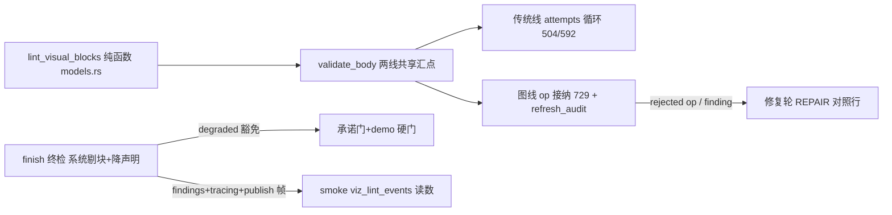

# 施工图 · f3 课时可视化块机械 lint

## 1. 元信息

- **目标**：课时正文 ```mermaid 围栏加最小机械校验（块级括号配平+flowchart 节点定义）进两线既有打回通道；发布终检仍坏系统剔块+降声明+留痕——坏图不再进库
- **版本**：v1
- **状态**：草稿
- **日期**：2026-10-30
- **票**：[tickets/f3-visualization-lint.md](../tickets/f3-visualization-lint.md)（Resolution 已记裁决与勘误）

<!-- 状态流转：草稿 → 定稿（用户确认后，守图协议生效）→ 施工中 → 已完成 -->

## 2. 现状摘要

- 两线都产 mermaid：传统线 VISUAL_STANDARD_BLOCK（generation/lesson.rs:743-764，调色板含 mermaid/svg/jsxgraph/$$/表格；902 行已有 mermaid 引号卫生条款）+「流程图」承诺只认 mermaid（models.rs:582-587）；图线五选一（lesson_content_loop.rs:110，「纯文字概念/例题节会被质检门拒绝」）。两线共享节校验 `SectionPack::validate_body`（models.rs:482）
- 草稿 op 流：apply_one（lesson_draft.rs:700-740）接纳 SetSectionBody，body 先过确定性后处理 fix_mermaid_quotes（727 调用；generation/parser.rs:93 定义，**零单测**），再 validate_body（729）→ 失败 Err → LessonPatchReport.rejected 原样回工具结果（526-531）——**op 拒绝=天然打回通道，模型可重提**
- 审计：refresh_audit（lesson_draft.rs:999-1011）重验全部已落库正文，失败=section_invalid danger；finish 门（service/lesson_draft.rs:116-132）仅 SEV_DANGER 挡发布；findings=LessonFinding{severity, kind: String, message}（386-392，kind 裸 String 零注册成本），**无持久表**（内存+SSE+报告文本）
- 修复面：REPAIR_LESSON_AGENT_SYSTEM（lesson_content_loop.rs:145-166）按 finding kind 给修复动作对照（153-161，新 kind 需在此补一行）；FlowCycle.repair_audit（453-460）取 findings 文本为修复依据
- 传统线打回/降级先例（本仓；learnhub contentgen fail loud 无降级臂 facade.rs:480/573）：generate_section_body（lesson.rs:432-510，每型初跑+2 修复）；降级保底（295-327，visual=无 纯文字重写）；单节重写降级臂（561，`for degraded in [false, true]`）
- 门与 prose：prose_char_count（models.rs:610-633）**剥围栏/$$/表格计算——剔块不减 prose，文字下限（490-506）不撞**；承诺门 undelivered_visual（562-606，声明「流程图」只认 mermaid）；demo 硬门（532-538，demo 节必须有可视化，不按声明豁免）；degraded_keys 图线恒空（947），传统线落库按 degraded_keys 置列（service/lesson.rs:2102-2106）
- 留痕与观测先例：tracing::warn("over_capacity")（service/lesson.rs:2084-2091）；publish 帧 lesson_agent_publish（lesson_content_loop.rs:340-349，生产恒 None、smoke 接线）；smoke content 读数行 2654-2736 从观测存档取数
- 消费侧：MermaidBlock 渲染失败静默源码陈列（MermaidBlock.tsx:112-118，无错误提示；svg/jsxgraph 有 AI 修复）；FIGURE_REPAIR 只 svg/jsxgraph 不含 mermaid（completer.rs:66-103）
- learnhub：cc.visual.form+cc.svg.spec（validator.rs:1000-1031；check_svg_block 495-611：viewBox/字号/白名单/容器闭合）=svg 规格闸先例；mermaid 零检查
- 法证案例（e2e2「滚雪球」s1）：`A[["第1期 本金 P] -->|"算利息 P×利率"| B[利息1"]`——引号错位+括号不平衡；另有三段互不连通（语义碎裂，本票非目标）

## 3. 总体结构



- **关键流程**：打回=各线既有通道（lint 并入 validate_body 即两线同时生效；图线另加 REPAIR 对照行）；兜底=finish 终检对仍坏块系统剔除+该节 visual 声明降「无」（系统 mutation）+degraded 标记；留痕三通道（findings warning/tracing/publish 帧计数）
- **全局不变量与禁区**：
  - 零迁移；零新依赖（不引 mermaid 解析器）
  - 可视化门本身不动（≥1 块要求、模型改交表格/公式合法）；语义碎裂（连通性）非目标；jsxgraph 不单列（仅顺带括号配平）
  - 消费侧前端零改动（MermaidBlock 静默陈列保持）；FIGURE_REPAIR 端点不扩 mermaid
  - fix_mermaid_quotes 现行为不动（引号改写先于 lint，顺序保持）
  - 普通代码围栏（非 mermaid/svg/jsxgraph）零动作

## 4. 分块图纸

### 4.1 · lint 纯函数（models.rs，validate_body 邻域）

- **接口契约**：

```rust
enum VizLintKind { MermaidBalance, MermaidNodeUndefined, SvgShell }
struct VizLintIssue { kind: VizLintKind, detail: String }   // detail 含块序号与行内容摘录
fn lint_visual_blocks(body: &str) -> Vec<VizLintIssue>
```

- **核心算法（伪代码）**：

```
扫 ```lang 围栏（状态机形状同 fix_mermaid_quotes，models.rs 内自足约 30 行）：
  lang == mermaid：
    块级累计（非按行——classDiagram 跨行块防误杀）：
      逐行跳过双引号段（行内 " 计数为奇 → 记 MermaidBalance「引号不配平」）
      豁免段外累计 [ ] ( ) { } 六对，任一对不配平 → MermaidBalance
    若首行前缀 ∈ {flowchart, graph}：
      defs = 节点定义 id 集（id 后紧跟 [ ( { 或 [[ ([ ）
      refs = 边语句端点 id 集
      refs − defs ≠ ∅ → 每个未定义 id 一条 MermaidNodeUndefined
  lang == svg：     块体非空且含 "<svg"，否则 SvgShell（防空壳过门）
  lang == jsxgraph：仅括号六对配平（顺带，零成本）
  其它 lang：       零动作
```

- **失败路径**：未闭合围栏沿用 validate_body 现行行为，lint 不新增判定；空 mermaid 块 → 配平过+节点查过 → 合法（由既有门管）

### 4.2 · validate_body 并入（两线共享汇点）

- **接口契约**：validate_body（models.rs:482）内现有检查之后追加 lint，issue 非空 → 计入 section 违约，detail 进违约文本（含处置指引「修复该围栏块语法，或改用表格/公式承载」）
- **效果**：传统线 504/592 两调用点自动获得打回（attempts=3 循环现状）；图线 op 接纳 729 自动获得拒绝 → LessonPatchReport.rejected → 模型重提
- **失败路径**：违约严重级沿用 validate_body 现行 danger 语义（挡发布由 finish 门管）；打回不设「恰一次」，由各线既有预算约束（图线 op 重提不限次+修复轮预算；传统线 attempts）

### 4.3 · 修复对照行（图线）

- **接口契约**：REPAIR_LESSON_AGENT_SYSTEM（153-161）补一行：`viz_block_lint（mermaid 括号不平衡/节点未定义）→ 修复该围栏块语法或改用表格/公式承载该节讲解`
- **失败路径**：修复轮产出仍坏 → 走 4.4 终检

### 4.4 · finish 终检：系统剔块+降声明（图线兜底）

- **数据形状**：草稿节级 degraded 标记（复用或新增字段）；degraded_keys 从图线草稿穿出（to_output 不再恒空，lesson_draft.rs:947 接线）
- **核心算法（伪代码）**：

```
finish_lesson_draft 发布前，对每节 body 跑 lint_visual_blocks：
  issue 块 → 从 body_md 剔除该围栏整体（节其余保留）
  该节剔除后：manifest visual 声明降为「无」（系统 mutation，非模型 op；
            若节内余有其它形态块则按余块形态声明）
  该节记 degraded（degraded_keys 穿出 → 落库 degraded 列，service/lesson.rs:2102-2106 先例）
  findings.push(warning("viz_block_lint_dropped", 节 key+原因))
  tracing::warn + 计数（供 publish 帧/smoke 读数）
  剔后重审：承诺门按新声明自然过；demo 硬门对 degraded 节放行（唯一需新豁免的门）；
          文字下限天然不撞（prose 剥围栏计算）
```

- **失败路径**：demo 节坏块修复轮救不回 → 剔除+degraded 豁免 demo 硬门，发布继续（「正文不因图烂而整课失败」）；全节皆坏 → 全剔，节 degraded 如实标记，发布不阻断
- 传统线**不用此兜底**：已有降级保底先例（lesson.rs:295-327/561），lint 并入 validate_body 后预算尽自动走 visual=无 重写，零新机制

### 4.5 · 留痕与读数

- **接口契约**：findings kind 两值 `viz_block_lint`（打回/审计触发，warning）与 `viz_block_lint_dropped`（终检剔除，warning）；publish 帧增 `viz_lint_events` 计数；smoke content 读数行（2654-2736）追加 `viz_lint_events=N`（非门禁）
- **失败路径**：findings 无持久表——跨会话留痕走 tracing（日志）与 degraded 列（节级），不建新表

## 5. 决策卡片

### A1 · lint 落位 models.rs（validate_body 同文件）

- **类型**：模块边界
- **决策**：lint 纯函数落 models.rs（prose_char_count/undelivered_visual 邻域），自足实现围栏遍历；不落 generation/parser.rs、不引 parser 依赖。
- **理由**：validate_body 是两线唯一共享校验汇点（models.rs:482），lint 与它同文件依赖最短；parser.rs 的 fix_mermaid_quotes 职责是「改写」非「校验」，且 models→generation 依赖方向未经验证，不赌。
- **代价**：围栏遍历逻辑与 parser.rs 各一份（约 30 行，形状类似）。
- **推翻条件**：围栏状态机出现第三处重复消费方时，提取共享遍历器。

### A2 · 查项：块级配平（引号豁免）+flowchart/graph 节点定义；`---` 查砍

- **类型**：算法
- **决策**：见 4.1 伪代码。配平按块累计（非按行），引号段豁免，行内引号奇数记「引号不配平」；节点定义查仅 flowchart/graph 前缀；不做 `---` 闭合查、不做连通性查。
- **理由**：法证案例按此规则命中（MermaidBalance）；classDiagram 跨行块按行计会误杀；sequence/state 参与者免定义，全型节点查会误杀（票面三查第②查的缺陷，grilling Q7 修订）；`---` 在 mermaid 既是 frontmatter 也是连线语法，歧义大且案例未死于此；连通性是票面明示非目标。
- **代价**：放掉「引号配平但语义坏」与「连通碎裂」两类坏图（消费侧静默陈列兜底显示）。
- **推翻条件**：真机 lint 零打回期后仍出现成规模的坏图进库且集中于未查类别。

### A3 · 打回并入既有通道，弃「恰一次」

- **类型**：失败模式
- **决策**：不建打回次数状态；lint 进 validate_body 后，传统线=attempts 循环、图线=op 重提+修复轮，各按既有预算；终检兜底在 finish。
- **理由**：图线 op 拒绝通道天然无限重提、传统线 attempts=3 与共享修复预算（SECTION_REPAIR_BUDGET=4）是既定语义；新增「恰一次」需跨线新状态，无对价收益。
- **代价**：图线模型可能反复重提坏块耗预算（与现行 over_capacity 同风险面，已被循环预算约束）。
- **推翻条件**：真机出现 lint 死循环耗尽预算的案例。

### A4 · 兜底=系统剔块+降声明+degraded 豁免

- **类型**：失败模式
- **决策**：见 4.4。剔除必须系统侧同步降 visual 声明；demo 硬门与承诺门对 degraded 节放行（承诺门实为声明已降自然过，demo 硬门是唯一真豁免）；degraded_keys 从图线草稿接线穿出。
- **理由**：纯剔块撞承诺门+demo 硬门（Resolution 勘误）；草稿无单节改 visual 的模型 op，系统 mutation 是唯一合法落点；「只剔块」（票面原案）被否；「整节 visual=无 重写」（备选）多 1–3 次 LLM 且修复轮前置后大概率不触发，不划算。
- **代价**：degraded 节的可视化承诺失约如实留痕（warning），读数可见；门豁免增加一个 degraded 分支需测试钉住。
- **推翻条件**：产品要求可视化缺失课时整课失败（当前语义明确相反）。

### A5 · 留痕三通道，零新表

- **类型**：数据结构
- **决策**：findings warning（两 kind）+tracing::warn+publish 帧计数 → smoke viz_lint_events 读数；不建持久 findings 表。
- **理由**：findings 无持久表是现状（LessonFinding 内存+SSE）；真机验收看日志与读数即可；smoke 读数从 publish 观测帧取数是既有接线（340-349）。
- **代价**：findings 不落库，历史追溯只能靠日志与 degraded 列。
- **推翻条件**：出现按课时审计 lint 历史的产品需求。

## 6. 施工顺序

| # | 施工步 | 图纸位置 | 验收 |
|---|---|---|---|
| 1 | lint 纯函数+红绿样 | 4.1, A2 | 红样：法证原行（MermaidBalance）/未定义节点/空壳 svg；绿样：合法 flowchart/sequenceDiagram/stateDiagram/classDiagram（跨行块）/含引号合法文本；fix_mermaid_quotes 邻域测试顺带补 |
| 2 | validate_body 并入 | 4.2 | generation/tests.rs section_body_validation（193-235）补 lint 违约样；传统线 attempts 打回通路测试 |
| 3 | 图线 op 接纳+refresh_audit+REPAIR 对照行 | 4.2-4.3 | lesson_draft/lesson_content_loop 既有测试全绿；新增：坏 mermaid op 被拒→重提合法过闸 |
| 4 | finish 终检剔块+降声明+degraded 豁免+degraded_keys 接线 | 4.4, A4 | 两连败样：块剔除+findings 行+demo/概念节发布成功；demo 硬门 degraded 豁免样 |
| 5 | 留痕+读数：tracing+publish 帧+smoke viz_lint_events | 4.5, A5 | smoke content 读数行目验 viz_lint_events=；cargo test -p nomifun-ai-agent + -p nomifun-learning 全绿 |
| 6 | fmt + cargo check --workspace + 票面翻转 | 全图 | 全绿；零迁移确认 |

## 7. 未决事项

- viz_block_lint warning 是否让传统线修复 prompt 额外显式引用（现状 last_error 已含违约文本，够用）——推荐默认：不额外接线；触发重议：传统线真机 lint 打回自愈率显著低于图线。
- publish 帧字段命名（viz_lint_events）实现可就近惯例微调。

## 8. 变更记录

| 日期 | 类型 | 位置 | 变更 | 根因/触发 |
|---|---|---|---|---|
| 2026-10-30 | 修订（定稿前） | 全图 | v1 成图：Q5（弃恰一次）/Q6（修复轮前置+系统兜底）/Q7（查项修订）入图；文字下限撞点实核排除（prose 剥围栏计算） | grilling 2026-10-30 + 影响面核查 |
