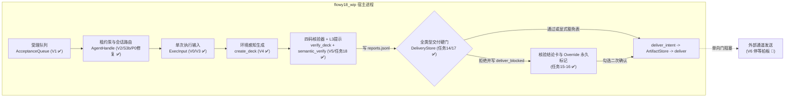
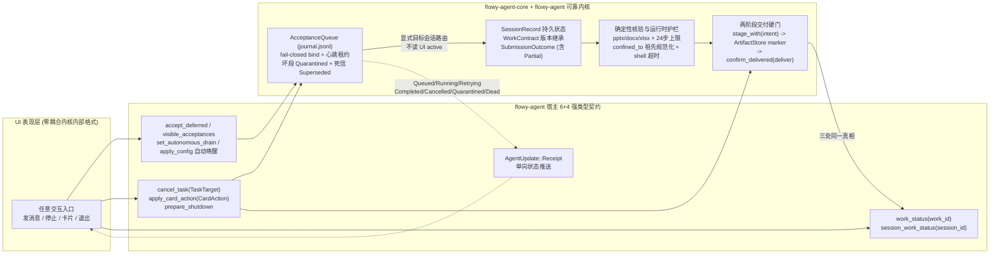
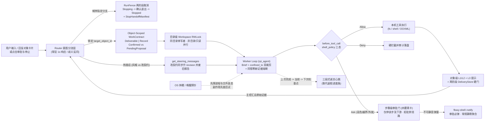
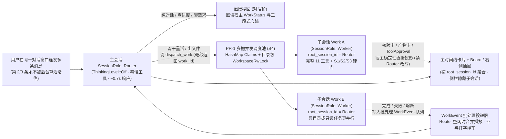

# Flowy 首版架构 · 最终方案（整理版）

2026-11-26 · 修订 9.12 · 由《整体架构-v2》(2.22) ＋ 本轮讨论与 `feat/flowy-v0-rc@f47804a9d` 内核收口校准整理（完整保留修订 9.1–9.11 正文与 §12.1–§12.10 账本；修订 9.6 基于 `origin/main@526b2336f` 实跑证伪与代码级证据 `证据.md` §11.32，新增 §12.5 Super Agent 架构四项结构性校准与增补；修订 9.7 新增 §12.6 记录 PR #492 `feat/flowy-v1-integration` 的 S1–S3、极简助理 UI 与 5 笔对抗审查裁剪落地真相；修订 9.8 基于 `origin/main@da4f6574a` 真机连发双消息阻塞复现与三层代码审计 `证据.md` §11.34，新增 §12.7 确立「会话级轻量 Router + `root_session_id` 多后台 Work」架构方案与 PR-1/PR-2 精确影响范围账本；修订 9.9 新增 §12.8 记录 PR #495 `feat/flowy-nav-board-polish` 导航栏、全局快搜、进度看板 v2、会话右键菜单与 S4 并发兼容收口账本；修订 9.10 新增 §12.9 记录 PR-2A（`feat/flowy-router-kernel` / PR #496，已于 `origin/main@aa522353f` 合入 `main`）纯内核落地、PR #495 耦合护栏、深度审查加固与 PR-2B 接缝契约；修订 9.11 新增 §12.10 记录 PR #497（`feat/flowy-studio-ux-polish`，已于 `origin/main@eb30a4d21` 合入 `main`）进度看板 7 日本地自然日点击反筛、资料库网格锚点/右键修复、快搜分类筛选、5 秒归档撤销与深度去膨胀收口账本；**修订 9.12 新增 §12.11 记录 PR-2B（`feat/flowy-router-ui`，线性 rebase 至 `origin/main@eb30a4d21`）会话级 Router UI 接线（Q1–Q6）、PR #497 耦合收敛与审查减脂收口账本**）

## 目录

**第一部分 · 静态结构**

- 0 一句话与三个核心选择
- **主流程：从一句话到一份文件（先读这个，是地图也是检查表）**
- 1 分层：五层 ＋ 两竖切（1.1 watchdog 的权限）
- 2 work：一段会反复追问的合作（2.1–2.6，**2.5 Router 层 / 2.6 work 页面**）
- 3 能力模型：能力包是四件套（3.1–3.6）

**第二部分 · 运行机制**

- 4 执行模型：一次执行的数据形状（4.1–4.4）
- 5 调度模型（5.1–5.19）
- 6 核验模型：三种锚 ＋ 四类错误码（6.1–6.8）
- 7 记忆与上下文（7.1–7.4，**7.4 是上下文组织**）
- 8 待人卡：两类卡，两套规则（8.1–8.10）

**第三部分 · 边界与依据**

- 9 明确不做什么
- 10 横向参照 → **已拆到 [`参照.md`](参照.md)**
- 11 证据状态 → **已拆到 [`证据.md`](证据.md)**
- 12 实施顺序
- 13 观测与追查：**只加一个字段，其余走 payload**
- 先记：暂时不做的六件事 → **已拆到 [`先记.md`](先记.md)**

**附**：本轮被推翻的四个判断 · 为什么做成 super agent

> **拆出去的三份是给「要反驳的人」读的。** 要动手只读这份（约 1200 行），
> 证据里有可跑的实验目录，参照里有别人家的做法。

---

## 0. 一句话与三个核心选择

**Flowy 首版是「云端推理 ＋ 本机执行」的交付型 agent**：用户提要求，系统陪他把事做完，产出**可核验的文件**，必要时对外发送。

三个核心选择定了这套架构的形状：

1. **内核用 pi-rust，work 跑进程内。** 不引第二个 harness，也不自创跨进程协议——将来要接外部 agent，标准是 ACP。
2. **能力按交付物切，能力包是四件套。** 工具 ＋ Skill ＋ 资源 ＋ 运行时依赖。
3. **先核验，后签字。** 验收器必须确定性；签字绑定**成品哈希**，不绑定字段值。

---

## 主流程：从一句话到一份文件

这张表是给新人的地图。每一行只说什么发生，细节在哪节。

| # | 发生什么 | 细节 |
| --- | --- | --- |
| 1 | 用户说话——在某个 work 里，或在无 work 的会话里 | §1 |
| 2 | **Router 判断这句话是什么**：新任务 ／ 某 work 的继续 ／ 闲聊。它是**唯一对外说话的人** | §2.5 |
| 3 | **判断轮次类型**：这句话是要聊清楚，还是要出东西 | §2.2 |
| 4 | 若是**对话轮** → 走对话通道，不排队，直接答 | §5.1 |
| 5 | 若是**交付轮** → 装配能力包：工具 ＋ Skill 目录 ＋ 资源 ＋ 运行时依赖 | §3 |
| 6 | **生成 `ExecInput`**：work_id / revision / attempt_id / token / mode / capabilities / ask_first / context（含 `decided`）/ session_hint | §4 |
| 7 | **准入**：Worker loop 有空位就派；没有就排队，界面显示「排队中」 | §5.1、§5.3 |
| 8 | **执行**：loop 跑，工具调用落事件，attempt 周期上报心跳 | §5.5 |
| 9 | **出候选产物**：渲染文件，路径写进事件 | §6 前 |
| 10 | **核验**：跑 `verify_artifacts`，出四码报告 | §6 |
| 11 | **按结果分支**（见下） | §6.3 |
| 12 | **待人卡**：依据在哪、不选会怎样、选错能退吗 | §8.1 |
| 13 | **签字**：决定绑定账户 ＋ 收件人 ＋ 附件哈希 | §8.3 |
| 14 | **外发**（如需要）：四态文案，250 不等于送达 | §8.5 |
| 15 | **收束**：交付 / 收束 / 搁置；收束时**提议**沉淀 | §2.2、§7.1 |

**第 11 步的分支**（三种，不是一种）

| 核验结果 | 系统做什么 |
| --- | --- |
| 通过 | 生成审批卡，进第 12 步 |
| **锚在、值不对**（`VALUE_MISMATCH`） | **自动重渲染一次**；再不对才交给人 |
| **锚坏了**（`ANCHOR_MISSING` / `INVALID` / `DUPLICATE`） | **回到对话轮**，人要重新标注，重渲染没用 |
| 产物不可信（连续两次失败） | 放弃，**不留半成品在可交付位置** |

**横切三件事，任何一步都可能发生**

1. **打断**（§5.8）—— 确认进程退出才放开 work；半成品要么删、要么标记为不可交付。
2. **授权与披露**（§4.4）—— 凭什么能做这一步，凭什么相信这个结果。
3. **持久化与恢复**（§5.13）—— 这一步落盘了没有，重启后还能不能接上。

---

## 1. 分层：五层 ＋ 两竖切

| 层 | 拥有 | 一句话 |
| --- | --- | --- |
| **接入** | 输入、身份、工作区、模型选择 | 用户从哪进来 |
| **工作** | 工作的身份、简报、状态、产物、交付 | **一段合作的容器**（不是授权容器，见 §2） |
| **调度** | 准入、配额、前台优先、等待 | 现在轮到谁跑 |
| **执行** | loop、工具调用、子代理、权限执行 | 真正在跑的那段 |
| **交付** | 验收、签字、回执、外发 | 东西怎么交出去 |

**两条竖切（不是层，是横穿所有层）**

1. **授权与披露** —— 谁能看、谁能做、发生了什么要告诉谁。
2. **持久化与恢复** —— 什么必须落盘、重启之后怎么接上。

**watchdog 在两竖切里，不在任何一层。** 它要观察所有层、又不能写任何业务状态。

**授权不在 work 上。** 授权在轮次（`ExecInput.mode` / `capabilities`），产物带版本与哈希，签字绑哈希。这条推论决定了 §2 的「默认沿用」成立。

---

### 1.1 watchdog 的三档权限

| 档 | 能做什么 | 为什么 |
| --- | --- | --- |
| **读** | 看所有层、所有事件、所有卡 | 它得能判断「该动没动」 |
| **写草稿** | 生成诊断报告和建议补丁（提示词、重试参数、触发条件） | 有产出才有用 |
| **生效** | **不能** —— 要人一键应用 | 一旦它能直接改，它就成了第二个调度器 |

**这一档比参照实现保守。** DSH 的 Watchdog 是「具备完整工具能力的 Agent Session」，能用自然语言问它故障原因，**也能在线修正主系统行为**。

我们的折中：**让它诊断到「建议」为止，生效这一步留给人。** 无人值守时确实会慢一步——但两个写入者比慢一步更糟。

#### watchdog 其实是两个东西，别揉成一个

| | 是什么 | 什么时候跑 | 管什么 |
| --- | --- | --- | --- |
| **验收器** | 检查**这一份产物**合不合格 | **卡点触发**（产物出来时） | 三锚四码 ＋ 语义复核 |
| **Watchdog** | 看这活儿有没有进展、方向偏没偏 | **定时驱动**，一直在跑 | 进展与方向 |

参照实现里，DSH 的 Watchdog 管的是后者（原文：判断「各个 Worker 是否有实质进展、方向是否偏离整体目标」），
**它不管产物对不对**。而 Claude Code 的 `TaskCompleted` 钩子、ZCode 的「执行成功 → 仍需验证任务产物」，
管的是前者。

**两件事，两个东西，不要合并。**

#### 三条硬约束

1. **可否决，不可放行。** 验收器说「不行」就拦住；说「行」也只是必要条件之一，放行仍由 §6.4 的硬门决定。
2. **fail-closed。** 验收器**自己**崩溃、超时、输出非法时，**必须阻断**。见下面的实测。
3. **它自己的规则要先被签。** 验收器的配置和脚本属于「监督者」，不能和产物一起改 ——
   参照 ZCode 的做法：项目里的 Hook 默认**未信任**，要 `review → grant` 并绑定内容 digest；
   **声明一变，digest 就变，重新未信任**。

#### 实测：fail-open 会漏掉三种异常

`flowy-skeleton/gate_failure.py`。验收器五种状态 × 两种策略，**以事件日志里有没有 `deliver` 为准**：

| 验收器状态 | fail-open | fail-closed |
| --- | --- | --- |
| 正常放行 | 放行 | 放行 |
| 正常否决 | 阻断 | 阻断 |
| **崩溃（非零退出）** | **放行 ⚠** | 阻断 |
| **超时** | **放行 ⚠** | 阻断 |
| **输出非法 JSON** | **放行 ⚠** | 阻断 |
| **符合预期的组数** | **2 / 5** | **5 / 5** |

**默认 fail-open 等于把「验收器坏了」当成「验收通过」。**

Claude Code 的文档自己承认了这个坑（hook 崩了动作照常放行，要显式配 `onFailure: "block"`）；
ZCode 写的是「其他失败、超时及非法输出会产生诊断，**不能把所有异常都当作可靠拒绝**」。

**两家都踩过，我们别再踩。**

## 2. work：一段会反复追问的合作

### 2.1 为什么要这么定

2026-11-16 OpenAI 发布《Science at the Frontier》：58 万条消息、1,800＋ 科学家、251 份问卷。三个数字定了这条设计：

1. **四项活动占平均科学家消息的 85%** —— 理解陌生概念、起草、分析结果、写研究代码。**没有一件是「产出一个文件」。**
2. **每 3 条消息就有约 1 次追问** —— 要求解释、检查、重算。
3. 真正瓶颈是时间/人手（51.8%）与经费（43.8%），不是 AI 能力。

口径限制要记住：样本是科学家，研究者也没拿到原始对话，靠内部分类工具打标签。**所以这是「挑战假设」的证据，不是「推翻结论」的证明。**

但结论仍然成立：**一轮完不成满意的结果，改代码也不是一次就满意的。**

### 2.2 所以 work 不是「一次交付」

work 是**一段会反复追问的合作**。四条推论：

1. **work 是叙事容器，不是授权容器。** 所以事件流混在一起不污染授权、产物与签字（见 §1 末）。
2. **简报可演进。** 支持**空简报起步**，边聊边填；简报不绑签字。
3. **三类正常结束**：交付（有产物且签字）／收束（用户说就这样）／搁置（长期不动）。**「没产物」不算失败。**
4. **work 必须有名字**，系统起、用户可改——用户要能一眼指着说「那个」。

### 2.3 两个生命周期必须分开

这是本轮最重要的修正：**「轮次结束」不等于「任务完成」。**

| 对象 | 状态 | 含义 |
| --- | --- | --- |
| **work** | 待补简报 → 进行中 → 已交付 ／ 已收束 ／ 搁置 | 一段合作的生命周期 |
| **attempt** | `done` ／ `nothing` ／ `failed` ／ `cancelled` | **一次执行**的生命周期 |

`done` 只表示**本轮结束**，不代表任务完成；未完成的部分由卡片和后续轮次接着跟。

借自 AutoLoop 的四态：

| 值 | 含义 |
| --- | --- |
| `done` | 本轮结束（不代表完成） |
| `nothing` | 没事可做 |
| `failed` | 没跑成，会重派 |
| `cancelled` | 被停 |

### 2.4 沿用规则：一条被改了两次的规则

| 版本 | 规则 | 为什么不行 |
| --- | --- | --- |
| 旧 | 永不自动沿用，每句都新建 | 碎片化，用户每句话都开一个新 work |
| 上一版 | **默认**沿用，除非你显式说「这是另一件事」 | **错归进已有 work 会污染它的记录、产物和签字** |
| **现在** | **有来源就直达；无来源不猜，默认新建或问人** | 代价方向终于对了 |

#### 关键：「有来源」不是默认，是事实

从某个 work 页发的、回复某张卡的、点了引用的 —— 这些**不需要任何判断**，直接归（§5.15）。

**「默认沿用」只该存在于「有来源」这一侧。** 一旦消息没有来源，默认必须是**新建或问人**。

#### 为什么不能默认沿用

两种情况判错的代价是不对称的：

| 判错方向 | 后果 |
| --- | --- |
| 错归到已有 work | **污染它的记录、产物、签字** —— 不可逆 |
| 错开成新 work | 多一个空 work，合并或删掉即可 |

**所以无来源时宁可多开，不可错归。**

#### 保留的硬规则

事件一旦归进某个 work，**不重新拆分、不合并**（归属后冻结，见 §5.4）。

> **修订 9.6 演进注记（实证见 `证据.md` §11.32、详见 §12.5）**：合流 PR #490 后现役代码已固化 **`Project → Session (= Work) → TrackedObject`** 形态——同一 `Session` 内允许承载多个独立寻址对象（`Deliverable | Record`）；遇无引用多对象歧义时，在启动 Worker 前弹 **`DisambiguationCard` 消歧抉择卡**，不再因此裂变碎片 `Work`。同时 §2.5 的常驻全局 Router 校准为**混合按需触发的 `ContractResolver`**（带来源/单对象 0ms 直通，避免给每次常规对话叠加 ~5.1–6.5s 云端网关延迟税）。
>
> **修订 9.8 纠偏注记（已被 `证据.md` §11.34 实机体验证伪并升级，详见 §12.7）**：上述 9.6 中「靠多 Session 侧边栏替代独立对话通道」的假设已在 `origin/main@da4f6574a` 真机连发两条消息时被证伪——同一窗口内连发第 2 条消息被 `panel.rs:1626` 直接塞进后台排队、且 `queue.rs:201` 全局单槽锁死并发。同时 §11.33 实测生产网关轻量工具调用已降至 `675–881ms`。因此正式升级为**「每个主会话即轻量 Router（零慢工具、1 秒直答）⇄ 名下按 `root_session_id` 并行派发多个后台 Worker 子会话」**，既恢复 §5.1 全双工对话轮体验，又 100% 兼容 PR #492 的侧边栏多会话、项目目录隔离与 S1–S3 硬门。

### 2.5 Router 层：常驻的全局路由

**它不是查表器，是一个常驻的 LLM 会话。**

这一条推翻了本方案 3.8 版的设计——原来让 Router 查 `focus_work_id` 表，那是错的。依据：《Super-agent 设计探索》（DeepSeek Harness 团队，2026-11）。

#### 职责三条

1. **承接所有人类交互** —— 它是**唯一对外说话的人**。
2. **判断这句话是什么** —— 新任务 ／ 某个 work 的继续 ／ 闲聊。
3. **分派与协调** —— 新任务建 work；跨 work 的信息与决策在这里汇总。

#### 它不做什么

1. **不执行具体任务** —— 甚至不配 bash。
2. **不介入单个 work 内部的步骤拆解** —— 那是 Worker 自己的事。

这条边界很重要：**Router 管任务之间，Worker 管任务之内。**

§9 原来写「不做模型的意图分解」，反对的是后者被模型乱拆；**前者必须有**，否则一个会话里的多件事分不开。

#### Worker 不能直接跟人说话

| | 谁说话 |
| --- | --- |
| **Worker** | 只向 Router 汇报；产出和状态沉淀在 work 里 |
| **Router** | 统一整理成简短结论，回复给人 |

理由（原文）：多个会话各自回复会造成交互混乱。LobeHub 的实践更硬：**「Worker 绝对不能直接在外部群里说话」**。

#### 归属怎么定：两条路

| 路 | 触发 | 谁决定 |
| --- | --- | --- |
| **直通**（Fast Path） | 已归属的事件继续来 | **程序**，不经 Router |
| **分派**（Slow Path） | 新任务、跨 work 协调 | **Router 判断** |

「直通」就是我们的「归属后冻结」——同一件事的后续事件不需要再判断一次。

DSH 实测：**去掉直通后，Router 的决定次数增加约 30%，读缓存 token 增加约 37%。** 直通不提升质量，但省下可观的成本。

#### 为什么它可以轻量

1. **它的任务不复杂** —— 每步通常是「长输入、短输出」，轻量模型就够。
2. **积压会自己合并** —— 上一轮推理期间到达的消息，在下一次调用里一起处理。

DSH 压力测试：消息到达速率从每分钟 1 条升到 40 条，batch 从 1.0 升到 2.8，但单次请求只从 2.5 秒增到 3.9 秒——**单个决定分摊的推理时间从 6.4 秒降到 1.6 秒**。

#### 它是个单点，这是要认的账

1. **必须持久化** —— 重启后接着之前的状态。
2. **上下文不能无限长** —— 需要按需召回（见 §7.1 的三层沉淀）。
3. **规模再大只能水平切分**，代价是牺牲跨任务的连续性。

#### 两条快筛 ＋ 一条弱提示：能确定就别问模型

在 Router 用 LLM 判断之前，先用确定性规则筛一遍。**命中就不调模型。**

| # | 规则 | 确定度 | 能不能自动归入 |
| --- | --- | --- | --- |
| 1 | **输入点自带 `work_id`** —— 从某个 work 页面发言、回复某张卡 | 100% | ✅ **可以** |
| 2 | **消息里有显式引用** —— @ 某个 work、引用某张卡 | 100% | ✅ **可以** |
| 3 | ~~当前会话只有一个活跃 work~~ | ~~100%~~ | ❌ **不可以**（见下） |

#### 为什么第 3 条被降级

原来把它算作「候选唯一 → 100%」。

**它跟 §2.4 直接打架。**

场景：A 正在跑，你在**总输入框**里说「顺便把招聘计划也做了」。这条消息没有来源，也没有引用。
按第 3 条，候选唯一 → 100% 归进 A。**可它是另一件事。**

**这正好是 §2.4 禁止的那种错归** —— 而错归会污染 A 的产物、记录和签字。

**所以第 3 条降级为「弱提示」，不是「快筛」：**

| 它还能干什么 | 它不能干什么 |
| --- | --- |
| 问人的时候，把那个唯一的活跃 work 作为**默认选项** | **不能自动归入** |

#### 修正后的规则

> **有来源（`from_work` / `reply_to_card` / `ref`）→ 直接归，不调模型。**
> **没来源 → 先受理、独立落盘，再判归属。**

**「先受理」这一条来自外部审查**：不要因为归属没定就不接受输入。
**B 必须能立刻拿到编号**，能不能归到某件 work 是后面的事。

这条跟 §5.19 的装载规则是同一种思路：**先让它存在，再决定它属于谁。**

#### 两条快筛和 §5.15 是同一件事

`from_work` / `reply_to_card` / `ref` 这三个字段有值 → 命中快筛。
**两处讲的是同一件事，不要实现成两套。**

这就是 DSH 的 Fast Path / Slow Path 两级过滤——**我们原来只抄了 Slow Path**。

#### 两条快筛都不中时：Judge 的四条实测约束

这四条都是实验测出来的，不是推演的。实验见 §11.4–§11.7，题库在 `judge-lab/`。

1. **快照必须中性化。** 只给 `work_id` / `title` / `brief`，**不给 `state`、`recent`、`artifacts`**。
   实测：带上状态字段后，Judge 会把几乎所有消息归给「最活跃」的那个 work。
2. **temperature 必须为 0。** 否则同一份快照跑两次可能得出不同 Decision。实测三次里出现过 2:1 分裂。
3. **`ask_human` 必须能批量确认。** 实测模糊消息上有 10%~62% 会被判 `ask_human`。一条一问等于打断洪水——要一次列全。
4. **不要用关键词表做快筛。** 实测证伪：人工表的「覆盖率」是在测试集上拟合出来的假象，而且**程序判错是静默的**（见 §11.7）。

**一条贯穿性的原则**：

> **宁可让模型猜错并且说出来，也不要用程序判对却不说。**

#### 五种 kind，五个去向

| kind | 什么时候 | 去哪 |
| --- | --- | --- |
| **`revise`** | **推翻**这一轮已陈述的方向（改区域、换数据、换主题） | **插队**：注入当前 attempt 的 steering 队列，在途产物作废，**不出卡** |
| `continue_job` | 不推翻，只追加或细化（加一页、改标题、调格式） | 排队，等这一轮跑完 |
| `new_job` | 另一件独立的事 | 新建 work |
| `chat_only` | 只是问，Router 自己能答 | Router 直接答 |
| `ask_human` | 判不出来，或用户要停 | 出卡问人 |

**判 `revise` 与 `continue_job` 的唯一标准：这条消息是否与已经说过的需求冲突？**

不是「会不会让在途产物变旧」——「再加一页附录」也会让产物变旧，但它没有推翻方向。

实测 6/6（§11.14）。**插队 vs 排队：出 1 张卡 vs 出 2 张卡，其中一张是废的。**

机制不用自己造：pi-rust 的 `steering` 队列在一轮工具批次结束后、下一次 LLM 调用前注入，
宿主只要把 revise 消息塞进去。

#### 输出 `p`，但不要拿它做门

Judge 除了 kind 还要输出 **`p`（0.00–1.00）**：这个判断正确的把握。

实测数据说明两件事：

1. **没上下文时 p 有区分度** —— 明确消息 0.93~0.99，模糊消息 0.30~0.45（§11.11）。
2. **有上下文时 p 不能当门** —— 「用红色」p=0.62 但判定是对的（承接预算表），
   「再细一点」p=0.72 也对（承接客户名单）。

**所以不设阈值自动转人工。** 0.7 的门会把两条正确判定打成 `ask_human`。

**`p` 的正确用法是决定回显的强度：**

| p | 回显怎么画 |
| --- | --- |
| ≥ 0.9 | 一行淡淡的「→ work_001」 |
| 0.7 ~ 0.9 | 正常回显，附一行理由 |
| < 0.7 | **显著的「不确定，猜的」**，一键改的入口更显眼 |

这跟 §11.7 的教训是同一条：**程序做的判断，要么可见，要么不做。**

#### 判错之后：三档，按有没有签字分

| 时机 | 能不能改 | 怎么改 |
| --- | --- | --- |
| 还没出产物 | **能，无损** | 直接改归属 |
| 出了产物、没签字 | **能** | 产物跟着 work 整体移交 |
| **已签字或已外发** | **不能** | 只能新开一个 work 重做，并记一笔「X 误归属」 |

**「判错可纠正」的前提是「还没签字」。**

这条把纠正成本限定在可接受的范围里，也顺带解释了为什么签字必须绑哈希——
**签过字的东西不能再被悄悄改归属。**

#### 一句话

> **聊天页是一条时间线；Router 是这条时间线上唯一的声音；work 在时间线之外跑，只在需要时通过 Router 说话。**

---

### 2.6 work 页面：摘要只是入口，详情都在这里

Router 对人只说一句。**但那一句不是全部。**

一个 work 页面上要有六样：

| 内容 | 为什么必须在这 |
| --- | --- |
| **简报**（当前修订 ＋ 历史） | 「我当初要的是什么」 |
| **轮次历史** | 每次跑了多久、结果是什么、为什么重试 |
| **产物**（候选与版本、哈希） | 哪个才是最终的 |
| **核验报告**（逐项 ＋ 依据） | 「凭什么说它对」 |
| **卡片历史**（问过什么、怎么答的） | 「我批准过什么」 |
| **交付记录**（签字、外发四态） | 「东西到底出去了没有」 |

**没有这个页面，Router 的一句话摘要就是无源之水。**

LobeHub 的做法正是这样：**Task 是信息锚点**，提问、Thread 对话、中间产物、CI 结果、PR 链接全部沉淀在一个任务页里；摘要只是让你知道该点哪个。

---

## 3. 能力模型：能力包是四件套

| 件 | 内容 | 给模型的是 | 何时进上下文 |
| --- | --- | --- | --- |
| **工具** | 2–3 个窄接口 | schema | 装配期 |
| **Skill** | 说明书 ＋ 脚本 | name ＋ description | 目录常驻，正文按需 |
| **资源** | 模板、样式、样例 | 不直接给 | 由脚本读取 |
| **运行时依赖** | 运行时 ＋ 版本区间 ＋ 包清单 | 状态四态 | 检测时 |

首版三个包：汇报（pptx）、文档（docx）、数据（xlsx）。**首版只做 pptx**，另两个在原型里验证过骨架。

### 3.1 工具分层与申请

能力包的工具按「谁能调」分四层：只读查询 → 写工作区 → 对外动作 → 改配置。

**首版只有前两层真在用**（渲染、核验都是写工作区）。对外动作要确认，改配置不开放接口。

详细分层与申请流程见 [`先记.md`](先记.md)。

### 3.2 申请机制

| 问题 | 答案 |
| --- | --- |
| 向谁申请 | **宿主**。它不是模型也不是人，是唯一能改能力集合的角色 |
| 要不要人批 | 看一条：**是否扩大资源范围**。不扩大 → 规则批准；扩大 → 人批 |
| 怎么拿工具 | 宿主查能力注册表。不是找谁，是查表 |
| 申请的是什么 | **集合运算**，不加载代码——所有能力编译期已知 |

**批准后下一次 attempt 生效**，因为能力集合在 attempt 开始时冻结。

**能力包由系统提议 ＋ 一键确认，不给用户菜单。** 普通用户不知道「这该用哪个包」。

### 3.3 缓存的实测代价

单工具 schema 约 **200–320 token**，5 个工具 **1,000–1,600 token**。所以「attempt 之间工具可变」的代价可接受。真正该优化的是**把工具描述写短**。

### 3.5 能力清单怎么呈现给模型

四件套是**静态描述**。模型真正看到的是**激活后渲染出来的一份清单**。这一节定这份清单长什么样。

#### 格式

```
- 名字: 一句话描述 - 什么时候该用 (file: /绝对路径)
```

**每条必须带路径。** 模型看得到名字不够，得能马上去读。

#### 预算与降级

| 项 | 值（照参照实现） |
| --- | --- |
| 整份清单预算 | **20 000 字符** |
| 单条描述上限 | **250 字符**（超了截断加 `...`） |

**超预算时的做法：整份降级，不是截断一半。**

```
- 名字 (file: /绝对路径)
```

所有行一起降到「名字 ＋ 路径」，**不保留一部分完整、一部分残缺** —— 残缺的清单比短清单更难用。

#### 顺序必须固定

按名字排序。同一份清单两次渲染顺序不同，模型行为就不可复现（§5.13）。

#### 和参照实现的唯一区别

参照实现的 skill 是**全局可用**：清单里全列出来，模型自己挑。

**我们是按 work 激活**：这个 work 只能看到它能力包里的那几样。

**所以清单是按 work 渲染的，不是全局渲染的。** 这一层参照实现没有，得自己设计：

1. 清单只含**当前 work 的能力包**；
2. work 之间不共享清单；
3. 换 work 就是换一份清单，不累积。

#### 一个必须守住的边界

**清单是「有什么」，不是「允许什么」。**

- 清单里列了，只是说模型知道它存在；
- 能不能用，还要过 §4.4 的凭据边界和权限判定。

**三层别混**：出现 ≠ 允许 ≠ 成功。

### 3.6 插件模型：声明「服务」，不声明「函数」

参照实现（ZCode）的插件清单里**没有 `tools` 字段**。它能声明的只有这些：

| 字段 | 是什么 |
| --- | --- |
| `skills` | 说明书文档 |
| `commands` | 斜杠命令 |
| `hooks` | 生命周期脚本 |
| `agents` | 子代理 |
| `mcpServers` | 外部工具服务 |
| `lspServers` | 语言服务 |
| `channels` | **消息渠道**（嘴和耳朵） |

**想给 agent 一个新工具，只有两条路：写一个 MCP server，或写一个 LSP server。没有第三条。**

它自己的组件枚举也只有五种：`agent / command / skill / hook / mcp`。

#### 为什么这个设计更好

| | 声明函数 | **声明服务** |
| --- | --- | --- |
| 换实现 | 要改能力包 | **不用**，服务内部随便换 |
| 进程隔离 | 同一个进程 | **独立进程** |
| 命名空间 | 容易撞 | **天然隔离**（`plugin:名字:服务`） |
| 崩溃影响 | 拖垮宿主 | 只死那一个服务 |

**所以能力包里的「工具」，应该写成「服务声明」，由运行时去桥接。**

#### 装完插件，能力挂在哪：按「它是嘴还是手」分

这是关键判定 —— **不是所有能力都该挂给 work。**

| 组件 | 挂给谁 | 为什么 |
| --- | --- | --- |
| **`channels`**（收发消息） | **Router** | 它是嘴和耳朵，不是手 |
| `skills` | **Work** | 告诉 Worker 怎么做 |
| `mcpServers` / `lspServers` | **Work** | 那是工具，是手 |
| `agents` | **Work** | 子代理 |
| `commands` | **人** | 斜杠命令是人敲的 |
| `hooks` | **运行时**（横切） | 拦截工具调用，不属于任何一方 |

**一句话：Router 只装嘴和耳朵，手一律给 Work。**

#### Router 挂渠道，也必须守住一秒不变式

收消息是**事件驱动**（不占它的 loop），发消息是**异步投递**（写完就回）。

**这两样都不满足「秒级阻塞」这条，就不能挂 Router。**（§5.1）

**参照实现把 `channels` 和 `mcpServers` 分成两个字段，本身就是这个分野。**

### 3.4 运行时依赖：两个判据 ＋ 失败后分类

安装包里不带 Python/Node，也不让模型自由装。

**核心原则：不预测环境，只解释失败。**

#### 只保留一个提前判据

| 判据 | 怎么判 | 提前做什么 |
| --- | --- | --- |
| `NotFound` | spawn 时 `ErrorKind::NotFound` | 提示「需要 Python」＋ 安装命令 |
| **其余一切** | —— | **直接跑** |

`NotFound` 值得提前说，因为它是 0 秒就能知道的确定事实。**其他情况一律不预测**——跑一次比猜一次准。

#### 失败之后按证据分类

| 观察 | 判定 | 给用户什么 |
| --- | --- | --- |
| exit 0 ＋ 有输出 | `done` | 正常结果 |
| exit 3 ＋ 约定标记 | `failed`（可重试） | 脚本按约定失败 |
| exit 2 ＋ `can't open file` | `failed`（环境类） | 环境坏了，重试无用 |
| **任何非 0 ＋ stderr 有可读说明** | —— | **把 stderr 原话转给用户** |
| 超时 / 主动打断 | `cancelled` | 已停止 |

#### 为什么不做「运行时可用性检测」

试过，判错两次（实测记录见 §11.2）：

1. **Windows 上 `env("PATH","")` 模拟不了缺失** —— 可执行文件定位发生在父进程上下文，子进程环境变量影响不到它。
2. **「能 spawn」不等于「能用」** —— `WindowsApps\python.exe` 是 0 字节的应用执行别名：spawn 成功、stderr 打印「Python was not found… install from the Microsoft Store」、退出码 9009。

但这两条**恰恰说明不需要预判**：那个存根自己把「怎么办」写在 stderr 里了，连「关掉应用执行别名」都写了。**预判它反而多余——直接转述它的话就行。**

做五态状态机要三端各维护一份平台细节，换来的只是提前 20 秒告警。**不值。**

#### 状态只剩一个用途：显示

能力包列表里显示「可用／不可用」可以，但**它只是提示，不是流程门禁**。不可用也允许尝试。

#### 一条硬规矩不变

**缺依赖不是「生成失败」。** 用户该看到「需要 Python，这是命令」，不是一句失败。

---

## 4. 执行模型：一次执行的数据形状

```
ExecInput {
  work_id, revision, attempt_id,   // 谁、哪一版要求、第几次
  token,                           // 只对本次执行有效，不可复用
  mode,                            // 权限模式
  capabilities,                    // 工具白名单 = 能力包 ∩ 授权
  ask_first,                       // 哪几类事必须先问人
  context {                        // 一律当不可信资料
    inputs, answers, pending, decided
  },
  session_hint,                    // 可选优化，不是正确性依赖
}
```

**`decided` 是本轮新增**：这个 work 定过的事，**只对当时那件事有效**。它就是「简报演进」的历史——记决定，但限定作用域。

**六条硬约束**

1. `token` 只对本次执行有效，不可复用——它是「这份结果凭什么算这次交的」的唯一凭据。
2. `session_hint` 是优化不是依赖；接不上就开新会话。**续接是有价格的**：AutoLoop 实测「会话很长时，什么都没做的一轮也要花上十几万 Token」——因为整段会话要重读。所以隔很久的事应当开新会话，把背景写进事件或 Skill。
3. `context` 里的一切当不可信资料，写成文件给 Worker，不拼进系统提示词。
4. 结果可重放，但只限同一份：同 token ＋ 同内容返回同样确认，内容不同直接拒绝。
5. **系统是「至少一次」语义** —— Agent 可能被叫两次，有副作用的动作必须在 Skill 层先核实当前状态。
6. **`decided` 只对当时那件事有效** —— 它是这个 work 定过的事的历史，不跨 work、不跨轮次继承或回填；`ExecInput` round-trip 必须原样保留它。

第 5、6 条要写进契约，不只是写进文档，否则实现者会默认当成「恰好一次」或把 `decided` 当成全局记忆。

**同会话互斥**

一轮要接的会话里如果还有别的轮次没结束、或者没了音信，**这一轮开新会话，不让两个进程开同一个会话**。回答与复查的内容照样带给它。

**定位**：这是**事件日志格式**，不是跨进程协议。要落盘可追查，但不承诺对外兼容。

**配置快照时机**：绑定在「执行被领取」那一刻——已领取的保留原配置，排队与等重试的在领取时用最新。

### 4.1 能不能安全续接，取决于「Agent 是否确认收到了提示词」

AutoLoop 的判据很值得抄：Agent 输出里带一个 `started` 标志，表示**它已经收下这一轮的提示词**。

| 有没有 `started` | 失败后的处理 |
| --- | --- |
| **有** | 算没跑成，**留在原会话重派** |
| **没有** | 接着旧会话的失败都当成接不上，**开新会话把提示词重跑一遍** |

差别在于：不知道 Agent 有没有收到提示词时，重派可能让它做两遍。

**四种情况必须开新会话，不续接**

1. **上一轮被停掉了**（人停的，或连续失败停下的）—— 接着它多半还是同样的结果。
2. **上一轮是别的 Agent 跑的。**
3. **上一轮没有留下会话。**
4. **会话里还有别的轮次没结束、或者没了音信** —— 不让两个进程开同一个会话。

除了这四种，接不上都算"暂时接不上"，可以重派；只有这四种是**主动放弃续接**。

### 4.4 凭据边界：token 能干什么，不能干什么

| 凭据 | 能 | 不能 |
| --- | --- | --- |
| **一轮的 token** | 报告**这一轮**的这一次执行 | 碰别的轮次 |
| 卡片链接 | 回答**这一张**卡片 | 其他一切 |
| 通道的凭据 | 领卡片、报告、转达授权名单内的回答 | 其他一切 |
| 本人的凭据 | 看全部、回答、结案、停止、暂停、恢复、补跑 | 发事件、领活、改规则 |

**四条硬规矩**

1. **凭据不下发到上下文。** 不要把主密钥放进 Agent 的提示词或资料文件；文件访问范围由 Agent 的权限决定，不由"它不知道密钥"决定。
2. **日志不存 token。** token 和卡片链接用 HMAC 单独推导，日志里只记它们的哈希或不记。
3. **重复领取要重新签发 token，上一份立即失效。** 领取响应丢了再领一次时，旧 token 作废。
4. **配置不在 API 里。** 改规则 = 改文件，任何凭据都不能通过接口改规则。

### 4.2 回执写错，不重做业务

接单方接着原会话，只让 Agent 把最后一条消息重写一遍，**最多两次**；还是没有就作废回执、保留业务结果、推一张卡告诉人原文在哪。

**补回执失败，不能把已完成的业务变成自动重试。**

### 4.3 若将来走 ACP：四条已知限制

> 本节是 §9 第 2 条「不做进程外」的补充说明——推迟不等于没有代价。放在这里是因为它约束适配器接口的形状。

我们定了「将来接本地 agent CLI 走 ACP」，但那不是免费午餐。AutoLoop 已经踩过，四条要记住：

1. **ACP 不是安全隔离。** `access` 三档依赖 Agent 自己遵守规范；规范允许 Agent 不询问就执行，这种情况下 `access` **拦不住**。真隔离要用系统账号或容器。
2. **`edit` 档要核对符号链接** —— 经过「找不到目标的链接」的操作算在目录外。
3. **只有 `end_turn` ＋ 最后一条文字消息才算完成**；加载会话时重放的历史不算这一轮的回复，思考和工具输出也不进回执。
4. **续接失败不等于拒绝会话。** 程序起不来、初始化出错、加载中途断了，都**留在原会话重派**；只有 Agent 明确拒绝这个会话才开新会话。「会话正被别的程序打开」也不算拒绝，属于过一会儿再试。

另外两条会让人意外：`model` / `effort` / `tier` 在 ACP 下**不生效**；官方 Codex 适配器给的拒绝选项只有 `cancel`，选了它整轮就算 `cancelled`。

---

## 5. 调度模型：两条通道 ＋ 准入

### 5.1 两条通道的真相：不是调度资源，是两个独立的 loop 实例

**先说结论：全双工不是靠让一个 loop 不阻塞，是靠跑多个 loop。**

pi-rust 的 `run_agent_loop` 是**批间注入的半双工**（实测见 §11.3）——工具批次执行期间，用户消息只能排队，等批次结束才被注入。

但那条限制**只约束一个 loop 实例**。用户只跟 Router 说话，而 Router 从不跑长工具，所以 Router 永远空闲——**对话就永远是全双工的。**

| | 一个 loop 里 | Router / Worker 分开 |
| --- | --- | --- |
| 用户消息进谁的队列 | 干活那个 loop | **Router，从不在跑工具** |
| 工具批次阻塞谁 | 整个对话 | 只阻塞那个 Worker |
| 完成后怎么通知 | `return` 给父 loop，父 loop 继续等 | **投递一条消息给 Router** |

#### 和 subagent 的区别：等不等

`AgentTool::execute` 是 `async fn`。subagent 在里面 `await run_agent_loop(...)`，而父 loop 那边是 `execute_tool_calls(...).await`。

**⇒ 父 loop 等子 loop 跑完 ⇒ 整个过程仍然串行。**

| | 结构 | 结果 |
| --- | --- | --- |
| **subagent** | 同步嵌套 | 拆解得再细，父还在等 |
| **Router / Worker** | 异步解耦 | 谁都不等谁 |

**区别不在「拆不拆」，在「是否共享同一条 await 链」。**

#### pi-rust 现成的零件

`rpi-harness` 里已有 **`AgentLane`**（lane-bound runners）——同一 session 的多个 lane 各跑自己的分支，**共享配置与事件**。加上 `prompt` / `wait_for_idle` / `run_when_idle` / `abort_reclaiming`，以及 `PendingMessageQueue` 的 steering，零件是齐的。

**Flowy 要写的只有两样：**

1. 每个 Worker 一个独立 task（跑自己的 `run_agent_loop`）；
2. 一个**投递器**：Worker 结束后往 Router 的 pending queue 塞一条消息。

#### 三条硬约束

1. **Router 的工具集里不许出现任何长操作。** 只允许派活、读状态、出卡。任何超过 5 秒的事一律不许放 Router 侧——**一旦 Router 里出现慢工具，整条对话立刻退化成半双工。**
2. **Worker 完成不是 `return`，是投递。** 结构上要断开那条 await 链。
3. **失败也必须投递。** 只投成功的话，Router 永远等不到消息，会当成一直在跑。失败、被停、超时，三种都要投。

#### 代价

1. 每个 Worker 一个 loop ＝ 一份上下文，token 成本上升；
2. Worker 的产出不会自动进 Router 上下文——投什么、投多少，是独立的设计题；
3. Router 仍是单点。

#### Router 的唯一硬约束：一秒内回到可响应

以前我们用过三条判据，其中两条站不住：

| 判据 | 问题 |
| --- | --- |
| ~~Router 的工具集里没有产出交付物的工具~~ | 太粗。**它是 LLM，把内容写在消息里也能产出东西。** |
| ~~Worker 之间的 await 链是断的~~ | **不是概念区别。** 很多 subagent 本来就是 fire-and-forget |
| 系统能同时持有 N 个独立目标 | ✅ 这条才算「多任务」与「单任务」的分界 |

但上面前两条虽然表述错了，**背后的担心是对的，而且能量化。**

#### 真正的约束：Router 的每次工具调用都不能堵住对话

pi-rust 的 loop 是**串行**的（§11.3 实测）：工具批次的 future 不解出来，**loop 就回不到读输入那一步**。

> **说清楚一件事：不是 `await` 阻塞了线程。** async 不阻塞线程。
> 真正的原因是**这个 loop 只有一条路径** —— 它没办法「一边等工具、一边处理新消息」。
> 我们实验里用 `time.sleep(8)` 模拟的是「loop 走不动」，不是「线程被占住」。**结论对得上，但机制别记岔。**

所以 —— **Router 的工具耗时多少，用户那句话就多等多少。**

| Router 该有的工具 | 耗时 | 能不能放 |
| --- | --- | --- |
| 派活（写一条记录，立即返回） | 微秒级 | ✅ |
| 读状态（本地内存） | 微秒级 | ✅ |
| 出卡（写一条记录） | 微秒级 | ✅ |
| **渲染 PPT** | **451~688 ms** | ❌ |
| 调外部 API | 几百 ms ~ 几十秒 | ❌ |

渲染放进 Router，你每次说话就多等半秒 —— 对话立刻变得黏手。

#### 还有第二半：派活不能 await

派活要等 Worker 跑完，那 Router 一样被堵 —— 耗时从「一个工具」变成「一整件事」。

**所以两半合成一条不变式：**

> **Router 永远在一秒内回到可响应状态。**

1. **每个工具的耗时上界远小于人的等待阈值**（毫秒级）；
2. **派活是投递，不是返回** —— 写完记录就回到等输入。

#### 实测：7500 ms vs 0.1 ms

`flowy-skeleton/router_block.py`。场景：Router 里有一个耗时 **8 秒**的工具，你在第 0.5 / 1.5 / 2.5 秒各说一句话。

| 做法 | 第 1 句 | 第 2 句 | 第 3 句 | 最长等 |
| --- | --- | --- | --- | --- |
| **Router 自己调慢工具** | 7500.6 ms | 6501.0 ms | 5500.5 ms | **7500.6 ms** |
| **Router 只派活，立刻返回** | 0.1 ms | 0.1 ms | 0.1 ms | **0.1 ms** |

**差 72 469 倍。**

三个数字连起来看更说明问题：**7500 / 6500 / 5500** —— 每句的等待正好等于「距离工具跑完还剩多久」。
这不是"慢一点"，是**每一句都在等那个工具**。

#### 所以这条能测

给它塞一个 30 秒的假工具，看对话延迟是不是涨到 30 秒；换成投递式派活，看是不是回到毫秒。

**「Router 不许自己干活」是结论，「一秒内回到可响应」是判据。** 后者才能写进测试。

### 5.2 三层降级作废

原来写的是「抢占后台调用 → 让出 Run → 等待」三层。

**有了多 loop 实例之后，这个降级链不需要了**：对话跑在 Router 的 loop 上，交付跑在 Worker 的 loop 上，两者物理隔离，不存在「抢」。

**剩下的只是一个纯粹的配额问题**：同时允许多少个 Worker loop 在跑。见 §5.3。

### 5.3 并发只看三样

全双工解决之后，「抢资源」的问题没了，剩下的纯粹是配额。

| 层 | 管什么 | 首版 |
| --- | --- | --- |
| **Worker loop 总数** | 同时有几个 Worker 在跑 | 默认 1，可配 |
| **单个 work 的轮次** | 一个 work 同时只跑一轮 | **硬性 1** |
| **Router** | 永远只有一个 | 固定 1 |

调低后等已领取的收尾再派新活，不打断正在跑的。

### 5.4 归属后冻结

事件一旦归进某个 work，**不重新拆分、不合并**——即使规则或能力包后来改了。回答与到期复查回到当初那个 work。

**沿用管的是「要不要进」，冻结管的是「进了就不许动」。**

### 5.5 状态由 agent 上报，不由宿主推断

宿主只看得到「进程还活着」，看不到「事情做到哪了」。

**所以状态必须由 Worker 显式上报，宿主不根据产物或耗时去猜。**
猜出来的状态一旦错，后面所有调度都建在错的前提上。

#### 推论：「用过没有」查模型可见的历史，不另建表

有一类状态特别容易被做错：**「这个 work 已经加载过某个能力了吗」**。

直觉做法是维护一个 `Set<work_id, capability>`。**那是错的。**

因为**事件日志 ≠ 模型记忆**：压实（compaction）会把那次调用挤出上下文，
日志里还在，模型眼前已经没了。**这时候门应该重新关上，而 Set 不会自己关。**

**正确做法：判据直接查「模型此刻看得到的那段历史」。**

- 历史里有、且调用成功 → 算加载过
- 被压实挤出 → 自动算没加载过
- 恢复 / 回放重建历史 → 答案跟着重建，不需要第二套同步

**一条原则：能从可见事实推出来的，不要另存一份。** 两份就一定会分叉。


### 5.6 重试节奏（照 AutoLoop）

5 分钟后重派，每次翻倍，最长 1 小时；连续第 3 次告知用户（卡片只写原因最后一行，超 120 字留结尾）；**连续第 10 次不再重试**，记为 `cancelled` 并发通知。

### 5.7 必须进验收的三条

**这三条都是「一秒不变式」（§5.1）的具体表现，每条都要能测。**

1. **A 跑着时提交 B → B 立刻有编号，不等槽位。**
   验收：A 还在跑的时候发 B，B 的编号必须在 **50 ms** 内出现。
2. **A 跑着时发新问题 → 走 Router 的 loop，不许显示成「已发送」而没有后续。**
   验收：A 正在跑一个 30 秒的工具，这时发一句话，**Router 的回应必须在 1 秒内出现**。
3. **A 完成后队列按到达顺序处理，不重复执行。**
   验收：连发三条，完成顺序与到达顺序一致，且每条只执行一次（ack 表可查）。

### 5.8 打断与暂停：两件不同的事

**先把两个词分开**，之前混成一个了。

| 动作 | 对象 | 我们要不要 |
| --- | --- | --- |
| **打断**（`cancel`） | 一轮执行 | **要**，首版就要 |
| **暂停**（`pause`） | 一整类规则 | **不要** —— 我们没有「规则」；「这类活先不做」由 work 的「搁置」覆盖 |

**打断的语义：不是瞬间开关，是一个要确认的过程**

1. 用户点「停止」= 请求停止，**不能立刻显示「已停止」**。
2. 实现上先发停止信号，给一个宽限期（参考值 10 秒），仍在跑就强制结束**整棵子进程树**。
3. **确认进程真的退出之后**，才把这一轮标成 `cancelled`，并且**到这时才放开这个 work**，允许下一轮开始。
4. 停止动作本身要落盘 —— **重启后继续把这次停止做完**，不能因为重启就当没停过。

第 3 条是这条设计里最容易被省略、也最要紧的一步：**先释放锁再确认，等于允许两个进程同时干活。**

**用户的实际动线通常是「打断 ＋ 纠正」**

说错话 → 让它停 → 补一句正确的。所以打断之后要能**接着原会话**再说一句，而不是从头开始。这也是 §4.1 里「上一轮被停掉」列进「不续接四种」的唯一例外场景：**用户主动停并纠正时，要续接。**

（注意这条与 §4.1 的张力：那边说「被停掉的会话不续接」，是因为自动重试续接它多半还是同样结果；**用户手动打断并纠正**是另一种情况，要续。）

### 5.9 外部事件的形状：三条硬规则

> 首版不接外部事件源。放这里是因为它约束调度层要消费的数据形状，不放在「接入层」是因为接入层还没开始设计。

**一、按「是否进提示词」分级校验字段**

AutoLoop 的做法：`subject` 只能是标识符（字母、数字和 `# . _ : / @ -`），`link` 只能是纯 ASCII 网址——**因为它们会进提示词**。而 `summary`、`detail` 不进提示词，可以自由。

**这是提示注入防御里最省的一条**：进提示词的字段收紧字符集，不进提示词的字段放开。

**二、字段有上限**

| 字段 | 上限 |
| --- | --- |
| id | 200 字 |
| subject | 100 |
| summary | 200 |
| detail | 4000 |
| link | 500 |
| type | 64 |

**三、幂等键是（来源，事件 id），不是全局 id**

同一来源同一 id 只记一次，所以来源尽管重发。

**另外三条工程细节**

1. **`unknown` 状态下，之后交的结果照样收。** 标记失联不等于判定失败——结果来了还是要认。
2. **轮询的游标纪律**：脚本必须在**回执交出去之后**才推进游标，或者干脆不留游标、靠稳定 id 去重。顺序反了会丢事件。
3. **时钟三规则**：错过的（比如电脑合盖了）醒来只补最近一次；重复的时刻（夏令时）只跑第一次；不存在的时刻跳过。

**一条安全习惯**：验签密钥放独立的 secrets 文件，**不进配置文件**。

### 5.10 三条默认安全姿势

**一、按「是否进命令行」再分一次级**

上一节说的是「进提示词的字段要收紧」。还有一条同样的：**要进命令行参数的字段，还要额外防「被当成选项」**。

AutoLoop 的规则：`title` 必须是字母或数字开头、不含空白的一个词，理由是——

> 提示词作为参数交给 Agent 的命令行，**对象不能打头**，免得 `-` 或 `/` 开头的对象被当成选项或命令。

所以两级收紧：**进提示词 → 限字符集；进命令行 → 限开头字符。**

**二、默认要安全，不是默认全放开**

`askFirst`（哪几类事必须先问人）不写时的默认值是七类：删数据、停服、花钱、对外发消息、改产品方向、新建或轮换密钥、修改权限。

**默认值是安全的那一档**，用户想放宽才去改。

**三、坏配置不生效，旧配置继续跑**

规则文件改错了，**改动不生效、旧规则继续跑**，同时推一张卡告诉你错在哪。

这是配置热更新的默认姿势：**新配置要么整体生效，要么整体不生效**，不能让半份坏配置把正在跑的东西带崩。

### 5.11 超时要区分（已移出）

> **移到「先记」了。** 首版没有长耗时的外部调用，等接了真外发再回来看。

### 5.12 摘要与全文分离

执行失败时，**第一行原因**写进本轮结果和退回说明，**完整原因留在本轮输出**里。

对应的通知规则：卡片只写原因的最后一行，超过 120 字只留结尾，并写明去哪里看全文。

**给人看的那一份要短到能读完，查问题的那一份要全到能定位。**

### 5.13 确定性与可复现：五条工程规矩

这几条决定了「历史能不能重放」，也决定了出问题时查不查得动。

1. **什么都没改变的输入，不产生记录。** 重复的事件、距上次不到一分钟的心跳，都不写。否则日志里一半是噪声。
2. **一次提交完成全部：判断、追加、更新视图，然后才应答。** 应答之后才写=可能丢；写之前应答=可能骗人。
3. **判断是纯函数**（不改传入的视图和输入）；**只有一个写入者**负责落投影。多写入者是重放不一致的根源。
4. **一次判断只带本次改动，不复制整表，不把全部历史常驻内存。** 参照实现的空闲内存 59 MB 恒定就是靠这条。
5. **格式指纹只算「决定存储内容的那些文件」**，别的文件改动不算。否则改个日志格式就要全量重建。

**一条代价要预期**：格式真的变了，首次启动要从日志全量重建。参照实现 110 万条用了 **43.1 秒**——这是我们升级时能接受的停机上限。

---

### 5.14 Trigger 与批处理（已移出）

> **移到「先记」了。** 我们的事件源是 30–3600 秒轮询一次，永远不会到「每分钟 40 条」。

### 5.15 消息来源：归属的第一手依据

**每条进来的消息，都带一个「它是从哪来的」。这不是猜的，是客户端保证的。**

| 字段 | 什么时候有值 | 怎么用 |
| --- | --- | --- |
| `from_work` | 用户在某个 work 页里发言 | **直接归这个 work**，零判断 |
| `reply_to_card` | 用户回复了某张卡 | 解析那张卡属于哪个 work |
| `ref` | 用户点了引用 | 解析引用对象 |
| 三个都是 null | 用户在主时间线自由输入 | **这时才进 Judge** |

**优先级从上往下，命中就停，一次模型都不用调。**

#### 实测（§11.10）

同一批 10 条消息，5 条带上来源：

| | 准确率 | 模型调用 | token |
| --- | --- | --- | --- |
| 全靠 Judge | 7/10 | 10 条 | 2622 |
| **带来源** | **5 条全对** | **5 条** | **2043** |

**准确率没降，成本和不确定性减半 —— 因为一半的消息根本不用问。**

#### 孤儿消息：默认不猜

三个来源都是 null 的，才是真正的孤儿。对它们的默认策略是：

1. **含强新建标记**（「另外」「还有个」「新的」）→ `new_job`
2. **否则问人或新建**，**不往回猜归属**

**为什么默认不是「归给某个已有 work」**：错归到已有 work 会污染它的记录、产物和签字；
错开一个新 work，只是多一个空 work，合并或删掉即可。**代价方向不对称。**

#### 这一条比 Judge 更重要

**Judge 判不准，最多少一个便利；来源丢了，整个归属就成了猜谜。**

所以 `from_work` / `reply_to_card` / `ref` 三个字段要在接入层就力求有值，
UI 上「从哪儿说的」比「说了什么」更该被强调。

---

### 5.16 revise 的调度路径

判出 `revise` 之后，**谁做什么**：

1. **查目标 work 有没有 in-flight attempt**
   - 有 → 把这条消息塞进那个 attempt 的 **steering 队列**
   - 没有（已经跑完或还没开始）→ **降级为 `continue_job`**，排队，下一轮
2. **不新建 attempt，不改 attempt 编号** —— 那是同一轮的方向修正，不是新的一轮
3. **在途产物标记 `superseded`**，保留不删（留证据），但**不出卡**
4. 记事件 `steer { work_id, attempt, msg_id }`

#### 三条边界

**① attempt 已经出了卡、还没签字**

产物整体作废（走 §2.5 判错三档的第二档），但**不再插队** —— 那一轮已经结束了，纠正变成新一轮。

**② 已经签字**

**不能 revise。** 签字是交付承诺，纠正按新的一轮处理，不推翻已签的东西。

**③ attempt 正在一个长工具里**

pi-rust 的 steering 在**工具批次结束之后**注入（§11.3 实测）。

所以从「用户说改」到「模型真的改」，中间隔着当前这一步工具跑完的时间。
界面上要如实显示 —— 别让用户以为已经改了。

> **一句话：revise 只在「这一轮还在跑、且还没签字」时成立；其余情况一律降级为排队。**

---

### 5.17 attempt 被推翻的账

被 revise 推翻的那次 attempt，**不是失败**。

| 项 | 值 |
| --- | --- |
| 状态 | `superseded`（**不是 `failed`**） |
| 计入重试次数？ | **不计** |
| 产物 | 保留，标记 superseded |
| 核验报告 | 保留 —— 将来要看「为什么这版不要了」 |
| 事件 | `attempt_superseded { work_id, attempt, by_revise: msg_id }` |

#### 为什么必须分开算

§5.6 的重试节奏是给**失败**用的：连续失败几次就冻结、交给人。

**如果被推翻也算失败，后果是**：用户频繁纠正一个 work（很正常），
三次就把这个 work 冻结了 —— **系统把「用户改主意」误判成「系统做不好」**。

这两种情况的处置完全相反：

| | 该怎么做 |
| --- | --- |
| 失败 | 变策略重试，不行就交给人 |
| 被推翻 | 照新方向重做，**不该计惩罚** |

**所以状态机里必须有 `superseded` 这个态，且它不进重试计数器。**

---

### 5.18 运维四件套：跑久了不坏

前面 17 节讲的是「怎么把一件事做对」。这一节讲**「跑三个月还站得住」**。

这四条与架构无关 —— 双层也好单层也好，都得有。参照实现（`dsh-session-superagent`）把它们做齐了，
我们一条都没有。

#### ① ack：这条事件处理过了

**`msg_id` 幂等键管的是「重复投递同一条消息」，管不了「这条外部事件已经处理过」。**

反例：一个 GitHub issue 被改了两次标签，触发两次唤醒。第二次唤醒时工作已经做完了，
但系统不知道，于是又办一遍。

做法：

1. 每个外部事件带一个**稳定的 `event_key`**（如 `repo#issue-12@updated_at`）。
2. work 处理完记一条 `ack { work_id, event_key, at, note }`。
3. 下一个 Trigger 到达先查 ack 表，命中就跳过。

**注意 ack 是按 work 记的，不是全局的** —— 同一个 issue 可以被两个 work 分别处理一次。

#### ② 唤醒限额：别把用户吵死

§5.3 的并发上限是「同时跑几个」，**不是「多久叫醒你一次」**。这是两个维度。

反例：三个 work 在跑，每个完成都叫醒一次，一上午叫醒二十次。

| 层 | 首版默认 | 超限怎么办 |
| --- | --- | --- |
| 单个 work | 6 次 / 小时 | **合并成一批**，不是丢弃 |
| 整个会话 | 12 次 / 小时 | 同上 |

**超限不是丢事件，是攒着一次交。** 丢事件等于丢工作，攒着只是晚一点知道。

#### ③ 事件游标：只处理新的

每条来源维护一个 `last_seen` 时间戳，只处理晚于它的。

**关键规则：拉取失败不推进水位。**

反例：某轮 GitHub API 超时返回空，被当成「没有新事件」，水位推到当前时间 ——
**那一段的事件就永久丢了**。

所以顺序必须是：**拉到 → 推进水位；拉失败 → 水位不动，下一轮重试。**

参照实现的原话：「评论查询失败不会当成『无评论』，也不会推进水位，下一轮会重试。」

#### ④ 隔离区回收：别把磁盘堆满

work 的产物目录会一直堆。要按状态分：

| 状态 | 保留策略 |
| --- | --- |
| 已交付 | 保留 **30 天**，之后可回收（东西已经发出去了，本地是副本） |
| 未交付 | **不回收** —— 还要续做 |
| 被 superseded 的产物 | 留到 work 收束后 30 天 —— **它是「为什么这版不要了」的证据** |
| 临时隔离区（改副本那种） | 最多 5 个，超 **3 天**回收 |

**回收前先算一次哈希，和签字记录比一次。** 对不上就不删 —— 那说明有人动过。

#### 为什么这四条排在 17 节之后

因为前面都在回答「判得准不准」，这四条回答「跑久了会不会坏」。

**判得再准，一天叫醒你二十次、三个月把磁盘塞满、丢一段事件 —— 一样没人用。**

#### 首版要验的四条

1. **连跑 8 小时**，work 目录增长多少、有没有泄漏。
2. **同一条事件投递三次**，只应处理一次。
3. **限额打满之后**，事件是攒住了还是丢了。
4. **水位推进**：故意让一次拉取失败，看下一轮会不会补上。

**这四条都不用真模型，纯运维，成本很低，但一条都没测过。**

---

### 5.19 能力装载：嘴给 Router，手给 Work

§3.6 定了「按嘴/手分」。这一节定**装载规则**，以及一条必须机器强制的边界。

#### 装载表

| 组件 | 装给谁 | 装载时机 |
| --- | --- | --- |
| `channels`（收发消息） | **Router** | 宿主启动时 |
| `skills` | **Work** | 该 work 的能力包激活时 |
| `mcpServers` / `lspServers` | **Work** | 同上 |
| `agents`（子代理） | **Work** | 同上 |
| `commands` | **人** | 与人交互时 |
| `hooks` | **运行时**（横切） | 常驻，不属于任何执行者 |

#### 一条必须机器强制的边界

**Worker 的能力清单里，不许出现任何能对外发消息的东西。**

理由不是「约定」，是我们已经确定的一条铁律：**Worker 绝不直接跟人说话**（§2.5）。
所有对外的话都要经过 Router —— 因为只有 Router 知道全局，也只有它会把这些话压成一句。

**如果 `channels` 跟着能力包走，这条铁律当场破掉**：一个装了 IM 渠道插件的 work，
Worker 就能自己发消息，人收到的话不再经过 Router，也就没人再保证它跟别的事不冲突。

#### 怎么强制，不是怎么约定

**在装载处按类型过滤，不靠能力包作者的自觉。**

1. 能力包里声明了 `channels` 类组件 → **装载时剥掉，并记一条诊断**；
2. 诊断上报到卡上（不是静默丢弃）——「这个能力包带了渠道，已忽略，请改到 Router 侧配置」；
3. **Worker 的运行时拿不到渠道句柄**，它想调也没有入口。

#### 第 3 条的边界，必须说清

**Worker 有 bash 的时候，它可以自己 `curl` 任何东西。** 拿不到句柄不等于发不出去。

| Worker 形态 | 「不许对外说话」是 |
| --- | --- |
| **没有 shell**（纯声明式工具集） | **真隔离** —— 拿不到就是拿不到 |
| **有 bash / 能执行任意命令** | **只是约定** —— 它能 curl |

**首版做不到第二种的真隔离。** 写在这里，不假装做到了。

真隔离只有两条路：容器网络策略（出站白名单），或者 Worker 根本不给 shell。
**前者要基础设施，后者要牺牲能力。首版两个都不选，就承认它是约定。**

这跟我们处理「程序化决策会静默出错」是同一条思路（§6.3）——
**能让错的写法写不出来的，就别写规则去禁止它。**

#### Router 侧的对称约束

Router 挂渠道也不是随便挂：

- **收消息**必须是事件驱动（不占它的 loop）；
- **发消息**必须是异步投递（写完就回，不等对方回执）。

**不满足「一秒内回到可响应」的渠道，一个都不许挂 Router**（§5.1，实测堵 7.5 秒）。

---

## 6. 核验模型：三种锚 ＋ 四类错误码

**一条通用规则：身份不能绑在位置上。有内建名字的用名字，没有的就用内容当名字。**

| 对象 | 锚 | 怎么比较 |
| --- | --- | --- |
| 叙述性文本框 | **形状名**（内建） | 逐字段 |
| 文档段落 | **Word 书签**（`w:bookmarkStart`） | 逐字段 |
| 表格 / 图表 | **行键 / 类别名**（内容当身份） | **整表 / 整图重算比对** |

**四类错误码是类型无关的**（8 条实测全过）

1. `ANCHOR_MISSING` —— 找不到
2. `ANCHOR_DUPLICATE` —— 重复
3. `ANCHOR_INVALID` —— 多出来 / 表头不符
4. `VALUE_MISMATCH` —— 锚在、值不同

**统一报告结构**

```json
{ "artifact": "路径", "anchor": "shape_name|bookmark|row_key",
  "ok": true, "issues": [{ "code": "ANCHOR_MISSING", "field": "F05" }] }
```

`anchor` 必填——没有它，消费方分不清「字段缺了」是**锚坏了**（要用户重新标注）还是**文件坏了**（要重新生成）。

**两条硬规则**

1. **图表读值走内嵌工作簿**（`ppt/embeddings/*.xlsx`），不能读 chart XML 缓存——实测 PowerPoint 改完数据后缓存是旧值，**而且静默**。
2. **派生数据不做逐格锚**，整表重算比对；差异定位到行列即可。

**核验只在交付轮触发。** 对话轮不产出文件，不核验。

### 6.1 核验器的配置，不能来自被核验的对象

自动化审查踩过三条，对我们完全适用：

1. **配置从「上游的固定版本」读，不从待审内容里读。** 否则被审的产物能顺手改掉审它的规则。
2. **审查时不检出、不执行待审内容里的代码、测试、配置和钩子。**
3. **审查跑在干净环境里**，不继承用户配置和记忆，只读独立快照。

一句话：**核验器凭什么判定，不能由被核验的东西决定。**

### 6.2 报告要聚合，不要刷屏

同一类问题**报成一条**，列出所有同类位置。

逐条报十条相同的问题，用户会关掉通知——那等于没报。

---

### 6.3 校验可以程序化，决策不行

这是 §11.7 那次失败教出来的，但**结论要收窄**。

那次我们用程序做**归属决策**（关键词表、批内继承），准确率从 8~10/10 掉到 7/10，
而且判错是**静默**的 —— 消息被吞掉，用户根本不知道。

**但这不是「什么都别用程序」。是要分清两件事：**

| | 是什么 | 判错之后 |
| --- | --- | --- |
| **校验** | 检查**已经发生**的事（这个字段对不对、这个文件能不能打开） | **变红**，你立刻看见 |
| **决策** | 决定**还没发生**的事（这句话归哪个 work、这一步该不该做） | **静默**，你根本不知道 |

**校验可以程序化，而且应该尽量程序化。决策不行，必须留在会说明理由的模型手里。**

这也是为什么 §6 整节敢全部用程序做 —— 核验是校验，不是决策。

#### 一个可以照抄的三级顺序

改错的时候，按这个顺序找拦法，**越靠前越硬**：

1. **写成检查** —— 能机械判断的，做成类型检查或守卫测试，跑一次就红。
2. **改结构** —— 改接口或目录，让错的写法根本写不出来。
3. **写进文字规则** —— 前两条都做不到，才写规则，并写明为什么做不成检查。

**第 2 级我们基本没用过。** 那是比检查更狠的一层：不是「错了会报警」，是「错不了」。

新增检查时，已经存在的违规记成**欠账**，只许减少；新代码一处也不许有。

---

### 6.4 核验不过，就是发不出去

**核验如果不是硬门，它就只是一份建议。**

| | 核验不过会怎样 |
| --- | --- |
| 弱做法（我们原来的） | 出一张卡，写明「12/12 未通过」，**你点「发」还是发了** |
| **硬做法** | **发不出去。** 交付动作在核验报告 `ok=false` 时直接拒绝 |

#### 怎么做

交付动作执行前，先查这一轮的核验报告：

1. 报告不存在 → **拒绝**（没核验过的东西不许发）
2. 报告 `ok=false` → **拒绝**，并把失败字段列出来
3. 报告 `ok=true`，但**产物哈希和报告里的对不上** → **拒绝**（核验的不是这份文件）

**三条都过了，才轮到签字。**

#### 「我要强行发」怎么办

**允许，但要留痕，而且要让人多按一次。**

- 必须在卡片上显式勾选「我知道核验没过」
- 记事件 `deliver_override { work_id, issues, by, at }`
- 那次交付在 work 页面上**永久带一个标记**，不可消除

**强行发不等于没发生过。** 这跟我们「被推翻的 attempt 单独记账」（§5.17）是同一条思路。

#### 实测：门到底是不是真的

`flowy-skeleton` 的 `run-gate` 模式。造一份核验失败的产物（3 个字段值写错），然后走交付。

| 步骤 | 结果 |
| --- | --- |
| 核验 | `ok=false`，`VALUE_MISMATCH` × 3 |
| 正常交付 | **被拒**：`核验未通过：VALUE_MISMATCH` |
| **交付后查日志** | **一条 `deliver` 事件都没有** ← 关键 |
| 强行越过 | 放行，记 `deliver_override` |
| 最终事件序列 | `verify → deliver_blocked → deliver_override → deliver` |

**第三行是重点。** 「被拒」很容易做成「界面提示拒绝，但实际上发出去了」。
所以验收方式**不是看提示文案，是查事件日志里有没有 `deliver`**。

#### 机制：交付动作只能有一个出入口

外部审查证明了这条要求不是多余的 —— **普通入口能带着失败的核验报告一路走到交付**：

```
verify(false, ANCHOR_MISSING) → branch → sign → deliver
```

另一次，在同一路径上**更换了附件**，旧核验报告仍被门函数接受。

**这说明「核验不过就拒绝」如果不放在唯一入口上，等于没有。**

**所以要的不是「记得检查」，是「别处没有发送能力」：**

| 规则 | 形式 |
| --- | --- |
| 交付动作只能从 Gate 这一个函数出去 | 其他模块**不持有**发送器 |
| Gate 自己读核验报告，不信调用方传进来的 | 报告由 Gate 按 `work_id` 现查 |
| 附件字节由 Gate 现算哈希，和报告里的比 | 不信调用方说的「就是这份」 |
| 发送次数可被外部观察 | 验收时数发送器被调了几次 |

**第三条是审查抓到的：报告里有 `artifact` 字段，但门函数当初没拿它跟实际附件比。**

**验收方式**：从**普通入口**走一遍（不是从 `run-gate` 这种专用路径），让产物少一个字段，
然后**独立数发送端被调用了几次、发出去的字节是不是那一份**。

**从专用路径验 = 没验。**

#### 为什么这条比什么都重要

我们整个方案的立身之本是「交付物可信」（§0）。

**如果核验结果可以被一个点击越过，那这个「可信」就是话术。**

参照实现把这道门放在 CI 之前（不过审查就进不了 CI）。
**我们的门要放在交付动作之前** —— 不过核验就发不出去。

---

#### wip 当前实现（2026-11-25，提交 `4e35a1580` → `5e96fb681` / `599b82c35` 全部收口）

- 门在 `flowy18_wip/crates/flowy-agent/src/delivery.rs`；报告与事件落 `<store_root>/delivery/reports.jsonl`、`events.jsonl`，append-only。
- **初版基线（`4e35a1580`）**：`DeliveryStore::deliver()` 实现按路径读最新报告、重算 sha256、三类拒绝码与事件留痕，当时 `publish_file` 仅对 `.pptx` 调用只读 `gate.check()`。
- **现役终态（`5e96fb681` + `599b82c35`）**：
  1. `publish_file` 普通生产入口已去掉 `.pptx` 特判，统一经 `DeliveryStore::deliver_with` 包裹 `ArtifactStore::prepare`：已知无核验器类型（`csv/pdf/md/txt/json/html`）按方案 A 记 `EXEMPT_NO_VERIFIER_V0`（写 `deliver_exempt`），未知扩展名与未核验/失败/篡改 `.pptx` 一律阻断（`prepare` 调用 0 次，真实落盘 `deliver_blocked`）；
  2. 入库前先落 `deliver_intent`、完成后落 `deliver`，`recovery_state` 可精确识别崩溃窗口 `InDoubt`；
  3. Studio 聊天流已渲染 §8.3 核验结论卡（四码本地化文案、SHA-256 短指纹、L3 语义复核提示），`ok=false` 时隐藏常规保存按钮，勾选默认未选的「我知道核验没过」才放行 `override_deliver_artifact`，并在聊天卡片与资料库永久展示「未过核验强制放行」徽标（详见 `证据.md` §11.27）。

---

### 6.5 执行成功不等于产物合格，这是单独一步

参照实现把这条写在权限链路的最后一行（ZCode `05-permissions.md` 原文）：

```
执行成功 → 仍需验证任务产物
```

**它没有把「工具跑完了」当成「事儿办成了」。**

#### 失败会伪装成成功

同一份文档接着写：

> 工具拒绝后模型仍可能继续回答，进程也可能返回 `0`。同时检查**流式事件、工具结果和文件产物**。

**三样都要查，缺一不算通过。**

| 查什么 | 能发现 |
| --- | --- |
| 流式事件 | 模型说它做了，但工具被拒了 |
| 工具结果 | 工具报错了，但模型绕过去了 |
| 文件产物 | 文件生成了，但内容不对 |

只查最后一样（打开文件看看），就会漏掉前两种；只查前两样，会漏掉第三种。

#### 落到我们的验收上

| 层 | 查什么 | 不过会怎样 |
| --- | --- | --- |
| 工具结果 | 每个工具调用有没有报错 | 直接判本轮失败，不进核验 |
| 核验（三锚四码） | 产物字段对不对 | 回对话，不出卡 |
| 语义验收（验收器） | 答没答到点上 | 出卡问你 |

**三层都过才出卡。** 这是 §6.4 硬门的上游。

---

### 6.6 期望值必须从需求来，不能从 Worker 的配方来

§6.1 说了「核验器的配置不能来自被核验对象」。**但没说机制。这一节补上。**

#### 漏洞长什么样

Worker 交上来两样东西：**产物**，和它自己的**配方**（说明每个字段放在哪、值是什么）。

核验器如果拿**配方**当期望值，那就是**自己出题自己判卷**：

> Worker 少做一页 → 配方里也只有两页 → 核验照着两页查 → 全对。

#### 实测：换一个期望来源，结论就反了

`flowy-skeleton/verify_gap.py`。完整需求是三页 12 个字段，Worker 漏掉第三页：

| 期望来自 | 结果 |
| --- | --- |
| **Worker 的缩水配方（8 字段）** | **`ok=True`**，8/8 全对，0 个 issue |
| **完整需求（12 字段）** | **`ok=False`**，`expected_fields=12`，**4 个 `ANCHOR_MISSING`** |

**同一份产物、同一个核验算法，只换期望值来源，结论相反。**

**所以核验的生死不在算法，在期望值从哪来。**

#### 机制

1. **Worker 交两样**：产物 ＋ 配方（实现说明）。
2. **核验器不看配方定义期望。** 期望来自**你方**从简报里抽出的「必须出现的信息点」清单。
3. **配方只用来定位** —— 哪个字段该落在哪个形状上，不用来定义「应该有什么」。

| 用途 | 谁能定 |
| --- | --- |
| 该有哪些信息点 | **需求方**（从简报抽） |
| 这些点该落在哪 | Worker（配方） |
| 落对了没有 | 核验器（对照需求方的点） |

**一句话：配方可以决定「放哪」，不能决定「有没有」。**

---

### 6.7 三层核验：结构、字段、语义

只有字段层是不够的 —— 字段全对，产物也可能根本不对。分三层，**每层的期望来源和失败语义都不同**。

| 层 | 查什么 | 期望从哪来 | 不过怎么办 |
| --- | --- | --- | --- |
| **L1 结构** | 页数 / 每页标题 / 每页有没有内容 | **需求** | **回对话**，重做没用 |
| **L2 字段** | 三锚四码（锚在不在、值对不对） | **需求**抽出的信息点（不是配方） | **自动重做一次**，再不行交人 |
| **L3 语义** | 答到点上了吗 | 简报 ＋ 验收器判断 | **出卡问人**（这是判断，不是错误） |

#### L1 结构层（已实测，5/5）

`pptx-pack/scripts/check_structure.py`。期望写成一份**从需求来**的结构说明：

```json
{ "slide_count": 3,
  "slides": [
    { "index": 1, "title_contains": "市场概览", "min_fields": 4 },
    { "index": 2, "title_contains": "关键动作", "min_fields": 4 },
    { "index": 3, "title_contains": "下季度目标", "min_fields": 4 } ] }
```

五种情况实测：

| 用例 | 期望 | 实际 | issue |
| --- | --- | --- | --- |
| 正常三页 | 通过 | 通过 | — |
| 少一页 | 拦住 | 拦住 | `SLIDE_COUNT_MISMATCH` ＋ `SLIDE_MISSING` |
| 第三页空着 | 拦住 | 拦住 | `TOO_FEW_FIELDS` |
| 第二页标题错 | 拦住 | 拦住 | `TITLE_MISMATCH` |
| 第一页没标题 | 拦住 | 拦住 | `TITLE_MISSING` |

**5/5 全对。** 而且这些期望来自需求，不来自 Worker 的配方（§6.6）。

#### 三层的失败语义为什么不同

| 层 | 为什么不能同样处理 |
| --- | --- |
| L1 | 结构不对说明**做法错了**，重来一遍还是错，必须回对话问清楚 |
| L2 | 结构对、值写错，通常是**手滑或数据没对上**，重做一次有机会 |
| L3 | 这是**判断**不是错误 —— 什么叫「答到点上」本来就可以商量，所以问人 |

**一句话：结构错要问清，字段错可重试，语义错要商量。**

#### ⚠️ 承诺必须收窄：「每个数都对」是错的

外部审查证明了这一点：

> 三页 PPT 里保留原来的「38 亿元」，**新增一个普通文本框**写同口径「99 亿元」。
> 重新打开后两句都在，**L1、L2 仍通过**，L3 读到的正文也没有新增金额。

**因为核验只认预先声明的那几个字段。声明之外的文本框，它根本不知道存在。**

所以对外只能说：

> **系统只为「预先声明且重新核对成功的字段」背书。**

**不是「文件里的每个数都对」。**

对外的表述要跟着改，`一页纸.md` 和 `实现对照.md` 里的强承诺同步收窄。


#### 多 work 端到端实测（3 个 work）

`flowy-skeleton/e2e_three.py`。三个 work 各自出产物、各过三层：

| work | 页/数据 | L1 | L2 | L3 |
| --- | --- | --- | --- | --- |
| 华东区销售汇报 | 3 页 / 12 条 | 通过 | 通过 | 通过 |
| 产品路线图 | 2 页 / 7 条 | 通过 | 通过 | **拦住** |
| 招聘计划 | 2 页 / 8 条 | 通过 | 通过 | **拦住** |

**墙钟 2.42 s，串行合计 6.51 s。**

**两个 L3 拦住的都是真问题**，而且是我造数据时自己没注意的：

> **路线图**：只列了功能优先级，**没有时间节点** —— 简报要的是「下两个季度」，产物看不出哪季度做什么。

> **招聘计划**：只写「第一季度到岗 7 人」，**没标年份** —— 无法确认是「明年」。

**这比「三层全过」更有价值。** 一份测试数据被它当场指出「路线图没有时间轴」，说明 L3 不是摆设。

#### 隔离性也测了

把 work_002 的产物砍掉一页：

- work_002 的 L1 → **拦住**（`SLIDE_COUNT_MISMATCH` ＋ `SLIDE_MISSING`）
- 另外两个 work 的产物仍在、**核验结论未变**

**一个 work 的缺陷不污染其他 work 的判定。**

#### L3 语义层（已实测）

`pptx-pack/scripts/check_semantic.py`，用真模型判「内容对不对题」。

三条约束照 §1.1：

- **可否决，不可放行** —— `ok=true` 只是必要条件，放行仍要 L1、L2 全过；
- **fail-closed** —— 模型调用失败／超时／输出非法，一律判不通过；
- **判据可复查** —— 每条 issue 必须带 `where / what / why`，不许只说「感觉不对」。

**实测对照**（简报：把华东区销售数据做成三页汇报）：

| 产物 | L1 结构 | L2 字段 | L3 语义 |
| --- | --- | --- | --- |
| A 对题 | 通过 | 通过 | 通过 |
| **B 只把正文里的「华东」改成「华南」**（11 处，标题不动、配方自洽） | **通过** | **通过** | **拦住** |

**B 的结构和字段全对，只有 L3 能发现它答非所问。**

L3 给的依据（原文）：

> 第 1 页 F02：写上海贡献 6.1 亿元并称占**华南区**总额 49%
> 依据：**上海属于华东区**，且简报要求华东区数据，不能用华南区总额统计

**它不但看懂了区间不对，还发现「上海」和「华南区」内部自相矛盾。**

#### L3 的隐含门槛：宁可漏判，不可误判

**L3 唯一的权力是否决，而否决的代价是打扰。**

判错 → 出卡 → 人看一眼 → 发现没事 → **三次之后人就把 L3 关了。**

| 指标 | 要求 |
| --- | --- |
| **误判率**（对题的判成不对题） | **必须极低** —— 这是它能不能活着的前提 |
| 漏判率（不对题的判成对题） | 可以高一些 |

**宁可漏判，不可误判。** 漏判只是少拦一次，误判会让人关掉整个 L3。

一个佐证：L3 第一次上线就把「对题」的那份判了不通过（§11.20），
查下去是**测试资产本身不匹配** —— 它判得对。但同样的行为如果发生在真实产物上，
**那就是一次误判，而人不会去查原因，只会把开关关掉。**

**所以 L3 的门槛不在「准不准」，在「吵不吵」。**

#### 实测：三次校准，前两次都被自己污染

| 轮次 | 标题怎么写的 | 误判 | 漏判 | 污染源 |
| --- | --- | --- | --- | --- |
| v1 | `C01 good` / `C01 bad` | 0/10 | 0/10 | **标签直接进了裁判输入** |
| v2 | 统一「数据汇报」 | 3/10 | 0/10 | **标题与内容主题不匹配** |
| **v3** | **从简报提炼主题，两版共用** | **0/10** | **1/10** | — |

**v2 那三个「误判」，查下去全是真判定：**

- C07：「标题为『数据汇报』，内容仅列预算金额，未体现『预算审批』」—— **是我把标题改成了中性名**
- C10：「标题写的是『数据汇报』，不是『新员工培训计划』」—— 同上
- C02：「简报说下两个季度，今天 2026-05，应是 Q3/Q4，产物写 Q1/Q2」—— **判得对**，是我把「下两个季度」写得有歧义

**所以 v2 的 30% 不成立。修一个污染，引入了另一个污染。**

#### v3 的结果：不误杀，但会漏

| 指标 | 数值 |
| --- | --- |
| 误判（对题→拦住） | **0 / 10** |
| 漏判（错题→通过） | **1 / 10 = 10%** |

**漏掉的是 C05**：简报要「客户满意度分析」，产物只有投诉量。**裁判认为投诉是满意度的相关指标，放过了。**

这个方向恰好是对的 —— **宁可漏判，不可误判**（见下）。

#### 但 0% 不能当「0%」用

**10 个样本、0 次误判，95% 置信上限约 26%。**

点估计是 0，真实值可能到四分之一。**而且走的还是专用路径**（直接调 `check_semantic.py`，不是真实交付入口）。

#### 所以 L3 的定位：数字支持出卡，但首版仍先只提示

| | 说法 |
| --- | --- |
| **数据说了什么** | 干净条件下 0 误判，够格出卡 |
| **数据能撑住什么** | 10 个样本、置信上限 26%、专用路径 —— **撑不住「已解决」** |
| **首版怎么做** | **先只出提示，跑够真实样本再决定要不要开阻断** |

**理由不是「它不准」，是「我还没资格相信这个 0」。**

三次校准里我错了两次，两次都是同一个病。**在这种记录下，选保守不是谨慎，是必需。**

**灰度怎么走**：前 50 次真实交付里 L3 只出提示，把它的判断和人的判断都记下来；
50 次之后看误判实际是几个，再决定开不开阻断。

#### 一个仍然成立的方向

它抓到的真问题是真的 —— §11.21 里「路线图没有时间轴」「招聘计划没写年份」，
都是我自己造数据时没注意的硬伤。

**所以它值一行字，只是还没到值一张卡的时候。**

#### 顺带一条被修掉的 bug

`check_semantic.py` 原来写 `"ok": bool(out["ok"])`，而 `bool("false")` 是 `True`。
**模型把 `false` 写成字符串就会被判成通过。** 已改为严格类型校验。

#### 再顺带：一个 prompt 约束仍然有效

之前发现「L3 会按『一份完整的 X 应该有什么』加码」，加一条约束后误判从 20% 降到 0%
（那是带标签时的数字，不能直接引用）。

**但这条约束本身是对的，保留：**

> 只依据简报的字面要求。简报没要求的，缺了不算问题。


`flowy-skeleton/l3_calib.py`。10 个简报 × 2 个版本（对题 / 不对题）= 20 次调用。

| 版本 | 误判（对题→拦住） | 漏判（错题→通过） |
| --- | --- | --- |
| 原 prompt | **2 / 10（20%）** | 0 / 10 |
| **加一条「只按简报字面判」** | **0 / 10** | 0 / 10 |

**被误判的两例（C09 供应商评估、C10 培训计划），查下去都不是误判 —— 是我造的数据确实不完整：**

> C09：简报要「评分标准」，我只给了权重 40/40/20，**没给换算规则**。
> C10：简报要「培训计划」，我只写了参加人／时间／地点，**没有日程和课程**。

**它们暴露的是同一个倾向：L3 会按「一份完整的 X 应该有什么」来加码，而不是按简报字面要求。**

**这个倾向在真实场景里就是「用户觉得够了，L3 说不够」—— 反复出卡，然后被关掉。**

修法不是换模型，是写死一条约束：

> **只依据简报的字面要求。简报没要求的，缺了不算问题。**
> **只有当产物与简报明确说的东西冲突或对不上时，才判不通过。**

#### 成本（实测）

| 项 | 数值 |
| --- | --- |
| 单次 L3 调用 | **4.80 s**，303 prompt ＋ 406 completion ≈ **709 tokens** |
| 一次交付（L3 ＋ 验收器 ＋ Router 汇报，3 次） | ≈ **2128 tokens**，**约 14 s** |

**一天 20 次交付 ≈ 4.3 万 tokens、约 5 分钟纯模型时间。** 首版可接受。

#### 一个意外收获

L3 第一次上线，把「对题」那份也判了不通过。查下去发现：**是测试资产本身不匹配** ——
那份示例配方讲的是「整体市场规模、客服扩编」，根本不是「华东区销售数据」。

**它判得对。** 一个还以为自己没问题的产物，被它当场揪出来。

**这正是 L3 该有的样子：它不该轻易说「行」。**

---

### 6.8 来源标注：错要拦，缺要标，假要拦

产物里每个数据点都该能回答「你从哪知道的」。**但这件事不能做成硬门。**

#### 为什么不能拦

| 做法 | 后果 |
| --- | --- |
| **没有来源就拒绝** | ① 用户口述的、行业常识、推导出来的全被拦 ② **更糟：逼 Worker 编一个假来源** |

**编一个假来源，比没有来源更坏** —— 没来源至少人知道要小心，假来源在骗人。

> **凡是可能逼出假数据的检查，都不该是硬门。**

#### 三条线

| 情况 | 处理 | 为什么 |
| --- | --- | --- |
| **错** —— 值不对、结构不对 | **拦** | 这是错误（§6.4） |
| **缺** —— 没有来源、或来源是模型回忆 | **标** | 这只是信息不完整 |
| **假** —— 来源指向的文件不存在／哈希不符 | **拦** | 这是骗人 |

**provenance 不参与 `ok` 判定。** 它属于「标」，不属于「拦」。

#### 数据形状

```json
{ "id": "F01", "value": "12.4 亿元",
  "provenance": {
    "kind": "user_file | fetched | browser | model_recall",
    "ref": "/path/to/q3.xlsx",
    "at": "2026-11-23T10:00",
    "digest": "sha256:…" } }
```

`model_recall` 是**模型自己知道的**，最危险 —— 它看到「华东区销售数据」就能写出
「12.4 亿、同比增长 18%」，**看着非常合理，而它没算过也没查过。**

**这类数据必须标「模型回忆，建议核实」，而且只允许出现在草稿里。**

#### 标注必须进产物本身

**人看到的是最终文件，不是应用里的界面。** 只在界面里标，发出去就没了。

所以标注要写进产物：附页、文件属性、或者随附一份来源说明。
**最少也要在每页页脚留一行「本页含 X 条未注明来源的数据」。**

#### 顺带一个坑

后期接了浏览器抓取（bsk），要区分两种情况：

| 抓取方式 | 可信度 |
| --- | --- |
| 匿名打开公开页面 | 还行，但**不可复现**（内容会变） |
| **登录态打开的页面** | **低** —— 你看到的和别人看到的不一样 |

后者必须在标注里写出来。

---

## 7. 记忆与自进化：只做前两种「懂」

### 7.1 经验怎么跨 work 反哺

**不是沿用上下文，是沉淀三层。**

| 层 | 内容 | 载体 | 下次怎么带 |
| --- | --- | --- | --- |
| **事实** | 客户 A 结算周期 45 天 | 实体库（带来源） | 同一实体自动带 |
| **偏好** | 汇报要三页、不要形容词 | 用户画像（少量、可读、可改） | 每次带 |
| **流程** | 这类活先要一期数据再要二期口径 | Skill | 按能力包带 |

**work 的上下文不该被反哺。** 它是叙事的，越读越贵（§4 第 2 条的十几万 token）。

### 7.2 首版只做前两级「懂」

四种「懂」——懂事实、懂偏好、懂流程、懂人。**首版只做前两种**，后两种要长期观察，先不做。

### 7.3 自进化的五级与边界（已移出）

> **移到「先记」了。** 首版不做自进化，先把前两级「懂」跑稳。

### 7.4 上下文组织：把窗口当 Cache 管

§7.1 讲的是**长期记忆**（事实／偏好／流程怎么跨 work 沉淀）。
这一节讲的是**窗口本身**——当前这一轮该往里放多少、放什么。**两件事，之前混成一件了。**

#### 两个基本操作

| 操作 | 做什么 |
| --- | --- |
| **Inline** | 近期很可能用到的信息直接放进窗口，省掉一次工具往返 |
| **Spill** | 超出预算或低频的完整内容留在窗口外，窗口里只留引用或摘要 |

#### 三步走

1. **从最少信息开始** —— 只给对象 ID 和摘要。
2. **按局部性逐步 Inline** —— 先附紧邻对象的 ID，再附前后文（前 50 字、相邻字段名、同组字段）。
3. **超上限就 Spill** —— 截断并保留续读入口，模型需要时再调工具读全。

#### 链式召回

给每个对象一个唯一 ID，注入时**带上下一跳的 ID**，形成一张引用图。模型从当前事件出发，可以按引用关系逐跳展开，不必一次性把历史全塞进窗口。

#### 映射到我们的场景

| 对象 | Inline | Spill |
| --- | --- | --- |
| 能力包模板 | 名称 ＋ 一句话 | 模板文件本体（给路径） |
| 核验报告 | 结论行 ＋ 失败项 | 逐项明细（给路径） |
| 简报历史 | 当前版本 | 更早版本（给 ID） |
| pptx 字段清单 | 字段名 | 具体值 |

**这一节解决的是 §2.5 里说的「Router 上下文不能无限长」。**

原来那句话指向 §7.1，是错的——§7.1 管长期记忆，管不了窗口。**这是答错了题，现在补上。**

---

## 8. 待人卡：两类卡，两套规则

### 8.1 六个要素

发生了什么 / 建议做什么 / 为什么 / 依据在哪 / 不选会怎样 / 选错了能退吗。

推荐用**选项数组 ＋ 推荐下标**表示（借 AutoLoop 的 `recommend`），不是预选。

### 8.2 两类卡不能用同一套指标

真实使用里澄清极频繁。若每张澄清卡都算「打扰」，指标立刻失真。

| 类型 | 用途 | 在场 / 计入打扰预算 |
| --- | --- | --- |
| **澄清卡**（`fyi`） | 我理解成 A，对吗？ | 创建即结案，**不计入** |
| **审批卡** | 要不要发出去 | 在场待办，**计入** |

`fyi` 卡不进后续待办列表，点击也不产生回答事件。

**通知分三档，但「关掉通知」压不住提问和告警**

AutoLoop 的 `tell` 字段是这条的样板：

| 档 | 行为 |
| --- | --- |
| `always` | 每轮做成都发（没事可做、没跑成不发） |
| `needed` | 只在有卡片时发（默认） |
| `never` | **只压住回执里的通知**；提问和中台自己的告警**照发** |

关键在 `never` 的边界：**静音不等于失明。** 用户关掉通知，不等于允许系统出问题时沉默。

**外部任务可以借我们的卡问人**

还有一种卡片来源：**在别处跑的任务**（不是我们启动的），它自己跑，但需要人拍板时，可以向我们投递一张带选项的卡；人答了，我们再叫醒它、把回答交回去。

移交的就是上一节的 `fyi` / `ask` 两种形态。这给了外部编排者一个不接管我们调度的接入口。

### 8.3 结论卡的三条硬规则（只对审批卡）

1. **推荐项永远不默认勾选。**
2. 决定绑定**账户 ＋ 收件人 ＋ 附件哈希**。
3. 卡的数量是被测量的，不是随手加的。
4. **核验没过，「发」这个选项根本不出现。** 要发得先显式勾「我知道核验没过」，并留永久标记（§6.4）。

### 8.4 阻塞的完整协议（五条）

1. 需要本人恢复连接、登录或验证时，用 `done` 结束本轮并交卡，**不交 `failed`**。
2. 同一阻塞已有开着的卡时，**不重复提问**。
3. **不用定时重试**兜这条阻塞。
4. 已排的同一阻塞的复查，用 `cancel` 取消。
5. 保留已完成业务，卡上写清恢复后只做哪些剩余步骤。

### 8.5 外发的四态文案（250 ≠ 送达）

| 状态 | 用户看到 |
| --- | --- |
| `submitted` | 已交给服务器，对方是否收到尚不确定 |
| `failed` | 发送失败 |
| `bounced` | 被退回 |
| `no_bounce` | 未收到退信，不能确认对方已收到 |

`submitted` 与 `no_bounce` 的文案里**不许出现「送达」「成功」**——这条有自动检查。

### 8.6 通道的诚实边界

外发通道都有自己的坑，必须**报失败而不是假装成功**：

1. **Webhook 没有幂等保证** —— 发送成功但报告丢失时可能重发。所以外发不能靠通道保证「只发一次」。
2. **超限不截断** —— 平台有长度上限（企微 2048 字节、Discord 2000 字）时，**报告失败**，不能悄悄截断问题或链接。截断等于篡改。
3. **没有图形会话就不弹通知** —— 报告 `skipped`，不反复打扰；卡片仍可在应用内查看和回答。
4. **卡片更新只报告，不重复弹出。**
5. **不把用户文字当脚本执行** —— 传参只用参数位，不拼进命令字符串。

### 8.7 告警抑制（已移出）

> **移到「先记」了。** 首版还没有告警系统。

### 8.8 送达语义（已移出）

> **移到「先记」了。** 首版单机单窗口，卡片就在眼前，「送到」不是一个问题。

### 8.9 回答的三重校验（已移出）

> **移到「先记」了。** 同上 —— 多信道的场景还没出现。

### 8.10 交付动作的四条铁律

> **适用范围**：这四条来自 CI/PR 流水线。**我们本地交付只取第二条**，其余三条是跨系统异步操作才需要的。
> 第一条「读回确认」在本地写文件时是多余的——写成功就是写成功；第三条「状态不倒退」在我们的状态机里已经由 §2.3 保证；第四条「范围保守」在我们这里没有对应场景。
> 分级见 §10.4。

交付流水线是整套协议里踩坑最密的地方，四条对我们直接适用。

**一、每个写操作之后都要读回确认**

原文的做法：合并前先关掉已有的自动合并**并读回确认**；合并响应丢了**先看是否已经合并**，不盲目再提交；清标签失败也读回确认是否已移除。

**「调用返回成功」不等于「状态已改变」。**

**二、一个成功信号不能掩盖另一个失败信号**

原文：**健康检查 HTTP 200 不能覆盖发布失败或尚未完成。**

同样的错法在我们这里有：产物能打开 ≠ 内容对；核验通过 ≠ 可以发。**每个信号只证它自己那一件事。**

而「核验通过」本身也不是建议 —— **核验不过就是发不出去**，见 §6.4。

**三、已交付的状态不因后续失败倒退**

原文：**已经完成的交付，不因后来的失败发布倒退。**

状态机要单调：交付过就是交付过，后来的失败是新问题，不是旧交付作废。

**四、范围判断保守：不知道就当成要做**

原文：能跳过发布的只有「明确的普通内部文档变化」；可执行位、符号链接、重命名到外部路径、**未知历史**——一律要求发布。换不到完整提交号时，**也算要发布**。

**保守的默认值救的是那种「以为没事」的事故。**

**附带一条**：放宽必须有显式开关。测试要连 `http://127.0.0.1` 时，必须显式传一个参数才允许，**默认只接受 HTTPS**。

---

## 9. 明确不做什么

1. **不做面向用户的插件市场** —— 只做内部 trait ＋ 注册表。
2. **不做进程外 work** —— 将来接外部 agent 走 **ACP**，不自创协议。

   **但要修正一句**：接外部 agent 不一定一上来就要 ACP。更简单的一级是 **「任意能打印最后一条消息的命令」** —— 不用协议、不用 SDK，退出码非 0 就算没跑成。ACP 是第二级，用来换会话续接、权限协商与用量统计。

   所以路径应该是：**先 command 模式，再 ACP**。
3. **不做应用内编辑器** —— 首版「交出去改 ＋ 重开核验」。
4. **不做 MCP** —— 动态且数量不可预知的远端 schema 会打破「窄工具」前提。
5. **不做 L3 自进化（改代码）。**
6. **不捆绑 Python / Node。**
7. **不做故意测退信** —— 会让发信域进黑名单。
8. **不做第 3 种「懂」（判断该不该问）** —— 需要评测集，首版没有。
9. **不做模型的任务内拆解** —— 但 **Router 可以做任务之间的分派**（§2.5）。
   边界：**Router 管任务之间，Worker 管任务之内**。前者必须有，否则一个会话里的多件事分不开。
10. **依赖只做链，不做图** —— work 之间可以有**链式依赖**（A → B → C，任意长度），
    但每个 work 最多**一个前置**。需要汇合（两个前置）时说清「首版不做」，用一句对话代替。

---

## 10. 横向参照

**见 [`参照.md`](参照.md)。**

三句结论就够了：

1. **五款工作台的横评**：没有一款同时做到「多任务并行 ＋ 交付物可核验 ＋ 本地优先」。
2. **AutoLoop**：抄机制（它的事故清单），不抄范式（规则 × 对象）。
3. **sub agent ≠ super agent**：差在「是否共享同一条 await 链」，不在拆得细不细。

要看细节再翻 `参照.md`。

## 11. 证据状态

**见 [`证据.md`](证据.md)。** 方案里只留这四条总纲：

| 结论 | 数字 | 出处 |
| --- | --- | --- |
| **有状态 Router 是关键** | 有上下文 **8/8**，无状态 5/8 | §11.12 / §11.13 |
| **端到端能串通** | 11 个事件跑到签字；并发、打断、插队各验一次 | §11.3a |
| **运维不坏** | 验收 10/10，每条都有「没机制时会坏」的对照 | §11.15 |
| **程序化判断会静默出错** | 硬规则 7/10，比纯模型差；错还看不见 | §11.7 |

**方法论警告写在 `证据.md` 开头**：前四轮用 subagent 当 Judge，测的是 subagent 的性格，不是 Judge 的。
换成真端点后结论全变了。

## 12. 实施顺序

```
V0 地基 ─▶ V1 受理 ─▶ V2 调度 ─▶ V3 执行 ─▶ V4 产物 ─▶ V5 核验       V6 外发（L1 已过，差 L2）
```

| 切片 | 一句话验收 |
| --- | --- |
| V0 | `ExecInput` round-trip 字节相等 |
| V1 | 提交后立刻拿到编号，重启后仍在 |
| V2 | 对话通道不排队；交付通道显示「排队中」；不重复执行 |
| V3 | 同输入重放得到相同事件序列 |
| V4 | 一条指令产出三页 pptx；缺 Python 报 `missing` 不报失败 |
| V5 | 四类锚异常各有不同卡文案 |

**第一个动作**：把 `ExecInput` 落成 Rust 类型（含 `decided`），写 round-trip 单测，六条不变量逐条写成断言。

### 12.1 `flowy18_wip` 落地进度与剩余实施路线图（2026-11-25）



#### 一、已完成切片账本（工作树 `.agents/worktrees/feat-flowy-local-receipt`）

| 切片 | 状态 | 当前提交 | 代码落点 | 已验证契约 |
| --- | --- | --- | --- | --- |
| **V0 地基** | ✅ 已完成 | `66266058a` / `384ead805` | `flowy-agent-core/src/exec_input.rs` | 六条硬约束写入 §4；`ExecInput` round-trip 字节相等；`from_receipt` 单向派生且不泄漏 `token` |
| **V1 受理** | ✅ 已完成 | `394bd1742`..`ad571745e` | `flowy-agent-core/src/acceptance.rs` | append-only `journal.jsonl`；尾部半行截断容忍；`accept.sh` 4/4 |
| **V2 + S3b 调度** | ✅ 已完成 | `2d1a65278`..`be02dff9a` | `flowy-agent/src/handle.rs`、`flowy-studio/src/{panel,studio}.rs` | 租约互斥领取、10 次重试死信、按 `session_hint` 路由回原会话、队列条显示归属 |
| **V3 执行与重放** | ✅ 已完成 | `679fb1acb` | `exec_input.rs`、`engine.rs`、`handle.rs` | `ExecInput::prompt()` 唯一取词；同输入两次运行归一化回调序列与历史形状一致 |
| **V4 产物能力** | ✅ 已完成 | `94caeb511` | `flowy-agent/src/pptx.rs` | `create_deck` 生成并读回校验页数；`FLOWY_PPTX=missing` 返回 `status:"missing"` 成功结果 |
| **V5 锚核验** | ✅ 已完成 | `c693b0ab1` | `flowy-agent/src/verify.rs` | 先 L1 页数后形状名核验；四码聚合去重；23 locale 文案同步 |
| **Phase 1–2 全类型硬门与崩溃窗口** | ✅ 已完成 | `4e35a1580` / `5e96fb681` | `delivery.rs`、`publish_tool.rs`、`pptx.rs`、`handle.rs`、`panel.rs` | 启动不误排 `mock`、跨会话结案隔离、三工具 `output_root` + `path_guard` 统一、方案 A 豁免表、`deliver_intent` 崩溃检测、`INFO` 结构化日志 |
| **Phase 3–4 核验卡、Override 与 L3** | ✅ 已完成 | `599b82c35` | `semantic_verify.rs`、`projection.rs`、`feed.rs`、`library/*`、`flowy-app` | §8.3 核验结论卡、`ok=false` 隐藏默认交付、未勾选禁点、聊天与资料库重启持久 Override 徽标、L3 字面简报提示不阻断硬门 |

#### 二、任务 14–18 验收状态与 V6 止损边界

| 顺序 | 任务 | 状态与落点 | 机器可判验收证据（见 `证据.md` §11.27） |
| --- | --- | --- | --- |
| **1** | **任务 14：全类型硬门 ＋ 普通入口审计落盘** | ✅ 已完成（`5e96fb681`） | `non_exempt_unknown_extension_is_refused_and_audited_while_exempt_csv_passes`、`tampered_pptx_after_verification_is_refused_with_artifact_changed`、`artifact_integration_tests` 原断言全绿 |
| **2** | **任务 15：Override 显式确认 UI ＋ 永久标记** | ✅ 已完成（`599b82c35`） | `override_delivery_writes_audit_chain_and_persists_badge_across_reopen`、`app_startup_guards_pending_queue_and_hydrates_library_override_badge` |
| **3** | **任务 16：核验结论卡（§8.3）与交付回执展示** | ✅ 已完成（`599b82c35`） | `verification_card_renders_four_codes_hides_default_save_and_requires_checkbox`（23 locale 对齐） |
| **4** | **任务 17：交付崩溃窗口收口** | ✅ 已完成（`5e96fb681`） | `a_failing_sender_leaves_an_in_doubt_intent_without_deliver_completion`（区分 `Blocked / InDoubt / Delivered`） |
| **5** | **任务 18：L3 语义核验提示层（§6.7）** | ✅ 已完成（`599b82c35`） | `semantic_verify::tests::*`（4 条：字面规则、`Value::Bool` 防 `"false"`、fail-closed、不阻断硬门） |
| **6** | **V6：外部通道发送** | **🔴 硬止损（停）** —— 见 `BLOCKED.md` §5，等需求方拍板通道、凭据与 `submitted / failed / bounced / no_bounce` 接法后再开新单 | 未获拍板前，`flowy18_wip` 外发网络调用数为 0 |

### 12.2 `feat/flowy-v0-rc` 内核收口、Harness 四大支柱评估与方案偏差账本（修订 9.3 · 2026-11-25）

> **为什么补这一节**：在 `599b82c35` 之后，代码经历了合并 `feat/flowy-super-ui`（`506ac599d`）、独立内核审查反例复现（见交接目录《内核审查：从任务传递到本地交付》）以及 6 轮内核纵深加固（`f8fb6b491`..`65772f857`）。本节按 **Harness 四大工程支柱（可异步执行 / 沙箱隔离 / 确定性步骤与 agentic 组合 / Structured Outputs 契约）** 对照本方案正文，**把「已夯实」「刻意演进」「现存偏差」全部写清**，方便后续开发者溯源设计初衷、避免重复踩坑。

#### 一、现役内核拓扑（`feat/flowy-v0-rc@65772f857`）



#### 二、Harness 四大支柱对齐评估与方案偏差矩阵

| Harness 支柱 | 现役能力状态（`65772f857`） | 与《最终方案》的偏差 / 未落缺口 | 根因与后续演进方向 |
| --- | --- | --- | --- |
| **1. 可异步执行** | ✅ **强**：append-only `journal.jsonl`；`queue.bind` fail-closed 后派工；`submit_message_targeted` 脱离 UI 焦点；心跳租约（`lease_ms/3`）；宿主 Tokio runtime `autonomous_drain` + `apply_config` 自动唤醒；`visible_acceptances()` 覆盖退避/死信/隔离；`RetryDeadReceipt` 原子 `Superseded` 防重启诈尸；`reconcile_committed_acceptances` 逐 `submission_id` 对账。 | ⚠️ **三处偏差**：① §2.5/§5.1 **常驻 1 秒不变式 Router 独立对话 loop** 未落（忙时可无阻塞入队，但闲聊/追问仍未独立走不排队 Router，也未接 LLM Judge 与 `revise` steering 插队）；② §5.3 全局 Worker 并发仍硬锁为 `1`（`has_active_claim \|\| has_busy_session`）；③ §5.8 `cancel_task` 已保护 `Finalizing` 且能停 loop，但未在 Windows 上用 Job Object 强杀并轮询确认 `pi_shell` 孙进程树退出。 | 首版先保证「单机不丢单、不串会话、重启不误判」的可靠性底盘；下一阶段再引入独立 Router loop + 并发 Worker 池 + Windows Job Object 进程树回收。 |
| **2. 沙箱隔离** | ✅ **文件工具强 / Shell 软约定**：`confined_to` 向上回溯最深已存在祖先 `canonicalize`（封堵不存在子路径 + Junction/symlink 逃逸）；`create_deck`/`verify_deck`/`verify_artifact`/`publish_file` 全纳 `path_guard` 并统一 `outputs/<submission_id>/`；`artifact_source.rs` 拦 symlink、ADS/DOS 别名与占用中写锁；`conversation_artifacts.rs` 全量过门防临时脚本偷渡；`pi_shell` 强制默认超时、`read_file` 2 MiB 截断、`loop_runner` 24 步上限 + `transform_context` 上下文压缩。 | ⚠️ **两处边界**：① §5.19 明确承认的边界——**`pi_shell` 仍跑在宿主用户权限下**，无 OS 容器/AppContainer/出站网络白名单（有 shell 时「不对外发请求」仍是约定）；② §3.5–§3.6 按 work 动态渲染的能力包四件套与 20k 字符整份降级清单尚未抽象。 | 文件交付与路径工具做到真隔离；真 OS 级执行沙箱（Windows AppContainer / 容器）按成本留到接第三方不可信 Skill 或多租户阶段。 |
| **3. 确定性步骤 × Agentic 组合** | ✅ **本分支最强长板**：宿主掌控工作终态（模型停下后宿主按 `WorkContract` 逐项核对 `ArtifactStore` 可见文件，缺件记 `SubmissionOutcome::Partial { missing }`，不再误报 `Completed`）；`WorkContract` 跨修订继承（第二轮「只改日期」自动保留首轮页数与报价约束）；`.pptx`/`.docx`/`.xlsx` 三类零外置依赖 Rust 确定性核验器（统一 `roxmltree` + `zip`）+ `next_action`（第二次 `VALUE_MISMATCH` 锁死 `clarify_or_rebuild` 防死循环）；两阶段交付审计（`stage_with` 写 `deliver_intent`，真正落可见 marker 后才 `confirm_delivered` 写 `deliver`）；L3 语义复核带披露开关、严格 `Value::Bool` 校验、fail-closed 不阻断硬门。 | ⚠️ **三处未补齐**：① §6 **内嵌图表工作簿（`ppt/embeddings/*.xlsx`）整表重算比对**未落；② §6.8 **`provenance` 来源标注写进产物页脚/附页**与假来源哈希拦截未落；③ §5.17 被 `revise` 推翻的 in-flight attempt 独立记 `superseded`（不计失败重试）需待 Router `revise` 上线一并补齐。 | 优先把核心「报价表 + 三页汇报」多件齐交、跨轮修订与崩溃三处对账彻底跑硬，再逐项补齐图表工作簿核验与 provenance。 |
| **4. Structured Outputs 结果契约** | ✅ **宿主与工具层强契约**：核验输出统一 `{ artifact, anchor, ok, next_action, issues }`；工作状态统一 `WorkStatus`（`work_status` + `session_work_status`）；宿主→UI 控制面固化为 `6+4` 强类型 API（`TaskTarget` / `CancelOutcome` / `CardAction` / `CardActionOutcome` / `ReceiptState` / `AgentUpdate::Receipt`）；L3 输出严格校验 `Value::Bool` + `where/what/why` 失败即 fail-closed。 | ⚠️ **三处缺口**：① **LLM Provider 请求体尚未接入原生 `response_format: json_schema`（strict）**，目前 L3 语义复核仍靠 System Prompt + 宿主严格解析兜底；② §8.1 通用待人卡（`fyi`/`ask` 六要素：`options + recommend + 不选会怎样 + 选错能否退`）与 §2.6 独立 Work 详情聚合面尚未契约化；③ §5.18 运维四件套（`ack`/唤醒限额/游标/30 天回收）与 V6 外发四态待后续里程碑。 | 接入 Router Judge 与复杂结构化提取前，优先在 `flowy-agent-core` 补 Provider 原生 Structured Outputs（不支持模型自动降级严格 parser）。 |

#### 三、刻意演进的架构决策（避免后来者误以为「漏做」）

| 编号 | 原《最终方案》写法 | 现役代码落点（`65772f857`） | 为什么这样改（设计初衷与溯源） |
| --- | --- | --- | --- |
| **E1** | §4/§12 独立结构体 `ExecInput` 作为执行单 | `a9d48f3e5` 移除无生产调用方的 `ExecInput` 空壳；核心字段直接落到 `AcceptanceQueue`（`attempt_id / target_session_id / submission_id`）与 `SessionRecord`（`work_contract / submission_revisions / submission_outcomes / delivery_commits`） | 防止出现「结构存在但只靠单测调用、生产路径绕开」的假抽象；待引入多 Worker / ACP 跨进程时再按需派生只读执行快照与一次性 HMAC `token`。 |
| **E2** | §2.4/§5.15 `from_work` 快筛 + 无来源不猜 | 现役实现以会话为单位显式目标路由（`submit_message_targeted(Some(&session), ...)`），`accept_deferred` 仅存非绑定 `session_hint`，`run_accepted_once` 绑定成功前绝不改写 UI `active` | 在常驻 LLM Router 上线前，先保证后台执行与前台视图彻底解耦（选 A 切 B 绝不把产物写进 B，且无活跃会话时不建空会话）。 |
| **E3** | §6.4 单步 `deliver_with` 写 `deliver` | `a0e96262b` 升级为两阶段：`publish_file` 仅调用 `stage_with` 落 `deliver_intent` 暂存；只有 `ArtifactStore::commit_delivery` 真正写出可见 marker 后才调用 `confirm_delivered` 落 `deliver` | 复现反例 3 暴露「文件刚暂存、资料库可见数为 0 时审计已提前写 `deliver`」，两阶段彻底对齐「审计可见 = 资料库可见 = 用户可打开」。 |
| **E4** | `RetryDeadReceipt` 直接追加新回执 | `65772f857` 改为持锁原子 `AcceptanceQueue::retry_dead`：同批追加新 `Accepted` + 原 ID `Superseded`（回放映射为 `ReceiptState::Cancelled`），不新增 `ReceiptState` 枚举变体 | 配合 `visible_acceptances()` 暴露 `Dead` 回执后，防止旧死信跨重启「诈尸」及双击重复建单，同时保持 `ReceiptState` 枚举 100% 向后兼容。 |

#### 四、本轮内核加固提交链（`f8fb6b491`..`65772f857`，0 碰 UI）

| 提交 | 核心收口 | 对应解决的问题 |
| --- | --- | --- |
| `f8fb6b491` | 崩溃恢复初版对账、同字节交付、绑定覆盖与 L3 披露门开关 | 消除 `override_deliver` 绕过报告绑定与 L3 无开关隐式外发 |
| `45d0d317b` | `queue.bind` fail-closed、显式目标会话路由、逐 `submission_id` 终态恢复、租约心跳、`ReceiptState::Cancelled` | 修复绑定失败仍派工、选 A 切 B 串会话、Error 会话重启误判 Completed、长轮次租约过期双跑 |
| `54d10087f` | 持久化版本化 `WorkContract`、`SubmissionOutcome::Partial`、`work_status(work_id)`、加固 `verify.rs`（多 sheet/空锚/二次锁死） | 修复三件缺 PPT 仍标 Completed、二轮「只改日期」丢失首轮约束、无统一工作编号查询口径 |
| `a0e96262b` | 两阶段交付审计（`stage_with` / `confirm_delivered`）、自动导入全量过门、幂等 `override_deliver_artifact`、坏段 `Quarantined` | 修复审计早于资料库可见、失败轮次自动导入 `.md`、坏中间行导致已完成回执被二次领取 |
| `71cdb8e92` | `6` 个 UI 解耦控制接口（`set_autonomous_drain` / `AgentUpdate::Receipt` / `cancel_task` / `apply_card_action` / `work_status` / `prepare_shutdown`）、`accept_drain` 互斥、`loop_runner` 24 步与上下文压缩、`confined_to` 最深祖先规范化、`pi.rs` 超时兜底 | 把调度、停止、卡片动作、优雅退出收归内核，消除 UI 轮询与视图耦合，补齐沙箱与运行护栏 |
| `65772f857` | `4+1` 项 UI 对齐补丁：`apply_config` 自动唤醒队列、`visible_acceptances()`、`RetryDeadReceipt` 原子 `Superseded`、`session_work_status(session_id)`、`Quarantined` 去重推送 | 消除云端就绪不唤醒、退避期任务从 UI 消失、死信重启诈尸、直提会话查不到 `WorkStatus` 四大盲区 |

### 12.3 路线 1 v2：内核模块化拆解、跨平台通用层与结构化输出校准（修订 9.4 · 2026-11-25）

> **背景与实证校准**：在 `65772f857` 基础上，围绕「Windows 优先实测 + macOS/Linux 预留架构 + 零 UI 触碰 + 超大单文件拆解」落地了 4 个纯内核提交（`5beece91c`..`f47804a9d`）。其中两项关键判断被真机/源码实证推翻并修正：① `pi-rust`（`rpi-tools@300c1f3`）底层已具备 Windows `win32job::Job` + Unix `process_group(0)` 进程树终止，真正需要修的是 `RunFence` 取消后未等退出即放行新轮次的跨平台竞态；② 真云端探针实测 `server.flowyaipc.com`（`AIPC-qwen3.8-flash`）对 `response_format: json_object` 返回 HTTP 500、对 `response_format: json_schema` 退化为空 `issues: []`，而**单次 HTTP 绑定 `tool_choice` 的类型化工具调用** 100% 稳定且较纯文本 L3 提速 **3.26×**（详见 `证据.md` §11.31）。

#### 一、新内核目录布局（彻底消除 6,200 行 / 2,100 行单文件冲突热点）

| 原单文件 | 新模块目录（对外公开 API 100% 不变） | 各子模块职责与行数 |
| --- | --- | --- |
| `flowy-agent/src/handle.rs`（6,226 行） | `flowy-agent/src/handle/` | `mod.rs`（1706，生命周期与提交主流程）、`observer.rs`（1452，`TurnObserver` 投影与回填）、`tests.rs`（1251）、`queue.rs`（684，受理排队与自治排水）、`work.rs`（597，`WorkStatus`/`cancel_task`/`apply_card_action`/`prepare_shutdown`）、`artifacts.rs`（579，交付与 Override）、`guards.rs`（175，`path_guard` + `shell_policy_guard`） |
| `flowy-agent/src/verify.rs`（2,146 行） | `flowy-agent/src/verify/` | `tests.rs`（668）、`ooxml.rs`（580，`.pptx`/`.docx`/`.xlsx` 解析）、`mod.rs`（571，工具入口与最终报告落盘）、`contract.rs`（569，`BriefContract` 跨修订继承）、`provenance.rs`（165，§6.8 来源溯源校验） |
| `flowy-agent-core/src/tools/` | 新增跨平台通用层 2 文件 | `shell_policy.rs`（311，MIT 净室静态高危命令拦截）、`sandbox.rs`（313，平台中立 `SandboxPolicy`、诚实 `SandboxAvailability` 探针 + macOS SBPL / Linux `bwrap` 纯构造器） |

#### 二、修订 9.4 新增提交链与原 §12.2 缺口收口对照

| 提交 | 核心收口 | 消解的 §12.2 缺口与演进决策 |
| --- | --- | --- |
| `5beece91c` | 纯零行为变更拆分 `handle.rs` → `handle/`（7 文件）与 `verify.rs` → `verify/`（4 文件） | 降低并发改动冲突面，为后续 Router / Worker / 沙箱适配建立清晰文件边界 |
| `a3fc4214a` | `RunFence` 两阶段取消回收锁（`ActiveRun { cancelling }` + `Condvar` + 唯一 `RunTicket` RAII Drop + 轻量 `PublishToken`）+ `Engine::wait_until_idle` + `prepare_shutdown` 2s 回收等待 | 彻底收口 §5.8 取消后旧子进程未退出即并发起新轮次的跨平台竞态（不重复套 Windows Job） |
| `13dad5e4c` | MIT 净室 `shell_policy.rs`（拦截隐私/TCC、凭据目录含 `Flowy/Flowy/data/auth`、全盘毁灭、提权）+ `sandbox.rs`（诚实上报 `Degraded`，预留 macOS Seatbelt / Linux `bwrap` / Windows `AppContainer`）+ `handle::guards::shell_policy_guard` | 为三端提供统一安全底线；macOS / Linux 真机适配详见 [`跨平台沙箱与进程回收预留方案.md`](跨平台沙箱与进程回收预留方案.md) |
| `f47804a9d` | `openai_structured_stream_fn` + `complete_structured`（单次 HTTP + `tool_choice` 绑定）升级 L3 `submit_semantic_verdict`；新增 `verify/provenance.rs`（§6.8 缺来源/`model_recall` 仅告警、假 `user_file`/越界/SHA-256 不符硬阻断 `PROVENANCE_INVALID`） | **新决策 E5**：放弃 `response_format`，以单工具调用作为跨网关 Structured Outputs 标准原语；收口 §6.8 假来源硬拦截 |

#### 三、修订 9.4 仍明确留待后续里程碑的边界

1. **常驻 1 秒不变式 Router 独立对话 loop + 多 Worker 并发池 + `revise` steering**（需配合 UI 侧对话/工作分流视图同步演进）。
2. **macOS (`sandbox-exec`) / Linux (`bwrap`) / Windows (`AppContainer`) OS 级真机包壳执行**（通用层与纯构造器已落地，真机验证后将 `SandboxAvailability` 升为 `Enforced`）。
3. **内嵌图表工作簿（`ppt/embeddings/*.xlsx`）核验**（当前 `create_deck` 不生成图表，待图表生成能力上线时同步补齐）、§8.1 通用待人卡、§5.18 运维四件套与 **V6 外发（`BLOCKED.md` §5 仍硬阻塞）**。

### 12.4 OpenAI Dot 四轮实测反哺与对抗审查定稿路线（修订 9.5 · 2026-11-25）

> **背景与审查口径**：PR #490（`origin/main@526b2336f`）已把 `feat/flowy-v0-rc`、ClawHub Skills（#487）与本地 UI v2 全部合流主干，并将架构文档迁回 `flowy18_wip/docs/architecture/flowy-v0/`。本节汇总对 OpenAI Dot 的四轮对照（机制追问 + 青禾项目黑盒实测 + B 组深水追问 + 实验 1 无引用歧义抉择卡实测，详见 [`参照.md`](参照.md) §10.5），并经过**第一性原理与对抗式审查（`carl-idea-king`）**裁剪虚胖设计、补齐隐藏耦合后，给出基于 `origin/main@526b2336f` 精确代码的下一里程碑演进路线（**S1–S5** + 严格控边界的 **Tier B 触发账本**）。

#### 一、对抗审查（`carl-idea-king`）砍掉的三处坑与一项提级决策

在将 Dot 经验写入正式路线前，对抗式审查直接暴露了 4 处高危偏差并据此修正排期：

1. **【P1 提级】现役扁平 `WorkContract` 存在实证级串味与失明隐患，升为 S1 首修**：
   - 核查 `flowy18_wip/crates/flowy-agent-core/src/session.rs:120-130` 与 `flowy18_wip/crates/flowy-agent/src/verify/contract.rs:183-185, 226-228, 264-275, 902-1039`：当前 `WorkContract` 仅有会话级单一扁平 `pinned_facts` 与 `min_slides`。青禾场景中，若会议记录写「报价调整为 35 万（尚待确认）」会直接覆写全会话 30 万正式报价；单改 PPT 日期会连带误伤同会话 Excel 报 `brief_date` 不匹配；同会话出现两份 `.pptx` 时 `check_filename` 的 `matches.len() != 1` 会静默跳过校验。**结论**：先把 `WorkContract` 升级为多对象契约（`object_id` + `Confirmed/PendingProposal`），再谈多并发。
2. **【P1 防耦合】`get_steering_messages` 热插话必须与 `contract_revision` 同步，否则触发宿主自杀式误拦**：
   - `flowy18_wip/crates/flowy-agent-core/src/loop_runner.rs:197` 虽已有未接线钩子，但若只给 LLM 热注入「把汇报日期改到 11 月 30 日」而不原子递增宿主 `WorkContract.revision` 并使旧 `verify_report` 失效，宿主确定性核验器会拿旧的 `11 月 27 日` 契约把模型按新要求生成的正确文件硬拦截！**结论**：只改风格/重点可直接热注入；凡触及契约字段的插话必须同步升级 `contract_revision` 并作废旧核验报告。
3. **【P1 砍膨胀】尚未落地工具的调度器一律打回 Tier B，拒绝提前造死抽象**：
   - 核查 `origin/main@526b2336f`：`flowy18_wip` 目前并无桌面焦点/浏览器自动操控工具 crate，`flowy18_wip/crates/flowy-studio/src/automation.rs` 仍为 `"auto.later"` 占位 UI。因此「四类非文件资源防死锁锁表」与「自动化巡检 4 条铁律」只写死触发条件归入 Tier B，不挤占当前内核排期（避免重演 `E1` 移除 `ExecInput` 空壳的教训）。
4. **【P1 辨真伪】严格区分 Dot 的「实测证据」与「口头自述」**：
   - 截至 Dot 额度耗尽收官，已获真机截图实证的共有三项：**青禾单候选改日期与 35 万笔记隔离**、**审批挂起中对话不锁死**、以及**实验 1 无引用多对象反向歧义触发 A/B/C 结构化消歧抉择卡**（卡头明示「只改所选、其余保持 30 万」，选项附首页日期鉴别锚点并自动过滤会议记录 `Record`）；而「拒批不绕路」「文档间接 Prompt Injection」「运行中喊停交 5 要素回退清单」仍标为**自述预期（未实证）**，后续直接在 Flowy 自身单测/E2E 里做成硬门验收，不再依赖云端对照。

#### 二、目标常驻调度与多对象契约拓扑（最小增量扩展现有 `rpi_agent` 内核）



#### 三、对照 `origin/main@526b2336f` 代码现状的 5 项缺口与 S1–S5 落地切片

| 切片 | 现役代码精准定位（`origin/main@526b2336f`） | 最小改动目标与设计约束 | 机器可判验收口径 |
| --- | --- | --- | --- |
| **S1 · 多对象契约与事实状态分级** | `flowy-agent-core/src/session.rs:97-130` 扁平 `WorkContract`；`flowy-agent/src/verify/contract.rs:183, 226, 264, 902` 无对象作用域与 `PendingProposal` 护栏 | ① `WorkContract` 升级为「会话共享默认 + `objects: Vec<TrackedObject>`（稳定 `object_id`、区分 `Deliverable` 与轻量 `Record`、独立 `overrides`、鉴别锚点摘要与 `VerifyState`）」；② 事实带 `Confirmed / PendingProposal`，硬门仅校 `Confirmed`，归档笔记永不覆写正式报价；③ 多份同扩展名产物逐对象校验文件名与字段；④ UI 卡片支持携带 `reply_to_object_id` 显式寻址，当无显式引用且匹配多个可写 `Deliverable` 时产出候选清单（自动排除 `Record`）交由消歧抉择卡确认。 | 单测覆盖青禾 3 轮 + 双 PPT + 反向歧义场景：`35万尚待确认` 绝不覆盖 `30万`；单改原汇报日期到 `12/2` 不影响 `报价表.xlsx` 与 `内部讨论稿(11/30)`；两份 `.pptx` 各自独立通过/拦住文件名与日期核验；无引用「改刚才那份报价」返回带鉴别锚点的 3 项候选（不含会议记录 `Record`）。 |
| **S2 · 诚实停止态、热插话（带契约同步）与同错熔断** | `flowy-agent/src/handle/work.rs:506-511` 回收未完先置 `Stopped`；`flowy-agent-core/src/loop_runner.rs:197` `get_steering_messages: None` 且 24 步循环无同错熔断 | ① `TurnStatus` 新增 `Stopping`（`RunFence` 释 `RunTicket` 后才迁 `Stopped`）并输出 5 要素 `StopHandoffManifest`（输入版本 / 命令结果 / 改过文件 / 已生效与待查项 / 可回退点），清晰分家「停主轮 / 停后台分支 / 关计划」；② 接通 `get_steering_messages`，凡改动契约字段必须同步升 `contract_revision` 并作废旧核验报告；③ `loop_runner` 对 `(tool, target, error_sig)` 记指纹，无新假设/新证据重复同错立即止损（步内瞬时故障仅对只读/幂等操作最多自动重试 1 次）。 | 单测覆盖：长子进程取消期间保持 `Stopping`，退出后转 `Stopped` 并产 `StopHandoffManifest`；运行中热改日期同步升 `revision` 后新产物通过核验、旧报告失效；工具连续两次返回同一非瞬时错误即熔断，不空耗 24 步。 |
| **S3 · 统一抉择/审批交互卡、三段式心跳与通知分级** | `flowy-agent-core/src/tools/shell_policy.rs:29` 仅 `Allow \| Deny`；`loop_runner.rs:200` `before_tool_call: None`；`flowy-studio/src/ports/board.rs:76-87` 仅有事后 `NeedsApproval` 与静态 `percent`；`flowy-shell/src/notify.rs` 仅含 OTA 通知 | ① 统一实现**结构化交互卡原语**，覆盖两类高频卡：**消歧抉择卡（`DisambiguationCard`）**（吸收实验 1 实证：不明确就停手让用户点选，卡头声明「只改所选、其余保持原值」，每项附鉴别锚点如首页日期/版本，支持单选及同步更新多选）与 **Pre-tool `Ask` 步骤级审批卡**（`shell_policy` 扩为 `Allow / Ask / Deny`，接通 `before_tool_call` 只挂起当前步及下游，强制四要素，拒批返 `UserDenied` 且宿主+提示词双重禁绕路）；② `BranchPhase::Running` 补「上次确认完成+时间 → 当前动作 → 下次检查/超时点」三段式诚实心跳（无新证据报 `在等，尚未确认进展`），并在核验卡诚实注明「未做渲染图/PowerPoint 视觉实测」；③ `flowy-shell::notify` 增 `ApprovalRequired`（忽略免打扰）与 `BatchDelivered`（可静音聚合）。 | 单测覆盖：无引用歧义触发 `DisambiguationCard` 且选中项只变更目标 `object_id` 其余保持原值；分支 A 卡在 `Ask` 时独立分支 B 照常 `Delivered`；拒批后同轮禁止绕路执行等价写命令；`ApprovalRequired` 在「仅完成提醒」模式下仍弹窗；心跳在无新事件时不伪造进度推进。 |
| **S4 · 目录级 RWLock、1s 常驻 Router 与 Brief＋权限双裁剪** | `flowy-agent/src/handle/queue.rs:201-206` 全局单槽锁 `has_active_claim() \|\| has_busy_session()`；`flowy-app/src/persona.rs` 全局平铺未分三层；`handle/guards.rs` 未与子任务作用域联动 | ① 将全局单槽降级为按 `canonicalize(project_root)` 的 `Read/Write` 锁（同目录单写者、异目录或只读并行）；② 落地 1s 常驻 Router 意图分流（纯对话 / 喊停某路 / 热插话 / 多对象歧义反问不乱猜）；③ 拆分长期偏好（拒收一次性口头指令）、项目资料（存决策与原路径引用）与临时上下文（失败仅留复现+根因+修法），派子任务强制把「裁剪 Brief」与「收紧后的 `confined_to` + 禁建定时任务/禁提权/禁直交」绑为单一不可拆分构造体。 | 单测覆盖：同目录双写串行、异目录或一写一读并发且不串会话；双 PPT 无引用发「改刚才那份报价」触发 Router 反问而不盲猜；子任务 Brief 不含其他项目上下文且物理越界被 `confined_to` 硬拦。 |
| **S5 · 休眠/唤醒真实状态探针与真机沙箱升级** | `flowy-agent/src/handle/mod.rs:39` 挂钟 `ACCEPTED_LEASE_MS = 30_000` 租约；`tools/sandbox.rs:106` 诚实报 `Degraded` | ① 心跳线程比对单调时钟与墙钟跳变（`wall_delta - mono_delta > threshold`）识别合盖休眠，唤醒后先探进程存活、文件哈希与交付 marker，对结果不明的副作用操作先查是否已生效绝不盲重试；② 结合 `跨平台沙箱与进程回收预留方案.md` 逐步把三端 `SandboxAvailability` 推向真机 `Enforced`。 | 单测覆盖：模拟系统休眠跳表 +300s 不误判租约死信；唤醒对账对已落盘产物直接收敛 `Delivered`；副作用状态不明时转待确认卡而不盲重放。 |

#### 四、Tier B 预留触发条件账本（先记规则、严禁在触发前动工）

| 预留能力 | 源自 Dot 实测的高价值不变量（届时直接照抄进 Rust 内核） | 唯一允许开工的触发条件 |
| --- | --- | --- |
| **B1 · 本地非文件共享资源锁表** | ① **按资源排队不按整任务排队**；② 桌面焦点/已登录浏览器全机互斥、用户操作时不抢焦点、交接重读活页面；③ 端口先探再复用/动态分配、**严禁杀未知 PID**；④ 占锁 Office 文件走副本预备 + 释放后比对原件哈希、双边冲突保留双版本不覆盖；⑤ 多资源按固定序原子申请防 AB-BA 死锁，超时/掉线必重探真实 OS 状态。 | Flowy 正式引入本机浏览器会话驱动或桌面 GUI 操控工具 crate 时。 |
| **B2 · 自动化巡检 4 条内核铁律** | ① 离线错过 N 次合并补查 1 次，无日志时段诚实标 `未覆盖`；② 告警指纹 `(project/env, object, error_type)` 不含时间戳，忽略只静音当前实例、升级/恢复后复发必重报；③ 默认只读，自动修复仅限显式授权幂等白名单且修后必验、不绕平台审批；④ **静默 ≠ 不烧额度**：单目标不并发 + 单轮超时/步数上限 + 连败 3 轮自动暂停并报原因。 | `flowy18_wip/crates/flowy-studio/src/automation.rs` 从 `"auto.later"` 占位 UI 启动真实调度后端时（联动 [`先记.md`](先记.md) §5.14 / §8.7）。 |
| **B3 · 多子 Agent 冲突证据仲裁** | **不投票、不折中**：先对齐文件哈希/提交/环境，再针对原始文件跑一次确定性判别检查；仍无法区分则双列证据与缺失项标 **`未验证`**。 | 真多 Worker 并发审查/并行产出合流落地时。 |

> **与 V6 及现役边界的兼容性**：S1–S5 与 Tier B 均严守 `BLOCKED.md` §5（V6 外发通道仍硬阻塞直至拍板），不触碰根工作区 Tauri/React，按 **S1 → S2 → S3 → S4 → S5** 分 PR 独立推进，每片均需通过 `cargo test -p flowy-agent-core -p flowy-agent -p flowy-studio`。

### 12.5 Super Agent 架构可行性校准与四项结构性增补（修订 9.6 · 2026-11-26）

> **为什么需要修订 9.6**：在修订 9.5 落盘 S1–S5 后，我们按第一性原理对「方案是否真能顺着 `origin/main@526b2336f` 长出来」执行了真机实跑证伪与代码级边界审计（完整输出、行号与量化数据见 [`证据.md`](证据.md) **§11.32 E1–E5**）。实证结论：**方向对当前实现高度有帮助，但必须对原 Super Agent 架构补齐 4 项承重设计，否则 S1–S4 会在正则崩溃、Router 延迟税、重启丢审批卡、旧契约绕门四处直接撞墙。**

#### 一、校准后的目标架构拓扑（融合 PR #490 现役代码与实证边界）

```mermaid
flowchart LR
  User["用户输入 / 点卡片回复<br/>(带 session_id 或 reply_to_object_id)"] --> FastGate{"0ms 确定性快筛<br/>(单对象或显式对象引用?)"}

  FastGate -->|"是 · 0ms 直通"| Freeze["宿主冻结 ObjectContract<br/>(递增 contract_revision)"]
  FastGate -->|"否 · Home 无归属<br/>或同 Session >=2 对象/疑似变更"| Resolver["ContractResolver<br/>(按需 1 次 complete_structured<br/>仅产出宿主合法 object_id 提案)"]

  Resolver -->|"Ambiguous (多可写对象无指向)"| Disambig["持久化 PendingCard::Disambiguation<br/>TurnStatus::WaitingForUser<br/>(不启 Worker · 重启不丢)"]
  Disambig -->|"用户点 A/B/C (CardAction::ResolveCard)"| Freeze
  Resolver -->|"明确单目标 / 归档 Record"| Freeze

  Freeze --> Lock["目录级 Workspace RWLock<br/>(按 canonicalize 路径并发)"]
  Lock --> Worker["Worker Loop (rpi_agent)<br/>+ 同错零新证据熔断<br/>+ 三段式诚实心跳"]

  Worker --> PreHook{"before_tool_call<br/>shell_policy 三态"}
  PreHook -->|"Allow"| Exec["本机工具执行<br/>(11 个现役工具)"]
  PreHook -->|"Deny"| Block["硬拦截并落审计"]
  PreHook -->|"Ask"| WaitCard["持久化 PendingCard::ToolApproval<br/>(绑 args_hash · 暂停租约过期)<br/>TurnStatus::WaitingForUser"]
  WaitCard -->|"允许并校验 args_hash"| Exec
  WaitCard -->|"拒绝 -> UserDenied 禁绕路"| Worker

  Exec --> Verify["对象级 L1/L2 OOXML + L3 提示"]
  Verify --> Gate["DeliveryStore 硬门<br/>(同时校验 hash + contract_revision)"]
```



#### 二、基于 `证据.md` §11.32（E1–E5）的四项架构调整与增补

| 编号 | 调整 / 增补项 | 硬证据依据（`证据.md` §11.32） | 落地规范（替代旧模糊写法） |
| --- | --- | --- | --- |
| **A1 · 终结双宇宙分裂** | 正式固化 **`Project → Session (= Work) → TrackedObject`** 三层对象模型，不再在 `Session` 之上另造脱离 UI 的独立 `Work` 层 | **E3**：`handle/work.rs:17-180` 全部以 `SessionRecord` 为真相，`panel.rs:38-47` 已落地 `Home/Chat/Board/Automation`；`参照.md` §10.5 实验 1 实证「稳定对象标识 ≠ 独立 Work」 | ① `Project` 管本地目录与项目资料；② `Session (= Work)` 管持续执行/暂停/结案与 Board 卡片；③ `TrackedObject`（`Deliverable \| Record`）挂在 `SessionRecord.work_contract` 内，带稳定 `object_id`、鉴别锚点（如首页日期）与独立 `VerifyState`。 |
| **A2 · 淘汰纯正则契约，改为混合按需 `ContractResolver`** | 停止向 `contract.rs`（1,298 行）继续堆正则，改为「0ms 确定性快筛 + 按需 1 次 `complete_structured` 提案 + 宿主硬校验」；放弃「每句话必过全局 Router」 | **E1** 实跑证伪：`contract.rs` 7 组实跑暴露 5 项硬伤（`"2026 年"` 空格漏抽、`35万待确认` 覆写 `30万` 误杀真报价表、双 PPT 拼出 3 脏名且放行 `totally_wrong_file.pptx`、分歧日期反杀 `12/02`、裸改 `32万` 零歧义拦截）；**E2** 实测带来源 0ms 全对而单次 `complete_structured` 耗时 `5.1–6.5s` | ① 显式 `reply_to_object_id` 或单对象无冲突轮次 **0ms 直通**；② 仅在「`Home` 无归属」或「同会话 ≥2 对象 / 归档与改价歧义信号」时调用 1 次 `complete_structured(propose_contract_delta)`；③ 宿主严格校验返回的 `object_id` 必存在于现役对象表，判 `Ambiguous` 则在启动 Worker 前直接出 `DisambiguationCard`；④ Rust `ooxml.rs` 仍 100% 掌控最终核验放行。 |
| **A3 · 补齐持久化 `WaitingForUser` 与 `PendingCard` 状态机** | 为 `TurnStatus` 新增 `WaitingForUser`，在 `SessionRecord` 持久化 `pending_cards: Vec<PendingCard>`，扩展 `CardAction::ResolveCard` | **E4**：`CardAction`（`handle/work.rs:312-370`）仅有 3 个事后动作；`prepare_shutdown_with_timeout`（`work.rs:394-424`）退出无条件取消全部活跃会话，`boot`（`mod.rs:782`）无条件将未提交租约转 `Retrying`，纯内存挂起必在重启时丢卡或误重跑 | ① `DisambiguationCard` 事前拦截不占 `RunFence`、不烧租约；② `ToolApproval` 绑定 `(tool_name, args_hash)` 落盘并冻结该回执租约超时，`prepare_shutdown` 与 `boot` 对 `WaitingForUser` 只保留不取消、不自动重派；③ 复用 `6+4` 契约仅新增 `CardAction::ResolveCard { card_id, selection }`。 |
| **A4 · 补齐 `DeliveryStore` `contract_revision` 硬校验并降噪 S2 插话** | 在 `DeliveryStore::check` / `stage_with_hash` 强校验 `report.contract_revision == expected_revision`；契约变更型插话首版走「取消 + 新版本续跑」 | **E5**：`§11.3` 实证 `pi-rust` 为批间半双工；`handle/mod.rs:1568-1607` 在启动前按值 clone 冻结 `BriefContract`；`delivery.rs:762-824` 从未校验 `report.contract_revision`，热改契约同时存在「旧契约误拦新文件」与「旧报告绕门放行旧文件」双重漏洞 | ① 交付硬门校验升级为 `(report.ok && hash 匹配 && contract_revision 匹配)`，彻底封堵旧报告偷渡；② S2 中「纯风格/只读追问」可轻量响应，凡改动契约字段一律走已验稳的 `RunFence` 两阶段取消 → 带着递增后的 `contract_revision` 立即重派，首版不做运行中工具流契约热改。 |

#### 三、修订 9.6 最终推荐实施顺序（覆盖 §12.4 原排期）

| 顺位 | 切片 | 本轮实证校准后的最小交付范围 |
| --- | --- | --- |
| **1** | **S1 · 多对象契约 + 混合 `ContractResolver` + `DisambiguationCard` + `DeliveryStore` 版本门** | `TrackedObject`（`Deliverable \| Record`）+ `Confirmed/PendingProposal` + 按需 `complete_structured` 解析 + 持久化 `WaitingForUser / PendingCard::Disambiguation` + `CardAction::ResolveCard` + `DeliveryStore` `contract_revision` 校验（先补 §11.32 E1 7 组用例为回归红灯再转绿）。 |
| **2** | **S2 · 诚实停止态、同错零新证据熔断与取消重派** | `TurnStatus::Stopping` + 5 要素 `StopHandoffManifest` + `loop_runner` `(tool, target, error_sig)` 零新证据熔断 + 契约变更走 `RunFence` 取消后带新 `revision` 续跑。 |
| **3** | **S3 · 三段式诚实心跳 + 持久化 Pre-tool `Ask` + 通知分级** | `BranchPhase::Running` 三段式心跳（取代假百分比）+ 核验卡诚实免责标注 + `shell_policy::Ask` 接入持久化 `PendingCard::ToolApproval(args_hash)` + `flowy-shell::notify` 分级弹窗。 |
| **4** | **S4 · 目录级 Workspace RWLock 并发 + Brief/权限双裁剪** | `handle/queue.rs:201` 单槽锁升级为按规范化项目根路径 RWLock（多 Session 真并发）+ 三层记忆分治 + 子任务 Brief 与 `confined_to` 权限双裁剪。 |
| **5** | **S5 · 休眠/唤醒跳表探针 + 真机 OS 沙箱 `Enforced`** | 单调/挂钟差值检测休眠 + 唤醒真态对账（副作用先查后试）+ 按 `跨平台沙箱与进程回收预留方案.md` 推进三端 `SandboxAvailability::Enforced`。 |

> **Tier B 触发红线保持不变（E3 实证支撑）**：`flowy18_wip` 现役仅 11 个工具（0 GUI / 0 浏览器 / 0 Cron 后端），四类非文件资源锁表（B1）、自动化巡检 4 铁律（B2）、多子 Agent 冲突仲裁（B3）严守 §12.4 表四触发条件，触发前一行代码不提前写。

### 12.6 `feat/flowy-v1-integration`（PR #492）代码落地、审查裁剪与现役状态账本（修订 9.7 · 2026-11-26）

> **现役代码真相（PR #492，基于 `origin/main@a12440075` 线性 14 提交，8 crate 600/600 单测全绿，详见 [`证据.md`](证据.md) §11.33 与 [`PROGRESS.md`](PROGRESS.md)）**：§12.5 规划的 **S1、S2、S3** 与 **极简私人助理 UI / 无歧义 SVG / 原生 GPUI 动效** 均已在 `flowy18_wip/` 落地并完成对抗审查加固；**S4、S5 与 V6** 明确留待后续 PR。

#### 一、S1–S5 落地状态与代码落点对照

| 切片 | 状态 | 现役代码落点 | 审查加固与刻意裁剪说明（防后来者误以为「漏做」） |
| --- | --- | --- | --- |
| **S1 · 多对象契约 + 消歧 + 版本门** | ✅ **已落地（PR #492）** | `flowy-agent/src/verify/{contract,resolver}.rs`、`flowy-agent/src/delivery.rs`、`flowy-agent-core/src/{engine,session}.rs`、`flowy-agent/src/handle/{mod,work,queue}.rs`、`flowy-studio/src/pending_card.rs` | ① 落盘 `TrackedObject(Deliverable \| Record)`、`Confirmed/PendingProposal`、持久化 `WaitingForUser` / `PendingCard::Disambiguation`、`CardAction::ResolveCard` 与 `DeliveryStore` `expected_contract_revision` 强校验；② 修复 `contract.rs` 连续点号 UTF-8 切片 panic、多子句按 key 作用域合并与混合子句 `target_object_ids`；③ **刻意裁剪**：未接线的 `resolve_contract_async` 降级至 `#[cfg(test)] mod llm_probe`（生产走确定性快筛 + 宿主消歧卡，零 5s 云端延迟税，真云端 `ContractResolver` 探针已单独实测 4.03s 通过）；④ 消歧排队不再饿死并发会话 B，支持多卡顺序确认与回执 `target_session_id.or(session_hint)`。 |
| **S2 · 诚实停止态 + 熔断 + 取消重派** | ✅ **已落地（PR #492）** | `flowy-agent-core/src/{engine,loop_runner}.rs`、`flowy-agent/src/handle/{mod,work,observer}.rs`、`flowy-agent/src/publish_tool.rs`、`flowy-studio/src/pending_card.rs` | ① `TurnStatus::Stopping` + `RunFence` 回收后落盘 5 要素 `StopHandoffManifest`（附 `verified_effects` 与本地化回退提示 `card.stop_rollback_none` / `card.stop_rollback_modified`）；② `loop_runner` 按 assistant turn 计数熔断 + 尾部成功重置 + `Aborted` 优先于 `WaitingForUser`；③ `StagedIntentLog` 在 `Aborted \| WaitingForUser` 轮次自动回滚，保留 `Failed` 存疑审计；④ `cancel_all_active` 尊重 `finalizing`、`CancelTrace` 保留 `interrupted:*`；⑤ **刻意裁剪**：移除无调用方的 `submit_chat_for_object`、`revise_active_contract_or_queue`/`ReviseOutcome` 与 `deliver_with_revision`。 |
| **S3 · 三段式心跳 + Pre-tool `Ask` 审批** | ✅ **已落地（PR #492）** | `flowy-agent-core/src/tools/shell_policy.rs`、`flowy-agent-core/src/engine.rs`、`flowy-agent/src/handle/{guards,mod,work}.rs`、`flowy-studio/src/pending_card.rs` | ① 三段式诚实 `BranchHeartbeat`（`working` / `waiting` / `stalled`）；② `shell_policy.rs` 从 16 条正则重构为**引号感知 tokenizer + 结构化 `argv` 策略**（覆盖 PowerShell `-ec`/`-Pa:`/`-Li:`/`-Path:HKLM:` 与 `rm -Irf`），`Ask` 接 `before_tool_call` 持久化 `PendingCard::ToolApproval(args_hash)`（忽略纯展示 `description` 并规范化浮点整数 JSON），`prepare_shutdown`/`boot` 保护 `WaitingForUser`；③ **刻意裁剪**：`flowy-shell::notify` 未接线分级通知已裁回 OTA-only，避免无读方死代码。 |
| **Calm UI · 极简助理、无歧义 SVG 与 GPUI 动效** | ✅ **已落地（PR #492）** | `flowy-studio/src/{composer,composer_add_menu,pending_card,deliverables,feed,panel,studio,work_actions}.rs`、`flowy-studio/src/ports/local_path.rs`、`flowy-ui/src/{icons,motion,overlays,button}.rs`、`flowy-app/src/app/{mod,skills,conversation_actions}.rs`、23 份 `flowy-i18n/locales/*.json` | ① 拆出纯函数 `ports/local_path.rs`（自顶向下 `VecDeque` 重解析点遍历：放行 Windows 重定向祖先与 OneDrive 占位符，守住 UNC junction / 叶 symlink / TOCTOU）；② 接真 `AgentHandle::skill_catalog()` 与 `/skill:<owner>/<slug>`；③ 移除 `fold-desk` 与顶栏重复模型选择，4 控件收口为 `+` 旋转菜单 + Active-Only 胶囊，hover `copy→check`，默认双标签抽屉，23 语种 891 键去 AI 味重写；④ 换标准 Lucide SVG + `LICENSES.md`，修 `flowy-app` 硬编码 `set_reduce_motion(true)`，落地 `Icon` GPU 变换与叶级 `with_spring`；⑤ 补全 8 条切会话 `clear_right_sheet()` 与 `pending_card` 限高/脱敏/锁保护。 |
| **S4 · 目录级 Workspace RWLock + 权限双裁剪** | 🟡 **顺延至下一 PR** | `flowy-agent/src/handle/queue.rs` | 按 `BLOCKED.md` §6 刻意留作独立 PR，保持 PR #492 评审范围聚焦。 |
| **S5 · 休眠/唤醒跳表探针 + 真机 OS 沙箱 `Enforced`** | 🟡 **顺延至后续 PR** | `flowy-agent-core/src/tools/sandbox.rs` | 依赖三端真机逃逸测试与 `跨平台沙箱与进程回收预留方案.md`。 |
| **V6 · 外发通道与单向门** | 🔴 **硬阻塞（`BLOCKED.md` §5）** | — | 停在本地交付门与卡片层，未经拍板严禁动工。 |

### 12.7 会话级轻量 Router 与多 Work 并行架构方案（修订 9.8 · 2026-11-26）

> **背景与实证纠偏（详见 [`证据.md`](证据.md) §11.34）**：PR #492（`origin/main@da4f6574a`）已将 S1–S3 单任务硬门全部做硬，但真机连发两条消息实测暴露：当前代码把「聊天的嘴」和「干活的手」焊死在同一个 `pi-rust` loop 里，导致第 2 条消息被 `panel.rs:1626` 直接转成 `accept_deferred` 后台排队，且被 `queue.rs:201` 全局单槽锁死。同时三层代码审计证明：**底层 `flowy-agent-core::Engine` 原本就是按 `session_id` 隔离 `RunFence` 的多并发引擎**，真正缺的是中层 `flowy-agent` 的多槽调度器与轻量 Router 通道。经 `carl-idea-king` 对抗审查裁剪后，本节定稿**「主会话即轻量 Router ⇄ `root_session_id` 后台多 Work」**融合方案（零推翻 PR #492）及精确到文件的两步（PR-1 / PR-2）改造蓝图。

#### 一、融合架构拓扑（不推翻 PR #492 侧边栏与多项目隔离）



#### 二、核心设计契约（解决对抗审查的 4 条红线）

1. **角色分离与向后兼容（`SessionRole`）**：
   - `SessionRecord` 新增 `#[serde(default)] pub role: SessionRole`（`Standard` / `Router` / `Worker`，旧 `history.json` 默认反序列化为 `Standard` 100% 兼容）。
   - **侧边栏不污染**：`AgentHandle::list_sessions()` 默认过滤掉 `SessionRole::Worker`，左侧会话列表只展示顶层对话（`Standard | Router`）；子 Work 全部通过 `root_session_id` 归属并在 `Board` 看板与当前对话右侧抽屉实时呈现。
   - **级联生命周期**：删除或退出登录时，顶层 `Router` 自动级联取消/清理名下 `Worker`（尊重 `Finalizing` 与 `WaitingForUser` 保护规则）。
2. **Router 轻量化与「1 秒不变式」**：
   - `Router` 会话禁止挂载任何慢工具（无 `pi_shell`、`create_deck`、`write_file`、`edit_file`、`verify_*`、`publish_file`），仅挂载 4 个亚秒级宿主控制工具：
     - `dispatch_work(target_work_id?, mode: read_only | read_write, brief, target_object_ids?)`：校验目录锁/创建子 `Worker` 会话或续接已有 `work_id`，立即写入队列并异步唤醒，**毫秒返回 `work_id`**（绝不 `await` 执行完成）；
     - `query_work_status(work_id?)`：零模型成本直读宿主 `WorkStatus`、`BranchHeartbeat` 与 `pending_cards`；
     - `control_work(work_id, action: cancel | revise)`：复用 `cancel_task` 与 S2 取消后带新 `contract_revision` 续跑；
     - `ask_user_choice(card)`：复用 S1 `PendingCard::Disambiguation` 消歧抉择卡。
   - Router 明确绑定 `ThinkingLevel::Off`（对齐 §11.33 实测 `675–881ms` 亚秒响应），且 `dispatch_work` 一被调用即刻在后台 Tokio runtime 起跑 Worker，不等 Router 文本流吐完。
3. **S4 多槽调度池与目录级读写锁（`WorkspaceRwLock`）**：
   - `UiState::accepted_claim: Mutex<Option<AcceptedClaim>>` 升级为 `active_claims: Mutex<HashMap<String, AcceptedClaim>>`（默认最大并发槽位 `MAX_CONCURRENT_WORKS = 3`）。
   - 移除 `queue.rs:201-206` 全局 `has_active_claim() || has_busy_session()` 与 `queue.rs:630` 一刀切拦截，改为按 `canonicalize(workspace_root)` 维护轻量内存读写锁表：
     - **只读任务（`Read`）**：同目录可与多个只读任务共享并行；
     - **写/交付任务（`Write`）**：同目录严格单写者串行，不同目录（如项目 A 与项目 B，或不同 Home 独立输出目录）真并行；
     - 同一 `target_session_id` 仍受 `Engine::fences` 单会话互斥与 `WaitingForUser` 保护。
4. **Worker → Router 异步回投防撞车与硬门不降级**：
   - **硬门卡片直通宿主投影**：Worker 产出的 `VerificationCard`、`DeliveryCommit`（带 SHA-256 绑定）、`PendingCard::ToolApproval` 与 `StopHandoffManifest` 由宿主直接投影回 `root_session_id` 对应的主时间线与看板，**绝不经过 Router LLM 二次转述**，守住「核验与签字防篡改」铁律。
   - **批处理摘要投递**：Worker 终态（完成/失败/熔断）追加至 `root_session_id` 的内存/持久化 `WorkEvent` 批处理队列；若 Router 空闲则单次唤醒合并播报一条收口结论，若 Router 正在流式回复则等当前 1 秒短回复结束后再合并唤醒，杜绝多任务齐完刷屏撞车。
   - **UI 发送解绑**：`panel.rs:1626` 的 `running` 判定仅绑定当前 `Router` 会话自身是否在流式吐字（或云端离线/有阻塞性消歧卡），**不再因后台子 Work 运行就把用户新消息打进 `accept_deferred` 排队条**；旧 `Standard` 会话保持原行为平滑过渡。
5. **交互细节与兼容契约（对抗审查定案）**：
   - **老会话策略**：历史 `history.json` 默认反序列化为 `SessionRole::Standard` 并保持既有执行路径（零迁移风险）；PR-2 起仅对**新建顶层对话**启用 `SessionRole::Router`。
   - **Router 只读状态头（~200 tokens）**：每次唤醒 Router 前由宿主注入轻量只读摘要（名下所有 `ChildWork` 的 `work_id / 状态 / 三段式心跳 / TrackedObject 文件名与日期锚点`），既支持 0.7s 秒答进度，又能准确传递 `work_id + object_id` 或当场弹 `DisambiguationCard`。
   - **Router 1 秒吐字窗防抖**：后台多 Work 并行永不堵输入框；仅在 Router 自身正在流式吐字的 ~0.7–1.5 秒内收到的连发消息走轻量防抖/跟进队列（复用 `get_follow_up_messages`），绝不降级成「后台任务排队条」。
   - **与 UI 新版导航/看板/快搜（`feat/flowy-nav-board-polish`）无缝兼容**：① 全局快搜搜会话默认归并至顶层 `Router`（子 `Worker` 命中自动折回 `root_session_id` 主对话），资料库产物全量直达；② 置顶/重命名/归档/删除右键菜单仅作用顶层会话，删除/归档由内核级联处理子 `Worker`；③ 多子 `Worker` 聚合为同一 `SessionBoardGroup` 内的并行 `WorkBranchSummary` 泳道，直接复用新版 7 天折叠、日柱状图与 `CodeWeb` 分类。
6. **五件套高内聚新模块拆解（防 3,000 行大文件膨胀与并行冲突）**：
   - PR-1 新增 1 个后端模块：`flowy-agent/src/handle/workspace_lock.rs`（规范化路径 `WorkspaceRwLock` + RAII `WorkspaceLease`），PR-1 **零碰 `flowy-agent-core` / `flowy-studio` / `flowy-ui` / `flowy-app` / `flowy-i18n`**，可与隔壁 UI 分支 100% 并行。
   - PR-2 新增 4 个高内聚模块：`flowy-agent/src/handle/router.rs`、`flowy-agent/src/handle/work_events.rs`、`flowy-studio/src/router_works.rs`、`flowy-studio/src/ports/router_projection.rs`，使 `mod.rs` / `observer.rs` / `feed.rs` / `deliverables.rs` / `board.rs` 各只留 5–20 行薄接缝。

#### 三、分两步 PR 落地与精确影响范围账本（基线 `origin/main@da4f6574a`）

为防止「并发锁竞态」与「Router 交互/提示词」互相掩盖归因，严格拆为 **PR-1（纯后端并发底座，0 碰 UI）** 与 **PR-2（会话级 Router + 异步回投 + UI 解绑）**：

| PR 阶段 | 目标与改动范围 | 涉及文件（现役行数）与改动级别 | 影响面与风险控制 |
| --- | --- | --- | --- |
| **PR-1 · S4 多槽并发与目录级 RWLock** | 解除全局并发 = 1 锁，允许不同工作区/只读任务真并行，同目录写严格串行；**0 改动 UI 与 i18n** | **新增**：`flowy-agent/src/handle/workspace_lock.rs`（~160 行，规范化路径 RWLock）<br>**中改**：`flowy-agent/src/handle/mod.rs`（2,695 行，`accepted_claim` → `active_claims: HashMap`）、`flowy-agent/src/handle/queue.rs`（764 行，多槽 drain / 多路租约心跳 / 唤醒条件）、`flowy-agent/src/handle/work.rs`（1,317 行，按 `session_id`/`receipt_id` 释放对应 claim）<br>**小改**：`flowy-agent/src/handle/observer.rs`（1,690 行，结束时精准结算该 session 对应 claim 与释放目录锁）、`flowy-agent/src/handle/tests.rs`（补 6–8 条并发/同目录串行/重启回归单测） | **影响面：中（仅 `flowy-agent` 单 crate，0 碰 UI / `flowy-agent-core`）**。<br>核心风险：租约心跳泄漏与并发 drain 竞态 → 通过单测覆验「双目录真并发」「同目录双写严格串行」「单路取消不影响另一路」后独立合流。 |
| **PR-2 · 会话级轻量 Router + 多 Work 闭环** | 拆出 `SessionRole::Router / Worker`、4 个亚秒控制工具、`WorkEvent` 批处理回投，以及 UI 发送解绑与看板按 `root_session_id` 聚合 | **内核小改（`flowy-agent-core`）**：`session.rs`（895 行，加 `SessionRole` 与 `WorkAccessMode`，serde default 100% 兼容）、`engine.rs`（3,449 行，加 `child_sessions(root_id)` 查询辅助）<br>**宿主核心（`flowy-agent`）**：**新增** `handle/router.rs`（~450 行，Router 系统提示词 + 4 控制工具 + `WorkEvent` 批处理投递器）；**中改** `handle/mod.rs`（新建对话走 `Router`、`list_sessions` 过滤 `Worker`、删父级联删子）、`handle/observer.rs`（子 Work 卡片/交付直投 `root_session_id` 时间线）、`handle/work.rs`（`board_work_contracts` 聚合 `root_session_id` 子 Work）、`lib.rs`（816 行，导出 `SessionRole` 与只读 `child_works` API）<br>**UI 与多语种（`flowy-studio` + `flowy-i18n`）**：**中改** `panel.rs`（3,592 行，1626 行松绑后台 Work 对发送框的阻断 + 接收子 Work 事件刷新）、`ports/board.rs`（1,247 行，按 `root_session_id` 将多子 Work 折叠成同一会话卡片内的多分支泳道）、`deliverables.rs`（1,135 行，右侧抽屉展示本会话派出的多路后台 Work 状态）；**小改** `feed.rs`（3,090 行，渲染「已派后台 Work」胶囊）、`work_actions.rs`（622 行，点子 Work 卡停止/审批路由到真实 `worker_session_id`）、23 份 `flowy-i18n/locales/*.json`（新增 ~5–6 个对称键） | **影响面：中高（跨 4 crate：`flowy-agent-core` / `flowy-agent` / `flowy-studio` / `flowy-i18n`，不碰 `flowy-ui` / `flowy-skills` / `flowy-shell` / 根 Tauri 工作区）**。<br>核心风险：① Router 误把简单聊天派给 Worker 或把重活自己硬答 → 明确工具 Schema + 单测 + 真云端实测校准；② 子 Work 审批/交付卡路由错 session → 强制在卡片 payload 携 `worker_session_id`；③ 验收必须跑通「同一对话连发两句：第 1 句派 PPT、第 2 句秒回查进度/派第 2 路并行」真机 E2E。 |

> **刻意不碰的边界**：两个 PR 均**不改** `flowy-agent-core/src/loop_runner.rs` 与 `pi-rust` 上游代码、**不碰** `flowy-skills` / `flowy-ui` / 根工作区 Tauri+React、**不碰** `BLOCKED.md` §5（V6 外发通道）与 §12.4 Tier B（桌面焦点锁表 / 自动化 Cron 后端）。
>
> **PR-1 落地校准账本（2026-11-26 · `feat/flowy-s4-concurrent-pool`，详见 `证据.md` §11.35）**：PR-1 已按零冲突边界完成全部实现与深度对抗加固，实际仅触及 `flowy-agent/src/handle/{workspace_lock.rs, mod.rs, queue.rs, work.rs, tests.rs}` 5 个文件（`handle/observer.rs` 因 RAII `WorkspaceLease` 收拢至 `mod.rs` 监控闭包实现 **0 改动**）。经 `/code-review` 与 `carl-idea-king` 对抗审查增补 6 项硬护栏：① `paths_overlap` 父子嵌套目录（Monorepo 根 + 子包）严格写互斥而兄弟前缀（`proj` / `proj-2`）真并行；② `workspace_lease.release()` 提前至 `finish_accepted_if_owned` 与 `queue.complete` 之前并配套 `Condvar` 有界 `settle_finishing_workspace_lease`，消除 `_dispatch` 锁反序假忙与连发收尾窗口；③ `in_flight_work_count()` 统一统计前台与后台在跑会话并**仅约束后台队列领取**，保证前台直提 / 卡片恢复与未来 PR-2 Router 永不被后台满槽阻塞；④ `queue.take()` 二次竞态校验补目录锁短路；⑤ `next_autonomous_wakeup_delay_ms` 外提 `active_claim_ids` 快照与 `workspace_locks.is_empty()` 快速路径；⑥ Windows 扩展路径先统一小写反斜杠再剥离 `\\?\unc\` / `\\?\`。全量门禁：`cargo fmt --check`、三 crate `clippy --all-targets -- -D warnings` 0 警告、`flowy-agent-core` 112 + `flowy-agent` 223（新增 16）+ `flowy-studio` 110 = **445 / 445 全绿**。

### 12.8 顶部栏修复、全局快搜、进度看板 v2 与统一会话右键菜单落地账本（修订 9.9 · 2026-11-26）

> **基线与定位（详见 [`证据.md`](证据.md) §11.36）**：分支 `feat/flowy-nav-board-polish` 已线性 rebase 至 `origin/main@664b648ad`（含 PR #493 修订 9.8 文档与 PR #494 S4 多槽并发池），严格限定在 `flowy18_wip/` 内（零新增第三方依赖、零改动 `Cargo.toml`/`Cargo.lock`/UI 契约扫描器/根 Tauri 工作区），针对 PR #492 真机体验反馈完成 5 项核心改造并与 PR-1/PR-2 路线保持 100% 架构兼容。

| 模块 | 已落地真实能力 | 核心实现落点与架构约束 |
| --- | --- | --- |
| **顶部栏命中区修复与零依赖全局快搜** | 移除外层 `WindowControlArea::Drag` 吞点击问题（左侧工具栏加 `.occlude()`、中段独立拖拽空白区）；以居中弹窗 `ActiveDialog::QuickSearch`（`Ctrl+K` / `Ctrl+Shift+F`）替代占位页，毫秒级检索会话（标题+脱敏正文）、资料库交付物、项目空间与已装技能，带 `ScrollHandle` 滚动跟随、IME `CharacterInput` 防劫持、不污染返回栈 | `flowy-app/src/app/{titlebar.rs, quick_search.rs, mod.rs}`、`flowy-agent/src/{title.rs, handle/mod.rs}`（搜索匹配与摘要提取前前置脱敏 `redact_search_text`，前端叠加 `redact_trace_text` 双保险） |
| **左上角品牌胶囊合并与侧栏命名** | 删除重复静态 `[F] Flowy` 顶栏，合并为带官方 `product_mark` 的单一主助理胶囊；新增 hover 微反馈及执行中 GPU 流动光带；剥离预览文本原始 Markdown（消除 `**` 泄漏）；侧栏更名 **进度看板** / **资料库** 并保持 **新建任务** 常驻 | `flowy-app/src/app/dock.rs`、全部 23 份 `flowy-i18n/locales/*.json`（920 键全对称） |
| **进度看板 v2（可视化扩容 + 7 天折叠 + 行去噪）** | 顶部升级为 3 张高密度卡片（76px 环图 + 内联卡点跳转、近 7 日活跃/交付真实日柱状图、5 类交付物占比新增 `CodeWeb` 代码类）；修复未归属回执 `created_at_ms / 1000` 单位错位并统一 `normalize_epoch_ms`；默认排序 `置顶 > 卡点 > 运行中 > 更新时间`；7 天前已完成会话折叠于 `7 天前 · N 项` 分隔栏（默认收起）并新增 `已归档` 筛选；移除行末重复「流程图」按钮与「默认工作区」灰标，逐级路径消歧同名产出物（缩略内部 `submission-<hex>` 为 `sub-<6hex>`，不丢失任何真实文件与 KPI 计数），无产出物行隐藏与标题同前缀的冗余预览 | `flowy-studio/src/ports/board.rs`、`flowy-studio/src/overview/mod.rs`、`flowy-ui/src/theme.rs`（新增 WCAG AA `file_kind_code`） |
| **自动标题重试与 `pinned`/`archived` 原子持久化** | 修复 `generate_title` 先清标记导致失败无法重试的缺陷（有界重试最多 2 次 + `auto_title_in_flight` 并发锁 + 恢复轮次跳过 `[UserApproved]`/`[UserDenied]` 模板文本 + 覆盖前取消旧 `title_signal`）；手动重命名保留字面符号（`clamp_manual_title`）并锁死自动标题覆写；`pinned` / `archived` 同步落盘至 `history.json` 与 `index.json`（索引落盘失败时双端原子回滚） | `flowy-agent-core/src/{session.rs, engine.rs}`、`flowy-agent/src/{index.rs, title.rs, handle/mod.rs, handle/observer.rs}` |
| **统一右键菜单与 S4 并发池兼容护栏** | 侧栏会话行与进度看板行统一支持右键（`OverlayHost::set_point_anchor`，打开模态/切换弹窗自动清零无泄漏）与 `...` 锚定按钮（每行独立无障碍标签），提供 **置顶 / 重命名 / 归档 / 删除**；严格遵循 PR #494 S4 并发锁序，禁止归档正在执行或持有 S4 `active_claims` / `WorkspaceLease` 的活跃会话（返回 `notice.agent_busy`），归档当前会话自动切离并同步过滤 `open_chief_assistant`、`open_first_blocker_modal` 与项目红点 | `flowy-ui/src/overlays.rs`、`flowy-app/src/app/{conversation_actions.rs, projects.rs, dock.rs}`、`flowy-studio/src/{panel.rs, work_actions.rs}` |

### 12.9 PR-2A 会话级轻量 Router 与多 Work 并发内核落地、对抗加固与 PR-2B 接缝契约（修订 9.10 · 2026-11-26）

> **拆单实证与当前边界（详见 [`证据.md`](证据.md) §11.37 与 [`PROGRESS.md`](PROGRESS.md) 任务 22）**：按审评建议将 §12.7 中的 PR-2 拆分为 **PR-2A（纯内核，0 碰 UI / i18n）** 与 **PR-2B（Studio / App / i18n UI 接线）**。PR-2A（`feat/flowy-router-kernel` / PR #496，基于 `origin/main@feb010a56`）已完成全量落地、PR #495 语义耦合护栏、深度 `/code-review` + `carl-idea-king` 对抗加固与 475/475 三 crate 门禁验收。

| 层次 / 模块 | PR-2A 已落地真实能力 | 关键不变量与审查加固（防后续 PR-2B 回归） |
| --- | --- | --- |
| **Layer 1 · `flowy-agent-core`（6 文件）** | `SessionRole { Standard, Router, Worker }`、`WorkAccessMode { ReadOnly, ReadWrite }`、`MessageSource::{CardResume, SystemEvent { event_kind }}`、`PendingRouterFollowup`（持久化 FIFO，上限 16，按 `submission_id` 幂等，`Engine::prepare` 原子弹出）、`DispatchRecord`（`MAX_DISPATCH_REQUESTS = 128` 按最旧淘汰且写盘失败完整回滚）、`AcceptanceQueue::accept_strict`（`strict_target = true` + `lease: Option<Box<Lease>>` 保持 `AcceptedMessage == 240B` 零侵入 `flowy-studio`）、`PreToolDecision::SuspendWithCard` | ① 旧 `history.json` 全部通过 `#[serde(default)]` 无损映射 `Standard`；② 未传显式 `request_id` 绝不合成假 ID 污染 `dispatch_requests`；③ 零裸 `#[allow]`（统一 `#[expect(..., reason = "...")]`）。 |
| **Layer 2 · `flowy-agent` Router & 并发（15 文件）** | 新增 `handle/router.rs`（4 亚秒控制工具统一走 `tokio::task::spawn_blocking`，自动播报轮物理剥离写工具仅留 `query_work_status`；900 字符有界 `[ChildWorksReadOnlySnapshot]`；跨根校验与不可变 `ReadOnly` 防提权；单一回滚闭包同步清孤儿 Home 目录）与 `handle/work_events.rs`（叶锁 `RouterInbox` 合并防抖 + 落盘前权威重读标 `stale_event_superseded` + 严格 `pending_router_followups > WorkEventBatch` 优先级）；`handle/guards.rs` 落地 `read_only_tool_registry` 严格三工具白名单（`glob` / `grep` / `read_file`）；`handle/queue.rs` 双层 `strict_target` 护栏 + 修复 `finish_accepted_locked` `active_claims` 竞态；`artifact_store.rs` + `handle/artifacts.rs` 可恢复级联删除 | ① `in_flight_work_count()` 排除 `Router`（不占并发槽位），同时 `busy_session_ids()` 继续反映活跃子 `Worker` 供左上角光带消费；② `submit_router_message` / `stop_router_reply` 强校验 `SessionRole::Router`，禁止直接向隐藏 `Worker` 投递；③ `DispatchRecord` 不向 `flowy-agent` 外部重导出，保持对外 API 精简。 |
| **PR #495 语义耦合护栏** | `search_sessions` 隐藏 `Worker` 并将脱敏命中按 `root_session_id` 折叠归并至父 `Router`（跳过 `SystemEvent`/`CardResume`）；`set_session_archived` 联动检查全部子 `Worker` 与 `pending_router_followups`；显式拒绝直接对 `Worker` 调 `rename`/`pin`/`archive`/`delete`；`Worker` 与 `SystemEvent`/`CardResume` 永久豁免 `generate_title` | 所有 PR #495 快搜/置顶/归档/重命名/标题重试逻辑在 Router+Worker 拓扑下均保持线性无冲突，并由 `pr495_coupling_*` 回归锁死。 |
| **PR-2B · 下一单 UI 接线范围（尚未动工）** | 仅消费 PR-2A 冻结的 `AgentHandle` 公开契约：`create_router_session` / `create_router_project_session` / `submit_router_message` / `session_role` / `pending_router_followups` / `child_works` / `root_pending_cards` / `stop_router_reply` / `cancel_work` / `revise_work` | ① 新建顶层对话改调 `create_router_*`；② `panel.rs` 解除后台 `Worker` 对输入框阻断；③ `ports/board.rs` 与 `deliverables.rs` 消费 `child_works` / `root_pending_cards` 展示多分支泳道与卡片路由；④ 补齐 23 语种对称文案与实机双主题 E2E。 |

### 12.10 PR #497 进度看板 7 日本地反筛、资料库右键/锚点修复、快搜分类筛选与 5 秒归档撤销落地账本（修订 9.11 · 2026-11-26）

> **边界与并行零冲突声明（详见 [`证据.md`](证据.md) §11.38 与 [`PROGRESS.md`](PROGRESS.md) 任务 23）**：分支 `feat/flowy-studio-ux-polish`（PR #497）在 PR #496 合入 `origin/main@aa522353f` 后实现零冲突线性 rebase；全量改动严格收口在 `flowy-studio`、`flowy-app`、`flowy-i18n`（23 语种，924 键对称）、`flowy18_wip/Cargo.lock`（仅为 `flowy-studio` 复用工作区已有 `chrono`）与本目录同步文档；**0 触碰** `flowy-agent-core` / `flowy-agent` / `flowy-ui` / `overview/flow_modal.rs` / 根 Tauri 工作区，与 PR-2A 全部新契约（含 `search_sessions` 折叠与 `set_session_archived` 联动子 Worker 护栏）100% 兼容。

| 切片 / 模块 | 已落地真实能力 | 关键架构约束与审查减脂（防膨胀） |
| --- | --- | --- |
| **Slice A · 进度看板本地自然日与点击反筛** | `ports/board.rs` 复用工作区 `chrono` 以显式本地偏移 `local_offset_secs` 计算近 7 日自然日分桶（`compute_daily_7d_in_tz`、`matches_day_filter`、`is_older_than_7d_in_tz`、`local_days_ago`），消除 UTC+8 凌晨跨天错桶与滚动 24h 漂移；`overview/mod.rs` + `work_actions.rs` 支持点击单日柱反筛会话、卡片头内联 `{date} · {active} 运行 · {done} 完成` 明细、可关闭日期筛选 chip，并在登出/切页/跨午夜自动清理过期筛选态 | 删净旧 UTC/24h 死公开 API（`SEVEN_DAYS_MS` / `local_date_from_epoch_ms` / `is_older_than_7d` / `compute_daily_7d`），私有化纯内部辅助函数并将 `ports/mod.rs` 导出收敛至 7 个在用符号；抽取 `format_bucket_day_label` 消除 3× 重复格式化并将 `active_day_filter` 单点下传。 |
| **Slice B · 资料库（Library）真 Bug 修复 + 右键/可读性** | `library/view.rs` 统一 `Popup::Item { id, anchor_id }` 根治网格视图 `...` 锚点错位；列表与网格全面接入 `MouseButton::Right` 右键（复用 `OverlayHost::set_point_anchor`）；`set_items` 目标条目消失时自动关闭弹窗防悬空焦点；对 `Missing`/`Corrupt` 隐藏静默失效的「另存为」、用 `arrow_up_right` 区分「回到原对话」与 `external_link`、语义 `status_pill` 与收藏星标替代截断灰字，并补全带文件名的 `...` 唯一无障碍标签 | **严格守住 `LibraryModel` 无磁盘路径安全契约**，不引入任何额外文件系统 I/O 或路径泄漏；0 改动 `flowy-ui`。 |
| **Slice C · 快搜分类筛选 + 5 秒归档撤销 + 死代码清零** | `quick_search.rs` + `app/mod.rs` 新增 `全部 / 会话 / 资料库 / 项目 / 技能` 筛选芯片（点击与 `Tab`/`Shift+Tab` 轮切均保焦不丢输入、单类结果上限升至 15 条）及 UTF-8 安全 `StyledText` 匹配高亮（`ui::ui_font()`）；`conversation_actions.rs` 新增右下角 5 秒轻量归档撤销条（`.occlude()` 防穿透、`!modal_active()` 门控、`prefs.activity` 悬浮窗避让、标题脱敏、`was_viewing_active` 护栏防非 Chat 页踢回）；`dock.rs` 删除死枚举 `Section::Search` 及 23 语种孤立键 `section.search` | `tokenize_query` 外提到渲染入口每帧只跑 1 次（非 38 次）；空查询 Library/Projects 排序改借用 `Vec<&_>` 消除每帧全量深拷贝；`ArchiveUndoController` 压减至 ~30 行单一自增代际控制器（无冗余字段与透明转发器）。 |

### 12.11 PR-2B 会话级 Router UI 接线（Q1–Q6）、PR #497 耦合收敛与审查减脂账本（修订 9.12 · 2026-11-26）

> **边界与验收基线（详见 [`证据.md`](证据.md) §11.39 与 [`PROGRESS.md`](PROGRESS.md) 任务 24）**：分支 `feat/flowy-router-ui` 在 PR #497 合入 `origin/main@eb30a4d21` 后完成线性 rebase 与联合代码审查（`/code-review` + `/laoyeye` + `/ponytail`）；改动严格收口在 `flowy-agent`（薄接缝）、`flowy-studio`、`flowy-app`、23 份 `flowy-i18n/locales/*.json`（**933 键**全对称）与本目录同步文档；**0 触碰** `flowy-agent-core` / `flowy-ui` / `flowy-skills` / V6 外发通道 / 根 Tauri 工作区。

| 决策 / 模块 | PR-2B 已落地真实能力 | 审查加固与防膨胀不变量 |
| --- | --- | --- |
| **Q1 · 延迟首发建 Router 与项目继承** | Home 首发、侧栏 `new_task`（继承当前可见项目；点项目胶囊 `×` 仅解绑未发草稿保留文字）、项目 `+`（`projects.rs` 仅 `open_project` 不再立即建会话）三入口统一在首发经 `AgentHandle::submit_router_chat_if_active` 原子校验、创建 `SessionRole::Router`、提交并失败回滚；历史 `Standard` 会话保留既有路径 | 删除生产无调用的 `StudioPanel::create_task` 防未来误调重开空会话后门；抽取 `apply_draft_project` 收拢 5 处项目/Home 绑定；`send_prompt` 合并重复 `accept_deferred` 分支；切项目不串草稿、双击幂等复用 `submission_id`。 |
| **Q2 & Q5 · 事件驱动缓存状态槽、双区弹层与队列反馈** | 新增 `flowy-studio/src/router_works.rs`，`StudioPanel` 维护事件驱动缓存 `popover_works: PopoverWorksSnapshot`（随结构变更、切页、开弹层与 ≥400ms 后台节流刷新），Chat `bg-tasks-slot`、Home 恢复胶囊与双区弹层（`本会话任务 / 其他会话任务`，按 `work_id` 去重，点击跳父 Router 定位子 Work）统一 O(1) 读取同一真相源；`pending_router_followups` 经内核确认后清本次草稿并显示 `待回复 N 条` 胶囊 | 彻底消除 `Render::render` 每帧对 `AgentHandle` 的 O(N) 锁扫描；Home 胶囊与弹层数字和 `awaiting_approval` 关注态 100% 同源；`handle/mod.rs::boot()` 重启气泡对账对齐 `observer.rs:1501` 排除 `SystemEvent`；删除私有重复 `AgentHandle::root_session_id_for`。 |
| **Q3 & Q4 · 子卡投射、归属路由与审批不锁输入** | `chat_history()` 确定性投射子 Worker `Verification`（带 `source_session_id`）与 `Artifact`（刷新/重启严格 1 次），`ArtifactAction::OverrideDeliver { session_id }` 显式路由到子 Worker，取消隐式回退薄壳 `confirm_override_delivery`；`pending_cards_slot` 聚合 `root_pending_cards` 并带来源标签，子 Worker 审批不阻断主输入框，失败提示回显父对话 | `ports/router_projection.rs` 为折叠子分支写入 `WorkBranchSummary.owner_session_id`，Flowchart Modal 的覆盖交付、重试交付与单路停止全部精准命中子 Worker（无报告审批阻塞直提供「前往对话」跳父 Router，不渲染失效复选框）；`ports/board.rs::fold_group_updated_at` 合并子 Worker `updated_at` 补齐 PR #497 7 日本地日历下钻语义。 |
| **Q6 · 单一角色分流停止** | `StudioPanel::stop_session_turn` 收口为唯一按 `SessionRole` 分流入口（`Router` → `stop_router_reply_target`、`Worker` → `cancel_child_work`、`Standard` → `cancel_task_target`），`stop_turn`、右侧步骤检查器、后台弹层与看板 Flowchart Modal 全部共享 | `work_actions.rs` 合并 `stop_router_reply_target` / `cancel_child_work` 样板为共享 `run_stop_work_action`；主停止严格保留后台子 Worker 与已持久化 follow-up，单路停止不影响兄弟 Worker。 |

---

## 13. 观测与追查：只加一个字段

出问题时要能回答三个问题：**这件事为什么发生、花了多少、慢在哪。**

### 13.1 已经有的，比想象多

> **2026-11-25 `flowy18_wip` 落地映射说明**：下文盘点的 `nomi-agent-trace` 位于根工作区（Tauri/axum 产品线），`flowy18_wip` 独立工作区不依赖它（见 `V0-执行计划.md` D3）。在 `flowy18_wip` 中，本节的「只加 `root_session_id` + 其余走扩展字段、不建 span 树、不引新 trace crate」原则直接映射落到 **`flowy-obs` 的 JSON 日志（`logs/*.flowy.log`，固定 `INFO` target：`flowy.acceptance` / `flowy.verify` / `flowy.delivery`，携带 `root_session_id`、`session_id`、`submission_id`、`receipt_id`、`attempt_id`、`delivery_id`）＋ 领域 append-only JSONL（`acceptance/journal.jsonl`、`delivery/reports.jsonl`、`delivery/events.jsonl`）**。

`crates/agent/nomi-agent-trace`（约 7500 行）已经有：

| 已有 | 说明 |
| --- | --- |
| `ObservationEvent` | append-only，`event_seq` ＋ `boundary_id`（root_turn > execution > conversation > process） |
| `ObservationIds` | 10 个业务 id，含 `parent_execution_id` / `parent_model_call_id` |
| `TokenUsage` | input / output / cache_read / cache_creation |
| `duration_ms` / `active_duration_ms` / `elapsed_ms` | 时效 |
| `ReproBundle` ＋ `ReproEnvironment` | 能复现一次运行 |
| `redact` | 脱敏 |
| `request_prefix_fingerprint` | 前缀指纹 |
| **`ObservationEvent.payload: Value`** | **任意 JSON —— 这就是现成的扩展点** |

### 13.2 只加一个字段

```rust
pub struct ObservationIds {
    // …已有的 10 个…
    /// 最顶层会话。子会话 spawn 时写入，下面全部继承。缺席表示本身就是顶层。
    #[serde(default, skip_serializing_if = "Option::is_none")]
    pub root_session_id: Option<String>,
}
```

**为什么只有它需要升为正式字段：** 追查时要**按它查**（「这件事所有相关的会话」）。
`payload` 里的东西没法高效按值索引。

**不加 span 树。** 现有的 `parent_execution_id` / `parent_model_call_id` 已经表达父子，
再引入一套 trace/span 就是两套真相。

### 13.3 扩展点就是 `payload`，不用提前留结构体

`ObservationEvent.payload` 是 `serde_json::Value` —— **任何新探针直接塞进去，不改结构体、不升 schema。**

```json
{ "event_type": "tool_timing",
  "payload": { "tool": "render", "latency_ms": 451, "blocked_ms": 0 } }
```

**一条升级规则：**

| 情况 | 做法 |
| --- | --- |
| 只是记录、事后看 | **塞 `payload`** |
| **需要按它查询/聚合** | 才升为正式字段 |

**「预留拓展」不等于「提前写下将来可能用到的结构体」。**
它是「有一个地方能放，而且放进去不用改代码」。

**我们已经有那个地方了。**

### 13.4 明确不做的，以及将来加在哪

不做的清单比做的清单重要 —— 否则下次讨论会被重新提出来，再膨胀一遍。

| 不做 | 将来要加的话 |
| --- | --- |
| 成本（钱） | `TokenUsage` 已经够；钱在投影层用当前价算，**不写进日志** |
| 工具耗时 P99 | 走 `payload` 的 `tool_timing` 事件，不改 schema |
| `badly_stuck` 类探针 | 同上，走 `payload`；**但先证明有真实需要** |
| span 树 | 不加。业务 id 已经够 |
| 新的 trace crate | 不加。用现有的 |

**四条硬规则不变：**

1. **探针必须旁路** —— 探针崩了不能变业务失败，业务失败也不能被探针吞掉。
2. **脱敏在写入前** —— 落盘之后就不再保证会走读取路径。
3. **每个新增字段必须有现在就读它的调用方** —— 没有读方的字段不许进。
4. **能被 `payload` 装下的，不加字段。**

---

## 附：本轮讨论中被推翻的四个判断

记在这里，避免以后重复争论。

| 原判断 | 改后 | 推翻理由 |
| --- | --- | --- |
| 永不自动沿用 | 默认沿用 | work 是叙事容器，不是授权容器——混在一起不污染授权、产物、签字；而频繁新建更糟 |
| 前台交互保留最后一格 | 对话独立通道 | 一句话要等 PPT 生成完才被接住，体验就死了 |
| work 拥有授权 | 授权在轮次 | 授权绑轮次，产物带版本，签字绑哈希；work 只管叙事 |
| 完成 = 产物已验收 | 三类结束 | 真实使用 85% 不产出文件；「没产物」不能算失败 |

## 附：为什么做成 super agent

**「super agent」不该是「能做很多事的 agent」——那是工具箱。**

能做很多事的，能力越多越不可靠。真正配得上这个词的是：

> **能对结果负责的 agent。**

拆成三件事，正好对应三条优势：

1. **产物可核验** —— 别人给聊天记录，我们给带核验回执的文件
2. **授权可追溯** —— 谁批的、基于哪一版、绑哪个哈希
3. **经验可审** —— 是可读的规则，不是黑盒调优

**缺了可核验，它就是一个聊天机器人；缺了可追溯，它就是一个自动化脚本。** 这两样都没有的东西，能力再多也不叫 super。

---


---

## 先记：暂时不做

六件事暂时不做，理由和触发条件都在 [`先记.md`](先记.md)：

| 项 | 为什么先不做 |
| --- | --- |
| §5.11 超时区分 | 首版没有长耗时外部调用 |
| §5.14 Trigger 与批处理 | 事件源 30–3600 秒轮询一次，永远到不了每分钟 40 条 |
| §7.3 自进化五级 | 先把前两级「懂」跑稳 |
| §8.7 告警抑制 | 还没有告警系统 |
| §8.8 送达语义 | 单机单窗口，卡片就在眼前 |
| §8.9 回答三重校验 | 多信道场景还没出现 |

**什么时候该回来看，每一节的开头都写了。**
