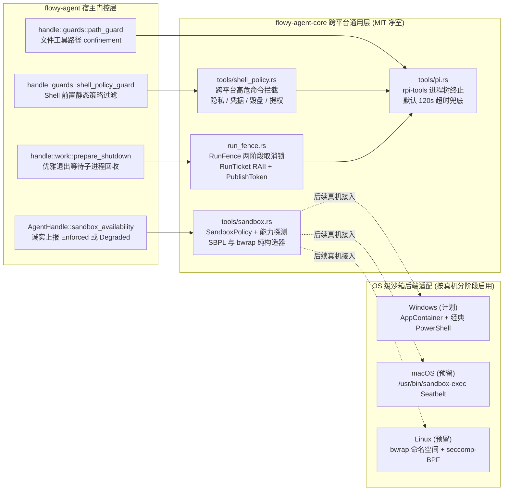
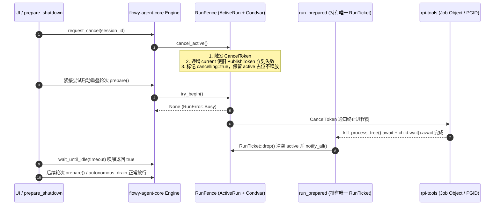

# 跨平台沙箱隔离与进程树回收预留方案

> **状态**：🔧 通用层已落地并经 Windows 实测（`flowy-agent-core` / `flowy-agent`）；macOS / Linux OS 级沙箱执行适配器已预留纯函数构造器与检测探针，待真机实测接入  
> **核心原则**：**“先守住跨平台不变量（路径硬边界 + 两阶段取消回收 + 静态高危拦截 + 诚实能力上报），再按 OS 真机逐一启用原生沙箱，绝不虚报隔离，绝不污染 MIT 协议。”**

---

## 1. 背景与核心痛点

### 1.1 业务背景

Flowy 桌面内核（`flowy18_wip/`）定位为「云端推理 ＋ 本机执行」的交付型 Agent，目标覆盖 **Windows（当前主开发与实测平台）**、**macOS** 与 **Linux** 三端。因为当前开发机仅具备 Windows 环境，无法本机实测 macOS / Linux 内核隔离原语，必须在架构上将「跨平台通用层」与「平台专属 OS 沙箱适配器」清晰解耦，并把 macOS / Linux 的演进蓝图、实测门槛与已知深坑沉淀进仓库文档，避免后续接入时重复踩坑。

### 1.2 现状盘点与三大痛点

在核对 `pi-rust`（`rpi-tools@300c1f3`）、仓库自研 `crates/shared/nomi-process-runtime` 及开源参考实现后，本轮定位并澄清了三个关键事实：

1. **误判澄清——进程树强杀底层已有，真缺口在宿主取消围栏（`§5.8`）**：`rpi-tools/src/os_env.rs` 已内置跨平台进程树终止（Windows `CREATE_SUSPENDED` + `win32job::Job` + `taskkill /F /T` 兜底；Unix `process_group(0)` + `kill(-pgid, SIGKILL)`）。真正的跨平台竞态是 `RunFence::cancel_active()` 此前在发完 `CancelToken` 后**同步清空 `*active = None`**，导致旧轮次子进程尚未退出时，新轮次或自治队列即可并发闯入同一工作区。
2. **文件工具强隔离，Shell 工具长期处于无防护状态**：文件读写与产物工具均经 `confined_to`（最深已存在祖先 `canonicalize`）强约束在工作区内，但 `powershell` / `bash` 仍以当前用户权限运行，此前缺少针对凭据目录（`~/.ssh`、`~/.aws`、`Flowy/Flowy/data/auth`）、macOS TCC 隐私弹窗篡改（`tccutil` / `osascript`）与全盘毁灭命令的前置静态防线。
3. **三端 OS 沙箱约束差异极大且存在协议红线**：macOS 依赖 `/usr/bin/sandbox-exec`（Seatbelt SBPL），Linux 依赖 `bwrap`（Bubblewrap 命名空间 + seccomp-BPF），Windows AppContainer 与 MSIX 打包 Shell / Git Bash 不兼容且必须退回经典 `WindowsPowerShell\v1.0\powershell.exe`；此外外部参考仓库 `zed/crates/sandbox` 为 **`GPL-3.0-or-later`**，绝不可直接拷贝代码进 MIT 许可的 `flowy18_wip`。

### 1.3 三平台能力对比矩阵

| 能力层 | Windows（已实测） | macOS（预留，待实机验证） | Linux（预留，待实机验证） |
| --- | --- | --- | --- |
| **文件工具路径隔离（`confined_to` + `artifact_source`）** | ✅ 已实测（Junction/ADS/DOS 别名/写锁全拦） | ✅ 通用层已就绪（symlink 祖先规范化） | ✅ 通用层已就绪（symlink 祖先规范化） |
| **两阶段取消与子进程退出等待（`RunFence` + `rpi-tools`）** | ✅ 已实测（`win32job` + `RunTicket` RAII 释放 + `prepare_shutdown` 等待） | ✅ 通用层已就绪（`process_group(0)` + `RunTicket` RAII） | ✅ 通用层已就绪（`process_group(0)` + `RunTicket` RAII） |
| **Shell 静态安全策略（`shell_policy.rs`）** | ✅ 已实测（全规则跨平台单测覆盖） | ✅ 已实测（含 `tccutil` / `osascript` 隐私规则） | ✅ 已实测（含 `rm -rf /` / `dd` / `sudo` / `systemctl`） |
| **OS 级沙箱配置与探测（`sandbox.rs`）** | 🔧 诚实上报 `Degraded`（预留 `WindowsAppContainer`） | 🔧 诚实上报 `Degraded` + 已探测 `/usr/bin/sandbox-exec` + SBPL 生成器已单测 | 🔧 诚实上报 `Degraded` + 已探测 `bwrap` + argv 构造器已单测 |
| **OS 级内核强制执行（Shell 子进程包壳）** | 📋 后续里程碑（AppContainer / Restricted Token） | 📋 待 macOS 真机挂载 `sandbox-exec -f` | 📋 待 Linux 真机挂载 `bwrap` + seccomp-BPF |

---

## 2. 方案全景与架构设计

### 2.1 分层拓扑图



### 2.2 核心目标与明确的非目标

- **本阶段目标（已落地）**：
  1. 关闭 `RunFence` 取消后未等子进程退出即放行新轮次的并发窗口（Windows / macOS / Linux 通用）。
  2. 落地零第三方协议风险的 MIT 净室 `shell_policy.rs` 与 `sandbox.rs`，并接入 `handle::guards::tool_registry`。
  3. 用纯函数在 Windows 上提前把 macOS SBPL profile 生成器与 Linux `bwrap` 参数构造器写完并通过单元测试。
- **本阶段明确非目标**：
  1. 不在无真机的前提下盲写 macOS `sandbox-exec` / Linux `bwrap` 子进程 spawn 包装并宣称 `Enforced`。
  2. 不在当前阶段为 Windows 强行启用会破坏常用 Python / Node / PowerShell 脚本的 AppContainer 强制模式。
  3. 不复制任何 `GPL-3.0-or-later`（`zed`）或受限许可证（`linger`、`ZCode`）源码。

### 2.3 架构不变量（安全红线）

1. **诚实能力上报红线**：在 OS 级沙箱真正包壳执行并实测逃逸阻断之前，`detect_sandbox_availability()` 必须返回 `SandboxAvailability::Degraded`，绝不允许伪造 `Enforced`。
2. **协议净室红线**：`flowy18_wip/` 为 MIT 许可，仅吸收架构思路（策略与后端解耦、TOCTOU 路径锚定、进程组两阶段清理），所有 Rust 代码 100% 净室独立编写，或直接复用本仓库自研 `crates/shared/nomi-process-runtime` 的设计模式。
3. **取消不可重叠红线**：同一会话在 `CancelToken` 触发后、原 `RunTicket` 完成回收并 `Drop` 之前，`RunFence::try_begin()` 必须稳定拒绝重叠轮次（`RunError::Busy`）。

---

## 3. 核心设计与模块规范

### 3.1 两阶段取消回收时序（`run_fence.rs` + `engine.rs` + `work.rs`）



### 3.2 跨平台通用层模块清单（已落盘）

| 模块路径 | 职责与公开契约 |
| --- | --- |
| `flowy-agent-core/src/run_fence.rs` | `RunFence`、`RunTicket`（唯一 RAII 占位，Drop 自动释放并唤醒 `Condvar`）、`PublishToken`（轻量观察者发布令牌，绝不拖延围栏释放）、`is_cancelling()`、`wait_until_idle(timeout)` |
| `flowy-agent-core/src/tools/shell_policy.rs` | `evaluate_shell_command(command, cwd) -> ShellPolicyDecision`，拦截四类高危模式：`SHELL_PRIVACY_TAMPER`（`tccutil` / `osascript` 隐私与 System Events）、`SHELL_CREDENTIAL_ACCESS`（`~/.ssh` / `~/.aws` / `~/.gnupg` / `Flowy/Flowy/data/auth` / `/etc/shadow` / `Windows/System32/config`）、`SHELL_DESTRUCTIVE_HOST_OP`（跨平台删根目录/用户目录/格式化磁盘）、`SHELL_SYSTEM_TAMPER`（`sudo` / `HKLM` 注册表 / `LocalMachine` 执行策略 / `systemctl` / `LaunchDaemons`） |
| `flowy-agent-core/src/tools/sandbox.rs` | `SandboxPolicy`、`SandboxBackend`、`SandboxAvailability`、`detect_sandbox_availability()`、`macos_seatbelt_profile(&policy)`、`linux_bwrap_args(&policy, cwd)` |
| `flowy-agent/src/handle/guards.rs` | 在 `tool_registry(cwd)` 中同时挂载 `path_guard`（文件工具）与 `shell_policy_guard`（`powershell` / `bash`，命中阻断时写 `WARN target="flowy.sandbox"`） |

### 3.3 平台专属 OS 沙箱预留接入规格（后续真机实施指南）

#### A. macOS 适配（`SandboxBackend::MacOsSeatbelt`）

1. **执行包装**：在 `pi_bash_definition` 的自定义 `ExecutionEnv` 实现中，检测到 `/usr/bin/sandbox-exec` 可用且启用沙箱时：
   - 调用 `macos_seatbelt_profile(&policy)` 生成 SBPL 策略，写入受控临时文件（`0600` 权限，进程结束后删除）；
   - 将原 `/bin/bash -lc <cmd>` 包装为 `/usr/bin/sandbox-exec -f <profile_path> -- /bin/bash -lc <cmd>`；
   - 将 `detect_sandbox_availability()` 在 macOS 上切换为 `Enforced { backend: SandboxBackend::MacOsSeatbelt }`（若用户显式关闭或二进制缺失则保持 `Degraded`）。
2. **已知深坑提示**：
   - Seatbelt 的 `(subpath ...)` 必须使用 `canonicalize` 后的真实路径（macOS 上 `/var` → `/private/var`、`/tmp` → `/private/tmp`）；
   - `sandbox-exec` 虽被 Apple 标注 deprecated 但 macOS 14/15 仍全量可用，需在 CI macOS runner 上保留回归测试监控其可用性；
   - 进程树清理沿用 `rpi-tools` 的 `process_group(0)`，若未来需处理 `setsid()` 脱离进程组的孙进程，可参考本仓库 `crates/shared/nomi-process-runtime` 的父进程看门狗 + 优雅 `SIGTERM`（500ms）→ `kill(-pgid, 0)` 探活 → `SIGKILL` 两段回收。

#### B. Linux 适配（`SandboxBackend::LinuxBubblewrap`）

1. **执行包装**：在自定义 `ExecutionEnv` 中检测 `bwrap` 可执行且非特权用户命名空间可用（可先运行一次 `bwrap --ro-bind / / -- true` 自检，防止 Debian/Ubuntu AppArmor 禁用 unprivileged userns 时静默崩坏）：
   - 调用 `linux_bwrap_args(&policy, cwd)` 生成参数序列（含 `--die-with-parent`、`--new-session`、`--ro-bind / /`、仅工作区 `--bind` 可写、敏感目录 `--tmpfs` 遮蔽、可选 `--unshare-net`）；
   - 在参数末尾拼接 `["/bin/bash", "-lc", command]`；
   - 进阶加固：按需通过 `--seccomp <fd>` 挂载 BPF 过滤器封禁危险 syscall（如 `ptrace`、`mount`、`bpf`、`kexec_load`），以及对敏感目录在绑定前检查路径父级防 TOCTOU 符号链接替换。
2. **进程回收补充**：
   - `--die-with-parent` 与 `--unshare-pid` 天然保证宿主异常崩溃时沙箱内全部孤儿进程由内核级 `PID 1` 联动销毁，可配合 `nomi-process-runtime` 中的 `LinuxProcessGroupAnchor` 思路实现零孤儿残留。

#### C. Windows 进阶适配（`SandboxBackend::WindowsAppContainer`）

1. **现役防护（已实测）**：`path_guard`（祖先 `canonicalize`）+ `artifact_source`（防 Junction/ADS/DOS 别名/写锁）+ `shell_policy_guard` + `rpi-tools` `CREATE_SUSPENDED` + `win32job::Job` + `RunFence` 两阶段回收锁。
2. **后续启用 AppContainer 的硬约束**：
   - **严禁使用 MSIX 打包的 `pwsh.exe` 或 Git Bash 作为 AppContainer 宿主 Shell**（AppContainer Token 无法拉起 MSIX 虚拟化包且易报 `ACCESS_DENIED`）；必须显式锁定经典 `%SystemRoot%\System32\WindowsPowerShell\v1.0\powershell.exe`（可复用本仓库 `crates/shared/nomi-process-runtime/src/windows_shell.rs` 的检测逻辑）；
   - 需对工作区目录显式授予 AppContainer SID 的读写 ACL，并在任务结束/销毁工作区时回收 ACL，且允许用户按工作区配置开关（避免阻断用户本机已安装的 Python/Office COM 工具链）。

---

## 4. 关键决策与权衡矩阵

| 编号 | 决策点 | 选定方案 | 放弃的替代方案与理由 |
| --- | --- | --- | --- |
| **D1** | Windows 进程树强杀落点 | **复用 `rpi-tools` 已有 `win32job::Job` + POSIX `process_group(0)`，集中修 `RunFence` 两阶段取消回收锁** | ❌ 在 `flowy-agent-core` 外层再套一层重复 Windows Job Object：与 `rpi-tools` 内部挂 Job 冲突且无法修掉「取消后未等退出即放行新轮次」的跨平台根因。 |
| **D2** | 开源参考代码借鉴边界 | **100% MIT 净室实现通用层 + 借鉴本仓库自研 `nomi-process-runtime`** | ❌ 直接移植 `zed/crates/sandbox` 或 `linger`：`zed` 为 `GPL-3.0-or-later` 与 `flowy18_wip` 的 MIT 冲突，`linger` 含托管限制条款。 |
| **D3** | 沙箱能力状态上报 | **未实机挂载前一律诚实返回 `SandboxAvailability::Degraded`** | ❌ 仅凭静态黑名单就上报「已沙箱隔离」：静态过滤可被编码/脚本绕过，虚报安全边界比不报更危险。 |
| **D4** | 静态 Shell 策略粒度 | **聚焦高危害确定性目标（凭据/隐私/毁盘/提权），不拦截常规工作区脚本** | ❌ 白名单制只允许极少数命令：会直接打断模型生成 `.xlsx`/`.docx`/`.pptx` 所需的 Python / PowerShell 正常构建脚本。 |
| **D5** | macOS / Linux 预留方式 | **在通用层落地纯函数 SBPL / `bwrap` 构造器并纳入 Windows 常规单测** | ❌ 只写纯文字文档不写代码接口：容易与后续演进脱节；纯构造器可在任意 OS 上持续编译与回归验证。 |

---

## 5. 验收标准与跨平台验证梯子

### 5.1 验收用例矩阵

| 编号 | 平台 | 验收项 | 预期结果 | 状态 |
| --- | --- | --- | --- | --- |
| **TC-WIN-01** | Windows | 取消运行中轮次，在旧轮次退出前立刻发起重叠轮次 | `Engine::prepare` 返回 `Err(RunError::Busy)`；旧轮次退出后 `wait_until_idle` 唤醒，新轮次放行 | ✅ 已通过单测 |
| **TC-WIN-02** | Windows | `shell_policy_guard` 拦截凭据读取、全盘删除、注册表提权、macOS TCC 命令，放行正常脚本 | 高危命令全部 `Deny` 并打 `WARN target="flowy.sandbox"`；工作区脚本全部 `Allow` | ✅ 已通过单测 |
| **TC-WIN-03** | Windows | `AgentHandle::sandbox_availability()` 上报状态 | 返回 `Degraded { platform: "windows", planned_backend: WindowsAppContainer, .. }` | ✅ 已通过单测 |
| **TC-MAC-01** | macOS | 真机执行 `sandbox-exec -f <profile>` 写入工作区外 `/tmp` 之外的宿主文件与读取 `~/.ssh` | 写宿主目录被 `EPERM` 拒绝，读 `~/.ssh` 被拒，写工作区成功 | 📋 待 macOS 真机实测 |
| **TC-MAC-02** | macOS | 真机取消带长时睡眠子进程的 `bash` 工具 | 子进程组退出前重叠轮次被拒；取消完成后 `ps` 确认零残留子进程 | 📋 待 macOS 真机实测 |
| **TC-LNX-01** | Linux | 真机执行 `bwrap` 自检 + 沙箱内写工作区外文件 / 读 `~/.ssh` / 禁网访问外网 | 写工作区外失败、`~/.ssh` 为空 `tmpfs`、外网连接 `ENETUNREACH` | 📋 待 Linux 真机实测 |
| **TC-LNX-02** | Linux | 强杀宿主进程（`SIGKILL`）验证 `--die-with-parent` | 沙箱内全部子进程自动退出，零孤儿进程 | 📋 待 Linux 真机实测 |

### 5.2 验证梯子（Verification Ladder）

```powershell
# 1. 通用层单测（Windows / macOS / Linux 通用）
cd flowy18_wip
cargo test -p flowy-agent-core run_fence
cargo test -p flowy-agent-core shell_policy
cargo test -p flowy-agent-core sandbox
cargo test -p flowy-agent shell_policy_guard

# 2. 跨 crate 严格门禁
cargo clippy -p flowy-agent-core -p flowy-agent -- -D warnings
cargo clippy -p flowy-agent --all-targets -- -D warnings
cargo check -p flowy-app
```

## 6. Wave 3.2a · Linux Shell 接入

Linux 在 `/usr/bin/bwrap` 能用普通用户启动 `/bin/bash` 并建立所需命名空间时，上报 `Enforced { backend: LinuxBubblewrap }`。探测与执行共用同一个启动决定。二进制缺失或探测失败时，上报 `Degraded`，沿用静态命令策略和进程回收。选中 Bubblewrap 后，策略准备、启动或命令执行失败会直接返回错误。

Shell 仍由 `rpi-tools` 负责输出、超时、取消与进程回收。沙箱将宿主文件系统挂为只读，单独开放获准工作区的写入，将 `/tmp` 与 `/run` 作为私有临时目录，并遮蔽策略指定的凭据路径及宿主的 `auth` 目录。Shell 环境只传递基础执行变量。默认保留联网行为。宿主 DNS 配置指向私有 `/run` 时，仅将解析器配置文件只读挂回。禁网策略使用独立网络命名空间。本阶段验收覆盖挂载和命名空间策略，seccomp-BPF 保留为进阶项。

使用 Ubuntu 24.04 WSL2、Bubblewrap 0.9.0 与普通用户实测生产 Shell 工作区边界、合成凭据遮蔽、禁网、取消、超时和宿主退出回收。GitHub Ubuntu 24.04 镜像的默认 AppArmor 策略拒绝 Bubblewrap 初始化独立网络命名空间。常规 Rust 测试继续在 Ubuntu 24.04 作业运行。独立沙箱门禁在自带 Bubblewrap AppArmor 配置的 Ubuntu 26.04 镜像安装发行版 Bubblewrap，以普通 runner 用户运行同一组集成用例。

```bash
cd flowy18_wip
cargo test -p flowy-agent-core --locked --lib linux_bwrap_ -- --ignored --test-threads=1
```
