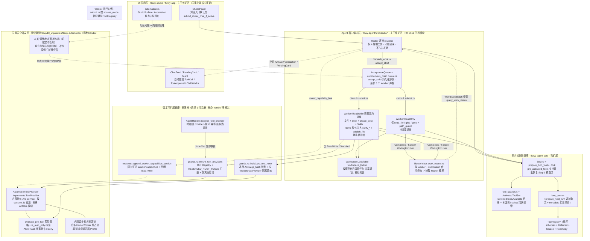
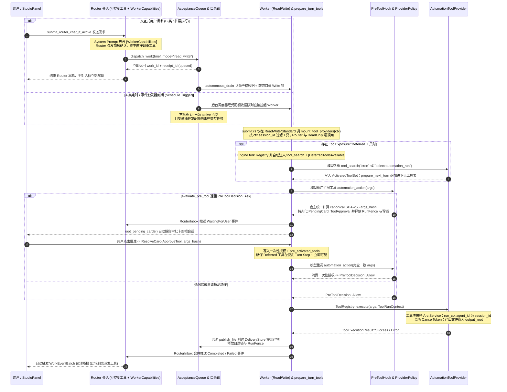

# Flowy 1.8 Router / Work 架构与自动化 Tools 扩展规范 · 技术方案

> **状态**：✅ 底座已实现并完成硬化收口（代码真源：`origin/main @ 768bbd155` PR #530 + 本轮 `fix/flowy18-provider-seam-hardening`，覆盖 `tool_search` 无环快照与 32 上限、Provider 强身份绑定防绕过审批、锁外预装配与异步 drain 隔离、单 Provider 重名 fail-closed）  
> **适用对象**：Flowy 1.8 自动化功能开发同事、后续接入 MCP / 可执行 Skill / 插件的工程师与 Coding Agent  
> **核心原则**：Router 只派活不干活（且零同步 Provider 回调）、`ReadOnly` 严守 3 个只读检查工具、扩展 `ToolProvider` 一律只在 `Worker (ReadWrite)` / `Standard` 经锁外预装配挂载、多工具走 `Deferred` + `tool_search` 按需激活（上限 32）、审批（绑版本/实例/cwd/nonce）与产物交付走统一宿主门禁。

---

## §1 背景与核心结论 (Background & Capability Matrix)

### 1.1 核心结论核实：只有 `Worker (ReadWrite)` 持有完整能力清单

在最新主分支（`flowy18_wip/`）上，**「只有 Work 后的 Agent 才是有完整能力清单的 Agent」这一判断完全成立**。这不是靠 System Prompt 软约束实现的，而是 `flowy-agent` 在每轮组装 `EngineConfig.registry` 时执行的**代码级物理工具隔离**（见 [submit.rs](../../crates/flowy-agent/src/handle/submit.rs#L465-L715)）：

1. **交互主对话默认创建 `SessionRole::Router`**：在 [panel/submit.rs](../../crates/flowy-studio/src/panel/submit.rs#L178-L296)（PR #528 自 `panel.rs` 拆分）中，除历史遗留的 `SessionRole::Standard` 会话外，所有新会话一律走 `submit_router_chat_if_active`。
2. **`Router` 只有亚秒级控制工具**：`router_tool_registry` 仅注册 4 个控制工具（在后台 `WorkEventBatch` 进度播报轮甚至物理剥离到只剩 `query_work_status` 1 个），不注入 Skills 清单、**零同步调用 `ToolProvider`**（`router_capability_hint()` 在 [`register_tool_provider`](../../crates/flowy-agent/src/handle/mod.rs#L657-L692) 时预清洗缓存为 `cached_router_hint`）、不申请目录锁、不占并发池名额、非认领回合结束直跳过 `accept_drain`；Router System Prompt 自动读取缓存拼入 `[WorkerCapabilities]` 只读摘要，引导其将扩展任务派发给 `ReadWrite` Worker。
3. **`Worker` 按不可升级的 `WorkAccessMode` 物理分档**：
   - `WorkAccessMode::ReadOnly`：仅白名单保留 `read_file` / `glob` / `grep` 3 个目录内检索工具，持目录共享读锁（允许同项目目录多读并发）；**永不调用任何扩展 `ToolProvider`**（从结构上杜绝漏判 `ReadOnly` 或误写降级代码）。
   - `WorkAccessMode::ReadWrite`（默认派发模式，含历史兼容 `Standard`）：挂载完整内置工具集 + Platform Shell + `create_deck` + Skills 清单 + 扩展 `ToolProvider`（含可选 `[ProviderCapabilities]`、`ToolExposure::Deferred` 延迟暴露与自动按需注入的 `tool_search`）+ 通用 `PreToolHook` 审批门禁；若为 `SessionOrigin::Home`，还动态注入 `verify_deck` / `verify_artifact` / `publish_file` 与 `DeliveryStore` 交付门禁。

### 1.2 关键消歧：两套独立 Workspace 与两类「自动化」

在开始编码前，必须先澄清两个极易导致开发冲突的边界问题：

1. **两套独立 Cargo Workspace（切勿跨层接错仓库）**：
   - 本架构归属 **`flowy18_wip/`** 嵌套 GPUI 工作区（基于 `flowy-agent-core` + `pi-rust`）。
   - 仓库根目录下的 [crates/agent/](../../../crates/agent/README.md)（24 个 `nomi-*` / `flowy-web` crate，包含旧版 `nomi-browser`、`nomi-computer`、`nomi-tools`）是**另一套独立 Rust workspace**，服务旧 Tauri/Web 架构；`flowy18_wip/` 与 `nomi-*` 无任何依赖关系。
2. **两类职责截然不同的「自动化」（切勿混为一谈）**：
   - **A 类 · 调度 / 触发器自动化（Control-Plane / Scheduled Automation）**：管理定时任务、事件触发器与周期唤醒，对应目前已有的占位画布 [automation.rs](../../crates/flowy-studio/src/automation.rs)（`StudioSurface::Automation` 展示 Schedule / Trigger / Advanced 卡片，当前点击均提示 `auto.later`），对应架构预留 [先记.md §5.14](flowy-v0/先记.md#L22-L38) 的第 3 类「定时或外部事件」Trigger。若允许模型在对话中创建/查看/暂停规则，其管理类 Tool 属轻量亚秒操作；但**定时触发后的真实执行体仍是独立 `Worker (ReadWrite)`**。
   - **B 类 · 外部执行 / 操控类自动化（Execution-Plane Automation）**：如浏览器 CDP、桌面 UIA、系统级 GUI 点击或长耗时外部工作流 Tool。此类 Tool **必须只挂在 `Worker (ReadWrite)`**，绝不能挂入 `Router` 或 `Worker (ReadOnly)`。

### 1.3 各角色 / 模式完整能力清单对照矩阵

以下矩阵逐项核对自 [submit.rs](../../crates/flowy-agent/src/handle/submit.rs#L465-L715)、[router.rs](../../crates/flowy-agent/src/handle/router.rs#L329-L348) 与 [guards.rs](../../crates/flowy-agent/src/handle/guards.rs#L543-L597)：

| 会话角色 / 模式 | 物理暴露的工具清单 (`ToolRegistry`) | Skills 注入 | Guard 与 `PreToolHook` 门禁 | 目录锁 (`WorkspaceLockTable`) | 是否占并发池 (`max=3`) |
| --- | --- | --- | --- | --- | --- |
| **`Router`（常规对话轮）** | `dispatch_work`、`query_work_status`、`control_work`、`ask_user_choice`（+ 缓存摘要 `[WorkerCapabilities]`） | 不注入 | 仅 `build_router_pre_tool_hook`（拦截 `ask_user_choice` 挂起 `PendingCard::Disambiguation`） | `None`（永不锁目录） | **否** |
| **`Router`（`WorkEventBatch` 播报轮）** | **仅 `query_work_status`**（物理剥离派发 / 控制 / 提问工具防重试风暴） | 不注入 | `None` | `None` | **否** |
| **`Worker (ReadOnly)`** | **仅 3 个**：`read_file`、`glob`、`grep`（物理 `unregister` 写工具，**零扩展 Provider**） | 注入 | 仅 `path_guard`（`pre_tool_hook = None`） | `Read`（允许同目录多读并发） | **是** |
| **`Worker (ReadWrite)` · Project** | `read_file`、`write_file`、`edit_file`、`glob`、`grep`、`powershell` / `bash`、`create_deck` **+ 扩展 `ToolProvider` + `tool_search`（存在 `Deferred` 工具时自动注入，搜索激活上限 32）** | 注入 | `path_guard` + `skill_shell_guard` + `shell_policy_guard` + 通用 `build_pre_tool_hook`（含按 `ToolSource::Provider` 隔离的 `evaluate_pre_tool` 与失效审批 `force_reconfirm_tools`） | `Write`（同目录及祖先/子孙目录排他） | **是** |
| **`Worker (ReadWrite)` · Home** | 上述全部 **+ 动态追加** `verify_deck`、`verify_artifact`、`publish_file`（优先级高于 Provider，防覆盖） | 注入 | 同上 + `WorkContract`（Revision 契约）+ `DeliveryStore` 交付门禁 | `Write`（隔离目录 `sessions/workspaces/w-*`，多 Worker 互不冲突） | **是** |
| **`Standard`（历史存量兼容）** | 同 `Worker (ReadWrite)`（同样挂载扩展 `ToolProvider`；按 `SessionOrigin` 决定是否追加核验与交付工具） | 注入 | 同 `Worker (ReadWrite)` | `Write` | **是** |

> [!NOTE]
> 内置工具表里的 `todo_write` 目前在 [guards.rs](../../crates/flowy-agent/src/handle/guards.rs#L554) 中显式调用 `registry.unregister("todo_write")` 移除，因为前端尚未提供 Todo 展示面，只向模型暴露宿主可闭环满足的工具。

---

## §2 方案全景、分层架构图与架构不变量 (Architecture & Invariants)

### 2.1 端到端分层拓扑与防冲突协作边界图



### 2.2 核心目标与明确非目标 (Scope vs. Non-Goals)

| 范围 | 明确内容 |
| --- | --- |
| **本阶段目标** | 1. 明确 Router 与 Worker 的物理工具隔离边界，防止新 Tools 误挂进 Router 阻塞对话或误入 `ReadOnly` 权限；<br/>2. 提供有状态 `ToolProvider` + `AgentHandle::register_tool_provider` 扩展底座，使定时任务 / MCP / Skill / Plugin 开发者与主干近零冲突并行；<br/>3. 落地通用 `PreToolDecision::Ask` + `args_hash` 审批卡消费闭环与 `ToolExposure::Deferred` / `tool_search` 按需工具激活。 |
| **明确非目标** | 1. **不**在 `flowy-agent-core` 中引入浏览器引擎（CDP）、桌面 UIA 或具体定时调度持久化依赖；<br/>2. **不**在本架构中重新实现第二套进程外 RPC / 插件市场协议；<br/>3. **不**允许扩展 Provider 绕过 `output_root` + `publish_file` 直接写入 `ArtifactStore`（挂载时强制剥离 `artifact_delivery`）；<br/>4. **不**在 `Worker (ReadOnly)` 内挂载任何扩展 `ToolProvider`，杜绝扩展层重复实现 `writable` 降级逻辑。 |

### 2.3 八条架构红线 (Architecture Invariants)

1. **Router 亚秒通道红线**：`Router` 永不调用任何 `ToolProvider`、永不挂载重 IO / 网络 / GUI / 子进程工具、永不申请目录写锁、永不计入 `in_flight_work_count()` 并发上限。任何耗时操作必须由 `Router` 经 `dispatch_work` 下发给 `Worker`。
2. **`ReadOnly` 物理 3 工具红线与模式不可升级**：`Worker (ReadOnly)` 严守 `read_file` / `glob` / `grep` 3 个目录内检索工具，持共享读锁，**永不挂载扩展 `ToolProvider`**；创建 `Worker` 后 `access_mode` 永久锁定在 `SessionRecord.access_mode` 中，对 `ReadOnly` Worker 再次派发 `mode="read_write"` 会被 [router.rs](../../crates/flowy-agent/src/handle/router.rs#L1009-L1015) 明确拒绝（`ACCESS_MODE_ESCALATION_DENIED`）。
3. **严格锁序不变量**：宿主锁序规定在 [handle/mod.rs](../../crates/flowy-agent/src/handle/mod.rs#L513-L520)：`accept_drain -> dispatch -> engine (clone & release) -> index_write -> live -> leaf locks (active, active_claims, workspace_locks, router_inboxes, updates, tool_args, approved_tool_calls, pending_provider_approvals, denied_tool_turns, notified_quarantined, providers)`。`providers` 为严格叶级锁，读取时仅 clone `Vec` 后立即释放；Worker 侧 `register_tools()` / `worker_prompt_hint()` 通过 `pre_stage_worker_providers` 在 `dispatch` 锁外完成且 `autonomous_drain` 经 `spawn_blocking` 隔离（非认领回合经 `has_owned_claim` 跳过 `accept_drain`），**任何 Provider / Tool 回调仍绝对禁止反向持有或等待 `Engine`/`Harness` 锁**。
4. **注册期零副作用 + 无引用环与激活上限**：`submit.rs` 每轮提交均通过 [stage_tool_providers](../../crates/flowy-agent/src/handle/guards.rs#L214-L270) 调用 `ToolProvider::register_tools(ctx, &staging)`。**`register_tools` 必须是纯内存、零网络/磁盘扫描/子进程启动的惰性构造**；真正的连接、浏览器标签或定时器资源只在工具 `execute` 闭包内按需懒创建。同时 [`tool_search_definition`](../../crates/flowy-agent-core/src/tools/search.rs#L187-L220) 仅捕获 [`SearchableToolEntry`](../../crates/flowy-agent-core/src/tools/search.rs#L40-L51) 值快照以消除 `Arc` 引用环，并设定每轮搜索累计激活上限 `MAX_ACTIVATED_TOOLS_PER_TURN = 32`（宿主 `pre_activated_tools` 豁免）。
5. **防阴影覆盖、防单 Provider 重名与跨实例审批防绕过红线**：[stage_tool_providers / merge_staged_providers](../../crates/flowy-agent/src/handle/guards.rs#L214-L338) 为每个 Provider 分配 `ToolRegistry::new_rejecting_duplicates()` 临时表（整名 fail-closed 拒绝同一 Provider 内重名注册），并在合并时拦截空/空白名、`RESERVED_HOST_TOOLS` 或与宿主/先注册工具重名的条目，强制剥离 `artifact_delivery` 并覆写 `ToolSource::Provider(id)`。Provider 审批严格绑定 `process_nonce`、`(provider_id, registration_id)`、`tool_fingerprint`（含 `ToolProvider::version()`）与 `cwd_key`，热替换/升版/卸载/重启后经 [verify_provider_approval_binding](../../crates/flowy-agent/src/handle/work.rs#L898-L970) 作废旧卡并注入 `force_reconfirm_tools`（即便新实例无 `Ask` 仍强制重确认）。
6. **产物交付单一出口**：自动化任务产出的交付文件（导出报表、截图成品、生成文档）必须落入 `ToolRunContext.output_root` 并通过模型调用 `publish_file`（走 `DeliveryStore` + `RegistryTool` 校验）交付资料库。只有名为 `"publish_file"` 且标记 `.with_artifact_delivery()` 的工具才允许携带 `ArtifactReceipt`（见 [adapter.rs](../../crates/flowy-agent-core/src/tools/adapter.rs#L97-L140)）。
7. **`flowy-agent-core` 轻量与紧凑体积红线**：`flowy-agent-core` 无重量级运行时依赖；同时 [flowy18_wip/AGENTS.md](../../AGENTS.md#L48) 明确约束改动 `flowy-agent-core` / `flowy-agent` 公开结构体时须防止下游 `flowy-studio` / `flowy-app` / `flowy-desktop` 触发 `clippy::large_enum_variant`（`EngineConfig` 仅增 `pre_activated_tools: Vec<String>`，`TurnRequest` 将 `rpi_agent::PrepareNextTurn` 封装在 `loop_runner` 内部不对外泄漏）。
8. **Workspace Lints 与跨平台红线**：全工作区开启 `unsafe_code = "deny"`、`rust_2018_idioms = "deny"`、`clippy::pedantic = "deny"`（见 [flowy18_wip/Cargo.toml](../../Cargo.toml#L116-L166)），单测目标同样受 `pedantic` 约束；所有自动化工具必须同时考虑 Windows 与 macOS 编译通过（不可无门控依赖单一 OS API）。

---

## §3 核心设计与模块规范 (Subsystem Design & Agent Navigation)

### 3.1 PR #519 + Capability Seam + Hardening 后源码导航地图（面向 Agent 快速定位）

PR #519 拆解 `handle/mod.rs`（PR #528 进一步拆解 `panel.rs`），本分支进一步在 `flowy-agent-core` 与 `flowy-agent` 落地并硬化 `ToolProvider` + `tool_search` 底座；下文列出精确文件职责与协作归属（**扩展业务无需改 `handle/` 核心文件**）：

| Crate | 模块路径 | 核心职责与关键符号 | 扩展开发接入归属 |
| --- | --- | --- | --- |
| `flowy-agent-core` | [tools/provider.rs](../../crates/flowy-agent-core/src/tools/provider.rs#L1-L87) | `ToolProvider` Trait（含默认 [`version()`](../../crates/flowy-agent-core/src/tools/provider.rs#L40)）、`ToolProviderContext<'_>`、`ToolPolicyContext<'_>` | **核心扩展接口（实现它；有内部变更建议覆写 `version()`）** |
| `flowy-agent-core` | [tools/registry.rs](../../crates/flowy-agent-core/src/tools/registry.rs#L22-L401) | `ToolDefinition`、`ToolSource`、`ToolExposure`（`Eager`/`Deferred`）、`with_read_only`/`with_tags`、`new_rejecting_duplicates()`（[#L272](../../crates/flowy-agent-core/src/tools/registry.rs#L272)）、`schemas()` 确定性排序、`fork()` | 定义工具用链式 Builder |
| `flowy-agent-core` | [tools/search.rs](../../crates/flowy-agent-core/src/tools/search.rs#L33-L250) | `TOOL_SEARCH_NAME`、`MAX_ACTIVATED_TOOLS_PER_TURN = 32`、无环 [`SearchableToolEntry`](../../crates/flowy-agent-core/src/tools/search.rs#L40) 快照、`ActivatedToolSet`、`tool_search_definition`、`format_deferred_tool_catalog` | 多工具模块标 `Deferred` 自动享用 |
| `flowy-agent-core` | [tools/adapter.rs](../../crates/flowy-agent-core/src/tools/adapter.rs) | `RegistryTool` 将宿主工具适配为 `rpi_agent::AgentTool`，收口 `ArtifactReceipt` 与文本结果 | 只读 / 如扩图片块需主干协商 |
| `flowy-agent-core` | [tools/builtin.rs](../../crates/flowy-agent-core/src/tools/builtin.rs) & [tools/pi.rs](../../crates/flowy-agent-core/src/tools/pi.rs) | `read_file`/`glob`/`grep`（均已标 `read_only=true`）/`write_file`/`edit_file` 与 `pi_shell_definition` | 只读参考 |
| `flowy-agent-core` | [types.rs](../../crates/flowy-agent-core/src/types.rs) | `ContentBlock`（当前仅 4 变体无图片）、`ToolRunContext`（`agent_id` 即 `session_id`）、`CancelToken` | 只读 / 如扩图片块需主干协商 |
| `flowy-agent-core` | [loop_runner.rs](../../crates/flowy-agent-core/src/loop_runner.rs#L521-L575) | `run_turn`、`build_prepare_next_turn`（轮内追加式工具激活）、同错熔断与 `read_only_tools` 元数据白名单 | **同事勿改**（标 `.with_read_only(true)` 自动生效） |
| `flowy-agent-core` | [engine.rs](../../crates/flowy-agent-core/src/engine.rs#L2021-L2113) | `Engine`、`EngineConfig::pre_activated_tools`、`prepare_turn_tools`（透明快路径 vs `fork + tool_search`） | **同事勿改** |
| `flowy-agent` | [handle/mod.rs](../../crates/flowy-agent/src/handle/mod.rs#L657-L731) | `Harness.providers` 叶级锁 + 缓存摘要 + `process_nonce` / `registration_id`、`AgentHandle::{register_tool_provider, unregister_tool_provider, registered_tool_provider_ids}` | **启动时调用 1 行注册**，勿改内部锁序 |
| `flowy-agent` | [handle/submit.rs](../../crates/flowy-agent/src/handle/submit.rs#L52-L96) & [L465-L715](../../crates/flowy-agent/src/handle/submit.rs#L465-L715) | 锁外 `pre_stage_worker_providers`；按角色物理分流，**仅在 `ReadWrite` / `Standard` 分支**挂载并写回 `pre_activated_tools`；非认领回合跳过 `accept_drain` | **同事勿改** |
| `flowy-agent` | [handle/guards.rs](../../crates/flowy-agent/src/handle/guards.rs#L21-L542) | `RESERVED_HOST_TOOLS`、`stage_tool_providers`、`merge_staged_providers`、`mount_tool_providers`、绑定式 `consume_or_request_approval` 与防绕过 `build_pre_tool_hook` | **同事勿改** |
| `flowy-agent` | [handle/router.rs](../../crates/flowy-agent/src/handle/router.rs#L329-L348) & [L847-L885](../../crates/flowy-agent/src/handle/router.rs#L847-L885) | `router_tool_registry`、`dispatch_work` schema、`append_worker_capabilities_section` 只读 `cached_router_hint` 汇总 `[WorkerCapabilities]` | **同事勿改**（实现 `router_capability_hint` 即生效） |
| `flowy-agent` | [handle/boot.rs](../../crates/flowy-agent/src/handle/boot.rs)、[sessions.rs](../../crates/flowy-agent/src/handle/sessions.rs)、[queue.rs](../../crates/flowy-agent/src/handle/queue.rs#L737-L905)、[work.rs](../../crates/flowy-agent/src/handle/work.rs#L491-L970)、[work_events.rs](../../crates/flowy-agent/src/handle/work_events.rs)、[workspace_lock.rs](../../crates/flowy-agent/src/handle/workspace_lock.rs)、[observer.rs](../../crates/flowy-agent/src/handle/observer.rs)、[artifacts.rs](../../crates/flowy-agent/src/handle/artifacts.rs) | 启动恢复、会话列表、`spawn_blocking` `AcceptanceQueue`、锁外审批恢复与 `verify_provider_approval_binding`、Router 合批、`WorkspaceLockTable`、终态清理、资料库 | **同事勿改** |
| `flowy-studio` | [panel/mod.rs](../../crates/flowy-studio/src/panel/mod.rs)、[panel/submit.rs](../../crates/flowy-studio/src/panel/submit.rs)、[automation.rs](../../crates/flowy-studio/src/automation.rs)、[work_actions.rs](../../crates/flowy-studio/src/work_actions.rs)、[ports/board.rs](../../crates/flowy-studio/src/ports/board.rs)、[ports/router_projection.rs](../../crates/flowy-studio/src/ports/router_projection.rs) | 主聊天、`StudioSurface::Automation` 占位画布、卡片动作、看板投影 | 仅 A 类定时 UI 才需在 `automation.rs` / `flowy-app` 接线；B 类工具 **无需改 UI** |

### 3.2 运行时交互时序图（派发、按需发现、审批挂起预激活恢复与定时触发）



### 3.3 零冲突有状态接入契约 (`ToolProvider` + `ToolExposure::Deferred` + 通用审批)

独立扩展 Crate（如同事新建 **`flowy18_wip/crates/flowy-automation`**）只需依赖 `flowy-agent-core`（绝不依赖 `flowy-agent` 或 `flowy-studio`），实现 [`ToolProvider`](../../crates/flowy-agent-core/src/tools/provider.rs#L33-L81) Trait 并在应用启动处调一行 `agent_handle.register_tool_provider(Arc::new(...))` 即可完成全链路接入——**全程无需修改 `handle/mod.rs`、`handle/submit.rs`、`guards.rs` 或 `router.rs`**。

```rust
// flowy18_wip/crates/flowy-automation/src/lib.rs（同事扩展接入完整示范）
use std::sync::Arc;
use flowy_agent_core::{
    PreToolDecision, ToolCallArgs, ToolDefinition, ToolExecutionResult,
    ToolExposure, ToolPolicyContext, ToolProvider, ToolProviderContext,
    ToolRegistry, ToolRunContext,
};
use serde_json::json;

pub struct AutomationToolProvider {
    /// 服务实例由 Provider 自身持有，无需挂进 Engine/Harness 结构体。
    service: Arc<AutomationService>,
}

impl AutomationToolProvider {
    #[must_use]
    pub const fn new(service: Arc<AutomationService>) -> Self {
        Self { service }
    }
}

impl ToolProvider for AutomationToolProvider {
    fn id(&self) -> &'static str {
        "automation"
    }

    /// 硬约束：仅在 Worker (ReadWrite / Standard) 每轮组装前触发。
    /// 宿主保证 Router 与 Worker (ReadOnly) 永不调用此方法，
    /// 因此扩展工具无需再手写 `writable` 参数与降级提示词 (`DOWNGRADE_NOTE`)。
    fn register_tools(
        &self,
        ctx: &ToolProviderContext<'_>,
        registry: &ToolRegistry,
    ) {
        // 1. 支持按 session_id 条件屏蔽（例如定时任务自己拉起的子执行会话禁止递归建定时任务）
        if self.service.is_automation_child_session(ctx.session_id) {
            return;
        }

        let service_list = Arc::clone(&self.service);
        registry.register(Arc::new(
            ToolDefinition::new(
                "automation_list",
                "List configured scheduled automation rules and states.",
                json!({"type": "object", "properties": {}, "additionalProperties": false}),
                move |_args: ToolCallArgs, run_ctx: ToolRunContext| {
                    let svc = Arc::clone(&service_list);
                    Box::pin(async move {
                        let sid = run_ctx.agent_id.as_deref().unwrap_or("");
                        let jobs = svc.list_for_session(sid).await;
                        ToolExecutionResult::success_text("ok", json!({ "jobs": jobs }))
                    })
                },
            )
            // 只读探测标注：用户拒绝风险动作后的同一轮仍允许模型排查，且瞬时失败可自动重试 1 次
            .with_read_only(true)
            // 多工具推荐标为 Deferred：日常写作/编码零 Schema 膨胀，需要时由 tool_search 按需解锁
            .with_exposure(ToolExposure::Deferred)
            .with_tags(["automation", "schedule", "cron", "定时任务"]),
        ));

        let service_delete = Arc::clone(&self.service);
        registry.register(Arc::new(
            ToolDefinition::new(
                "automation_delete",
                "Delete a scheduled automation rule by ID.",
                json!({
                    "type": "object",
                    "properties": { "job_id": { "type": "string", "minLength": 1 } },
                    "required": ["job_id"],
                    "additionalProperties": false
                }),
                move |args: ToolCallArgs, _run_ctx: ToolRunContext| {
                    let svc = Arc::clone(&service_delete);
                    Box::pin(async move {
                        let id = args.arguments["job_id"].as_str().unwrap_or("");
                        svc.delete_job(id).await;
                        ToolExecutionResult::success_text("deleted", json!({ "deleted": id }))
                    })
                },
            )
            .with_exposure(ToolExposure::Deferred)
            .with_tags(["automation", "schedule", "delete"]),
        ));
    }

    /// 宿主按 ToolSource::Provider("automation") 精确路由到这里（无法被其他 Provider 截胡）。
    /// 返回 PreToolDecision::Ask 时 args_hash 留空即可，宿主统一计算权威 SHA-256，
    /// 并负责挂起 ToolApproval 卡、用户批准后 pre_activated_tools 预激活与一次性授权消费。
    fn evaluate_pre_tool(
        &self,
        tool_name: &str,
        args: &serde_json::Value,
        _ctx: &ToolPolicyContext<'_>,
    ) -> Option<PreToolDecision> {
        if tool_name == "automation_delete" {
            let job_id = args.get("job_id").and_then(|v| v.as_str()).unwrap_or("");
            return Some(PreToolDecision::Ask {
                target_summary: format!("automation rule `{job_id}`"),
                args_hash: String::new(),
                risk_reason: "deletes a scheduled automation rule".into(),
                command_preview: format!("automation_delete(job_id={job_id})"),
            });
        }
        None
    }

    /// 宿主自动提取并限长展示进 Router System Prompt 的 [WorkerCapabilities] 段落。
    fn router_capability_hint(&self) -> Option<String> {
        Some("Manage and execute scheduled automation rules via ReadWrite Workers.".into())
    }
}

// 启动接线（如在 flowy-app 初始化 AgentHandle 处）只需 1 行，核心 handle/ 零合并冲突：
// agent_handle.register_tool_provider(Arc::new(AutomationToolProvider::new(service)));
```

### 3.4 状态机、熔断边界与 UI 投影约定

开发新 Tool 时必须遵守以下由 `flowy-agent-core` 与 `flowy-studio` 强制执行的运行时契约：

- **两阶段取消回收 (`RunFence` + `CancelToken`)**：请求取消时，[engine.rs](../../crates/flowy-agent-core/src/engine.rs#L1108-L1164) 立即触发 `CancelToken` 并作废 `PublishToken`，同时保持 `RunFence` 关闭直到工具 unwind 并清理子进程、释放 `RunTicket`。**任何阻塞式自动化 Tool 必须通过 `tokio::select!` 监听 `run_ctx.signal.cancelled()` 并杀死派生子进程 / 关闭标签页**，否则 `cancel_work` / `revise_work` 的 3 秒/2 秒 settle 等待窗口会超时返回 `notice.agent_busy`。
- **单回合上限与字符预算（来自 [loop_runner.rs](../../crates/flowy-agent-core/src/loop_runner.rs#L27-L31) & [search.rs](../../crates/flowy-agent-core/src/tools/search.rs#L33)）**：
  - `MAX_TOOL_TURNS_PER_SUBMISSION = 24`：单次提交最多 24 轮模型/工具交互。自动化工具粒度必须按语义动作封装（例如「打开并填表 / 批量读取」），切忌每移动一次鼠标耗 1 轮。
  - `MAX_TOOL_RESULT_CHARS = 32_000`：工具文本返回上限。DOM/UIA 树过长必须结构化过滤、分页切片或摘取关键元素，严禁原样吐整页 HTML 或 base64 字符串。
  - `MAX_ACTIVATED_TOOLS_PER_TURN = 32`：单回合通过 `tool_search` 新增激活的 `Deferred` 工具总数上限为 32；用户批准 `ToolApproval` 卡片后恢复预注入的 `EngineConfig::pre_activated_tools` 不计入该搜索配额。
  - **相同错误熔断 (`same_error_circuit_breaker`)**：对同一目标返回相同签名错误达到阈值会立即熔断整轮任务；工具错误码/文案应明确区分可恢复提示与终态失败，避免模型原参死循环重试。
- **UI 自动渲染零改动约定**：
  - [guards.rs::tool_target](../../crates/flowy-agent/src/handle/guards.rs#L866-L881) 会依次从参数对象读取 `"description"`、`"path"`、`"file_path"`、`"command"`、`"query"`、`"pattern"`、`"target"` 作为折叠行摘要。**新自动化 Tool 的 Schema 建议优先提供 `"description"`（或 `"target"`）字段**，即可自动在聊天气泡和心跳中正确展示目标。
  - [board.rs::infer_skill_label](../../crates/flowy-studio/src/ports/board.rs#L1539-L1567) 对未知工具名默认回退到 `SkillLabel::Literal(other)`，看板泳道不会崩溃或丢失。

---

## §4 关键决策与对抗审查权衡矩阵 (Decision & Trade-off Matrix)

以下决策均结合真实主干代码经第一性原理与对抗审查（`/laoyeye` `carl-idea-king` 模式）推演收敛，避免后续开发无休止重议：

| 编号 | 决策点 | 选定方案 | 放弃的替代方案与证据理由 |
| --- | --- | --- | --- |
| **D1** | B 类执行 / 扩展工具挂在哪一类会话？ | **只挂 `Worker (ReadWrite)` 与 `Standard`（结构性禁止 `Router` 与 `ReadOnly`）** | ❌ 挂在 `Router`：阻塞 `submit_router_chat_if_active` 的亚秒并发通道，且破坏 Router 不锁目录、不占并发池的契约。<br/>❌ 挂在 `Worker (ReadOnly)`：[router.rs:329](../../crates/flowy-agent/src/handle/router.rs#L329-L348) 与 `read_only_tool_registry` 明确承诺 `ReadOnly` 仅暴露 `read_file`/`glob`/`grep`，允许同项目目录多读并发；把扩展工具放进 `ReadOnly` 还会迫使每个扩展自写 `writable` 降级与 `DOWNGRADE_NOTE` 样板。 |
| **D2** | A 类（定时/触发器）与 B 类（执行 Tool）如何分层？ | **管理面归控制面，定时唤醒的真正执行体仍落 `Worker (ReadWrite)`，且带独立配额保护** | ❌ 把 `schedule_*` / 定时轮询与普通交互会话混用 `active` 焦点或无限挤占 `DEFAULT_MAX_CONCURRENT_WORKS=3`：会导致定时任务静默失败或饿死用户交互 Worker，且把 [sessions.rs:20](../../crates/flowy-agent/src/handle/sessions.rs#L20) 过滤的内部调度记录泄漏进侧栏。 |
| **D3** | 扩展接口形态 | **有状态 `ToolProvider` Trait（含 `version()`）+ `AgentHandle::register_tool_provider`（仅依赖 `flowy-agent-core`）** | ❌ 直接改 `handle/submit.rs` 或无状态自由函数 `register_automation_tools(registry, cwd)`：无状态纯函数无法携带 `Arc<AutomationService>` 或按 `session_id` 过滤，导致开发者被迫向 `Harness`/`mod.rs` 加特定服务字段并引发频繁 merge 冲突。 |
| **D4** | 如何让扩展工具接入 `ToolApproval` 审批卡？ | **已抽取通用 [consume_or_request_approval](../../crates/flowy-agent/src/handle/guards.rs#L339-L383) + 强身份绑定校验 [verify_provider_approval_binding](../../crates/flowy-agent/src/handle/work.rs#L898-L970)** | ❌ 仅按 `tool_name` + `args_hash` 恢复授权或未预激活 `Deferred` 工具：热替换同名 Provider、升级实现 `version()`、卸载或进程重启后会导致新实现静默消费旧审批卡；现已将 Provider 审批绑定 `process_nonce` / `(provider_id, registration_id)` / `tool_fingerprint` / `cwd_key` / `args`，失效时清空 `preserve_tool_approval` 并下发 `[ApprovalInvalidated]` + `force_reconfirm_tools` 防绕过，同时保留 `bash \| powershell` 原兼容通道。 |
| **D5** | 多 Worker 并发抢占全局 GUI / 浏览器 Profile 怎么办？ | **在扩展 crate 内部实现异步独占资源锁 / 租约（并发等待时监听 `CancelToken`）** | ❌ 复用宿主 `WorkspaceLockTable`：经核查（[router.rs](../../crates/flowy-agent/src/handle/router.rs#L1010-L1055)），Home 会话下每个 Worker 拥有隔离目录 `sessions/workspaces/w-*`，`WorkspaceLockTable` 从不阻塞 2 个并发 Home Worker，因此无法保护全局焦点窗口/鼠标或单浏览器 Profile。 |
| **D6** | 自动化工具如何回传网页 / 桌面截图给模型？ | **需由核心层先统一扩 `ContentBlock::Image`（`types.rs` / `adapter.rs` / `loop_runner.rs`）；未扩前仅使用文本 DOM / UIA 树与落盘文件** | ❌ 把图片 base64 编码进 `ToolExecutionResult` 文本：会被 `MAX_TOOL_RESULT_CHARS=32_000` 截断并撑爆上下文；直接让同事改 `flowy-agent-core/src/types.rs` 亦会触发全仓大范围重编与冲突。 |
| **D7** | 只读工具权限与熔断如何声明？ | **工具定义直接标注 `.with_read_only(true)`** | ❌ 手工在两处内核文件硬编码工具名列表：`guards.rs::build_pre_tool_hook` 与 `loop_runner.rs` 同错熔断已统一读取 `ToolDefinition::is_read_only()` 元数据（仅 `tool_search` 亦纳入宿主 `READ_ONLY_TOOLS` 兜底），扩展只需在定义工具时链式标注一次。 |
| **D8** | 后续叠加自动化/MCP/Skill 导致 Schema 膨胀如何治理？ | **`ToolExposure::Deferred` + 无环值快照 `tool_search`（每回合最多累计激活 32 个）** | ❌ 把 10+ 自动化/MCP/插件工具全量 `Eager` 塞进每轮初始 Schema 或让 `tool_search` 闭包直接捕获 `ToolRegistry`：前者破坏 Prompt Prefix Cache，后者在存在 `Deferred` 工具时构成 `tool_search` <-> `ToolRegistry` `Arc` 引用环拖住扩展服务句柄无法释放；现以 [`SearchableToolEntry`](../../crates/flowy-agent-core/src/tools/search.rs#L40-L51) 值快照破环并设 `MAX_ACTIVATED_TOOLS_PER_TURN = 32` 预算护栏。 |

---

## §5 验收标准、隐藏踩坑与验证梯子 (Acceptance Criteria & Ladder)

### 5.1 核心验收矩阵 (Acceptance Criteria)

| 编号 | 验收场景 | 操作路径 / 测试设计 | 期望可断言结果 |
| --- | --- | --- | --- |
| **TC-AUTO-01** | Router 与 `ReadOnly` 物理不可见 + 无阻塞 | 构造 Router 与 `Worker(ReadOnly)` 请求，并用阻塞型 `SlowProvider` 验证并发 Router B 提交 | 扩展工具零泄漏且 `register_calls == 0`；`router_capability_hint` 仅在注册期调 1 次；慢 Worker 阻塞在锁外 `register_tools` 时 Router B 在 2s 内完成提交与回复（见 [provider_tests.rs](../../crates/flowy-agent/src/handle/provider_tests.rs)）。 |
| **TC-AUTO-02** | 注册期零副作用、无引用环与按 `session_id` 过滤 | 连续重建 Registry、正常完成与 `cancel_task` 取消后检测 `Deferred` 工具闭包 `Weak` 强引用计数 | `handle` 存活状态下正常完成与取消均令工具闭包 `strong_count == 0` 立即释放，按 `ctx.session_id` 抑制零泄漏（[provider_tests.rs](../../crates/flowy-agent/src/handle/provider_tests.rs) & [search.rs](../../crates/flowy-agent-core/src/tools/search.rs)）。 |
| **TC-AUTO-03** | `Deferred` + 强绑定 `Ask` 审批卡与防绕过闭环 | 同版本恢复 & 热替换（含无 `Ask` 新版）/ 升 `version()` / 卸载 / 重绑 / 重启 5 组失败态审批卡验证 & `DenyTool` | 同版本一次性 `pre_activated_tools` 放行 1 次；任意跨实例/升版/卸载/重启场景均作废旧卡、下发 `[ApprovalInvalidated]`、零预激活并经 `force_reconfirm_tools` 强迫重确认；`DenyTool` 后写工具被 `USER_DENIED` 拦截。 |
| **TC-AUTO-04** | 两阶段取消 (`CancelToken`) 回收 | 启动长耗时自动化 tool 后立即调用 `cancel_work` / `revise_work` | 派生任务/子进程在 2 秒内停止、`WorkspaceLease` 与 `RunFence` 释放、`revise_work` 不返回 `notice.agent_busy`。 |
| **TC-AUTO-05** | 多 Home Worker 并发资源锁 | 在同一 Router 下并发派发 2 个操作同一桌面/浏览器资源的 Home Worker（`max=3`） | 第 2 个 Worker 在资源锁前异步挂起而不死锁宿主 `Engine`/`Harness` 锁，若期间被取消可立即退出排队。 |
| **TC-AUTO-06** | 产物交付单一出口、防伪造与单 Provider 重名拒绝 | Provider 尝试 `.with_artifact_delivery()`、阴影覆盖宿主工具或在同一 `register_tools` 重复注册同一工具名 | `stage_tool_providers` / `merge_staged_providers` 对保留名、阴影重名与同 Provider 重名全部整名 fail-closed 拦截，并强制剥离交付权限（已由 `provider_tests` 覆盖）；产物必须经 `publish_file` 过 `DeliveryStore`。 |
| **TC-AUTO-07** | 上游提示词与参数展示 | Router 对话测试触发自动化任务；观察 UI `ToolCall` 行的 `target` | Router 正确下发 `mode="read_write"`（不误发 `read_only`）；UI 折叠行正确显示 `description`/`target`。 |
| **TC-AUTO-08** | 跨 Crate 编译与严格 Clippy | 修改公开枚举/结构体或接入新 Crate 后跑全链检查 | `flowy-desktop` `--locked` 与全影响面 `--all-targets -- -D warnings` 0 告警、Windows/macOS 条件编译干净。 |

### 5.2 分层验证梯子 (Verification Ladder)

开发与提交 PR 时严格遵循 [flowy18_wip/AGENTS.md](../../AGENTS.md#L45-L53) 与全仓规则：

1. **底座与扩展 Crate 内循环（秒级）**：
   - `cargo test -p flowy-agent-core`
   - `cargo test -p flowy-agent --lib provider_tests -- --nocapture`
   - `cargo check -p <your-extension-crate> --lib && cargo test -p <your-extension-crate> -- --nocapture`
2. **宿主接线与签名验证**：
   - `cargo check -p flowy-desktop`（一次覆盖 `flowy-app` 及全部传递依赖类型签名，跳过链接）
   - `cargo test -p flowy-agent --lib guards -- --nocapture`
3. **PR 合并前完整门禁（只跑 1 次，同一 worktree 严禁并发多 `cargo`）**：
   - `bun scripts/check-ui-contracts.mjs --self-test && bun scripts/check-ui-contracts.mjs`（若改过 UI/i18n）
   - `cargo fmt --all -- --check`
   - `cargo test -p flowy-agent-core`
   - `cargo test -p flowy-agent -- --test-threads=1`（Windows 必须单线程防 NTFS `fsync` 抖动触发 300ms 租约单测假红）
   - `cargo test -p flowy-studio` 及 `cargo test -p flowy-ui`（**`flowy-ui` 禁带 `--lib`**，否则漏跑 `tests/anchor_measurement.rs`）
   - `cargo clippy -p flowy-agent-core -p flowy-agent -p flowy-studio -p flowy-app -p flowy-desktop --all-targets -- -D warnings`
   - `cargo check -p flowy-desktop --locked`

---

## 附录：历史技术草案归档 (Historical & Technical Reference Archive)

> **归档说明**：以下逐字保留 PR #523（`origin/main @ 881c198d3`）初版规划的「无状态 3 函数薄接线草案」及初版交汇表，供技术演进对比与历史追溯。自 `feat/flowy18-work-capability-provider` 起，该草案已被正文 §3.3 的有状态 `ToolProvider` Trait（直接持服务实例 + 按 `session_id` 条件注册 + 仅 `ReadWrite` / `Standard` 挂载 + `Deferred`/`tool_search` + `consume_or_request_approval` 通用审批）正式替代。

```rust
// flowy18_wip/crates/flowy-automation/src/lib.rs（PR #523 初版无状态草案）
use std::path::Path;
use flowy_agent_core::{PreToolDecision, tools::ToolRegistry};

/// 1. 向完整能力 Worker (ReadWrite / Standard) 注册自动化 Tools。
///    硬约束：此函数在 boot / apply_config / submit 时多次调用，
///    严禁在此函数内发起网络请求、文件扫描或拉起浏览器/子进程！
pub fn register_automation_tools(registry: &ToolRegistry, cwd: &Path) {
    // 示例：registry.register(browser_navigate_definition(cwd));
    let _ = (registry, cwd);
}

/// 2. 在宿主 `build_pre_tool_hook()` 中委派自动化工具的风险分级判断。
///    返回 `None` 表示 `tool_name` 不归本 crate 管辖；
///    返回 `Some(PreToolDecision::Ask { .. })` 将由宿主统一挂起审批卡，
///    返回 `Some(PreToolDecision::Deny { .. })` 将直接拒绝执行。
pub fn evaluate_automation_tool_policy(
    tool_name: &str,
    args: &serde_json::Value,
    cwd: &Path,
) -> Option<PreToolDecision> {
    let _ = (tool_name, args, cwd);
    None
}

/// 3. 声明纯只读、无外部副作用的探测类自动化工具名。
///    用途：(1) 用户拒绝本轮风险操作后，这些工具仍允许继续检查状态；
///          (2) 便于宿主评估只读安全边界。
pub fn is_readonly_automation_tool(tool_name: &str) -> bool {
    let _ = tool_name;
    false
}
```

**初版草案设想的 3 处交汇点（已由 `AgentHandle::register_tool_provider` 单行接入取代）**：

| 接线点 | 文件 | 改动内容 |
| --- | --- | --- |
| **1. Crate 声明** | [flowy18_wip/Cargo.toml](../../Cargo.toml) + [flowy-agent/Cargo.toml](../../crates/flowy-agent/Cargo.toml) | `members` / `[workspace.dependencies]` 增加 `flowy-automation`，`flowy-agent` 加 1 行依赖。 |
| **2. 注册与门禁委派** | [guards.rs](../../crates/flowy-agent/src/handle/guards.rs)（PR #523 时为 `#L184-L272`） | 在 `tool_registry` 调 1 行 `register_automation_tools`；先抽出 `Ask` 通用消费辅助后在 `build_pre_tool_hook` 委派 `evaluate_automation_tool_policy`；在 `READ_ONLY_TOOLS` 判定处补 `\|\| is_readonly_automation_tool(tool_name)`。 |
| **3. Router 认知提示** | [router.rs](../../crates/flowy-agent/src/handle/router.rs)（PR #523 时为 `#L350-L366` & `#L760-L768`） | 在 `dispatch_work` 的 `mode` schema 描述与 `build_router_system_prompt` 中明确告知模型：浏览器 / 桌面 / 流程自动化任务同样需要派发 `mode="read_write"` Worker（`read_only` Worker 无自动化工具）。 |
