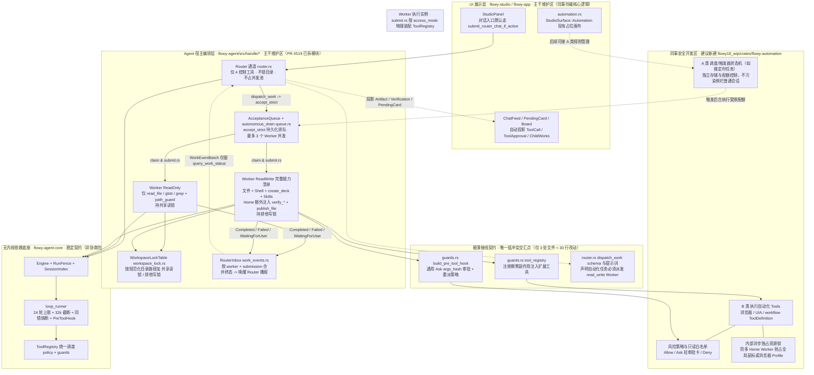
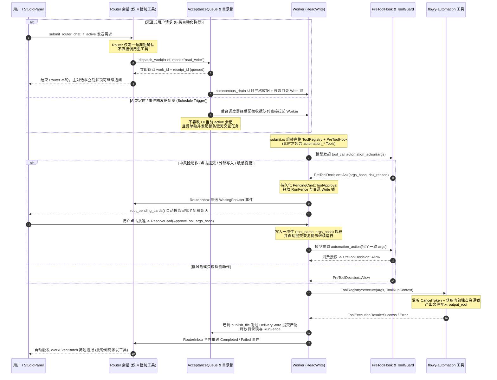

# Flowy 1.8 Router / Work 架构与自动化 Tools 扩展规范 · 技术方案

> **状态**：🧊 架构基线（代码真源：`origin/main @ 881c198d3`，含 PR #519 `handle/mod.rs` 模块拆分与 PR #520–#521）  
> **适用对象**：Flowy 1.8 自动化功能开发同事、后续接入工具 / 触发器的工程师与 Coding Agent  
> **核心原则**：Router 只派活不干活、按会话角色物理隔离 `ToolRegistry`、扩展能力采用独立 Crate + 极薄接线接入、审批与产物交付走统一宿主门禁。

---

## §1 背景与核心结论 (Background & Capability Matrix)

### 1.1 核心结论核实：只有 `Worker (ReadWrite)` 持有完整能力清单

在最新主分支（`flowy18_wip/`）上，**「只有 Work 后的 Agent 才是有完整能力清单的 Agent」这一判断完全成立**。这不是靠 System Prompt 软约束实现的，而是 `flowy-agent` 在每轮组装 `EngineConfig.registry` 时执行的**代码级物理工具隔离**（见 [submit.rs](../../crates/flowy-agent/src/handle/submit.rs#L358-L523)）：

1. **交互主对话默认创建 `SessionRole::Router`**：在 [panel.rs](../../crates/flowy-studio/src/panel.rs#L1813-L1819) 中，除历史遗留的 `SessionRole::Standard` 会话外，所有新会话一律走 `submit_router_chat_if_active`。
2. **`Router` 只有亚秒级控制工具**：`router_tool_registry` 仅注册 4 个控制工具（在后台 `WorkEventBatch` 进度播报轮甚至物理剥离到只剩 `query_work_status` 1 个），不注入 Skills 清单、不申请目录锁、不占并发池名额，确保主对话通道永不被耗时操作阻塞。
3. **`Worker` 按不可升级的 `WorkAccessMode` 物理分档**：
   - `WorkAccessMode::ReadOnly`：仅白名单保留 `read_file` / `glob` / `grep` 3 个文件检查工具，持目录共享读锁。
   - `WorkAccessMode::ReadWrite`（默认派发模式，含历史兼容 `Standard`）：挂载完整内置工具集 + Platform Shell + `create_deck` + Skills 清单 + `PreToolHook` 审批门禁；若为 `SessionOrigin::Home`，还动态注入 `verify_deck` / `verify_artifact` / `publish_file` 与 `DeliveryStore` 交付门禁。

### 1.2 关键消歧：两套独立 Workspace 与两类「自动化」

在开始编码前，必须先澄清两个极易导致开发冲突的边界问题：

1. **两套独立 Cargo Workspace（切勿跨层接错仓库）**：
   - 本架构归属 **`flowy18_wip/`** 嵌套 GPUI 工作区（基于 `flowy-agent-core` + `pi-rust`）。
   - 仓库根目录下的 [crates/agent/](../../../crates/agent/README.md)（24 个 `nomi-*` / `flowy-web` crate，包含旧版 `nomi-browser`、`nomi-computer`、`nomi-tools`）是**另一套独立 Rust workspace**，服务旧 Tauri/Web 架构；`flowy18_wip/` 与 `nomi-*` 无任何依赖关系。
2. **两类职责截然不同的「自动化」（切勿混为一谈）**：
   - **A 类 · 调度 / 触发器自动化（Control-Plane / Scheduled Automation）**：管理定时任务、事件触发器与周期唤醒，对应目前已有的占位画布 [automation.rs](../../crates/flowy-studio/src/automation.rs)（`StudioSurface::Automation` 展示 Schedule / Trigger / Advanced 卡片，当前点击均提示 `auto.later`），对应架构预留 [先记.md §5.14](flowy-v0/先记.md#L22-L38) 的第 3 类「定时或外部事件」Trigger。若允许模型在对话中创建/查看/暂停规则，其管理类 Tool 属轻量亚秒操作；但**定时触发后的真实执行体仍是独立 `Worker (ReadWrite)`**。
   - **B 类 · 外部执行 / 操控类自动化（Execution-Plane Automation）**：如浏览器 CDP、桌面 UIA、系统级 GUI 点击或长耗时外部工作流 Tool。此类 Tool **必须只挂在 `Worker (ReadWrite)`**，绝不能挂入 `Router` 或 `Worker (ReadOnly)`。

### 1.3 各角色 / 模式完整能力清单对照矩阵

以下矩阵逐项核对自 [submit.rs](../../crates/flowy-agent/src/handle/submit.rs#L358-L523)、[router.rs](../../crates/flowy-agent/src/handle/router.rs#L325-L344) 与 [guards.rs](../../crates/flowy-agent/src/handle/guards.rs#L122-L176)：

| 会话角色 / 模式 | 物理暴露的工具清单 (`ToolRegistry`) | Skills 注入 | Guard 与 `PreToolHook` 门禁 | 目录锁 (`WorkspaceLockTable`) | 是否占并发池 (`max=3`) |
| --- | --- | --- | --- | --- | --- |
| **`Router`（常规对话轮）** | `dispatch_work`、`query_work_status`、`control_work`、`ask_user_choice` | 不注入 | 仅 `build_router_pre_tool_hook`（拦截 `ask_user_choice` 挂起 `PendingCard::Disambiguation`） | `None`（永不锁目录） | **否** |
| **`Router`（`WorkEventBatch` 播报轮）** | **仅 `query_work_status`**（物理剥离派发 / 控制 / 提问工具防重试风暴） | 不注入 | `None` | `None` | **否** |
| **`Worker (ReadOnly)`** | **仅 3 个**：`read_file`、`glob`、`grep`（物理 `unregister` `write_file`/`edit_file`/`todo_write`） | 注入 | 仅 `path_guard`（`pre_tool_hook = None`） | `Read`（允许同目录多读并发） | **是** |
| **`Worker (ReadWrite)` · Project** | `read_file`、`write_file`、`edit_file`、`glob`、`grep`、`powershell`（Windows）/ `bash`（Unix）、`create_deck` **（B 类自动化 Tools 挂此）** | 注入 | `path_guard` + `skill_shell_guard` + `shell_policy_guard` + `build_pre_tool_hook` | `Write`（同目录及祖先/子孙目录排他） | **是** |
| **`Worker (ReadWrite)` · Home** | 上述全部 **+ 动态追加** `verify_deck`、`verify_artifact`、`publish_file` | 注入 | 同上 + `WorkContract`（Revision 契约）+ `DeliveryStore` 交付门禁 | `Write`（隔离目录 `sessions/workspaces/w-*`，多 Worker 互不冲突） | **是** |
| **`Standard`（历史存量兼容）** | 同 `Worker (ReadWrite)`（按 `SessionOrigin` 决定是否追加核验与交付工具） | 注入 | 同 `Worker (ReadWrite)` | `Write` | **是** |

> [!NOTE]
> 内置工具表里的 `todo_write` 目前在 [guards.rs](../../crates/flowy-agent/src/handle/guards.rs#L131-L133) 中显式调用 `registry.unregister("todo_write")` 移除，因为前端尚未提供 Todo 展示面，只向模型暴露宿主可闭环满足的工具。

---

## §2 方案全景、分层架构图与架构不变量 (Architecture & Invariants)

### 2.1 端到端分层拓扑与防冲突协作边界图



### 2.2 核心目标与明确非目标 (Scope vs. Non-Goals)

| 范围 | 明确内容 |
| --- | --- |
| **本阶段目标** | 1. 明确 Router 与 Worker 的物理工具隔离边界，防止新 Tools 误挂进 Router 阻塞对话或绕过 `ReadOnly` 权限；<br/>2. 为自动化 Tools 提供独立 Crate + 3 函数薄接线契约，使多开发者 / 多 Agent 并行开发时接近零合并冲突；<br/>3. 复用宿主已有的 `PreToolDecision::Ask` 审批卡、`CancelToken`、`ToolRunContext` 与 `publish_file` 交付闭环。 |
| **明确非目标** | 1. **不**在 `flowy-agent-core` 中引入浏览器引擎（CDP）、桌面 UIA 等重平台依赖；<br/>2. **不**在本架构中重新实现第二套进程外 RPC / 插件市场协议；<br/>3. **不**允许自动化工具绕过 `output_root` + `publish_file` 直接写入 `ArtifactStore`；<br/>4. **不**在未抽取通用 `Ask` 审批消费逻辑前直接接入需要人工确认的新风险工具。 |

### 2.3 七条架构红线 (Architecture Invariants)

1. **Router 亚秒通道红线**：`Router` 永不挂载重 IO / 网络 / GUI / 子进程工具、永不申请目录写锁、永不计入 `in_flight_work_count()` 并发上限。任何耗时操作必须由 `Router` 经 `dispatch_work` 下发给 `Worker`。
2. **Worker 访问模式不可升级**：创建 `Worker` 后 `access_mode` 永久锁定在 `SessionRecord.access_mode` 中，对 `ReadOnly` Worker 再次派发 `mode="read_write"` 会被 [router.rs](../../crates/flowy-agent/src/handle/router.rs#L951-L955) 明确拒绝（`ACCESS_MODE_ESCALATION_DENIED`）。
3. **严格锁序不变量**：宿主锁序规定在 [handle/mod.rs](../../crates/flowy-agent/src/handle/mod.rs#L449-L453)：`accept_drain -> dispatch -> engine (clone & release) -> index_write -> live -> leaf locks (active, active_claims, workspace_locks, router_inboxes, updates, tool_args, notified_quarantined)`。**任何 Tool 执行体绝对禁止反向持有或回调 `Engine`/`Harness` 锁**，必须且只能通过 `ToolRunContext`（只读快照 + `CancelToken` + `TodoSink`）与宿主交互。
4. **注册期零副作用（关键暗坑）**：`tool_registry(...)` 并非进程启动时只调用一次——[boot.rs](../../crates/flowy-agent/src/handle/boot.rs#L70)、[handle/mod.rs](../../crates/flowy-agent/src/handle/mod.rs#L584)（`apply_config`）与 [submit.rs](../../crates/flowy-agent/src/handle/submit.rs#L354)（每轮预处理）均会调用 `engine_config(&config, &cwd)` 并重建 `ToolRegistry`。因此 **`register_automation_tools` 必须是纯内存、零 IO、零子进程/浏览器启动的惰性构造**；真正的连接/进程只在工具 `execute` 闭包内按需懒创建。
5. **产物交付单一出口**：自动化任务产出的交付文件（导出报表、截图成品、生成文档）必须落入 `ToolRunContext.output_root` 并通过模型调用 `publish_file`（走 `DeliveryStore` + `RegistryTool` 校验）交付资料库。只有名为 `"publish_file"` 且标记 `.with_artifact_delivery()` 的工具才允许携带 `ArtifactReceipt`（见 [adapter.rs](../../crates/flowy-agent-core/src/tools/adapter.rs#L97-L140)）。
6. **`flowy-agent-core` 轻量与紧凑体积红线**：`flowy-agent-core` 无重量级运行时依赖；同时 [flowy18_wip/AGENTS.md](../../AGENTS.md#L48) 明确约束改动 `flowy-agent-core` / `flowy-agent` 公开结构体时须防止下游 `flowy-studio` / `flowy-app` / `flowy-desktop` 触发 `clippy::large_enum_variant`（例如 `AcceptedMessage` 通过 `Box<Lease>` / `Box<DraftTarget>` 维持紧凑体积）。
7. **Workspace Lints 与跨平台红线**：全工作区开启 `unsafe_code = "deny"`、`rust_2018_idioms = "deny"`、`clippy::pedantic = "deny"`（见 [flowy18_wip/Cargo.toml](../../Cargo.toml#L116-L166)），单测目标同样受 `pedantic` 约束；所有自动化工具必须同时考虑 Windows 与 macOS 编译通过（不可无门控依赖单一 OS API）。

---

## §3 核心设计与模块规范 (Subsystem Design & Agent Navigation)

### 3.1 PR #519 后源码导航地图（面向 Agent 快速定位）

PR #519 将原超长 `handle/mod.rs` 拆解为独立子模块；下文列出当前 `origin/main @ 881c198d3` 的精确文件职责与协作归属：

| Crate | 模块路径 | 核心职责与关键符号 | 自动化接入归属 |
| --- | --- | --- | --- |
| `flowy-agent-core` | [tools/registry.rs](../../crates/flowy-agent-core/src/tools/registry.rs) | `ToolDefinition`、`ToolRegistry`、`ToolGuard`、`ToolPolicy`、统一执行管道 `execute()` | 只读引用（定义新工具用 `ToolDefinition::new`） |
| `flowy-agent-core` | [tools/adapter.rs](../../crates/flowy-agent-core/src/tools/adapter.rs) | `RegistryTool` 将宿主工具适配为 `rpi_agent::AgentTool`，收口 `ArtifactReceipt` 与文本结果 | 只读 / 如扩图片块需主干协商 |
| `flowy-agent-core` | [tools/builtin.rs](../../crates/flowy-agent-core/src/tools/builtin.rs) & [tools/pi.rs](../../crates/flowy-agent-core/src/tools/pi.rs) | `read_file`/`write_file`/`edit_file`/`glob`/`grep`/`todo_write` 与 `pi_shell_definition` | 只读参考 |
| `flowy-agent-core` | [types.rs](../../crates/flowy-agent-core/src/types.rs) | `ContentBlock`（当前仅 4 变体无图片）、`ToolRunContext`、`ToolExecutionResult`、`CancelToken` | 只读 / 如扩图片块需主干协商 |
| `flowy-agent-core` | [loop_runner.rs](../../crates/flowy-agent-core/src/loop_runner.rs) | `run_turn`、`PreToolDecision`、`MAX_TOOL_TURNS_PER_SUBMISSION=24`、同错熔断与 `is_readonly_idempotent_tool` | 如加只读自动化工具可按 D7 对齐白名单 |
| `flowy-agent-core` | [engine.rs](../../crates/flowy-agent-core/src/engine.rs)、[session.rs](../../crates/flowy-agent-core/src/session.rs)、[acceptance.rs](../../crates/flowy-agent-core/src/acceptance.rs)、[run_fence.rs](../../crates/flowy-agent-core/src/run_fence.rs) | `Engine`、持久化 `SessionRecord`/`PendingCard`、`AcceptanceQueue::accept_strict`、`RunFence` 两阶段取消 | **同事勿改** |
| `flowy-agent` | [handle/mod.rs](../../crates/flowy-agent/src/handle/mod.rs) | `AgentHandle`、`UiState`、锁序文档、配置应用 `apply_config` | **同事勿改** |
| `flowy-agent` | [handle/boot.rs](../../crates/flowy-agent/src/handle/boot.rs) | 启动初始化、`reload_skills`、`boot` 恢复 | **同事勿改** |
| `flowy-agent` | [handle/sessions.rs](../../crates/flowy-agent/src/handle/sessions.rs) | `list_sessions`（过滤隐藏 `Worker`）、重命名/置顶/归档/搜索 | **同事勿改** |
| `flowy-agent` | [handle/submit.rs](../../crates/flowy-agent/src/handle/submit.rs) | `submit_message_targeted_locked`：按角色分发 `ToolRegistry`、建 `output_root`、取目录锁、派发与回投 `WorkEvent` | **同事勿改**（核心接线点已收敛进 `guards.rs`） |
| `flowy-agent` | [handle/router.rs](../../crates/flowy-agent/src/handle/router.rs) | `router_tool_registry`、`build_router_pre_tool_hook`、`build_router_system_prompt`、`dispatch_work_from_router` | **仅薄改** `dispatch_work` schema / Router 提示词 |
| `flowy-agent` | [handle/guards.rs](../../crates/flowy-agent/src/handle/guards.rs) | `READ_ONLY_TOOLS`、`build_pre_tool_hook`、`tool_registry`、`read_only_tool_registry`、`tool_target`、`confined_to` | **唯一工具接线点**（注入工具、门禁策略与只读白名单） |
| `flowy-agent` | [handle/queue.rs](../../crates/flowy-agent/src/handle/queue.rs)、[work.rs](../../crates/flowy-agent/src/handle/work.rs)、[work_events.rs](../../crates/flowy-agent/src/handle/work_events.rs)、[workspace_lock.rs](../../crates/flowy-agent/src/handle/workspace_lock.rs)、[observer.rs](../../crates/flowy-agent/src/handle/observer.rs)、[artifacts.rs](../../crates/flowy-agent/src/handle/artifacts.rs) | 队列认领与心跳续租、卡片恢复与取消、Router 事件合批、`WorkspaceLockTable`、`TurnObserver` 投影、删除计划与资料库 | **同事勿改** |
| `flowy-studio` | [panel.rs](../../crates/flowy-studio/src/panel.rs)、[automation.rs](../../crates/flowy-studio/src/automation.rs)、[work_actions.rs](../../crates/flowy-studio/src/work_actions.rs)、[ports/board.rs](../../crates/flowy-studio/src/ports/board.rs)、[ports/router_projection.rs](../../crates/flowy-studio/src/ports/router_projection.rs) | 主聊天与延迟创建 Router、`StudioSurface::Automation` 占位画布、卡片动作、看板分支投影 | 仅 A 类定时 UI 才需在 `automation.rs` 接线；B 类工具 **无需改 UI** |

### 3.2 运行时交互时序图（交互派发、审批挂起恢复与后台定时触发）



### 3.3 防冲突最小接入契约 (Independent Crate + Thin Seam)

建议新建独立 workspace member **`flowy18_wip/crates/flowy-automation`**，其 `Cargo.toml` **仅依赖 `flowy-agent-core`**（以及自身自动化驱动依赖，绝不依赖 `flowy-agent` 或 `flowy-studio`）：

```rust
// flowy18_wip/crates/flowy-automation/src/lib.rs
use std::path::Path;
use flowy_agent_core::{PreToolDecision, tools::ToolRegistry};

/// 1. 向完整能力 Worker (ReadWrite / Standard) 注册自动化 Tools。
///    硬约束：此函数在 boot / apply_config / submit 时多次调用，
///    严禁在此函数内发起网络请求、文件扫描或拉起浏览器/子进程！
pub fn register_automation_tools(registry: &ToolRegistry, cwd: &Path) {
    // 示例：registry.register(browser_navigate_definition(cwd));
    let _ = (registry, cwd);
}

/// 2. 在宿主 `build_pre_tool_hook()` 中委派自动化工具的风险分级判断。
///    返回 `None` 表示 `tool_name` 不归本 crate 管辖；
///    返回 `Some(PreToolDecision::Ask { .. })` 将由宿主统一挂起审批卡，
///    返回 `Some(PreToolDecision::Deny { .. })` 将直接拒绝执行。
pub fn evaluate_automation_tool_policy(
    tool_name: &str,
    args: &serde_json::Value,
    cwd: &Path,
) -> Option<PreToolDecision> {
    let _ = (tool_name, args, cwd);
    None
}

/// 3. 声明纯只读、无外部副作用的探测类自动化工具名。
///    用途：(1) 用户拒绝本轮风险操作后，这些工具仍允许继续检查状态；
///          (2) 便于宿主评估只读安全边界。
pub fn is_readonly_automation_tool(tool_name: &str) -> bool {
    let _ = tool_name;
    false
}
```

**双方唯一交汇的 3 处极薄接线点（总改动 < 30 行）**：

| 接线点 | 文件 | 改动内容 |
| --- | --- | --- |
| **1. Crate 声明** | [flowy18_wip/Cargo.toml](../../Cargo.toml) + [flowy-agent/Cargo.toml](../../crates/flowy-agent/Cargo.toml) | `members` / `[workspace.dependencies]` 增加 `flowy-automation`，`flowy-agent` 加 1 行依赖。 |
| **2. 注册与门禁委派** | [guards.rs](../../crates/flowy-agent/src/handle/guards.rs#L41-L153) | 在 `tool_registry` 调 1 行 `register_automation_tools`；先抽出 `Ask` 通用消费辅助后在 `build_pre_tool_hook` 委派 `evaluate_automation_tool_policy`；在 `READ_ONLY_TOOLS` 判定处补 `\|\| is_readonly_automation_tool(tool_name)`。 |
| **3. Router 认知提示** | [router.rs](../../crates/flowy-agent/src/handle/router.rs#L350-L363) & [L762-L765](../../crates/flowy-agent/src/handle/router.rs#L762-L765) | 在 `dispatch_work` 的 `mode` schema 描述与 `build_router_system_prompt` 中明确告知模型：浏览器 / 桌面 / 流程自动化任务同样需要派发 `mode="read_write"` Worker（`read_only` Worker 无自动化工具）。 |

### 3.4 状态机、熔断边界与 UI 投影约定

开发新 Tool 时必须遵守以下由 `flowy-agent-core` 与 `flowy-studio` 强制执行的运行时契约：

- **两阶段取消回收 (`RunFence` + `CancelToken`)**：请求取消时，[engine.rs](../../crates/flowy-agent-core/src/engine.rs#L1101-L1157) 立即触发 `CancelToken` 并作废 `PublishToken`，同时保持 `RunFence` 关闭直到工具 unwind 并清理子进程、释放 `RunTicket`。**任何阻塞式自动化 Tool 必须通过 `tokio::select!` 监听 `run_ctx.signal.cancelled()` 并杀死派生子进程 / 关闭标签页**，否则 `cancel_work` / `revise_work` 的 3 秒/2 秒 settle 等待窗口会超时返回 `notice.agent_busy`。
- **单回合上限与字符预算（来自 [loop_runner.rs](../../crates/flowy-agent-core/src/loop_runner.rs#L26-L34)）**：
  - `MAX_TOOL_TURNS_PER_SUBMISSION = 24`：单次提交最多 24 轮模型/工具交互。自动化工具粒度必须按语义动作封装（例如「打开并填表 / 批量读取」），切忌每移动一次鼠标耗 1 轮。
  - `MAX_TOOL_RESULT_CHARS = 32_000`：工具文本返回上限。DOM/UIA 树过长必须结构化过滤、分页切片或摘取关键元素，严禁原样吐整页 HTML 或 base64 字符串。
  - **相同错误熔断 (`same_error_circuit_breaker`)**：对同一目标返回相同签名错误达到阈值会立即熔断整轮任务；工具错误码/文案应明确区分可恢复提示与终态失败，避免模型原参死循环重试。
- **UI 自动渲染零改动约定**：
  - [guards.rs::tool_target](../../crates/flowy-agent/src/handle/guards.rs#L445-L460) 会依次从参数对象读取 `"description"`、`"path"`、`"file_path"`、`"command"`、`"query"`、`"pattern"`、`"target"` 作为折叠行摘要。**新自动化 Tool 的 Schema 建议优先提供 `"description"`（或 `"target"`）字段**，即可自动在聊天气泡和心跳中正确展示目标。
  - [board.rs::infer_skill_label](../../crates/flowy-studio/src/ports/board.rs#L1320-L1336) 对未知工具名默认回退到 `SkillLabel::Literal(other)`，看板泳道不会崩溃或丢失。

---

## §4 关键决策与对抗审查权衡矩阵 (Decision & Trade-off Matrix)

以下决策均结合真实主干代码经第一性原理与对抗审查（`/laoyeye` `carl-idea-king` 模式）推演收敛，避免后续开发无休止重议：

| 编号 | 决策点 | 选定方案 | 放弃的替代方案与证据理由 |
| --- | --- | --- | --- |
| **D1** | B 类执行自动化工具挂在哪一类会话？ | **只挂 `Worker (ReadWrite)` 与 `Standard`** | ❌ 挂在 `Router`：阻塞 `submit_router_chat_if_active` 的亚秒并发通道，且破坏 Router 不锁目录、不占并发池的契约。<br/>❌ 挂在 `Worker (ReadOnly)`：[router.rs:357](../../crates/flowy-agent/src/handle/router.rs#L357) 与 `read_only_tool_registry` 明确承诺 `ReadOnly` 仅暴露 `read_file`/`glob`/`grep`，允许免审批同目录并发读。 |
| **D2** | A 类（定时/触发器）与 B 类（执行 Tool）如何分层？ | **管理面归控制面，定时唤醒的真正执行体仍落 `Worker (ReadWrite)`，且带独立配额保护** | ❌ 把 `schedule_*` / 定时轮询与普通交互会话混用 `active` 焦点或无限挤占 `DEFAULT_MAX_CONCURRENT_WORKS=3`：会导致定时任务静默失败或饿死用户交互 Worker，且把 [sessions.rs:20](../../crates/flowy-agent/src/handle/sessions.rs#L20) 过滤的内部调度记录泄漏进侧栏。 |
| **D3** | 代码物理隔离形态 | **新建 `flowy18_wip/crates/flowy-automation`（仅依赖 `flowy-agent-core`）+ 3 处极薄接线** | ❌ 直接在 `flowy-agent/src/handle/` 或 `flowy-agent-core/src/tools/` 大改：与 Router/Work 正在高频演进的主文件（如 PR #519）极易冲突，且把重平台依赖拖进核心层。 |
| **D4** | 如何让自动化工具接入 `ToolApproval` 审批卡？ | **先将 [guards.rs:71-100](../../crates/flowy-agent/src/handle/guards.rs#L71-L100) 中 `approved_tool_calls` 的一次性 `(tool_name, args_hash)` 消费逻辑抽取为通用 Helper** | ❌ 直接让 `evaluate_automation_tool_policy` 返回 `PreToolDecision::Ask` 而不改 `guards.rs`：经源码核查（[guards.rs:58-102](../../crates/flowy-agent/src/handle/guards.rs#L58-L102)），目前**只有 `bash \| powershell`** 会检查并消费 `approved_tool_calls`！若不抽取，用户点击批准后模型重调依然命中 `Ask`，陷入无限弹窗死循环。 |
| **D5** | 多 Worker 并发抢占全局 GUI / 浏览器 Profile 怎么办？ | **在 `flowy-automation` 内部实现异步独占资源锁 / 租约（并发等待时监听 `CancelToken`）** | ❌ 复用宿主 `WorkspaceLockTable`：经核查（[router.rs:966-987](../../crates/flowy-agent/src/handle/router.rs#L966-L987)），Home 会话下每个 Worker 拥有隔离目录 `sessions/workspaces/w-*`，`WorkspaceLockTable` 从不阻塞 2 个并发 Home Worker，因此无法保护全局焦点窗口/鼠标或单浏览器 Profile。 |
| **D6** | 自动化工具如何回传网页 / 桌面截图给模型？ | **需由核心层先统一扩 `ContentBlock::Image`（`types.rs` / `adapter.rs` / `loop_runner.rs`）；未扩前仅使用文本 DOM / UIA 树与落盘文件** | ❌ 把图片 base64 编码进 `ToolExecutionResult` 文本：会被 `MAX_TOOL_RESULT_CHARS=32_000` 截断并撑爆上下文；直接让同事改 `flowy-agent-core/src/types.rs` 亦会触发全仓大范围重编与冲突。 |
| **D7** | 只读白名单同步边界 | **按职责同步两处只读表：`guards.rs::READ_ONLY_TOOLS` 必改，`loop_runner.rs::is_readonly_idempotent_tool` 按需对齐** | ❌ 只注册工具而忽略白名单：用户拒绝某次高危操作后，[guards.rs:47-57](../../crates/flowy-agent/src/handle/guards.rs#L47-L57) 会将非 `READ_ONLY_TOOLS` 全部拒绝，导致后续连状态查询都被拦死。 |

---

## §5 验收标准、隐藏踩坑与验证梯子 (Acceptance Criteria & Ladder)

### 5.1 核心验收矩阵 (Acceptance Criteria)

| 编号 | 验收场景 | 操作路径 / 测试设计 | 期望可断言结果 |
| --- | --- | --- | --- |
| **TC-AUTO-01** | Router 与 `ReadOnly` 物理不可见 | 构造 Router 与 `Worker(ReadOnly)` 的 `ToolRegistry`，检查 `.list()` 与模型请求 tools | **均不含**任何 `automation_*` 工具名；仅 `Worker(ReadWrite)` 与 `Standard` 可见。 |
| **TC-AUTO-02** | 注册期零副作用不变量 | 在沙箱空目录连续 10 次调用 `engine_config` / `tool_registry`（不执行 tool） | 耗时在亚毫秒级，**0** 子进程/浏览器启动，**0** 磁盘与网络副作用。 |
| **TC-AUTO-03** | 中风险 `Ask` 审批卡完整闭环 | 自动化工具返回 `PreToolDecision::Ask` -> `ResolveCard(ApproveTool, args_hash)` 恢复 -> 再试 `DenyTool` | 批准后一次性消费 `(tool_name, args_hash)` 放行且仅放行完全一致参数；拒绝后写 `denied_tool_turns`，只读自动化工具可放行，写工具被 `USER_DENIED` 拦截。 |
| **TC-AUTO-04** | 两阶段取消 (`CancelToken`) 回收 | 启动长耗时自动化 tool 后立即调用 `cancel_work` / `revise_work` | 派生任务/子进程在 2 秒内停止、`WorkspaceLease` 与 `RunFence` 释放、`revise_work` 不返回 `notice.agent_busy`。 |
| **TC-AUTO-05** | 多 Home Worker 并发资源锁 | 在同一 Router 下并发派发 2 个操作同一桌面/浏览器资源的 Home Worker（`max=3`） | 第 2 个 Worker 在资源锁前异步挂起而不死锁宿主 `Engine`/`Harness` 锁，若期间被取消可立即退出排队。 |
| **TC-AUTO-06** | 产物交付单一出口 | 自动化任务生成报告/截图文件交给用户 | 经 `ToolRunContext.output_root` 落盘后由模型调用 `publish_file` 过 `DeliveryStore`，`delivery/events.jsonl` 有完整台账。 |
| **TC-AUTO-07** | 上游提示词与参数展示 | Router 对话测试触发自动化任务；观察 UI `ToolCall` 行的 `target` | Router 正确下发 `mode="read_write"`（不误发 `read_only`）；UI 折叠行正确显示 `description`/`target`。 |
| **TC-AUTO-08** | 跨 Crate 编译与严格 Clippy | 修改公开枚举/结构体或接入新 Crate 后跑全链检查 | `flowy-desktop` `--locked` 与全影响面 `--all-targets -- -D warnings` 0 告警、Windows/macOS 条件编译干净。 |

### 5.2 分层验证梯子 (Verification Ladder)

开发与提交 PR 时严格遵循 [flowy18_wip/AGENTS.md](../../AGENTS.md#L45-L53) 与全仓规则：

1. **新 Crate 内循环（秒级）**：
   - `cargo check -p flowy-automation --lib`
   - `cargo test -p flowy-automation -- --nocapture`
2. **宿主接线与签名验证**：
   - `cargo check -p flowy-desktop`（一次覆盖 `flowy-app` 及全部传递依赖类型签名，跳过链接）
   - `cargo test -p flowy-agent --lib guards -- --nocapture`
3. **PR 合并前完整门禁（只跑 1 次，同一 worktree 严禁并发多 `cargo`）**：
   - `bun scripts/check-ui-contracts.mjs --self-test && bun scripts/check-ui-contracts.mjs`（若改过 UI/i18n）
   - `cargo fmt --all -- --check`
   - `cargo test -p flowy-agent-core`
   - `cargo test -p flowy-agent -- --test-threads=1`（Windows 必须单线程防 NTFS `fsync` 抖动触发 300ms 租约单测假红）
   - `cargo test -p flowy-studio` 及 `cargo test -p flowy-ui`（**`flowy-ui` 禁带 `--lib`**，否则漏跑 `tests/anchor_measurement.rs`）
   - `cargo clippy -p flowy-agent-core -p flowy-agent -p flowy-automation -p flowy-studio -p flowy-app -p flowy-desktop --all-targets -- -D warnings`
   - `cargo check -p flowy-desktop --locked`
