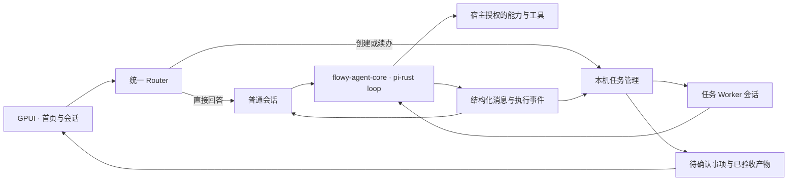
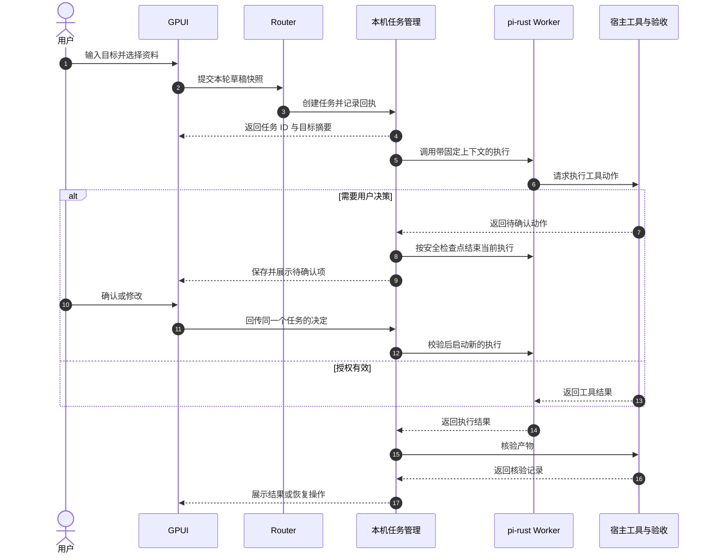
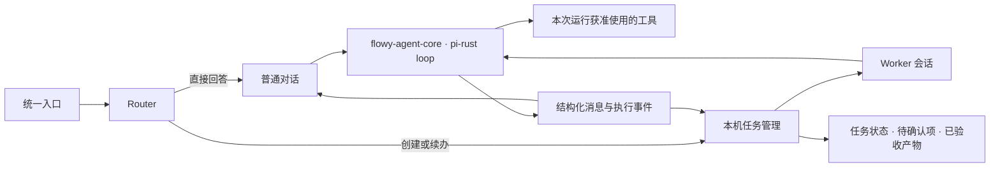

# Flowy 本机助理 · 产品与架构方案

> **状态**：设计基线，P0–P2 实施见交付记录\
> **基线**：`codex/flowy18-history-rendering`，`8aae3a5fb`，2026-11-19（香港时间）\
> **核心原则**：一个入口承接用户意图，每项任务有自己的授权、会话和结果。pi-rust 负责执行 loop，Flowy 对任务状态与可验证交付负责。\
> [开源借鉴证据](local-agent-evidence.zh.md) · [分阶段执行与验收](local-agent-execution.zh.md)

## 1. 背景与痛点

Flowy 面向用桌面电脑处理本地资料、创建产物和持续对话的人。用户应能说清想得到的结果、交办后离开，并从原任务找到产物、确认事项和继续入口。系统在用户电脑可用时执行，睡眠、关机或工具失联时保留已确认进度。

| 现状 | 目标 |
| --- | --- |
| 首页和对话用两套输入框，宽度、色彩和操作位不同。 | 共用一个输入模块，草稿、附件、交付物与发送行为一致。 |
| 新建先开会话，`send_prompt` 只传一段文字。 | 入口根据本轮意图直接回答、创建或续办任务；同一份提交数据驱动回执和执行。 |
| 消息投影以对话为主，长任务的状态、待确认项和产物缺少统一承载。 | 任务详情优先展示目标、下一步和结果。普通对话优先展示问答。 |
| 当前 Engine 共享配置入口，会话持久化写整份快照。本机桌面有焦点和应用状态等共享资源。 | 并行单位是独立任务，配置和权限按次固定。持久状态有序提交，共享资源由宿主调度。 |

源码入口见 [StudioPanel](https://github.com/Michael-Lfx/allo/blob/8aae3a5fbf38502f1d802b11c217515a42138e79/flowy18_wip/crates/flowy-studio/src/panel.rs#L450-L506)、[首页输入](https://github.com/Michael-Lfx/allo/blob/8aae3a5fbf38502f1d802b11c217515a42138e79/flowy18_wip/crates/flowy-studio/src/studio.rs#L643-L706)、[聊天输入](https://github.com/Michael-Lfx/allo/blob/8aae3a5fbf38502f1d802b11c217515a42138e79/flowy18_wip/crates/flowy-studio/src/composer.rs#L107-L202) 和 [Engine](https://github.com/Michael-Lfx/allo/blob/8aae3a5fbf38502f1d802b11c217515a42138e79/flowy18_wip/crates/flowy-agent-core/src/engine.rs#L239-L371)。

## 2. 方案全景



首个切片覆盖普通问答和本机清单。可编辑幻灯片负责验证不同能力可共用入口。应用、游戏、视频、计划触发、远程设备和多层 Worker 是分阶段候选。首版按用户主动提交触发，本机桌面进程存活时可在后台继续，设备不可用时转入可理解的暂停状态。

每项任务拥有稳定的工作目录和授权引用，路径和凭据由宿主处理。输入资料、生成产物和用户原件有各自的写入规则。普通能力使用可检查的宿主工具。当前通用 shell 具备用户进程权限，工作目录决定起始位置，安全隔离需由 OS 或宿主可执行的约束提供。模型调用遵循用户选择的本机或网络供应商。

## 3. 核心设计

### 3.1 首页、普通对话与任务详情

```text
左侧        新建
            待处理
            最近记录

首页                你想让 Flowy 帮你做什么？
                    ╭────────────────────────────────────────╮
                    │ 描述你要的结果，也可以拖入资料         │
                    │ ＋ 资料   交付物 · 自动 ▾   模型 ▾  ↑   │
                    ╰────────────────────────────────────────╯
                       用资料做幻灯片    整理一个文件夹

普通对话            提问
                    回复正文
                    制作幻灯片 · 已创建        查看任务
                    [同一个输入框，固定在底部]

任务详情            季度复盘 · 进行中 / 待确认 / 已交付
                    用两份已选资料做 6 页，另存一份
                    [待确认事项] 或 [已交付产物 · 预览]
                    ▸ 执行过程
                    [补充要求或继续修改]
```

- 「新建」回到统一首页。示例负责填草稿。资料选择与交付物提示属于这次请求，发送时从同一份快照读取。选幻灯片时可补页数、受众和格式。用户还能用自然语言补参数。
- 首页直接创建任务时打开任务详情，保留原输入并展示简短回执。普通对话里提出新的交付目标时，原处出现可打开的任务卡，记录来源上下文。点进任务后，输入框绑定该任务 ID。改主目标或扩大授权需要明确处理。
- 直接问答无需创建任务。长任务让用户先看到目标、资料范围和计划交付物。缺信息影响落地、需要额外授权或关键决定时展示具体待办。一个动作区有一个主操作。
- 已交付任务优先展示可打开的文件、格式和必要属性。示例是 `季度复盘.pptx · 6 页`，配预览、打开位置和继续修改。报告错误时同时展示已有产物和明确的恢复入口。
- 首页、消息、任务详情共用约 760 逻辑像素的内容列。使用 GPUI 的 `ResolvedTheme`、系统字体、`Button`、`IconButton` 和原主题字级。暖中性色提供层级，主题强调色承担发送、焦点和当前选择。待确认、运行和失败用图标与文字表达。
- 输入面、待确认事项和产物使用明确边界，消息正文用留白与行距分隔。窗口变窄时收起次级工具，保留资料、输入和发送。首页与会话转换支持减少动效，保持焦点和快捷键行为。 [产品原则](../../../PRODUCT.md#design-principles) · [GPUI 设计规范](../../DESIGN.md) · [主题实现](https://github.com/Michael-Lfx/allo/blob/8aae3a5fbf38502f1d802b11c217515a42138e79/flowy18_wip/crates/flowy-ui/src/theme.rs#L115-L214)

### 3.2 Router、任务与执行契约

Router 处理本轮意图。显式选择和已知的任务 ID 可以直达，歧义影响交付或权限时只问缺失的一项。选择「幻灯片」约束主要结果和可用能力，仍允许 Worker 同轮读取表格或制图。普通对话由原会话继续，模型偏好保留在模型设置中。

首版依赖按现有 crate 分层。在 `flowy-agent` 接入口和任务生命周期，`flowy-agent-core` 复用现有 Engine、ToolRegistry 与 pi-rust 适配，`flowy-studio` 显示交互，`flowy-app` 装配宿主所需服务。

以下是建议协议字段。字段命名照实现所在模块惯例调整。

| 记录 | 必要字段 | 语义 |
| --- | --- | --- |
| `TaskSpec` | `goal: String`、`deliverable: DeliverableSpec`、`inputs: Vec<InputRef>`、`scope: ScopeRef`，可选 `origin_session_id` | 本轮用户确认的目标快照。附件与权限使用宿主引用，界面和日志仅取得适用的展示值。 |
| `Task` | `task_id`、`worker_session_id`、`spec_revision`、`status`、可选 `current_attempt_id` | 用户长期跟进同一个任务。修订保留已经提交的结果与来源信息。 |
| `Attempt` | `attempt_id`、`task_id`、`session_id`、模型与能力快照、取消信号引用 | 每次执行、授权续办或重试有独立编号。任务和 UI 仅接受当前编号的有效事件。 |
| `PendingDecision` | `action_id`、`task_id`、参数摘要、授权范围、等待原因 | 回复前后核对参数和授权。外部动作是否完成不明时保留待核对项。 |
| `Artifact` | `artifact_id`、本机文件或预览引用、类型、验证摘要、版本 | 文件可读、可打开且符合明确要求时才进入交付列表。 |



### 3.3 状态与恢复

| 状态 | 合法的下一步 | 证据与守卫 |
| --- | --- | --- |
| 排队 | 运行中、已取消 | 宿主确认工作区、能力和资源可用时领取。 |
| 运行中 | 等资料、待授权、已暂停、待核对、验收中、失败、已取消 | 每会话一个活跃执行。旧 Attempt 的迟到事件无写入资格。 |
| 等资料、待授权 | 排队、已取消 | 保存待办后释放执行。决定、参数和授权范围对应，批准后重新校验。 |
| 已暂停 | 排队、待核对、已取消 | 重启后检查最后已知状态，动作状态可以确认时才继续。 |
| 待核对 | 排队、验收中、失败、已取消 | 核对已有实际结果。只有可证明未执行或重复无害的动作才重试。 |
| 验收中 | 已交付、失败、已取消 | 校验文件、数量和显式交付条件。保留失败产物以便诊断。 |
| 已交付 | 显式修订时创建新的执行 | 保留已交付版本和其验收记录。 |
| 失败 | 显式重试后排队、已取消 | 显示阶段、已有产物及恢复入口。 |
| 已取消 | 当前执行终止 | 保存取消原因及现场结果。后续独立执行需重新取得权限。 |

pi-rust 是唯一模型执行 loop。现有 `Engine` 和 `RunFence` 提供单会话运行保护，后续把同一编号贯穿工具完成、消息投影和持久化提交。用单写入者或等价的版本约束使旧快照无法覆盖新状态。等待详情和任务状态由宿主持久化。恢复依据已保存的消息、动作记录和授权。

本机只读与独立暂存结果可以并行。写入同一个目的路径、桌面焦点和剪贴板等共享资源由宿主排队。取消是信号和事件代际变更，资源释放仍以操作确实停下或完成核对为准。

### 3.4 GPUI 渲染与长历史

- `ChatFeed` 保留现有 `ListState`、按会话滚动位置和稳定行 ID。首页首次发送接到同一时间线。每会话有独立展开状态和阅读锚点。
- 以用户提问及可靠轮次信息组织正文和执行细节。已结束且有明确结果的轮次可折叠中间工具过程。运行中、错误、中止和待确认有可见摘要。旧历史缺少明确边界时沿用原消息顺序。
- 用户已向上阅读时，流式更新保持原行和行内偏移。主动发送成功后可回到最新消息。折叠使原行消失时定位到该轮摘要。会话切回继续恢复其原位置。
- 产物预览和链接来自已存的产物记录。失败说明就地可读。动效只承担状态变化反馈，减少动效使用相同终态。
- 已有虚拟列表测试覆盖 1000 行、切回会话定位、流式变更与前插。先度量首帧、长历史复制、可见行测量和每轮更新影响，再排增量 Markdown、按需载入或轮次导航。 [现有测试](https://github.com/Michael-Lfx/allo/blob/8aae3a5fbf38502f1d802b11c217515a42138e79/flowy18_wip/crates/flowy-studio/src/feed.rs#L677-L865) · [当前投影](https://github.com/Michael-Lfx/allo/blob/8aae3a5fbf38502f1d802b11c217515a42138e79/flowy18_wip/crates/flowy-agent/src/projection.rs#L150-L167)

#### 3.4.1 普通回复的 Markdown

P2 将已落定的助手正文渲染为 Markdown，普通对话和任务会话共用这套渲染。首选试接 fintwind 使用的 `pulldown-cmark 0.13`，消费解析事件，在 Studio 内用 GPUI 段落、行内样式和原生控件独立排版，继续使用 `ChatFeed` 外层虚拟列表。先支持段落、标题、强调、列表、引用、行内代码、围栏代码、基本表格和链接。宽表格与长代码有块内滚动或折行，整条消息仍能适应窄窗。代码块可聚焦并复制。数学、Mermaid 和语法高亮等复杂格式先保留可读的文字或代码，等有交付场景再评估。 [上游与依赖证据](local-agent-evidence.zh.md#fintwind-markdown-专项取证)

| 场景 | 展示与边界 |
| --- | --- |
| 正在回复 | 正文先显示原始文本，片段落定后解析完整源码并在同一行更新。切换过程保持滚动定位。中止、错误与待确认保持独立状态，部分回复仍可读。 |
| 已有历史与交错工具调用 | 使用投影提供的正文片段边界。每段独立解析，工具项保持原顺序。旧历史维持读入格式，助手原文可直接复制。用户原话、工具输出和日志继续按各自的纯文本或结构化类型显示。 |
| 链接、HTML 和图片 | HTML 显示字面文本，Markdown 图片显示替代文字。只有解析并验证为绝对 HTTP(S) 的地址才可通过原生控件显式打开。相对路径、其他协议和裸露本机路径均显示为文字。正文渲染零网络请求、零文件打开，产物打开和预览只通过宿主核验后的记录。 |
| 原文和复制 | 存储的消息文本是原文。整条复制可取得原始 Markdown，代码块复制只取代码内容。排版产生的换行和展示占位不写入历史或剪贴板。用中文、表情、反引号和多行样例核对。 |
| 超长消息与异步结果 | 可见时才排版，先设单条解析量和复杂结构的保护上限，超限保留纯文本及原文复制入口。若后台解析，提交结果前核对会话、稳定行 ID 和内容版本。缓存若含样式或测量信息，主题、字体或可用宽度变化时重新生成。 |

基础 Markdown 是 P2 的功能验收。流式增量解析、持久缓存和消息内部虚拟化由数据显示的瓶颈决定。后续启用增量时，最终视图始终与一次性解析同一份完整源码相同，迟到的引用定义或非追加修改触发整条重算。 [对抗复审与 P2 验证](local-agent-execution.zh.md#p2-markdown-执行与验收)

### 3.5 回执与交付的幂等边界

输入框为发送的草稿快照分配提交 ID。同一草稿在发送中连续点击或回执丢失后的重试沿用该 ID。Router 在启动执行前，经宿主用现有存储原子记录提交 ID 和任务或消息回执，重复提交读取同一回执。用户明确再次发送时创建新提交。UI 先展示发送中，收到宿主回执后展示任务或会话消息。

P1 产物先写入任务自己的输出区，读取并核验后再提交已交付记录。文件已写出但记录未提交时，恢复按当前任务与已留存的动作记录核对；来源和内容能确认时补上交付记录，无法确认时保留待核对及现场。正文里的「做好了」或一个 Markdown 链接只按正文显示。

## 4. 决策与权衡

| 编号 | 决策 | 取舍依据 |
| --- | --- | --- |
| D1 | 一个新建入口，共用输入框。 | 专业参数在选定交付物后显露。独立的专业首页有额外导航成本，适合明确出现高频流程时再讨论。 |
| D2 | 每项任务一个主 Worker，多个任务可并行。 | 首版验证工作独立性与宿主权限。细粒度子 Worker 和任务图适用于任务出现明确拆分收益后。 |
| D3 | pi-rust 走库级接入，Flowy 定义运行与交付状态。 | 当前 loop 与历史已有接线。DSH 扩展和其他执行器提供能力参考，首版使用现有进程模块与工具注册逻辑。 |
| D4 | 先产真实本机清单，再接可编辑 PPTX。 | 清单链路可用现有文件能力和人工核对证实。PPTX 生成与预览需先在目标桌面实测。 |
| D5 | 统一消息结构，任务显示结果优先视图。 | 过程折叠可从真实任务信息推导。持久化「来源入口」需要明确产品用途与旧数据迁移规则。 |
| D6 | 采用单机权限模型与可恢复状态。 | 用户电脑的桌面与文件是产品价值。持续在线、跨设备和云电脑需要分别定义产品承诺。 |
| D7 | P2 用成熟解析库加 GPUI 原生渲染。 | 复用 CommonMark 语义与现有桌面组件，保留源文本和任务边界。按实测决定流式增量和长文虚拟化。 |

## 5. 验收与验证顺序

| 用例 | 操作与通过标准 |
| --- | --- |
| TC-01 同一入口 | 首页普通提问得到答复且无任务记录。明确要求生成清单时有任务回执、可打开的文件和来源范围。续办回到原任务。 |
| TC-02 权限 | 限定目录内读取和任务暂存生成通过。越界路径、重解析点或未授权覆盖被拒绝，原件哈希一致。 |
| TC-03 并发和取消 | 两个任务并行，有意让旧写入与已取消流事件迟到。双方的消息、配置、工作目录和交付互不覆盖。 |
| TC-04 状态恢复 | 等资料或等批准时退出并重开，仍能关联原 Task 和原待办。重新确认后只有一次已知执行。 |
| TC-05 产物真实性 | 空文件、打不开或不符合约定的文件验收未通过。正常文件通过并可续办。 |
| TC-06 GPUI 历史 | 普通对话、已交付任务、待确认任务均可键盘操作。长历史虚拟化和展开前后的阅读位置稳定。 |
| TC-07 样式实机 | Windows 浅色、深色、窄窗和高 DPI 下，核对首页首次发送、续发、待确认操作与打开产物。实机证据记录操作和 UI 状态。 |
| TC-08 Markdown 内容与无障碍 | 核对语义、原文复制、代码复制、键盘和助读。旧历史与夹在正文之间的工具状态保持可见，HTML、图片和未授权地址保持被动展示。 |
| TC-09 Markdown 更新与定位 | 流式收尾、切会话、折叠和窗口尺寸变化后，原文、内容版本与可见锚点正确。分别记录千行历史和单条长文的 Windows 实测。 |
| TC-10 回执和交付恢复 | 同一提交双触发且回执丢失，只产生一个任务。文件已写而状态未提交时强制退出，恢复时核对原产物，重复提交也不会生成第二份。 |

验证按 `单元测试 → 并发与恢复 → 本机产物 → GPUI 实机` 逐级走。[执行阶段、命令与基线](local-agent-execution.zh.md)

---

## 附录 · 历次讨论原文

> 这里逐条保留当前主题自首页和历史设计讨论以来的用户问题与答复正文。记录按原时间顺序排列，保留当时的建议、来源、链接和结论。正文用于当前设计与验收。

### 1. 首页创建任务与普通对话历史

**用户 1**

那就回到主分支拉取最新，然后创建分支开始优化首页创建任务和普通对话的历史渲染设计？

**用户 2**

不要执行修改，先给我方案，我们讨论一下

**答复**

已从最新 `main`（`8aae3a5fb`）创建 `codex/flowy18-history-rendering`，源码保持原样。下面先按「打开会话后看到的消息历史」来讨论。

**我的建议是共用一条消息时间线，任务执行过程按需展开。** 现在首页首次发送和打开已有会话最终都进入同一个 `ChatFeed`，它已经支持长列表虚拟化、流式更新和按会话恢复滚动位置。可以沿用这些能力，把两种场景的差异放在信息呈现上。[会话入口](D:/workSpace/git_clone_test/allo/flowy18_wip/crates/flowy-studio/src/panel.rs:449) · [历史渲染](D:/workSpace/git_clone_test/allo/flowy18_wip/crates/flowy-studio/src/feed.rs:95)

| 场景 | 建议体验 |
| --- | --- |
| 首页创建任务 | 首条输入直接成为时间线里的第一条消息。执行中展示状态，完成后以结果为主，工具调用和执行细节可展开回看。 |
| 普通对话 | 默认突出提问和回复正文。有工具过程时按需展开，历史回看保持阅读连贯。 |
| 翻看长历史 | 流式回复继续生成时，保留用户正在读的位置；主动发送成功后回到最新消息。切换会话再回来时恢复各自的位置。 |

实施顺序我建议先定**哪些信息默认可见**，再修滚动和会话恢复，最后调消息排版。验收用隔离会话跑一遍首页首发、已有对话续发、长历史回看和切换会话，再在 Windows 浅色、深色下核对实际效果。

有一个产品决定值得先聊：**你希望用户打开历史时，一眼就能区分「任务」和「普通对话」吗？** 如果需要，得先定两类会话如何标识、旧会话归到哪里；如果主要是阅读体验，我倾向先统一时间线，有执行过程的消息才展示任务细节。


### 2. fintwind 的 GPUI 借鉴

**用户**

看看https\://github.com/roketskiy/fintwind  ，使用相同的技术栈，是否有可以借鉴的方案？

**答复**

有。**最值得借鉴的是按轮次收起执行过程，以及展开详情时保住阅读位置。** 两边都是 Rust + GPUI。fintwind 使用带补丁的 `gpui-pre 0.3.8`，Flowy 使用 `gpui-ce 0.3.0`。适合借鉴交互和渲染策略，再用 Flowy 现有的 `ChatFeed` 实现。[fintwind 依赖与许可证](https://github.com/roketskiy/fintwind/blob/eb8a6a36a90bcd80e3a9b7471954f9b4d03813e9/Cargo.toml#L48-L65) · [Flowy 依赖](/D:/workSpace/git_clone_test/allo/flowy18_wip/Cargo.toml:82)

1. **执行过程按轮次收起。** fintwind 保留用户提问和最终回答，把已结束轮次的中间过程折叠为一个入口。Flowy 可以沿用同一条时间线：首页发起的任务显示「提问 → 可展开的执行过程 → 结果」，普通对话自然呈现为「提问 → 回答」。运行中、失败和中止状态应保持可见，旧历史也应保留原始消息顺序。[fintwind 轮次折叠实现](https://github.com/roketskiy/fintwind/blob/eb8a6a36a90bcd80e3a9b7471954f9b4d03813e9/src/app/transcript.rs#L1203-L1252)

2. **展开和收起时，保住用户正在读的那一行。** fintwind 会记录当前行及行内偏移。如果那一行被折叠，就定位到该轮的折叠入口。Flowy 已有稳定行 ID、列表虚拟化和按会话恢复滚动位置，第一版可以在这套能力上补齐折叠时的定位规则。[fintwind 滚动还原](https://github.com/roketskiy/fintwind/blob/eb8a6a36a90bcd80e3a9b7471954f9b4d03813e9/src/app/transcript_view.rs#L1271-L1309) · [Flowy ChatFeed](/D:/workSpace/git_clone_test/allo/flowy18_wip/crates/flowy-studio/src/feed.rs:95)

3. **流式更新优先处理变化的尾部。** fintwind 的 Markdown 实现保留已稳定的块，把重解析放到后台，只提交发生变化的行。Flowy 现在构建可见历史时会克隆整份消息列表，这是长会话里值得测量的路径。建议先测首屏和流式更新成本，再决定是否引入增量 Markdown 和更细粒度的缓存。[fintwind 增量渲染](https://github.com/roketskiy/fintwind/blob/eb8a6a36a90bcd80e3a9b7471954f9b4d03813e9/src/md/virtualized.rs#L421-L466) · [Flowy 历史投影](/D:/workSpace/git_clone_test/allo/flowy18_wip/crates/flowy-agent/src/projection.rs:150)

我建议第一版先做 **「已完成轮次的过程折叠 + 展开时阅读位置稳定」**。拿一条有工具调用的任务和一条纯问答对照，就能讨论信息层级是否清楚。两类历史可以继续共用数据结构。fintwind 使用 GPL-3.0-only，适合参考设计并独立实现。本轮只做了源码对照，工作区无新增改动。


### 3. 统一入口与个人助理定位

**用户**

确实不错，但是我想讨论一下manus2.0，他可以做视频、应用、游戏、幻灯片等等产物，它使用统一入口创建任务，通过输入框的选项和提示词作为参数补充，相当于都在一个新建入口解决了入参的输入问题，然后路由给到对应的任务类型会话，只做那一类事务；就比如通过固定插件能力来针对会话产物；但是现在时代进步很快，deepseek最近推出super agent的形态，参考文章在[https://mp.weixin.qq.com/s/zoS7GlReWPhfCjENGxXCdg?scene=1](https://mp.weixin.qq.com/s/zoS7GlReWPhfCjENGxXCdg?scene=1)；然后我见识到了两个差不多形态的开源项目：[https://mp.weixin.qq.com/s/T9_acg247gxzUNL4j5zrCw?scene=1&click_id=132856434](https://mp.weixin.qq.com/s/T9_acg247gxzUNL4j5zrCw?scene=1\&click_id=132856434)和[https://github.com/stablyai/orca](https://github.com/stablyai/orca)；我希望做的这个agent可以有这样的单router，多work的形态，像个人助理只负责交付结果不必太关心过程，类似meta的muse、gpt的dot还有grok的bot，不过他们都有云电脑的优势，我们只有本地用户的环境电脑，不做云电脑；那么我们就需要讨论新时代的agent产品该如何定义，如何设计入口；目前我们可以像pi-rust一样或者dsh一样作为普通agent harness，但是需要先想好入口该如何做，背后的loop系统可以后续跟同事敲定；那你先探索这些项目，跟我说说你的建议，还可以问问老爷爷有什么想法

**答复**

我建议把 Flowy 定义成 **在用户电脑上把事情办完的个人助理**。入口只有一个。用户说目标、给资料、必要时指定交付物。Flowy 判断是直接回答，还是建立一项能独立推进、回看和验收的任务。用户主要看结果，需要拍板时才介入。

**Manus 的专业分工和 DeepSeek 的 Router / Worker 可以同时用。** Router 决定这件事交给谁、什么时候需要找用户；任务选择的能力决定它能看哪些资料、调用哪些工具、交付什么。同一项「做季度复盘 PPT」可以读表、查资料、生成图表，整件事仍由一个任务负责交付。

## 这几个项目分别值得借什么

| 项目 | 给 Flowy 的启发 |
| --- | --- |
| **Manus 2.0** | 按任务加载专业工具。视频交付可编辑时间线，游戏交付可试玩的项目。对 Flowy 来说，选「幻灯片」应影响文件格式、可用工具和验收方式，最终给用户一份可以继续编辑的产物。[Manus 2.0 官方介绍](https://manus.im/blog/introducing-manus-2-0) |
| **DeepSeek Super-agent** | Router 统一承接用户沟通，Worker 在独立上下文中办事。同一任务的后续消息可以直接回到原 Worker。官方文章是架构探索，开源原型验证的是单 GitHub 仓库场景。最值得借的是**多个任务有一个对人负责的入口**。[设计原文](https://mp.weixin.qq.com/s/zoS7GlReWPhfCjENGxXCdg) · [官方原型](https://github.com/deepseek-ai/dsh-superagent-prototype) |
| **Agent Autoloop** | 等用户决定时保存任务状态，退出执行进程，用户回答后再继续。它还把执行器和通知渠道做成插件。这对本机版尤其实用，用户十分钟后回来，仍能在原任务上回答那一个问题。[作者原文](https://mp.weixin.qq.com/s/T9_acg247gxzUNL4j5zrCw) · [开源仓库](https://github.com/KKKKhazix/agent-autoloop) |
| **Orca** | 把任务、一次执行和执行结果区分开，不同 Agent 可以在各自工作区运行。Flowy 可以借这一点：**任务是用户持续跟进的对象，Worker 是某一次具体执行**。重试或换执行器，仍回到同一项任务。[Orca 编排文档](https://github.com/stablyai/orca/blob/main/docs/site/content/docs/cli/orchestration.mdx) |

Muse、ChatGPT 的 dot 和 Grok Bot 都公开提供云端电脑，能在用户设备离线时继续工作。Flowy 的优势是能在**用户选定的本机资料、目录和应用里**完成交付。相应地，设备睡眠、关机或应用不可用时，任务应清楚显示暂停原因，恢复后从安全位置接着办。[Meta Muse](https://ai.meta.com/muse/) · [ChatGPT dot](https://learn.chatgpt.com/docs/dots/computers-and-apps) · [Grok Bot](https://x.ai/news/introducing-grok-bot)

## 我建议的首页入口

```text
你想让我完成什么？
[描述目标，可以拖入资料]

[附文件 / 选文件夹]  [交付物：自动 ▾]               [发送]
```

**交付物选项属于这次请求。** 用户选「幻灯片」时，可以补页数、受众和格式。选「自动」时，Flowy 从自然语言判断。比如，附上同一个 PPT：

- **「第三页讲了什么？」** 直接回答。
- **「把第三页改成面向客户的版本，另存一份。」** 创建任务，保留原件，交付新文件和预览。
- **「再把刚才那份改成六页。」** 在原任务上继续，沿用它的资料和工作区。

对较长的任务，发送后先显示一条简短回执，例如「制作 6 页季度复盘 · 使用两份已选表格 · 另存新文件」。用户看得懂它准备做什么，也能在执行前纠正。需要补资料、扩大权限或确认外部操作时，再提出具体问题。

这也回答了前面聊的**历史怎么渲染**：普通对话以问答为主；办事历史以任务卡为主，优先展示目标、当前状态、需要用户决定的事和产物。执行明细可以展开。用户从历史里回来，最重要的是能找到文件、理解卡在哪一步、继续修改。当前 GPUI 的发送入口已经把首页首发和对话续发接到 `send_prompt`，可以从这里讨论怎么加入任务回执，再与同事定 pi-rust 或 DSH 怎么承接。[当前 GPUI 发送入口](D:/workSpace/git_clone_test/allo/flowy18_wip/crates/flowy-studio/src/panel.rs:480) · [当前执行入口](D:/workSpace/git_clone_test/allo/flowy18_wip/crates/flowy-agent/src/handle.rs:371)

## 用老爷爷的「点子王」挑一遍

1. **自动路由猜对了产物，也可能猜错了授权。** 用同一份附件测「解释、修改并另存、覆盖原件」三句话。每句都应该得到不同的行动范围，覆盖原件需要明确确认。
2. **本机并行容易抢同一个文件或窗口。** 让两个任务同时触及同一目录，再在中途重启。独立产物可以并行，共享写入和桌面操作需要排队；恢复后应能说清哪些动作已经完成。
3. **Worker 说完成，用户可能仍然打不开结果。** 故意给它一个打不开的 PPT 或少一页的产物。任务应显示待修复，保留已有草稿，并让用户在原任务里继续。

**我的首版建议是用「做一份可编辑的幻灯片」和「整理指定目录并交付清单」验证同一个入口。** 前者验证专业产物，后者验证本机权限与恢复。再加一个只问问题的用例，确认简单请求仍能直接回答。先把从输入到交付这段走通，同事之后可以替换背后的 loop，用户的入口和历史体验都有明确依据。


### 4. pi-rust harness 架构

**用户**

所以你的harness 架构打算如何规划？内核的loop需要用pi rust

**答复**

我会把 **pi-rust 定为唯一的执行 loop**。普通对话和后台任务都用它完成模型调用、流式输出和工具续轮。Flowy 的 harness 负责入口路由、任务状态、本机工具权限和产物验收。

**现有代码已经接通了这条路。** `flowy-agent-core::run_turn` 调用 `rpi_agent::run_agent_loop`，仓库固定了 pi-rust 提交 `300c1f3`。现有 `Engine` 也已有结构化会话历史、取消和同会话单运行控制。我的方案是在这套执行内核上补任务管理。[Flowy loop 接线](D:/workSpace/git_clone_test/allo/flowy18_wip/crates/flowy-agent-core/src/loop_runner.rs:91) · [pi-rust 固定版本](https://github.com/bigfish1913/pi-rust/tree/300c1f3b560b653b812a8877956dc1a1776629b7)



### 分工怎么落

| 模块 | 职责 |
| --- | --- |
| **Router** | 把自然语言、附件和交付物选项变成请求，判断直接回答、创建任务还是续办。明确的选择和已有任务 ID 可以直接路由；需要理解意图时再调用模型。第一版可以是 `flowy-agent` 里的轻量模块。 |
| **任务管理** | 接收目标、资料范围和交付要求，分配工作目录和能力，安排运行、等待确认、重试与恢复。任务 ID 始终稳定；每次执行有单独的 `attempt_id`，防止已经取消的 Worker 把晚到的结果写进当前任务。 |
| **pi-rust Worker** | 从自己的会话历史继续运行。启动时固定本次模型、工作目录、工具清单、授权和预算。普通对话也走同一个 loop。第一版每项任务一个主 Worker，多项独立任务可以并行。 |
| **工具与交付** | 通过现有 `ToolRegistry` 挂载本次所需的能力。宿主逐次校验读写和外部操作。loop 结束后，由对应能力校验产物，例如 PPTX 能打开、页数符合要求，才把任务标为已交付。界面直接消费任务状态和产物。 |

### 我会先处理三个现有接线点

1. **稳定的会话 ID 和一次性运行配置。** 当前 `AgentLoopConfig.session_id` 还是 `None`，模型传输配置和执行配置也分两次读取。把会话 ID 传入 loop，并在启动时一次性取得本轮配置。这样两个并行任务各用各的模型、目录和工具。[Loop 配置](D:/workSpace/git_clone_test/allo/flowy18_wip/crates/flowy-agent-core/src/loop_runner.rs:114) · [Engine 启动路径](D:/workSpace/git_clone_test/allo/flowy18_wip/crates/flowy-agent-core/src/engine.rs:239)
2. **并发写入和取消。** 当前会话历史是整份快照，在释放锁后保存。并行时存在旧快照晚写、覆盖新快照的可能。先用单写入者保证落盘顺序，再把执行编号带到流式事件，避免取消后的旧输出串进下一次运行。[历史保存](D:/workSpace/git_clone_test/allo/flowy18_wip/crates/flowy-agent-core/src/engine.rs:267) · [执行事件](D:/workSpace/git_clone_test/allo/flowy18_wip/crates/flowy-agent-core/src/engine.rs:422)
3. **把等待授权做成可恢复状态。** 当前 registry 会把 `ApprovalRequired` 返回为工具错误。任务层应记录待授权的具体动作，停在安全位置；用户批准后重新校验再继续。结果不明的写入先核对现场。当前路径检查覆盖文件工具，通用 shell 仍在用户电脑权限下执行，常规任务应优先挂载可由宿主检查的专用工具。[工具策略](D:/workSpace/git_clone_test/allo/flowy18_wip/crates/flowy-agent-core/src/tools/registry.rs:176) · [当前文件范围检查](D:/workSpace/git_clone_test/allo/flowy18_wip/crates/flowy-agent/src/handle.rs:985)

**首版我会用一条普通问答、一个幻灯片任务和一个目录整理任务验证这套架构。** 让两个任务同时运行，中途取消一个、让另一个等待确认，再重启应用。验收看它们能否保住各自的历史、授权和产物，以及恢复后能否准确说明哪些动作已经完成。先验证这条链路，再决定哪些复杂任务需要在内部继续拆 Worker。


### 5. 首页、对话入口与样式

**用户**

可以的，那么首页和对话入口该如何设计？样式问题又该如何设计？

**答复**

我建议把 Flowy 首页做成 **一张工作台，中间只有一个起点**。首页输入框放在内容区中间偏上，进入普通对话或任务后，同一个输入框移到页面底部。左侧始终只有一个「新建」，下面是最近记录和待处理任务。

现有 GPUI 首页和对话已有两套输入框，分别用不同宽度、底色和操作位。第一步可以先统一它们，让用户从首次输入到后续追问始终认得同一个控件。[首页输入框](D:/workSpace/git_clone_test/allo/flowy18_wip/crates/flowy-studio/src/studio.rs:643) · [对话输入框](D:/workSpace/git_clone_test/allo/flowy18_wip/crates/flowy-studio/src/composer.rs:106)

## 首页怎么进

```text
                 你想让 Flowy 帮你做什么？

          ┌──────────────────────────────────────┐
          │ 描述你想要的结果，也可以拖入本机资料   │
          │                                      │
          │ ＋ 资料   交付物 · 自动 ▾   模型 ▾  ↑  │
          └──────────────────────────────────────┘

                用资料做幻灯片     整理一个文件夹
```

「交付物」默认自动。选中「幻灯片」后，再在输入框附近露出页数、受众等可选项。下方两个示例负责填入草稿，用户补完再发送。视频、应用、游戏等能力随实际可用性进入同一个菜单。

**资料和交付物随这次草稿一起提交。** 选了哪个目录、附了哪份文件，就直接回显在输入框上方。模型是次级控件，靠近发送按钮，三个页面保持同一位置。

## 发出去以后看什么

| 场景 | 页面呈现 |
| --- | --- |
| **普通对话** | 进入消息页，提问用浅底气泡，回复用左对齐正文，底部继续提问。用户说「把上面的内容做成幻灯片」时，在原对话里留一条可打开的任务回执。 |
| **首页直接创建任务** | 打开任务详情。先看到目标、资料范围和预期交付，比如「用两份表做 6 页季度复盘，另存新文件」。首条输入成为历史里的第一条消息。 |
| **任务进行中或已交付** | 进行中展示当前阶段；需要拍板时，把「确认并继续」放到具体问题旁边；完成后把产物放在最显眼的位置。比如 `季度复盘.pptx · 6 页`，主操作是「预览」，旁边可打开所在文件夹。执行过程按轮次展开。 |

任务详情底部仍可输入，提示改成「补充要求或继续修改」。重开已交付的任务时，优先看见产物；回到正在翻看的会话时，恢复原阅读位置。

## 样式怎么定

- **色彩**：延续 GPUI 的暖中性色。浅色是暖灰画布和浅色输入面，深色用对应的深色面。强调色留给发送、焦点和当前选择。运行、待确认、失败都用文字和图标表达。
- **尺寸**：首页、消息和任务共用约 **760 逻辑像素**的内容列。宽屏让两侧留白，窄窗口优先保住正文和发送按钮，次级工具收进菜单。标题、正文和控件共用现有系统字体与字号设置。
- **层级**：输入框、待确认事项、可打开的产物可以有明确边界。普通回复直接排在画布上，靠行距和留白组织。首页发送后，输入和附件应连续进入会话，支持减少动效。[GPUI 布局与按钮规范](D:/workSpace/git_clone_test/allo/flowy18_wip/DESIGN.md:41) · [现有主题色](D:/workSpace/git_clone_test/allo/flowy18_wip/crates/flowy-ui/src/theme.rs:115)

**我建议先定三张同尺寸稿**：空首页、已有普通对话、带一个已交付 PPT 的任务详情。横向一比，就能看出输入控件是否统一、任务结果是否比执行过程更容易找到。当前 Superdesign 资源不可用，以上用结构线框表达，项目代码保持原样。
