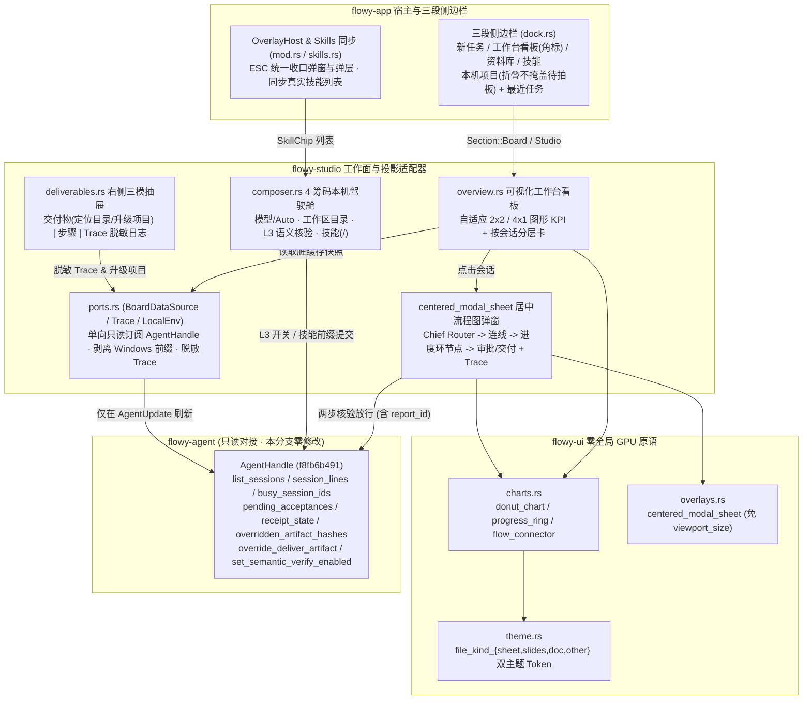

# Flowy Local-First UI v2（可视化工作台看板 + 0 冲突端口体系）执行方案

> **状态**：✅ 已实施并验收（基于 `feat/flowy-v0-rc` @ `f8fb6b491` 切出分支 `feat/flowy-local-ui-v2`）  
> **前序基线**：[super-agent-ui-and-motion.zh.md](super-agent-ui-and-motion.zh.md)  
> **核心原则**：**严格遵守与内核 worktree 的 0 冲突硬边界（仅修改 `flowy-ui` / `flowy-studio` / `flowy-app` / `flowy-i18n` 与 `docs/plans/`，零触碰 `flowy-agent-core` / `flowy-agent` 及共享进度文档）；以本机电脑环境为主体，通过 UI 侧窄投影适配器 `ports.rs` 纯订阅渲染，零生产 mock、零磁盘直读、全 23 语言对称。**

---

## 1. 背景与范式定调

### 1.1 本机优先办公桌面范式
- **非纯云端多 Bot 聊天室**：以「任务 + 可选本机项目目录 + 按需技能挂载」为主干，聚焦真实本机交付（Excel/PPT/Word/脚本/归档）与目录安全边界；
- **全局看图形数据，细节进弹窗看流程图**：解决三栏并排时中栏缩窄导致 KPI 竖排与流程图裁切的响应式痛点；
- **严格零新增第三方 crate**：复用已锁死依赖 `gpui-pre =0.3.14` 与 `gpui-kit =0.11.0` 底层的 `gpui_kit::base::plot::shape::{Arc, Pie}`（避开依赖全局 `gpui_component::init` 会 panic 的高层组件）。

### 1.2 0 冲突硬隔离与内核契约（基于 `feat/flowy-v0-rc` @ `f8fb6b491`）

| 边界项 | 严格约定 |
| --- | --- |
| **UI 允许修改范围** | 仅限 `flowy18_wip/crates/{flowy-ui, flowy-studio, flowy-app, flowy-i18n}/` 与 `flowy18_wip/docs/plans/` |
| **严禁触碰范围** | `flowy-agent-core/`、`flowy-agent/`、`docs/architecture/flowy-v0/{PROGRESS.md, 交接给下一个agent.md, 证据.md}`、根 Tauri/React 工作区 |
| **调度边界** | UI 仅做纯订阅展示层，不围绕 `has_active_claim` / `run_accepted_once` 建新状态机 |
| **核验放行边界** | `override_deliver_artifact(session_id, report_id, artifact_path)` 严格透传 `ChatLine::Verification` 的真实非空 `report_id`，保留两步确认门禁并承接内核报错 |
| **存储与性能边界** | 严禁 UI 直读 `sessions/{history,index}.json`、`delivery/*.jsonl`、`acceptance/journal.jsonl`；磁盘查询类 `AgentHandle` 方法（`overridden_artifact_hashes` / `receipt_state`）仅在 `AgentUpdate` / 项目变更 / 打开看板时重建缓存快照，绝不在 `render()` 或空闲 33ms 节拍调用 |

---

## 2. 端到端界面与投影架构



---

## 3. 核心模块实现清单

### 3.1 `flowy-ui` 零全局图表与弹窗原语
- [theme.rs](../../crates/flowy-ui/src/theme.rs)：新增 `file_kind_sheet`、`file_kind_slides`、`file_kind_doc`、`file_kind_other` 语义 Token，同时适配暖墨浅色与暖炭深色主题。
- [charts.rs](../../crates/flowy-ui/src/charts.rs)：基于 `gpui_kit::base::plot::shape::{Arc, ArcData, Pie}` + `gpui::canvas` + `PathBuilder` 实现 `donut_chart`、`progress_ring`、`flow_connector`，受 `MotionPolicy` 门控，不依赖 `gpui_kit::init(cx)`，附带 2 项 `#[gpui::test]` 回归测试。
- [overlays.rs](../../crates/flowy-ui/src/overlays.rs)：新增 `centered_modal_sheet`，全窗口 flex 居中 + 响应式最大宽度，零 `window.viewport_size()` 调用。

### 3.2 `flowy-studio` 数据投影、可视化看板、4 筹码驾驶舱与三模抽屉
- [ports.rs](../../crates/flowy-studio/src/ports.rs)：定义 `WorkBoardSnapshot`、`BoardDataSource`、`SessionBoardGroup`、`WorkBranchSummary`、`BranchPhase`、`RedactedTraceEntry`、`LocalEnvSnapshot`、`SkillChip` 与 `display_path`（剥离 Windows `\\?\` 扩展前缀）；内置密钥/Token 脱敏与载荷截断。
- [overview.rs](../../crates/flowy-studio/src/overview.rs)：实现自适应 `2×2 / 4×1` 图形 KPI 条（`donut_chart` 分支环 + 卡点脉冲卡 + 产物格式分布条 + 会话活跃柱）、按会话分层的视觉管道卡（历史会话自动折叠为单行色点管道）、以及 `centered_modal_sheet` 居中流程图弹窗（含两步核验放行与脱敏 Trace 切页）。
- [composer.rs](../../crates/flowy-studio/src/composer.rs)：升级为 4 筹码本机驾驶舱（`模型/Auto` · `工作区/项目` · `L3 语义核验开关` · `技能 /`），修复 `!cloud_ready` 静默吞回车问题。
- [deliverables.rs](../../crates/flowy-studio/src/deliverables.rs)：升级为 `交付物 | 步骤 | Trace` 三模抽屉，展示剥离 `\\?\` 的清晰路径，补齐 `定位文件夹` 与一键 `升级为项目` 动作，支持复制脱敏 JSONL。
- [studio.rs](../../crates/flowy-studio/src/studio.rs) 与 [panel.rs](../../crates/flowy-studio/src/panel.rs)：接入 `StudioSurface::Board`（看板页不常驻右抽屉）、顶栏 `● 本机就绪` 胶囊与体检弹层（含 `L3 语义复核` 开关直连 `agent.set_semantic_verify_enabled`）、脏缓存 `refresh_board_snapshot()` 与单次 `overridden_artifact_hashes()` 查表。

### 3.3 `flowy-app` 三段侧边栏与 23 语言对称字典
- [dock.rs](../../crates/flowy-app/src/app/dock.rs)：顶部核心 4 入口收口为 `新建任务` · `工作台看板`（带待拍板琥珀/活跃青绿实时角标）· `资料库` · `技能`；修复项目行折叠态与会话行中 `project_busy` 掩盖 `project_attention` 的问题；次级工具（`创作` / `自动化` / `个性化`）与底栏账户/设置全部保留可达。
- [mod.rs](../../crates/flowy-app/src/app/mod.rs) 与 [skills.rs](../../crates/flowy-app/src/app/skills.rs)：新增 `Section::Board`（纳入前进/后退导航栈）、将新建弹层与流程图弹窗接入 `OverlayHost`、同步真实技能清单至 `StudioPanel`。
- `crates/flowy-i18n/locales/*.json`：23 套语言字典 100% 键位对称，所有插值占位符（如 `{count}`）与调用处严格一致。

---

## 4. 给隔壁内核 worktree 的只读接口需求单（后续协同零返工）

当前 UI v2 已完全基于 `f8fb6b491` 既有公开 API 跑通，零 mock。后续内核侧推进自治调度、交互审批与多 Work 协作时，只需按以下最小签名补充，UI 侧替换 `ports.rs` 适配器即可无缝升级（零界面重写）：

1. **交互式工具审批挂起端口**：
   - `AgentHandle::pending_tool_approvals(&self) -> Vec<PendingToolApproval>`
   - `AgentHandle::resolve_tool_approval(&self, approval_id: &str, decision: ApprovalDecision) -> Result<(), &'static str>`
   - `AgentUpdate::ApprovalsChanged`
2. **结构化 Work Trace 脱敏流**：
   - `AgentHandle::work_trace(&self, session_id: &str, limit: usize) -> Vec<WorkTraceRecord>`
3. **默认本机目录懒创建元数据**：
   - `AgentHandle::session_workspace_meta(&self, session_id: &str) -> Option<WorkspaceMeta>`（含展示根路径与 `materialized: bool`）
4. **轻量只读汇总查询（消除重复扫盘）**：
   - `AgentHandle::receipt_states_snapshot(&self) -> HashMap<String, ReceiptState>`
   - `AgentHandle::session_board_summaries(&self) -> Vec<SessionBoardSummary>`（后续补充 `parent_session_id` / `route_label` / `active_skill`）

---

## 5. 验证梯子

```powershell
# 1. 0 冲突文件边界审计（必须 0 命中 flowy-agent-core / flowy-agent / docs/architecture/flowy-v0）
git diff --name-only feat/flowy-v0-rc

# 2. UI 静态契约与 23 语言对称检查
node flowy18_wip/scripts/check-ui-contracts.mjs

# 3. 无头单测（flowy-i18n + flowy-ui）与严格静态检查
cargo test --manifest-path flowy18_wip/Cargo.toml -p flowy-i18n -p flowy-ui
cargo fmt --manifest-path flowy18_wip/Cargo.toml --check
cargo clippy --manifest-path flowy18_wip/Cargo.toml --tests -p flowy-i18n -p flowy-ui -p flowy-studio -p flowy-app -- -D warnings
cargo test --manifest-path flowy18_wip/Cargo.toml --no-run -p flowy-studio -p flowy-app
```

---

## 6. 基于 `feat/flowy-v0-rc`（`71cdb8e92`）的 6 接口架构升级

- **零冲突切齐基线**：`git rebase feat/flowy-v0-rc`（`71cdb8e92`）0 文件重叠，继续严守 UI 侧文件边界（0 触碰内核与 `flowy-shell`）。
- **自治队列与事件订阅**：生产构造 `StudioPanel::new_background` 开启 `agent.set_autonomous_drain(true)`，关闭 UI 侧 5s 轮询与手动 `finish_accepted`/`run_accepted_once`（仅在 `!autonomous_drain()` 保留兼容既有确定性单测）；`notify_cloud_ready` 防御性唤醒 `set_autonomous_drain(true)`；`process_agent_updates` 消费 `AgentUpdate::Receipt { id, state }` 实时同步 `Queued/Running/Retrying/Completed/Cancelled/Quarantined/Dead`。
- **显式取消与统一卡片网关**：全部取消路径迁移至 `agent.cancel_task(TaskTarget::Session | Receipt)` 并诚实承接 `CancelOutcome::FinalizingNotCancellable`；覆盖放行、交付重试与死信重投统一收口至 `agent.apply_card_action(CardAction::OverrideDeliver | RetryDelivery | RetryDeadReceipt)`（含 `retrying_receipt` 防重入与重投后清理旧死信 ID）。
- **契约进度投影与单一退出总闸**：`ports.rs` 通过 `agent.work_status(work_id)` 为持有真实不透明 `receipt.id` 的分支投影 `WorkContractProgress`（交付数 / 要求数 / 缺失交付物）；`FlowyApp::new` 通过 `cx.on_app_quit` 单一钩子异步调用 `agent.prepare_shutdown()` 覆盖全部退出路径。
- **报给内核侧的 4 项后续只读补齐（不阻塞本次合入）**：`apply_config()` 自动 `kick_autonomous_drain()`、`visible_acceptances()`（覆盖退避期与跨重启死信/隔离态）、`RetryDeadReceipt` 终结/取代旧死信防重启复现、`session_work_status(session_id)`（或 `SessionSummary.latest_work_id`）让非队列直提会话也可查 `WorkStatus`。
