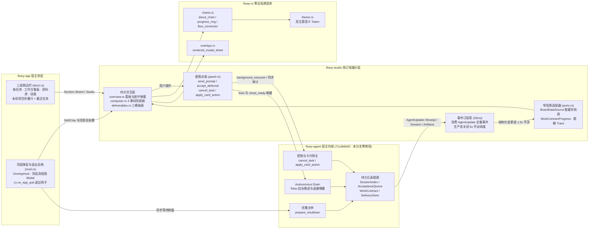
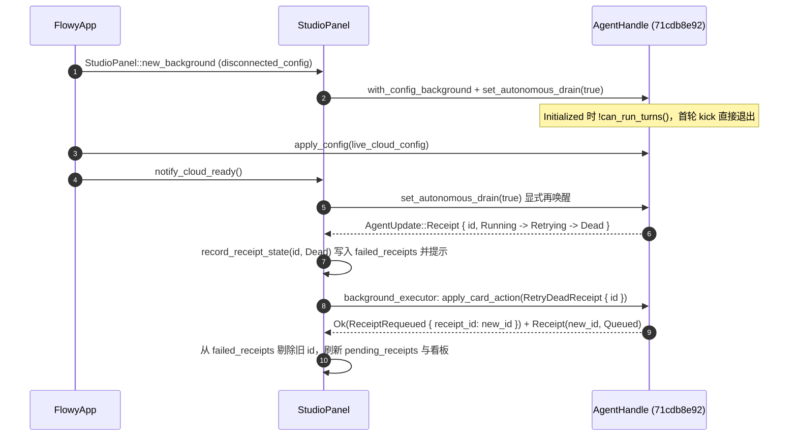
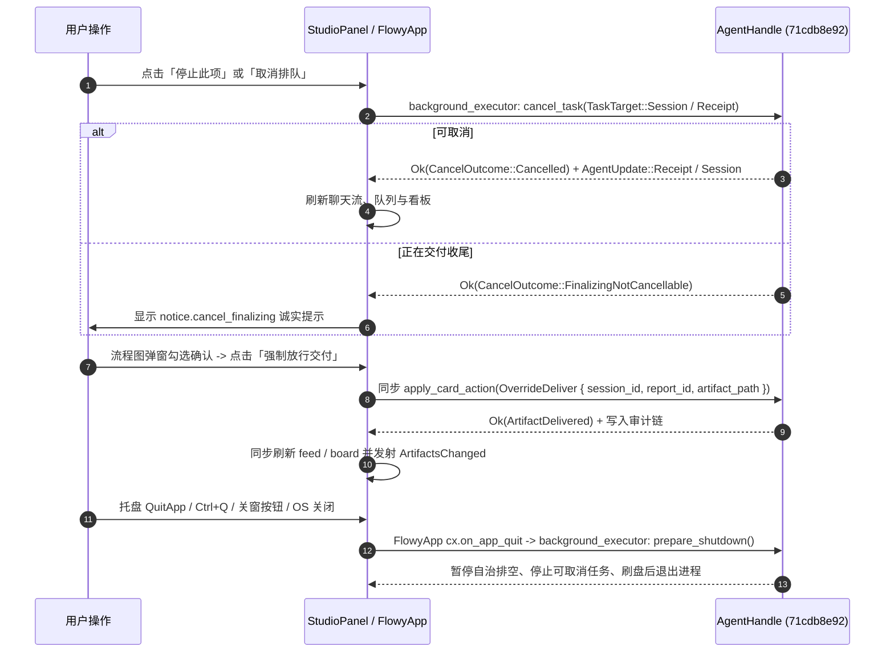
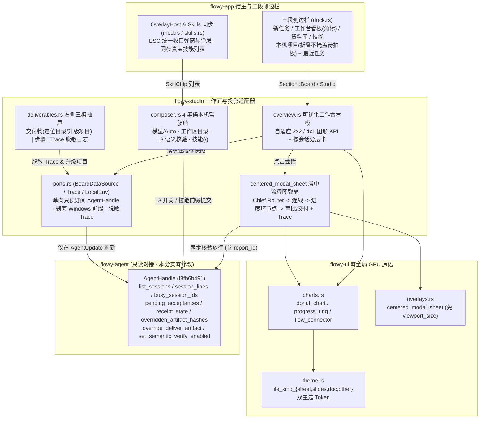

# Flowy Local-First UI v2 与内核 6 接口解耦架构 · 技术方案与溯源手册

> **状态**：✅ 已实现并提交（分支 `feat/flowy-local-ui-v2`，已无冲突 `rebase` 至 `feat/flowy-v0-rc` @ `71cdb8e92`）  
> **提交溯源**：`370dfdb5a`（UI v2 看板/弹窗/驾驶舱初版）→ `70cff483a`（代码审查 13 项深度收敛）→ `c5170e55a`（`flowy-agent` 新 6 接口架构重构）  
> **前序基线**：[super-agent-ui-and-motion.zh.md](super-agent-ui-and-motion.zh.md)  
> **核心原则**：**内核自治调度，UI 降维为纯订阅展示层；以本机办公交付为主体（全局看图形 KPI，细节进居中弹窗看流程图），严守 0 冲突文件硬边界、零生产 mock、零磁盘直读、零隐式内部格式耦合、23 语言全对称。**

---

## 1. 背景、设计初衷与痛点演化

### 1.1 业务定位与设计初衷
Flowy Desktop（`flowy18_wip`）定位为**本机优先（Local-First）的办公自动化桌面工作台**，面向需要同时推进多个本机文件任务（Excel 汇总、PPT 汇报、Word 合同、本机脚本与归档）的用户，而非纯云端多 Bot 聊天室。

本轮重构围绕三个核心初衷展开：
1. **解决窄屏响应式塌陷**：早期方案试图在三栏并排主界面中常驻横向流程图与右侧审批抽屉，在 960–1280px 常见笔记本视口下必然出现 KPI 竖排挤压、流程图裁切与文字重叠。因此确立**「主画布只做自适应图形 KPI + 按会话分层摘要卡，点击任意会话弹出宽幅居中流程图 Modal」**的信息分层。
2. **彻底剥离 UI 侧队列调度器**：此前 `StudioPanel` 在 UI 33ms 节拍器里内嵌了 5 秒定时轮询，手动推断 `has_active_claim()` / `claimed_session_status()` 并调用 `finish_accepted()` / `run_accepted_once()`，既与内核职责倒挂，又容易在后台队列推进时干扰当前焦点会话。在内核 `feat/flowy-v0-rc`（`71cdb8e92`）导出 6 个解耦接口后，我们在未发布期果断一次性完成对接重构，消除历史债。
3. **跨 worktree 零冲突协作**：内核侧与 UI 侧并行演进，必须通过窄投影适配器（[ports.rs](../../crates/flowy-studio/src/ports.rs)）和严格文件白名单实现硬隔离，确保双方合并 0 冲突、0 返工。

### 1.2 演进前后能力对比矩阵

| 维度 | 改造前（v0 基线 `f8fb6b491`） | UI v2 第一阶段（`370dfdb5a` / `70cff483a`） | UI v2 × 6 接口重构（`c5170e55a`） |
| --- | --- | --- | --- |
| **全局任务可视性** | 仅侧边栏文字列表，无法一眼识别卡点与产物分布 | 自适应 `2×2 / 4×1` GPU 环形图 KPI + 会话分层卡 + 居中流程图弹窗 | 新增 `ReceiptState` 全 7 态可视化、死信/隔离归入卡点、契约交付进度条 |
| **队列调度归属** | UI 5s 定时泵手动调 `finish_accepted` / `run_accepted_once` | 暂留旧泵（准备切换） | 生产态 `set_autonomous_drain(true)` 移交内核 Tokio 自治，UI 仅订阅 `AgentUpdate::Receipt` |
| **任务取消控制** | `stop_if_active` 隐式依赖当前焦点会话，无法取消排队回执 | 抽屉可停后台会话，仍走 `stop_if_active` | 统一 `cancel_task(TaskTarget::Session \| Receipt)`，诚实反馈 `FinalizingNotCancellable` |
| **卡片动作入口** | 核验放行、交付重试分散直调底层方法，无死信恢复 | 弹窗补齐两步核验放行，仍分头调用 | 统一收口 `apply_card_action(OverrideDeliver \| RetryDelivery \| RetryDeadReceipt)` |
| **契约进度与溯源** | 仅展示单文件核验卡与聊天流 | 新增脱敏 Trace 与 JSONL 导出 | 通过 `work_status(work_id)` 投影真实 `WorkContractProgress` 与缺失交付物告警 |
| **应用正常关闭** | 标题栏/系统关窗直接 `cx.quit()`，托盘退出无刷盘钩子 | 同前 | `FlowyApp::new` 单一 `cx.on_app_quit` 异步调用 `agent.prepare_shutdown()` 全路径兜底 |

---

## 2. 方案全景与架构设计

### 2.1 端到端数据流与控制流拓扑



### 2.2 核心目标 vs 明确非目标

| 类别 | 明确边界 |
| --- | --- |
| **核心目标** | ① 全局可视化工作台 + 宽幅居中流程图弹窗；② 4 筹码本机驾驶舱与三模抽屉；③ 全面切换 `71cdb8e92` 6 个新接口并将 UI 降维为纯订阅层；④ 23 语言对称与双主题零硬编码；⑤ 0 冲突文件边界。 |
| **明确非目标** | ① 严禁修改 `flowy-agent`、`flowy-agent-core`、`flowy-shell` 及共享文档 `docs/architecture/flowy-v0/*`；② 严禁引入新第三方 Rust crate 或调用 `gpui_kit::init(cx)`；③ 严禁在生产代码中塞入 mock 数据或直读磁盘状态文件；④ 严禁 UI 猜测并拼接内核内部 `submission-{id:032x}` 格式。 |

### 2.3 五条架构不变量（后续维护不可打破）
1. **0 冲突硬边界**：UI 侧只允许改动 `flowy18_wip/crates/{flowy-ui, flowy-studio, flowy-app, flowy-i18n}/` 与 `flowy18_wip/docs/plans/`。需要新内核只读能力时一律写入 §6.3 需求单由内核侧补充。
2. **双轨隔离兼容单测**：`StudioPanel::new_background`（生产 `FlowyApp`）必须开启 `agent.set_autonomous_drain(true)`；`StudioPanel::new`（`cfg!(test)` 确定性单测）保持 `false`，所有旧手动 drain 代码必须锁在 `if !self.agent.autonomous_drain()` 守卫内，不得在生产路径运行。
3. **零渲染帧 I/O**：`Render::render` 与空闲 33ms 节拍严禁执行 `fs::metadata` 或磁盘扫表；`WorkBoardSnapshot` 与 `LocalEnvSnapshot` 仅在结构化 `AgentUpdate`、项目/配置变更、打开看板或流式 1.2s 节流窗口更新。
4. **严格不透明 ID 契约**：`work_status(work_id)` 只允许传内核返回的不透明 `receipt.id`（或未来内核导出的 `latest_work_id`）；`CardAction::OverrideDeliver` 必须传 `ChatLine::Verification` 里的真实非空 `report_id`。
5. **单一退出总闸**：关闭刷盘必须统一收口在 `FlowyApp::new` 的 `cx.on_app_quit`，禁止在各个按钮或窗口回调里重复调用 `prepare_shutdown()` 造成遗漏或竞态。

---

## 3. 核心设计与模块规范

### 3.1 模块职责与代码锚点

| Crate | 文件 | 职责与关键改动 |
| --- | --- | --- |
| `flowy-ui` | [theme.rs](../../crates/flowy-ui/src/theme.rs)、[charts.rs](../../crates/flowy-ui/src/charts.rs)、[overlays.rs](../../crates/flowy-ui/src/overlays.rs) | 双主题 `file_kind_*` 语义 Token；基于底层 `Arc`/`Pie` + `canvas` 自绘 `donut_chart` / `progress_ring` / `flow_connector`（免全局 Theme）；免 `viewport_size()` 的 `centered_modal_sheet`。 |
| `flowy-studio` | [ports.rs](../../crates/flowy-studio/src/ports.rs) | `BoardDataSource`、`WorkBoardSnapshot`、`WorkContractProgress`（映射 `WorkStatus`）、`LocalEnvSnapshot`、`collect_session_traces`（含 JSON/JWT 密钥脱敏与缺失项告警）、`display_path`（剥离 Windows `\\?\` 与 `\\?\UNC\`）。 |
| `flowy-studio` | [panel.rs](../../crates/flowy-studio/src/panel.rs) | `set_autonomous_drain(true)` 生产启用与 `notify_cloud_ready` 防御性唤醒；`AgentUpdate::Receipt` 全量消费与 `failed_receipts` / `retrying_receipt` 状态管理；`cancel_task_target` 与 `apply_card_action` 统一收口。 |
| `flowy-studio` | [overview.rs](../../crates/flowy-studio/src/overview.rs)、[deliverables.rs](../../crates/flowy-studio/src/deliverables.rs)、[studio.rs](../../crates/flowy-studio/src/studio.rs)、[composer.rs](../../crates/flowy-studio/src/composer.rs)、[feed.rs](../../crates/flowy-studio/src/feed.rs) | 看板 KPI 与会话分层卡、顶层居中流程图弹窗（含两步放行/停止/取消排队/死信重投/契约进度）、三模右侧抽屉（0 交付物时也可切 Steps/Trace）、4 筹码驾驶舱（修复 `!cloud_ready` 引导与技能挂载清空草稿）。 |
| `flowy-app` | [mod.rs](../../crates/flowy-app/src/app/mod.rs)、[dock.rs](../../crates/flowy-app/src/app/dock.rs)、[projects.rs](../../crates/flowy-app/src/app/projects.rs)、[skills.rs](../../crates/flowy-app/src/app/skills.rs) | `cx.on_app_quit` 挂接 `agent.prepare_shutdown()`；顶层 `flow_modal_overlay` 渲染槽（遮罩覆盖全窗口）；三段侧边栏待拍板优先级修复；项目菜单一键跳转筛选看板；真实技能清单同步。 |
| `flowy-i18n` | `locales/*.json`（全 23 语种） | 对称新增 UI v2 与 6 接口状态/提示全部 key，经 `every_locale_has_the_same_keys` 与 `check-ui-contracts.mjs` 强校验。 |

### 3.2 关键异步交互时序

#### 时序 A：启动云端延迟就绪 → 自治队列唤醒 → 死信重投防重复



#### 时序 B：显式取消、核验两步放行与单一退出总闸



### 3.3 `ReceiptState` 全生命周期 UI 投影矩阵

| `ReceiptState` | 进度估算 | 语义色 Token | 看板 KPI 归类 | `has_blocker` | 弹窗 / 抽屉可执行动作 |
| --- | --- | --- | --- | --- | --- |
| `Queued` | `15%` | `theme.muted()` | `running_count`（活跃队列） | `false` | 取消排队（`TaskTarget::Receipt`） |
| `Running` | `45%` | `theme.status_active()`（脉冲点） | `running_count` | `false` | 取消排队 / 停止会话 |
| `Retrying` | `25%` | `theme.status_attention()`（脉冲点） | `running_count` | `false` | 取消排队（`TaskTarget::Receipt`） |
| `Quarantined` | `10%` | `theme.status_attention()` | `approval_count`（需关注卡点） | `true` | 查看契约/Trace 详情 |
| `Dead` | `10%` | `theme.danger()` | `approval_count`（需关注卡点） | `true` | 重新入队执行（`CardAction::RetryDeadReceipt`，带重入锁） |
| `Completed` | `100%` | `theme.status_verified()` | 退出队列（由交付产物分支体现） | `false` | 仅查看产物与 Trace |
| `Cancelled` | `0%` | `theme.muted()` | 不计入活跃 | `false` | 无 |

---

## 4. 关键决策与权衡矩阵（ADR）

| 编号 | 决策点 | 选定方案 | 放弃的替代方案与理由 |
| --- | --- | --- | --- |
| **D1** | 流程图展示形态 | **全局看板看图形 KPI + 顶层居中 Modal 展示宽幅流程图** | ❌ 三栏主区常驻流程图：960–1280px 窗口下横向空间严重不足，导致 KPI 竖排挤压与流程节点裁切。 |
| **D2** | GPUI 图表与环形图实现 | **基于已锁死 `gpui_kit::base::plot::shape::{Arc, Pie}` + `gpui::canvas` 封装零全局原语（`flowy-ui/src/charts.rs`）** | ❌ 调 `gpui_kit::init(cx)` 用高层图表组件：会覆盖现有 `ResolvedTheme` 体系并引入全局状态耦合；❌ 引入新绘图 crate：增加 Windows 构建链风险。 |
| **D3** | 自治队列开关策略 | **生产 `StudioPanel::new_background` 开启 `set_autonomous_drain(true)`；测试 `StudioPanel::new` 保持 `false`** | ❌ 无条件全局开启：会破坏 `panel.rs` 中 4 个依赖同步确定性 `refresh_pending_receipts` 的既有 GPUI 回归单测。 |
| **D4** | 云端就绪唤醒缺口兜底 | **在 `StudioPanel::notify_cloud_ready` 中防御性重调 `agent.set_autonomous_drain(true)`** | ❌ 寄希望于 `apply_config()` 自动唤醒：实证 `71cdb8e92` 的 `apply_config()` 未调 `kick_autonomous_drain()`，启动前积压的队列会在云就绪后永久停在 `Queued`。 |
| **D5** | 死信回执展示与防重投 | **订阅 `AgentUpdate::Receipt` 维护内存 `failed_receipts` + `retrying_receipt` 重入锁；`ReceiptRequeued` 后主动清除旧 ID** | ❌ UI 直接构造 `AcceptanceQueue::new(root)` 扫盘：违反内核“禁止 UI 直读磁盘状态文件”红线；❌ 重投后不清旧 ID：内核追加新回执而保留旧 `dead: true`，会导致用户连点复制任务。 |
| **D6** | `work_status(work_id)` 接入范围 | **仅对持有真实不透明 `receipt.id` 的分支投影 `WorkContractProgress`** | ❌ 对直提会话自行拼装 `"submission-{id:032x}"`：耦合内核内部私有字符串格式且进程重启后即丢失，改为向内核侧提 `session_work_status(session_id)` 只读接口需求。 |
| **D7** | 退出刷盘钩子落点 | **在 `FlowyApp::new` 单一注册 `cx.on_app_quit`，异步执行 `agent.prepare_shutdown()`** | ❌ 在 `titlebar.rs` 与 `on_window_should_close` 分散埋点：会被 `flowy_shell::QuitApp`（托盘退出 + `Ctrl+Q`）直接绕过，且需跨 crate 改 `flowy-shell`。 |
| **D8** | 卡片动作同步 vs 异步执行 | **`OverrideDeliver` 保持同步调用；`RetryDelivery` / `RetryDeadReceipt` / `cancel_task` 走 `background_executor`** | ❌ 把 `OverrideDeliver` 改成异步：直接破坏既有同步单测 `override_delivery_writes_audit_chain_and_persists_badge_across_reopen`；❌ 把 `RetryDelivery`/`cancel_task` 放 UI 线程：存在锁与磁盘 I/O 卡顿风险。 |
| **D9** | 看板与环境检查刷新频率 | **脏缓存 + 结构化 `AgentUpdate` 触发 + 流式输出 1.2s 节流；`local_env` 仅状态变化时重算** | ❌ 每帧 `render()` 或每 token 重建快照：会导致每秒数十次 `fs::metadata` 与 `session_lines` 扫描，直接拖垮帧率。 |

---

## 5. 踩坑实录与故障溯源手册（Pitfalls & Root-Cause Playbook）

> 供后续维护者与新接入 agent 快速溯源：每一条均为本分支研发、`/code-review` 与对抗式审查中**真实发生并已修复**的问题。

### 5.1 GPUI / `flowy-ui` 渲染与契约坑
1. **`ElementId` 元组类型不匹配（E0277）**
   - **现象**：`charts.rs` 中将 `(elem_id, 1_u64)` 传给 `.id(...)` 编译报错。
   - **根因**：`ElementId` 未实现 `(ElementId, u64)` 嵌套元组，仅支持 `(&'static str, u64)` 或 `(ElementId, &'static str)` 等固定组合。
   - **解法**：改用 `(elem_id, "ring")` / `(elem_id, "flow")`；所有动态列表项坚持 `("prefix", idx as u64)`。
2. **弹窗遮罩只盖住中栏、不盖侧边栏与标题栏**
   - **现象**：初版把 `flow_modal_overlay` 放在 `StudioPanel::workspace` 内部渲染，导致弹窗被侧栏裁剪、960px 窗口横向溢出。
   - **根因**：`StudioPanel` 仅占右侧内容区，不拥有整窗视口。
   - **解法**：在 `70cff483a` 提升至顶层 [mod.rs](../../crates/flowy-app/src/app/mod.rs) 的 `FlowyApp::render` 渲染槽，并收紧流程图节点宽度（`148 / 156 / 172px` + `22px` 连线），使 960px 窗口一屏完整无滚动裁切。
3. **`check-ui-contracts.mjs` 静态门禁拦截**
   - **现象**：任何裸 `rgb(...)`、`div().on_click(...)`、或 23 套语言字典少 key / 占位符不一致都会直接红灯。
   - **解法**：交互容器统一用 `flowy_ui::interactive(id, label, &self.theme)`；颜色一律走 `self.theme.*`；所有新 key 必须一次同步进全部 23 份 `locales/*.json`。

### 5.2 UI 状态机与交互逻辑坑（来自 `/code-review` 13 项修复）
1. **挂载技能发送后输入框草稿无法清空**
   - **现象**：选中技能 chip 发送消息后，提示词仍残留在输入框。
   - **根因**：`send_prompt` 在文本前拼了 `[Skill: ...]\n`，随后异步回调拿拼接后的 `text` 去比对 `prompt_text(cx).trim()`，永远不等。
   - **解法**：在 `70cff483a` 保留未拼前缀的 `trimmed_draft` 专门用于 `draft_matches` 校验。
2. **`!cloud_ready` 时发送按钮静默失效**
   - **现象**：未连接云模型时点击发送或按回车无任何反馈，用户误以为应用卡死。
   - **解法**：保持按钮可点并派发 `ComposerEvent::CloudNotReady`，自动打开模型菜单并弹出 `notice.model_setup_required` 引导。
3. **0 交付物时右侧抽屉打不开 Steps / Trace**
   - **现象**：抽屉可见性原绑定在 `self.deliverables.is_some()`，对话还没产出文件时用户点不开步骤与 Trace。
   - **解法**：拆分独立的 `right_drawer_open: bool` 开关，无文件时默认切到 `RightDrawerTab::Steps`。
4. **Windows `\\?\` 路径前缀泄漏与 `project_busy` 掩盖待拍板**
   - **现象**：核验卡与抽屉偶现 `\\?\D:\...` 路径；侧栏项目有任务同时在跑和待审批时只显示青绿运行点，隐藏了琥珀待拍板提示。
   - **解法**：统一经 `ports::display_path_str` 剥离 `\\?\` / `\\?\UNC\`；侧栏徽标优先级固定为 `attention > running > idle`。
5. **Trace 脱敏漏掉 JSON 键值对与 JWT**
   - **现象**：早期脱敏仅匹配 `key=val`，对 `{"api_key":"sk-..."}` 与裸 `eyJ...` JWT 失效。
   - **解法**：扩展 `redact_trace_text` 同时识别 `:` 分隔键值、多 token 续行及 `sk-` / `ghp_` / `eyJ` 前缀，并保留 2KB 载荷上限。

### 5.3 内核契约与并发控制坑（来自 `carl-idea-king` 对抗审查）
1. **`apply_config()` 不唤醒 `autonomous_drain`（P1）**
   - **溯源**：`71cdb8e92` 的 `handle.rs` 中 `apply_config()` 更新 `engine` 与 `config` 后直接返回 `Ok(())`。启动期 `disconnected_config()` 下积压的回执在 `Initialized` 时因 `!can_run_turns()` 退出且不设唤醒 timer，若 UI 不主动唤醒将永久挂起。
   - **当前对策**：`StudioPanel::notify_cloud_ready` 防御性重调 `agent.set_autonomous_drain(true)`；同时在 §6.3 请求内核侧在 `apply_config()` 内根治。
2. **`pending_acceptances()` 过滤退避期与死信态 + `RetryDeadReceipt` 不关旧死信（P1）**
   - **溯源**：`acceptance.rs` 中 `pending()` 仅返回 `is_claimable(now_ms)`，因此 `Retrying` 退避期（`available_at_ms > now_ms`）、`Dead`、`Quarantined` 均不在 `pending_acceptances()` 中；且 `RetryDeadReceipt` 仅 `queue.accept(...)` 追加新 ID、不修改旧 `dead: true`。
   - **当前对策**：UI 订阅 `AgentUpdate::Receipt` 维护 `failed_receipts` 并在 `ReceiptRequeued` 成功时移除旧 ID；跨重启恢复与退避期保活已在 §6.3 提交内核侧补 `visible_acceptances()` 与取代标记。
3. **`work_status(work_id)` 无法覆盖非队列直提会话（P1）**
   - **溯源**：`71cdb8e92` 中 `SessionSummary` 与 `ChatLine` 均无 `submission_id`。
   - **当前对策**：UI 仅对持有真实 `receipt.id` 的工作分支查 `work_status`，拒绝硬编码内部 `"submission-{id:032x}"`；已在 §6.3 请求内核提供 `session_work_status(session_id)`。
4. **`QuitApp` 绕过窗口关闭回调（P2）**
   - **溯源**：[flowy-shell/src/lib.rs](../../crates/flowy-shell/src/lib.rs#L98-L100) 注册了 `cx.on_action(|_: &QuitApp, cx| cx.quit())`，托盘退出与 `Ctrl+Q` 不经过 `on_window_should_close`。
   - **解法**：实证 `gpui-pre 0.3.14` 具备 `Context::on_app_quit`，在 `FlowyApp::new` 一处拦截所有 `cx.quit()` 路径并异步完成 `prepare_shutdown()`。

### 5.4 Windows 构建与 GUI 自动化环境坑
1. **沙箱 `0xC0000142` 与构建命令选择**：在无交互式 Win32 窗口站的受限沙箱中，普通 `cargo check` 会因 `gpui-pre` build script 退出码 `0xC0000142` 失败，而 `cargo clippy --tests`、`cargo test --no-run`、`cargo build -p flowy-desktop --bin flowy-app` 可完整编译链接（`rc.exe` 仅告警保留默认图标，退出码 0）。
2. **Windows Defender `os error 1224`**：高频改写源码后立刻跑 `cargo fmt` 偶发文件被临时内存映射锁定，重试一次即可。
3. **本机实机 GUI E2E 与截图 6 坑**：详见已沉淀的全局 skill `flowy-gpui-e2e`（单次 `.ps1` 会话内用 Git Bash 后台拉起、过滤 `113×113` 无标题悬浮球、`title -eq 'Flowy'`、查静态文本不带 `-i`、双层 `%APPDATA%\Flowy\Flowy\data` 备份还原）。

---

## 6. 验收标准、验证梯子与内核侧协同待办

### 6.1 验收用例与当前覆盖状态

| 编号 | 验收场景 | 断言口径 | 当前状态 |
| --- | --- | --- | --- |
| **TC-UI-01** | 0 冲突文件边界 | `git diff --name-only feat/flowy-v0-rc` 0 命中内核、`flowy-shell` 与共享文档 | ✅ 已通过（42 个文件全在 UI 白名单） |
| **TC-UI-02** | UI 静态契约与 23 语言对称 | `check-ui-contracts.mjs` + `every_locale_has_the_same_keys` 0 错误 | ✅ 已通过 |
| **TC-UI-03** | 零全局 GPU 图表与动效原语 | `flowy-ui` 42 项单测（含 `charts_paint_without_global_component_theme_init`） | ✅ 已通过（42/42） |
| **TC-UI-04** | 严格静态检查与二进制编译 | `cargo clippy --tests -- -D warnings` 0 告警 + `flowy-desktop` 编译通过 | ✅ 已通过 |
| **TC-UI-05** | `WorkContractProgress` 契约投影与死信卡点分类 | `ports::tests::work_contract_progress_projects_partial_missing_and_dead_receipts_as_blockers` | ✅ 编译通过（待本机桌面会话运行） |
| **TC-UI-06** | 死信状态跟踪与清除 | `panel::tests::dead_receipt_lifecycle_tracks_and_clears_failed_receipt_state` | ✅ 编译通过（待本机桌面会话运行） |
| **TC-UI-07** | 云就绪后唤醒自治队列 | `panel::tests::autonomous_drain_notify_cloud_ready_wakes_queued_receipt` | ✅ 编译通过（待本机桌面会话运行） |
| **TC-UI-08** | 核验两步放行审计链持久化 | `panel::tests::override_delivery_writes_audit_chain_and_persists_badge_across_reopen` | ✅ 编译通过（待本机桌面会话运行） |
| **TC-UI-09** | 双主题 × 960px/1280px 实机视觉与关窗刷盘 | 在本机普通桌面终端通过 `flowy-gpui-e2e` 截屏与行为验证 | ⏳ 待普通桌面环境复测 |

### 6.2 验证梯子（Verification Ladder）

```powershell
# 1. 0 冲突文件边界审计
git diff --name-only feat/flowy-v0-rc

# 2. 格式与 UI 契约门禁
cargo fmt --manifest-path flowy18_wip/Cargo.toml --check
node flowy18_wip/scripts/check-ui-contracts.mjs

# 3. 严格 Clippy 与无头单测
cargo clippy --manifest-path flowy18_wip/Cargo.toml --tests -p flowy-i18n -p flowy-ui -p flowy-studio -p flowy-app -- -D warnings
cargo test --manifest-path flowy18_wip/Cargo.toml -p flowy-ui
cargo test --manifest-path flowy18_wip/Cargo.toml -p flowy-i18n

# 4. Studio/App 测试构建 + 桌面二进制构建（普通桌面终端可直接去掉 --no-run 执行全套 GPUI 单测）
cargo test --manifest-path flowy18_wip/Cargo.toml --no-run -p flowy-studio -p flowy-app
cargo build --manifest-path flowy18_wip/Cargo.toml -p flowy-desktop --bin flowy-app
```

### 6.3 留给隔壁内核侧的 4+1 项配合需求（与后续 UI 瘦身点）

> 内核侧补齐以下 4 项（~80 行向后兼容代码）后，UI 侧只需删除 `failed_receipts` 内存态与 `notify_cloud_ready` 额外唤醒即可进一步收敛为 100% 无状态订阅：

1. **P1 · `apply_config()` 自动唤醒自治队列**：`autonomous_drain == true && self.can_run_turns()` 时自动调用 `self.kick_autonomous_drain()`。
2. **P1 · 新增 `AgentHandle::visible_acceptances(&self) -> Vec<(AcceptedMessage, ReceiptState)>`**：返回所有未 `Completed` 且未 `Cancelled` 的回执（覆盖 `Queued` / `Running` / 退避期 `Retrying` / `Quarantined` / `Dead`），彻底消除退避期任务“消失”与跨重启死信不可见问题。
3. **P1 · `CardAction::RetryDeadReceipt` 终结/取代旧死信**：追加新回执成功后，在 `AcceptanceQueue` 中标记旧 `receipt_id` 已取代/关闭（退出 `visible_acceptances()`，推对应 `AgentUpdate::Receipt`，且对旧 ID 重复调用保持幂等拒绝），防止重启后死信“诈尸”重复重投。
4. **P1 · 新增 `AgentHandle::session_work_status(&self, session_id: &str) -> Option<WorkStatus>`**（或 `SessionSummary.latest_work_id: Option<String>`）：使普通直提会话跨重启也能查询契约进度，无需 UI 耦合内部 `submission-{id:032x}` 格式。
5. **P2（可选）· `Quarantined` 事件补齐**：若对账或运行期触发隔离，顺手推送 `AgentUpdate::Receipt { id, state: ReceiptState::Quarantined }`。

---

## 附录：原始技术底稿与历史归档 (Historical & Technical Reference Archive)

> **归档说明**：以下 100% 逐字完整保留初版 UI v2 执行方案底稿（基于 `f8fb6b491` 编写、并于 `c5170e55a` 追加 §6），供历史演进对比与协议审计，未做任何删减。

---

# Flowy Local-First UI v2（可视化工作台看板 + 0 冲突端口体系）执行方案

> **状态**：✅ 已实施并验收（基于 `feat/flowy-v0-rc` @ `f8fb6b491` 切出分支 `feat/flowy-local-ui-v2`）  
> **前序基线**：[super-agent-ui-and-motion.zh.md](super-agent-ui-and-motion.zh.md)  
> **核心原则**：**严格遵守与内核 worktree 的 0 冲突硬边界（仅修改 `flowy-ui` / `flowy-studio` / `flowy-app` / `flowy-i18n` 与 `docs/plans/`，零触碰 `flowy-agent-core` / `flowy-agent` 及共享进度文档）；以本机电脑环境为主体，通过 UI 侧窄投影适配器 `ports.rs` 纯订阅渲染，零生产 mock、零磁盘直读、全 23 语言对称。**

---

## 1. 背景与范式定调

### 1.1 本机优先办公桌面范式
- **非纯云端多 Bot 聊天室**：以「任务 + 可选本机项目目录 + 按需技能挂载」为主干，聚焦真实本机交付（Excel/PPT/Word/脚本/归档）与目录安全边界；
- **全局看图形数据，细节进弹窗看流程图**：解决三栏并排时中栏缩窄导致 KPI 竖排与流程图裁切的响应式痛点；
- **严格零新增第三方 crate**：复用已锁死依赖 `gpui-pre =0.3.14` 与 `gpui-kit =0.11.0` 底层的 `gpui_kit::base::plot::shape::{Arc, Pie}`（避开依赖全局 `gpui_component::init` 会 panic 的高层组件）。

### 1.2 0 冲突硬隔离与内核契约（基于 `feat/flowy-v0-rc` @ `f8fb6b491`）

| 边界项 | 严格约定 |
| --- | --- |
| **UI 允许修改范围** | 仅限 `flowy18_wip/crates/{flowy-ui, flowy-studio, flowy-app, flowy-i18n}/` 与 `flowy18_wip/docs/plans/` |
| **严禁触碰范围** | `flowy-agent-core/`、`flowy-agent/`、`docs/architecture/flowy-v0/{PROGRESS.md, 交接给下一个agent.md, 证据.md}`、根 Tauri/React 工作区 |
| **调度边界** | UI 仅做纯订阅展示层，不围绕 `has_active_claim` / `run_accepted_once` 建新状态机 |
| **核验放行边界** | `override_deliver_artifact(session_id, report_id, artifact_path)` 严格透传 `ChatLine::Verification` 的真实非空 `report_id`，保留两步确认门禁并承接内核报错 |
| **存储与性能边界** | 严禁 UI 直读 `sessions/{history,index}.json`、`delivery/*.jsonl`、`acceptance/journal.jsonl`；磁盘查询类 `AgentHandle` 方法（`overridden_artifact_hashes` / `receipt_state`）仅在 `AgentUpdate` / 项目变更 / 打开看板时重建缓存快照，绝不在 `render()` 或空闲 33ms 节拍调用 |

---

## 2. 端到端界面与投影架构



---

## 3. 核心模块实现清单

### 3.1 `flowy-ui` 零全局图表与弹窗原语
- [theme.rs](../../crates/flowy-ui/src/theme.rs)：新增 `file_kind_sheet`、`file_kind_slides`、`file_kind_doc`、`file_kind_other` 语义 Token，同时适配暖墨浅色与暖炭深色主题。
- [charts.rs](../../crates/flowy-ui/src/charts.rs)：基于 `gpui_kit::base::plot::shape::{Arc, ArcData, Pie}` + `gpui::canvas` + `PathBuilder` 实现 `donut_chart`、`progress_ring`、`flow_connector`，受 `MotionPolicy` 门控，不依赖 `gpui_kit::init(cx)`，附带 2 项 `#[gpui::test]` 回归测试。
- [overlays.rs](../../crates/flowy-ui/src/overlays.rs)：新增 `centered_modal_sheet`，全窗口 flex 居中 + 响应式最大宽度，零 `window.viewport_size()` 调用。

### 3.2 `flowy-studio` 数据投影、可视化看板、4 筹码驾驶舱与三模抽屉
- [ports.rs](../../crates/flowy-studio/src/ports.rs)：定义 `WorkBoardSnapshot`、`BoardDataSource`、`SessionBoardGroup`、`WorkBranchSummary`、`BranchPhase`、`RedactedTraceEntry`、`LocalEnvSnapshot`、`SkillChip` 与 `display_path`（剥离 Windows `\\?\` 扩展前缀）；内置密钥/Token 脱敏与载荷截断。
- [overview.rs](../../crates/flowy-studio/src/overview.rs)：实现自适应 `2×2 / 4×1` 图形 KPI 条（`donut_chart` 分支环 + 卡点脉冲卡 + 产物格式分布条 + 会话活跃柱）、按会话分层的视觉管道卡（历史会话自动折叠为单行色点管道）、以及 `centered_modal_sheet` 居中流程图弹窗（含两步核验放行与脱敏 Trace 切页）。
- [composer.rs](../../crates/flowy-studio/src/composer.rs)：升级为 4 筹码本机驾驶舱（`模型/Auto` · `工作区/项目` · `L3 语义核验开关` · `技能 /`），修复 `!cloud_ready` 静默吞回车问题。
- [deliverables.rs](../../crates/flowy-studio/src/deliverables.rs)：升级为 `交付物 | 步骤 | Trace` 三模抽屉，展示剥离 `\\?\` 的清晰路径，补齐 `定位文件夹` 与一键 `升级为项目` 动作，支持复制脱敏 JSONL。
- [studio.rs](../../crates/flowy-studio/src/studio.rs) 与 [panel.rs](../../crates/flowy-studio/src/panel.rs)：接入 `StudioSurface::Board`（看板页不常驻右抽屉）、顶栏 `● 本机就绪` 胶囊与体检弹层（含 `L3 语义复核` 开关直连 `agent.set_semantic_verify_enabled`）、脏缓存 `refresh_board_snapshot()` 与单次 `overridden_artifact_hashes()` 查表。

### 3.3 `flowy-app` 三段侧边栏与 23 语言对称字典
- [dock.rs](../../crates/flowy-app/src/app/dock.rs)：顶部核心 4 入口收口为 `新建任务` · `工作台看板`（带待拍板琥珀/活跃青绿实时角标）· `资料库` · `技能`；修复项目行折叠态与会话行中 `project_busy` 掩盖 `project_attention` 的问题；次级工具（`创作` / `自动化` / `个性化`）与底栏账户/设置全部保留可达。
- [mod.rs](../../crates/flowy-app/src/app/mod.rs) 与 [skills.rs](../../crates/flowy-app/src/app/skills.rs)：新增 `Section::Board`（纳入前进/后退导航栈）、将新建弹层与流程图弹窗接入 `OverlayHost`、同步真实技能清单至 `StudioPanel`。
- `crates/flowy-i18n/locales/*.json`：23 套语言字典 100% 键位对称，所有插值占位符（如 `{count}`）与调用处严格一致。

---

## 4. 给隔壁内核 worktree 的只读接口需求单（后续协同零返工）

当前 UI v2 已完全基于 `f8fb6b491` 既有公开 API 跑通，零 mock。后续内核侧推进自治调度、交互审批与多 Work 协作时，只需按以下最小签名补充，UI 侧替换 `ports.rs` 适配器即可无缝升级（零界面重写）：

1. **交互式工具审批挂起端口**：
   - `AgentHandle::pending_tool_approvals(&self) -> Vec<PendingToolApproval>`
   - `AgentHandle::resolve_tool_approval(&self, approval_id: &str, decision: ApprovalDecision) -> Result<(), &'static str>`
   - `AgentUpdate::ApprovalsChanged`
2. **结构化 Work Trace 脱敏流**：
   - `AgentHandle::work_trace(&self, session_id: &str, limit: usize) -> Vec<WorkTraceRecord>`
3. **默认本机目录懒创建元数据**：
   - `AgentHandle::session_workspace_meta(&self, session_id: &str) -> Option<WorkspaceMeta>`（含展示根路径与 `materialized: bool`）
4. **轻量只读汇总查询（消除重复扫盘）**：
   - `AgentHandle::receipt_states_snapshot(&self) -> HashMap<String, ReceiptState>`
   - `AgentHandle::session_board_summaries(&self) -> Vec<SessionBoardSummary>`（后续补充 `parent_session_id` / `route_label` / `active_skill`）

---

## 5. 验证梯子

```powershell
# 1. 0 冲突文件边界审计（必须 0 命中 flowy-agent-core / flowy-agent / docs/architecture/flowy-v0）
git diff --name-only feat/flowy-v0-rc

# 2. UI 静态契约与 23 语言对称检查
node flowy18_wip/scripts/check-ui-contracts.mjs

# 3. 无头单测（flowy-i18n + flowy-ui）与严格静态检查
cargo test --manifest-path flowy18_wip/Cargo.toml -p flowy-i18n -p flowy-ui
cargo fmt --manifest-path flowy18_wip/Cargo.toml --check
cargo clippy --manifest-path flowy18_wip/Cargo.toml --tests -p flowy-i18n -p flowy-ui -p flowy-studio -p flowy-app -- -D warnings
cargo test --manifest-path flowy18_wip/Cargo.toml --no-run -p flowy-studio -p flowy-app
```

---

## 6. 基于 `feat/flowy-v0-rc`（`71cdb8e92`）的 6 接口架构升级

- **零冲突切齐基线**：`git rebase feat/flowy-v0-rc`（`71cdb8e92`）0 文件重叠，继续严守 UI 侧文件边界（0 触碰内核与 `flowy-shell`）。
- **自治队列与事件订阅**：生产构造 `StudioPanel::new_background` 开启 `agent.set_autonomous_drain(true)`，关闭 UI 侧 5s 轮询与手动 `finish_accepted`/`run_accepted_once`（仅在 `!autonomous_drain()` 保留兼容既有确定性单测）；`notify_cloud_ready` 防御性唤醒 `set_autonomous_drain(true)`；`process_agent_updates` 消费 `AgentUpdate::Receipt { id, state }` 实时同步 `Queued/Running/Retrying/Completed/Cancelled/Quarantined/Dead`。
- **显式取消与统一卡片网关**：全部取消路径迁移至 `agent.cancel_task(TaskTarget::Session | Receipt)` 并诚实承接 `CancelOutcome::FinalizingNotCancellable`；覆盖放行、交付重试与死信重投统一收口至 `agent.apply_card_action(CardAction::OverrideDeliver | RetryDelivery | RetryDeadReceipt)`（含 `retrying_receipt` 防重入与重投后清理旧死信 ID）。
- **契约进度投影与单一退出总闸**：`ports.rs` 通过 `agent.work_status(work_id)` 为持有真实不透明 `receipt.id` 的分支投影 `WorkContractProgress`（交付数 / 要求数 / 缺失交付物）；`FlowyApp::new` 通过 `cx.on_app_quit` 单一钩子异步调用 `agent.prepare_shutdown()` 覆盖全部退出路径。
- **报给内核侧的 4 项后续只读补齐（不阻塞本次合入）**：`apply_config()` 自动 `kick_autonomous_drain()`、`visible_acceptances()`（覆盖退避期与跨重启死信/隔离态）、`RetryDeadReceipt` 终结/取代旧死信防重启复现、`session_work_status(session_id)`（或 `SessionSummary.latest_work_id`）让非队列直提会话也可查 `WorkStatus`。
