# Personal Agent 对话式自动化 · 开发计划

> **接续验收更新（2026-11-26）**：PA-A06、PA-A07、PA-A08、PA-A09、PA-A10 已完成接口与回归验收，累计 **14/31**。最终七个 crate **671 passed / 0 failed / 5 ignored**，八个 crate 全目标严格 Clippy、workspace check、格式和 UI 契约通过。Shell 执行后的静止证明仍采用保守隔离；自动化生产功能尚未开启。当前证据与剩余范围见[第 9 节验收记录](personal-agent-automation-execution.md#pa-a06-a10)。以下旧状态逐字保留作历史。

> **状态**：计划，待实施；2026-11-25。
> **代码基线**：`22e6a195c72be18365229fe938984aa2af9043f8`，工作区 `C:/code/flowy/allo/flowy18_wip`。
> **核心原则**：对话和 UI 使用同一自动化服务；共享一个执行宿主，每次运行绑定独立会话、账户、任务版本和工作区。执行、产物提交、通知交付分别保存证据。
> **交付范围**：本文件是开发计划，不代表 31 项任务已实施或验收通过。测试命令均为后续步骤，本轮仅执行文档校验。

> **并行实施更新（2026-11-26）**：当前分支已验证 **9/31**，包括新完成的 PA-A03、PA-A12 和 PA-D01。PA-B06 是手动运行和重启恢复的内部验收节点，生产开启仍由 PA-E06 验收。见[实施与验证记录](personal-agent-automation-execution.md)。

> **最新执行更新（2026-11-26）**：PA-A02 已完成并验证，累计 **4/31**；Agent 121 passed / 1 ignored、Studio 79 passed，消费者编译与严格 Clippy 通过。下一项 PA-A03；见[PA-A02 验证记录](personal-agent-automation-execution.md#pa-a02)。下列 2026-11-25 更新及原计划保留为历史记录。

> **执行更新（2026-11-25）**：PA-A01、PA-A04 与 PA-B01 已实现并验证，当前 3/31 项完成。实际状态与结果见[实施与验证记录](personal-agent-automation-execution.md)；以下计划、任务书和来源快照保留。

[计划索引](README.md) · [文档总索引](../README.md) · [源码证据与 V2 完整快照](#appendix-source)

## 1. 背景、范围与代码核对

### 1.1 目标与范围

用户能够在 Personal Agent 对话中创建、查询、修改、暂停、恢复、归档和立即运行自动化；对话结束后，后台根据持久规则创建独立运行，并交付结果。

当前三个阻断点：自动化页面只有内存草稿；公开执行入口围绕 active session；授权、恢复、资源仲裁和保留还没有统一契约。

首版支持：

- 动作：`AgentTask`、`Reminder`。
- 触发：手动、一次性、每日、每周。
- 可靠性：持久命令收据、独立会话、取消提交点、账户隔离、工作区仲裁、执行预算、启动对账、blocked 恢复、结果投递及保留清理。
- 宿主：Flowy 进程内；托盘下进程存活时继续执行，真正退出后停止。电脑关机时不承诺本地执行。

后续扩展：Interval、任意 Cron、外部事件及 predicate、Connector/MCP 扩展、可执行工作流、独立 daemon、云执行。本轮不迁移全部 Agent 历史到 SQLite，不改造父仓库 Tauri/React 后端。

### 1.2 适用规范与现状

本工作区是独立 Rust/GPUI Cargo workspace，当前有 15 个 crate。适用[上级 AGENTS](../../../AGENTS.md)、[本目录 AGENTS](../../AGENTS.md)、[上级 CONTRIBUTING](../../../CONTRIBUTING.md)、[技术方案写作规范](../../../docs/contributing/technical-solution-standard.zh.md)及[数据库规范](../../../docs/contributing/data-and-identifier-standards.md)。构建、UI 和存储事实以当前 GPUI 代码为准。

已核对 [BLOCKED](../../BLOCKED.md)、[Cargo.toml](../../Cargo.toml)、[迁移记录](../architecture/agent-core-migration.md)、[Shell 决策](../architecture/agent-shell-strategy.md)、[GPUI 指南](../gpui-pre-and-kit.md)、[DESIGN](../../DESIGN.md)、[Windows 验证约定](windows-build-rebase-pitfalls.md)及[资料库当前范围更新](conversation-artifact-library.zh.md)。

| 能力 | 当前实现 | 实施分类 |
|---|---|---|
| 执行宿主 | AgentHandle 包装 Arc<Harness>，持有 Engine、自建 Tokio Runtime | 扩展为应用级共享所有权 |
| 多会话 | Engine 已支持按 session 运行及不同 session 并行 | 复用，新增 detached 宿主入口 |
| 会话创建 | create_session_with_metadata 最终执行 upsert | 新增严格的不存在才创建接口 |
| 前台发送 | 使用 active、当前配置；无凭证时可能 echo | 后台新增入口，禁止复用 echo 分支 |
| 工具系统 | ToolDefinition、ToolRegistry、Policy、guards | 扩展受信上下文、逐请求权限及预算 |
| 文件交付 | DeliveryCommit、ArtifactStore marker 和恢复协议 | 复用，补通用完成证据和 headless 恢复 |
| 自动化页面 | AutomationDraft 是内存草稿，提交按钮禁用 | 新增真实查询和命令接线 |
| 通知 | 只有 OTA 通知，返回 ()，主要打开主窗口 | 扩展稳定投递键和指定 Run 路由 |
| 进程所有权 | desktop 已用 instance.lock 和 File::try_lock | 复用并提升到共享宿主入口 |
| 历史与清理 | JSON 全量保存；已有会话级联删除和删除计划 | 扩展自动化保留和跨存储清理 |
| 自动化持久层 | 当前不存在 | 新增 flowy-automation |

任务路径缩写：`agent/`、`core/`、`app/`、`studio/`、`shell/`、`automation/`、`desktop/` 分别表示 `crates/flowy-agent/src/`、`crates/flowy-agent-core/src/`、`crates/flowy-app/src/`、`crates/flowy-studio/src/`、`crates/flowy-shell/src/`、拟新增 `crates/flowy-automation/src/`、`crates/flowy-desktop/src/`。数据文件另以 `<store_root>/` 标记。

### 1.3 方案与代码、规范的差异及调整

| 差异 | 文件、符号和证据 | 调整与理由 |
|---|---|---|
| V2 进程互斥已有实现基础 | [desktop/main.rs](../../crates/flowy-desktop/src/main.rs):12，InstanceLock::acquire | 提升和复用原锁，不新增第二套调度锁 |
| 创建接口不是幂等 ensure | [core/engine.rs](../../crates/flowy-agent-core/src/engine.rs):227/263，create_session_with_metadata/insert_session；session.rs:200，upsert | 新增 create_if_absent；不匹配时拒绝，绝不覆盖历史 |
| Completed 不证明产物已提交 | core/engine.rs:684–745，先历史、再 marker | 新增逐 submission 完成证据，不能仅按投影结算 |
| Stop 不证明工具静止 | [core/run_fence.rs](../../crates/flowy-agent-core/src/run_fence.rs):116，cancel_active | 写许可绑定真实执行生命周期和工具静止证明 |
| 提交重试依赖 UI | [agent/handle.rs](../../crates/flowy-agent/src/handle.rs):836，retry_delivery | 抽出按稳定 commit 引用工作的无窗口恢复接口 |
| 多窗口争抢更新 | agent/handle.rs:589，drain_updates；[studio/panel.rs](../../crates/flowy-studio/src/panel.rs):475，start_pump | 共享句柄前先独立订阅和快照恢复 |
| 登出只停止 active | [app/app/mod.rs](../../crates/flowy-app/src/app/mod.rs):1389，sign_out | 先失效账户执行授权，再取消该账户所有可取消运行 |
| 登录不一定有稳定主体 | [auth/session.rs](../../crates/flowy-auth/src/session.rs):11，user_id: Option<i64>；client.rs:132 | 无 ID 阻止后台执行，不从邮箱/昵称/token 推导身份 |
| 旧资料入口没有账户过滤 | [app/library_actions.rs](../../crates/flowy-app/src/app/library_actions.rs)，load_library/artifact_action；app/artifact_preview.rs | 查询、预览、另存、默认打开、来源跳转统一授权 |
| 收藏不能防会话级联删除 | agent/handle.rs:699，delete_session；[agent/artifact_store.rs](../../crates/flowy-agent/src/artifact_store.rs):826/1367 | P0 保留引用保护整个自动化会话，清理前显式检查 |
| 旧文档独立产物生存期已废弃 | conversation-artifact-library.zh.md:5–7 的当前范围更新 | 保持删除来源会话级联删产物，不恢复旧方案 |
| DESIGN 的 hotpatch 建议已不适用 | DESIGN、BLOCKED、GPUI 指南 | 使用正常 Cargo 构建和冷启动验证 |
| V2 物理 PK/FK 与统一规范冲突 | 上级数据库规范；V2 §3.1 | 用户已选技术自增主键、UUIDv7、逻辑引用，补独立 ADR/registry |
| 暂停表述歧义 | V2 §3.3 与 §3.6/TC-23 | 暂停只阻止新触发，已排队保留；归档取消未开始 Run |

行号定位本次基线，实施时以符号重查。V2 正文是当前方案，历史附录仅追溯；上表为本计划显式调整，不回写或删改 V2。

## 2. 方案全景与依赖

### 2.1 模块职责与架构

- `flowy-app::AppHost`：唯一 Runtime/AgentHandle/AutomationRuntime；账户、授权、退出、结果访问、交付。
- `flowy-agent`：共享执行端口、仲裁、detached、工具和 RunExecutor 适配。
- `flowy-agent-core`：通用来源、证据、取消、门禁、预算，不依赖 auth UI/automation。
- `flowy-automation`：定义、revision、收据、Run/Attempt、调度、恢复、Outbox、保留、registry，不依赖 GPUI/agent。
- `flowy-studio`：查询和命令投影，不拥有调度器、不直连 SQLite。
- `flowy-shell`：通知和 Run 路由，不判断授权和执行成功。

Cargo 依赖保持 `flowy-agent → flowy-automation`；agent 实现 automation 的 RunExecutor，禁止反向依赖。AppHost 直接创建 Runtime 时，flowy-app/Cargo.toml 显式增加 Tokio，不能依赖传递依赖。

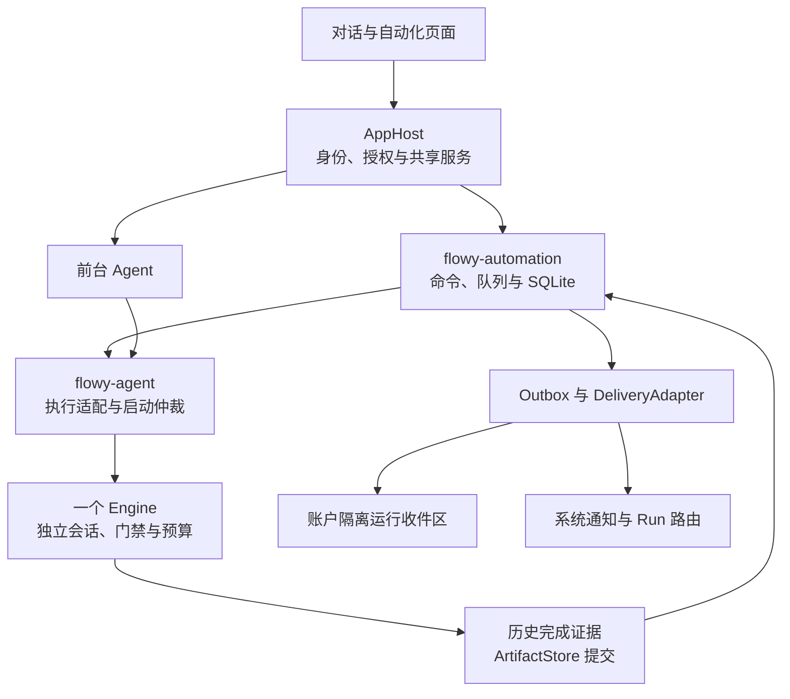

### 2.2 任务依赖 Mermaid

共 31 项：A12、B6、C3、D4、E6。编号保持稳定；粗线是主要阻断路径，普通线为其他前置依赖。

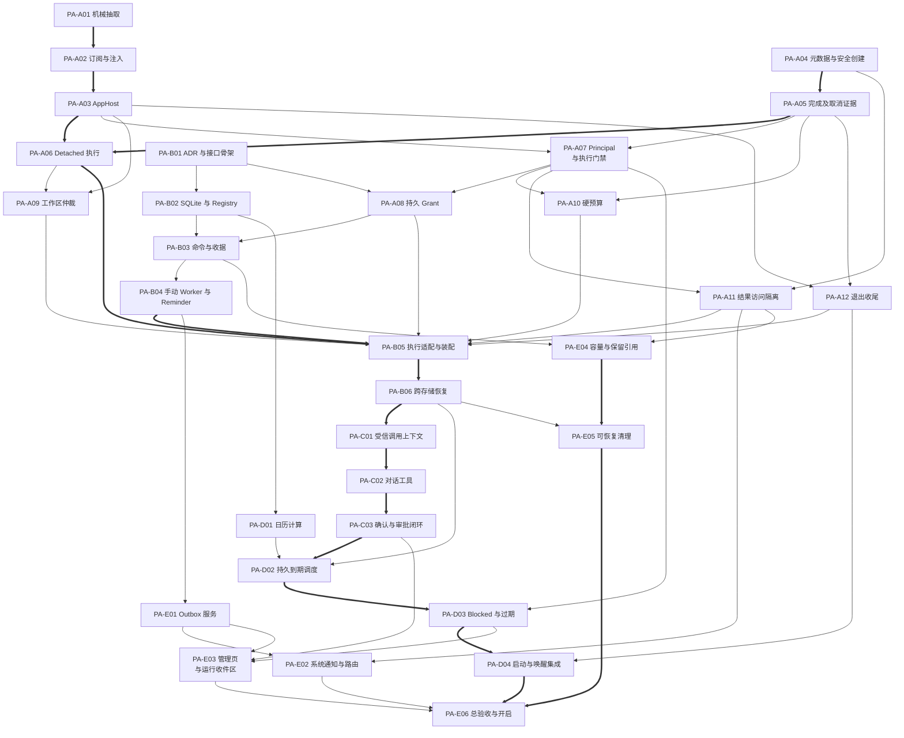

### 2.3 执行与交付时序

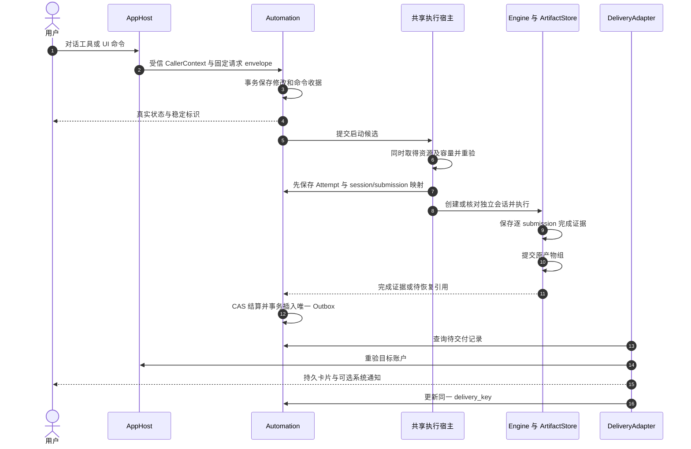

## 3. 核心接口与生命周期

### 3.1 接口与数据契约

| 接口 | 契约 |
|---|---|
| AutomationHandle::command/query/subscribe | 宿主身份上下文；订阅仅提示变化，重连查询权威快照 |
| RunExecutor::execute | 固定 RunSpec、取消通道、阶段报告器，返回完整 RunCompletion，不吞提交错误 |
| create_detached/start_detached | 显式 session/submission/来源/owner/工作区/配置/预算，不改 active |
| reconcile_attempt/retry_commit | 只查证据或重试原提交，不调用模型/任务工具 |
| ExecutionGate | 每次实际模型请求、重试、工具派发前检查 generation/Grant/范围/预算 |
| WorkspaceArbiter | 前后台共同申请完整资源及容量，等待者不长期占槽 |
| AppHost::request_shutdown | 停领取、取消或提交收尾、有界等待、保存证据，最后退出 |
| owner-aware 门面 | 会话、产物、预览、另存、打开、跳转均检查当前 principal |

以下是待实现字段契约，并非现有可编译代码：

```rust
struct RunSpec {
    run_id: RunId,
    attempt_id: AttemptId,
    revision: u64,
    principal: PrincipalId,
    account_generation: AccountGeneration,
    session_id: Option<String>,       // Reminder 无 Agent session。
    submission_id: Option<String>,    // 沿用现有宿主操作 token。
    workspace: Option<WorkspaceSpec>,
    capabilities: CapabilityRequest,
    model: Option<ModelBinding>,     // 固定标识及允许的 fallback。
    credential_ref: Option<CredentialRef>, // 仅引用，无 key/token。
    budget: Option<RunBudget>,        // AgentTask 必须为有限正值。
    latest_start_at_ms: i64,
}
struct RunBudget {
    max_execution_ms: u64,
    max_model_calls: u32,
    max_tool_calls: u32,
}
struct RunCompletion {
    execution_outcome: ExecutionOutcome,
    history_commit: HistoryCommitState,
    artifact_state: ArtifactState,
    commit_ref: Option<CommitRef>,
    result_ref: Option<ResultRef>,
    error_code: Option<String>,
    stop_reason: Option<StopReason>,
}
```

RunSpec 经不可变 revision 关联上下文摘要、技能版本/摘要、来源对话。身份和请求 envelope 由宿主填写。错误用稳定 code 和可本地化信息；Debug/Trace 不输出凭证、prompt 全文、私有结果正文，经现有 flowy-obs 关联脱敏 principal、automation/run/attempt/session/source_session/delivery_key。

### 3.2 状态、完成与取消

| 维度 | 合法状态 |
|---|---|
| 定义 | draft/enabled/paused/archived/suspended_storage |
| Run phase | queued/blocked/waiting_workspace/running/cancelling/finalizing/interrupted/settled |
| Run outcome | 仅 settled 填 succeeded/failed/cancelled/timed_out/budget_exceeded/skipped/expired/interrupted |
| Attempt 执行 | pending/completed/failed/cancelled/timed_out/budget_exceeded/interrupted |
| history_commit | not_started/committed/unknown |
| 产物 | not_required/pending/committed/retryable_failed/abandoned |
| Outbox | pending/retry_wait/suspended_account/delivered/suppressed/abandoned |
| 取消回执 | accepted/too_late/already_terminal/storage_error |

| 迁移 | 前置条件与持久动作 |
|---|---|
| queued → blocked | 未开始、依赖缺失，保存 reason/recheck |
| blocked → queued | 同主体重验 Grant、配置、资源、迟到窗口，CAS 原 Run |
| queued → waiting_workspace | 依赖有效且未过期，只登记候选，不建实际 Attempt |
| waiting_workspace → running | 完整 ticket 到手再重验；先保存映射和预算起点 |
| 未开始 → settled | 取消/迟到/重叠分别 cancelled/expired/skipped，无模型/工具调用 |
| running → cancelling | Engine 接受请求，等待工具静止和证据对账 |
| running → finalizing | 读取持久提交证据，不依赖事件顺序 |
| finalizing → finalizing | marker 失败或重试，只恢复原组，不建新 Attempt |
| finalizing → settled | 产物提交完成；或用户明确放弃，failed/abandoned 并告知未交付 |
| interrupted → queued | 证明未开始，或人工确认且满足安全重试，保留旧 Attempt |
| 任意结算 | CAS 匹配 run/attempt，与唯一 Outbox 同 SQLite 事务 |

1. accepted 只表示受理；UI Stopped、RunFence 失效都不是工具静止证明。
2. 过历史提交点后返回 too_late；marker 失败仍 finalizing，只恢复提交。
3. deadline/预算触达是 stop reason，不覆盖持久完成事实；过提交点后可以 succeeded，同时保留限额触达记录。
4. Reminder 直接事务保存结果、终态和 Outbox，不建 Agent session、不用模型/项目锁。
5. paused 只停未来触发，已排队保留；delete 归档并取消未开始 Run，运行中另外明确取消。
6. 已结算失败重跑建新 Run 并存 retry_of_run_id；待决 interrupted 安全重试建新 Attempt，保留原记录。
7. 后台 Registry 首版不注册管理自动化的工具，不做递归创建。
8. 成功要求执行 completed、Agent 历史 committed、产物 not_required/committed；失败可投递失败报告，未提交文件不得声称交付。

### 3.3 数据、账户和初始化

- 新表统一 `id INTEGER PRIMARY KEY AUTOINCREMENT`；跨存储标识用具名 UUIDv7；revision 用 `UNIQUE(automation_id, revision)`，不作复合物理主键。
- 事务校验 parent/revision/principal 逻辑引用，无物理 FK/trigger/数据库 cascade。独立 schema_contract 登记本库和侧存储，不混入 nomifun 单库 registry、不重置旧 GPUI JSON。
- PrincipalId 是 authority 加稳定 user_id，后者是 external ID；core 仅存通用 owner。未知旧 owner 不自动认领。旧 JSON 追加兼容字段，不全量改 session/submission ID。
- Grant 属宿主，ledger 无凭证；credential_ref 绑定主体/provider/scope，每实际请求解析当前凭证，不长期捕获旧 token。
- generation 按启动 epoch 隔离；退出/切换/撤权先失效租约再取消，已发出请求记录实际结果。finalizing 仅本地提交，通知不展示给其他账户。
- 查询/订阅/通知/预览/打开都验 owner，仅过滤自动化列表不够。
- 启动顺序：唯一所有权 → DB → GrantLedger 读取及完整性检查 → Agent 恢复 → Run 对账 → 账户/模型 → 扫描；账本、存储或历史完整性不可靠时停执行。
- SQLite/JSON/Grant ledger/ArtifactStore 无共同事务，靠稳定标识、幂等步骤和恢复证据收敛。

## 4. 关键决策与执行组织

### 4.1 决策与取舍

| 编号 | 决策 | 选定方案 | 放弃方案及原因 |
|---|---|---|---|
| D1 | 宿主 | AppHost、复用 InstanceLock | 窗口拥有会随窗口销毁；多个 Engine 并发写 JSON |
| D2 | 入口 | 对话/UI 共用 AutomationHandle | 两套实现造成幂等/权限/状态差异 |
| D3 | 依赖 | agent 实现 automation 的 RunExecutor | 反向依赖形成循环 |
| D4 | 数据 | 用户已选统一 PK/UUIDv7/逻辑引用，独立 registry | 不照译图示物理 PK/FK，不私设 GPUI 豁免 |
| D5 | 历史 | 保持 JSON，补证据和对账 | 全量迁移 SQLite 超范围 |
| D6 | 资源 | 前后台读写仲裁，Shell 设备级许可 | 只限后台不能防前后台覆盖；checkout 回流后续另设计 |
| D7 | 保留 | keep/favorite 等保护整个来源会话 | 现行资料库级联删除，不恢复独立产物生存期 |
| D8 | 首版 | Grant/预算/恢复/容量/GC 均必需 | 仅手动运行不是缺撤权/无界历史的豁免 |
| D9 | 退出 | Quit 前收尾，quit hook 兜底 | GPUI 钩子时间短，不能承诺数秒等待 |
| D10 | 通知 | 稳定 tag，至少一次，点击再授权 | OS 无可靠展示/已读回执，不能承诺恰好一次 |

### 4.2 实施顺序与关键路径

整体 **P0-A → P0-B → P0-C → P0-D → P0-E**。无接线纯模块可提前，E06 前生产功能保持关闭。

主要阻断路径：`A01 → A02 → A03 → A06 → B05 → B06 → C01 → C02 → C03 → D02 → D03 → D04 → E06`。

必须收敛的分支：

- A04 → A05 → A06：不覆盖会话、完成及取消证据。
- A07 → A08 → B03/B05：持久授权和账户生命周期。
- A09/A10/A11/A12 → B05：并发、预算、隔离和退出。
- B01 → B02 → B03 → B04 → B05：持久层和手动执行。
- E04 → E05 → E06：容量和 GC 是生产开启硬门槛。

这是依赖与风险形成的关键阻断路径，不是按工期计算的排期承诺。

### 4.3 并行、冲突与评审

| 可并行 | 条件 |
|---|---|
| A01/A04/B01 | 宿主机械抽取、core 元数据、规范/crate 骨架独立 |
| A08/A09/D01 | A07 稳定后做 Grant，仲裁/日历纯模块独立 |
| E01/E04/D01 | B02/B03 契约稳定，先不接生产入口 |
| E02/E03/E05 | Outbox、查询、保留接口冻结 |

| 冲突区域 | 任务 | 组织 |
|---|---|---|
| agent/handle.rs | A01/A02/A06/A09/A11/B05/C02 | 先抽取，后经新模块接线，集成顺序合入 |
| core/engine.rs、session.rs | A04/A05/A07/A10 | 元数据、证据先合，再接门禁/预算 |
| app/app/mod.rs | A03/A07/A11/A12/B05/D04/E02 | 单一集成负责人维护装配 |
| automation store/model/service | B02/B03/B04/D02/E01/E04/E05 | schema 串行评审，不改已应用版本 |
| studio/panel.rs、automation.rs、locale | A02/C03/E03 | 注入先合，确认先于完整管理页 |
| shell 通知/退出 | A12/E02 | 先统一事件入口，再加通知路由 |

每任务独立评审，模块移动与行为分步，消费者保持可编译。实现从 origin/main 新分支开始，先核对与本基线差异；PR 前 rebase，人工 Git 署名，不混入无关分支。本次文档交付不提交、不推送。

### 4.4 演示里程碑

| 阶段 | 用户场景 |
|---|---|
| P0-A | 隔离开发宿主保持前台聊天并启动 detached；同项目写排队、不同项目并行，慢取消不提前放锁 |
| P0-B | 隔离 smoke 建手动 AgentTask/Reminder 得持久 ID；提交点中断重启只恢复提交，不重跑模型 |
| P0-C | 对话创建手动任务，查询、改、启停、立即运行、取消；缺权限显示真实确认卡片 |
| P0-D | 一次性/每日任务重启或休眠后恢复；模型晚就绪只启动同 Run 一次，过时提醒 expired |
| P0-E | 收件区结果、通知定位、A→B 隔离；超额普通历史清理而保留结果可用 |

演示使用隔离数据根和夹具，生产无 mock 凭证/回显兜底。E04/E05 完成前不开放生产自动领取或无限制手动运行。

### 4.5 默认、待评审问题与期限

数字是工程默认，**不是产品已确认**；未调整时据此实施，改动在指定任务评审前锁定，不影响无关工作。

| 项目 | 默认/决议 | 影响与期限 |
|---|---|---|
| DB | 已选统一规范、独立 registry | B01 固化 ADR，之后 B02 |
| 并发 | 总容量 2，后台至多 1，保留前台容量 | A09 前；影响吞吐，不改状态契约 |
| 防饥饿 | 等 30 秒或连续让行 3 次后获下一个可行机会 | A09 前；仅未启动候选 |
| AgentTask 预算 | 10 分钟、20 模型请求、50 工具调用 | A10 前；正值，创建前展示 |
| 标题 | 后台禁模型 sidecar，任务名+时间 | 需要 sidecar 时纳入同预算/gate |
| 迟到 | 手动 10 分钟，Reminder 1 小时，日历 AgentTask 6 小时 | D01 前；持久化，不改旧 revision |
| misfire | 日历 AgentTask 默认 run_once，Reminder 默认 skip；Once 窗口内启动 | D01 前；创建前展示 |
| 时区 | 新 IANA 设置，默认检测系统，失败要求选择 | D01 前；不从 locale 推断或硬编码本机时区 |
| 历史 | 30 天且至多 500 普通自动化会话/账户 | E04 前；先触达者清理，保护数据仍计额 |
| 字节 | 自动化历史 64 MiB/账户，共享历史准入 256 MiB，私有目录 1 GiB/账户 | E04 前；不承诺用户项目/Shell 任意写盘隔离 |
| Outbox/摘要 | 待交付 10,000 条且 16 MiB/账户；摘要 5,000 条且 90 天 | E04 前；超额停新运行，不丢通知 |
| 请求/收据 | 请求 24 小时，终结收据保留 7 天 | B03 前；旧 envelope 不重签时间 |
| 退出 | Quit 前默认 5 秒，quit hook 兜底 | A12 前；超时靠恢复 |

专项评审：独立 registry 在 B01 前登记数据集/逻辑引用/孤儿审计；自然语言委托边界在 C01 前明确，缺受信 Grant 则提案；工具静止证明在 A09 前核实，不能证明则隔离；macOS/Linux 路径和通知行为证据在 E06 前取得，不能以 Windows/编译替代。费用仅观测估算，不承诺金额硬上限。

## 5. 验收标准与验证梯子

### 5.1 V2 24 项 TC 映射

TC 均指 V2 正文，不与资料库同名 TC 混用。

| TC | 责任任务 | 必须留下的证据 |
|---|---|---|
| TC-01 | A02/A03/A04/A06 | detached 不改 active、项目、草稿、前台 turn |
| TC-02 | B02/B03/B06/D04/A12 | 定义、revision、队列重启恢复 |
| TC-03 | B03/C01/E05 | 丢响应复用收据，过期/清理后拒绝重放 |
| TC-04 | A08/C01/C02/C03 | 授权委托直接启用，模型提案不自授权 |
| TC-05 | B03/C02/E03 | UI/对话并发更新 revision conflict |
| TC-06 | A05/A10/A12 | 历史后 marker 挂起，取消/超时 too_late |
| TC-07 | A04/A05/B05/B06/D04 | 映射/submission/历史/marker/结算崩溃点对账 |
| TC-08 | A05/B06/E01/E02 | 提交失败只重试提交，通知失败只重试通知 |
| TC-09 | A07/A08/A12 | 登出先失效授权，阻止后续请求 |
| TC-10 | A07/A11/E01/E02/E03 | B 无法列出/直接打开/接收 A 结果 |
| TC-11 | A07/A08/C03/D03 | 刷新、同主体重登、明确撤权分别验证 |
| TC-12 | A09 | 同项目前后台写互斥 |
| TC-13 | A09 | 别名、父子、只读并发、设备级 Shell 许可 |
| TC-14 | A09/A10 | 取消等待不漏槽，慢工具不提前放写许可 |
| TC-15 | A07/B04/D03/D04 | 晚就绪/重复唤醒只启动一次，无 mock |
| TC-16 | B04/D02/D03 | queued/blocked/waiting 过期后 expired |
| TC-17 | A10 | 连续回合在模型/工具上限停止 |
| TC-18 | A05/A10/A12 | deadline 与 finalizing 竞态确定 |
| TC-19 | E04/E05 | 年龄/数量/字节清理，保护超额停新运行 |
| TC-20 | A11/E04/E05 | 清理可恢复，保留引用/项目根不误删 |
| TC-21 | D01/D02/D04/E05 | DST、改时区、回拨、休眠不重放 |
| TC-22 | B03/C01/C03 | 同内容审批推进原收据，内容变化重确认 |
| TC-23 | B03/B04/D02/E03 | overlap/暂停/取消/归档分别成立 |
| TC-24 | A02/A03/E01/E02/E03 | 卡片唯一、通知至少一次、多窗口重连完整状态 |

最终逐项登记操作、断言、命令、退出码和证据；不能凭此映射称测试已通过。

| 六审查修订 | 实际任务 |
|---|---|
| 执行/产物/通知及取消提交点 | A05/A06/B04/B06/E01/E02 |
| principal/Grant/凭证/账户 | A07/A08/A11/C01/C03 |
| 共享工作区 | A09/A10 |
| blocked 解除/重入/过期 | B04/D02/D03/D04 |
| 时限/模型/工具预算 | A10/B04/B05 |
| Run/会话/产物/Outbox 保留 | E04/E05 |

### 5.2 验证命令

任务书 `V(crate)` 表示依次执行以下两条，以 flowy-agent 为例：

```powershell
cargo check -p flowy-agent --locked
cargo test -p flowy-agent --locked --lib -- --test-threads=1
```

均在本 GPUI workspace 根执行，只跑覆盖改动的最小检查；Cargo 不并行。新增过滤器须存在并执行预期测试，0 tests 不算验收；依赖修改同步 Cargo.lock 后再 --locked。Windows 优先正常 Rust 1.100/MSVC，遇 TEMP ACL/原生构建问题再按现有文档处理，不固化 workaround。

代码冻结后顺序集中验证：

```powershell
cargo fmt --all -- --check
cargo check --workspace --locked
cargo test -p flowy-agent-core --locked -- --test-threads=1
cargo test -p flowy-agent --locked -- --test-threads=1
cargo test -p flowy-automation --locked -- --test-threads=1
cargo test -p flowy-shell --locked -- --test-threads=1
cargo test -p flowy-i18n --locked -- --test-threads=1
cargo test -p flowy-studio --locked -- --test-threads=1
cargo test -p flowy-app --locked -- --test-threads=1
bun scripts/check-ui-contracts.mjs --self-test
bun scripts/check-ui-contracts.mjs
cargo clippy -p flowy-agent-core -p flowy-agent -p flowy-automation -p flowy-shell -p flowy-ui -p flowy-i18n -p flowy-studio -p flowy-app --all-targets --locked -- -D warnings
cargo build -p flowy-desktop --locked
```

随后中/英、浅/深和原生交互演示；系统通知、账户、休眠、强杀和真实云模型分别记录。脚本 provider 不替代真实云模型；不套用父 React 的 bun run typecheck/check。

---

## 附录 A：逐项任务书

初始全部未开始。复杂度 S=局部，M=单模块，L=跨模块，XL=跨存储/生命周期高风险，不代表工期。每项均含目标、依赖、crate/文件/符号、实现接口、数据初始化生命周期、完成标准/TC、最小验证/故障、回退及不确定性。

通用回退：停领取、协议收尾、关闭新入口，保留 DB/JSON/提交证据。产生私有数据后不直接降级至无 owner 检查旧版；格式可读不等于安全兼容。回退不撤销已发生外部副作用。

<!-- TASK_CARDS_START -->

### P0-A：共享执行宿主与独立会话

#### PA-A01：机械抽取执行宿主接缝

> **执行状态**：已完成并验证（2026-11-25）；Agent 111 passed / 0 failed / 1 ignored，消费者编译及 Clippy 通过；详见[PA-A01 记录](personal-agent-automation-execution.md#pa-a01)。

- **目标、依赖、复杂度**：从大 handle.rs 分离执行配置和 Runtime 接缝；前置无；M。
- **crate、文件、符号**：flowy-agent；`agent/handle.rs::{Harness,uninitialized,engine_config,tool_registry}`；新增 `agent/execution_host.rs`。
- **实现及接口**：先原样移动逻辑；增加可借用 Tokio Handle 的构造接缝，旧构造保留测试/兼容包装。不增加自动化、权限或取消行为。
- **数据、初始化、生命周期**：不改 JSON，保持后台初始化顺序；明确拥有 Runtime 与借用 Handle 的 Drop 差别。
- **完成标准与 TC**：前台发送、技能、标题、产物路径不变；形成 A03/A06 接线入口。支撑 TC-01。
- **最小验证与故障**：`V(flowy-agent)`；`cargo check -p flowy-studio -p flowy-app --locked`。验证初始化失败和重复构造仍使用隔离数据根。
- **回退与主要不确定性**：独立回滚机械移动，无数据回退；风险是隐藏锁序/回调捕获，评审不得夹带语义改动。

#### PA-A02：独立订阅与 Studio 注入入口

> **执行状态**：已完成并验证（2026-11-26）；独立订阅、快照/版本缺口恢复、共享面板注入及导航/项目/错误提示回归通过；Agent 121 passed / 0 failed / 1 ignored，Studio 79 passed / 0 failed；详见[PA-A02 记录](personal-agent-automation-execution.md#pa-a02)。

- **目标、依赖、复杂度**：防多个面板争抢更新；前置 PA-A01；M。
- **crate、文件、符号**：flowy-agent/flowy-studio；`agent/handle.rs::{AgentUpdate,drain_updates}`；`studio/panel.rs::{StudioConfig,new_with_mode,start_pump}`。
- **实现及接口**：每订阅者 cursor/版本通知、完整 snapshot；新增接收现成 AgentHandle 的 Panel 构造，旧构造暂作包装。
- **数据、初始化、生命周期**：不改格式；迟到/重连查 snapshot，销毁窗口仅释放订阅。P0 不引入每窗口独立前台 active 语义。
- **完成标准与 TC**：两个订阅者均看到 Initialized/Sessions/Stream/Artifacts，慢消费者不影响另一窗口。TC-01/24。
- **最小验证与故障**：`V(flowy-agent)`、`V(flowy-studio)`；慢消费、断开重连、通知丢失、销毁订阅者。
- **回退与主要不确定性**：生产共享前可回旧泵，共享后保留独立订阅；风险是事件/快照版本竞态。

#### PA-A03：AppHost 与唯一存储所有者

> **执行状态**：已完成并验证（2026-11-26）。App 库 67 项通过，桌面编译通过，存储不可用时保留原文件并拒绝创建会话。

- **目标、依赖、复杂度**：宿主独立于窗口；前置 PA-A02；L。
- **crate、文件、符号**：flowy-app/flowy-desktop；新增 `app/app_host.rs`；`app/app/mod.rs::{run,open_main_window,FlowyApp::new}`；`desktop/main.rs::InstanceLock`；flowy-app/Cargo.toml。
- **实现及接口**：AppHost 创建一个 Runtime/AgentHandle，窗口接句柄；提升既有锁到 owned bootstrap，桌面/库入口统一所有权；显式添加 app 的 Tokio 依赖和必要 workspace 配置。
- **数据、初始化、生命周期**：原 instance.lock 路径不变，锁先于历史读写，不重复加锁；初始化报告区分 ready/quarantined/unavailable。
- **完成标准与 TC**：第二进程不能创建 Engine；多窗口、关窗重开仍同宿主；无窗口宿主存活。TC-01/02/24。
- **最小验证与故障**：`V(flowy-app)`；`cargo check -p flowy-desktop --locked`；锁冲突、初始化失败、全窗口销毁重开、宿主释放。
- **回退与主要不确定性**：后台未启用前可回退装配，不得增加同根 Engine；风险是 GPUI Global、Runtime 所有权和引用环。

#### PA-A04：兼容执行元数据与安全创建

> **执行状态**：已完成并验证（2026-11-25）；core 60 passed / 2 ignored，Agent 118 passed / 1 ignored，App artifact 4 passed；本次补齐任务卡登记，原始证据见[PA-A04 记录](personal-agent-automation-execution.md#pa-a04)。

- **目标、依赖、复杂度**：恢复不覆盖会话；前置无，可与 A01 并行；M。
- **crate、文件、符号**：flowy-agent-core/flowy-agent；`core/session.rs::{SessionRecord,SessionOrigin}`、core/engine.rs；agent/index.rs、`agent/artifact_store.rs::ArtifactManifest`。
- **实现及接口**：通用 ExecutionSource、owner、run/attempt 绑定；保留 Home/Project 语义；新增 `Engine::create_if_absent(SessionSpec)`，已有记录核验来源、归属、工作区。
- **数据、初始化、生命周期**：兼容 serde 默认，不认领未知旧 owner；自动化缺 owner 隔离；创建写失败回滚内存，index 重建不丢安全元数据。
- **完成标准与 TC**：同 ID 同绑定复用，异 owner/路径/Attempt 拒绝；旧 fixture 可读。TC-01/07/10。
- **最小验证与故障**：`V(flowy-agent-core)`、`V(flowy-agent)`；重复恢复、写失败、归属冲突、损坏 history、index 重建。
- **回退与主要不确定性**：停新来源创建，保留字段；私有数据后不启用无门禁旧版。风险是投影合成路径漏元数据。

#### PA-A05：完成证据、取消提交点和 headless 恢复

- **目标、依赖、复杂度**：区分执行与产物提交；前置 PA-A04；L。
- **crate、文件、符号**：flowy-agent-core/flowy-agent；`core/engine.rs::{run_prepared,request_cancel}`、`core/session.rs::DeliveryCommit`；`agent/handle.rs::retry_delivery`。
- **实现及接口**：新增逐 submission 的 TurnCompletionEvidence，覆盖无产物成功/失败/停止；typed cancel 结果；按 commit 引用查询和重试，旧 UI 方法包装新接口。
- **数据、初始化、生命周期**：证据与历史原子保存；marker 失败后持久提交点不可倒退；headless 不依赖 Live，不调用模型。
- **完成标准与 TC**：有/无产物均可对账；历史后取消 too_late；marker 失败不伪报成功/新建 Attempt。TC-06/07/08/18。
- **最小验证与故障**：`V(flowy-agent-core)`、`V(flowy-agent)`；保留 `cancel_after_delivery_history_commit_cannot_undo_finalization`、`failed_store_marker_never_reports_successful_delivery`、`cancel_before_delivery_history_commit_never_publishes`、`retry_delivery_commits_the_durable_group_and_clears_failure`；历史后/marker 前后挂起失败。
- **回退与主要不确定性**：停 detached 新运行，保留原组恢复，不删证据；风险是终态保存失败、无产物证据及内存 finalizing 与持久事实不同步。

#### PA-A06：可等待 detached 执行端口

- **目标、依赖、复杂度**：显式运行目标 session、不触碰 active；前置 PA-A03/PA-A05；L。
- **crate、文件、符号**：flowy-agent；agent/execution_host.rs、agent/handle.rs；新增 create_detached/start_detached/cancel_session/session_status/reconcile_attempt。
- **实现及接口**：调用方给稳定 session/submission/逐次配置；复用 Engine::start_with_config；返回可等待执行句柄和阶段/完成结果；后台禁模型标题 sidecar。
- **数据、初始化、生命周期**：Home 自有受管目录，Project 缺目录不回当前目录；等待初始化报告；缺凭证返回依赖错误，不走 echo/env/BYOK。
- **完成标准与 TC**：创建、执行、取消不改 active/项目/composer/前台 turn；无窗口可运行和对账。TC-01/06/07/08。
- **最小验证与故障**：`V(flowy-agent)`；隔离脚本 provider 测前后台、缺目录、重复 submission、缺配置、切换前台。
- **回退与主要不确定性**：禁新入口，保留前台 API；风险是 observer 的 active 假设及 future 所有权。

#### PA-A07：Principal、generation 与逐请求门禁

- **目标、依赖、复杂度**：账户失效后阻止后续工作；前置 PA-A03/PA-A05；L。
- **crate、文件、符号**：flowy-app/flowy-agent/flowy-agent-core；新增 app/automation_access.rs；`app/app/mod.rs::{sign_out,refresh_models}`；core/transport.rs、tools/registry.rs、types.rs::ToolRunContext。
- **实现及接口**：Authority、ExecutionLease、CredentialResolver、通用 ExecutionGate；每实际请求/重试/工具派发重验同主体和 generation、解析当前凭证；保留 Policy/guards，只收窄权限。
- **数据、初始化、生命周期**：authority 用现有服务命名空间+user_id；无 ID 不启后台；刷新保持主体，退出/切换/撤权推进 generation；finalizing 只本地提交。
- **完成标准与 TC**：不再仅清空默认配置撤权；A 租约不用 B token，不因 A 重登复活；gate 处校验而非提示词。TC-09/10/11/15。
- **最小验证与故障**：`V(flowy-agent-core)`、`V(flowy-agent)`、`V(flowy-app)`；回合间登出、重试前撤权、旧回调、无 user_id、凭证刷新。
- **回退与主要不确定性**：停后台但保留 gate，不能关闭门禁回退；风险是已发请求不可撤回、closure 捕获旧 token、附带调用遗漏。

#### PA-A08：宿主持久 Grant 与撤权账本

- **目标、依赖、复杂度**：撤权跨重启/重登有效；前置 PA-A07/PA-B01；M。
- **crate、文件、符号**：flowy-app；`app/automation_access.rs::{GrantAuthority,GrantLedger}`、`app/disk.rs::commit`；新 `<store_root>/automation/grants.json`。
- **实现及接口**：持久 grant_id、principal、scope、version、expires/revoked、批准绑定，不存 token；幂等 grant-request 决议、查询、撤销。新 grant 标识使用统一 UUIDv7 依赖，A/B 标识分类在 B01 共同登记。
- **数据、初始化、生命周期**：缺 ledger=无授权，损坏/未来版本 fail closed；撤销不能被旧批准/重登逆转；切账户不删账本。
- **完成标准与 TC**：重复授权幂等、撤销持久、未知 Grant 拒绝；后台默认无管理工具/Shell。TC-04/09/11/22。
- **最小验证与故障**：`V(flowy-app)`；授权/撤销写失败、重启、旧批准重放、切账户后迟到回调。
- **回退与主要不确定性**：禁用 Grant 使用，不删除账本；风险是 Grant 与收据跨存储，C03 补批准恢复协议。

#### PA-A09：共享工作区与容量仲裁

- **目标、依赖、复杂度**：阻止宿主管理任务并发覆盖；前置 PA-A03/PA-A06；L。
- **crate、文件、符号**：flowy-agent；新增 workspace_arbiter.rs；`execution_host.rs::{StartCoordinator,ExecutionPermit}`；前台和 detached 入口。
- **实现及接口**：真实路径、别名、平台大小写和父子范围规范化；读共享、写独占、无范围证明 Shell 设备独占；完整资源与容量短协调区一并申请。能力模式来自实际 Registry，不信任 prompt。
- **数据、初始化、生命周期**：等待不持槽；RAII 绑定真实执行/工具静止，不绑定 Stopped。崩溃疑似残留 Shell 时隔离资源待确认。
- **完成标准与 TC**：同项目/父子/别名互斥，独立项目按容量并行；取消等待不漏资源，工具未静止不放锁。TC-12/13/14。
- **最小验证与故障**：`V(flowy-agent)`；junction/symlink、大小写、多资源逆序、慢取消、Shell 子进程、前台持续抢占。
- **回退与主要不确定性**：停后台，旧写入者静止后再退；风险是跨平台物理路径与子进程生命周期；不约束外部编辑器。

#### PA-A10：时限、模型与工具硬预算

- **目标、依赖、复杂度**：强制停止无限循环；前置 PA-A05/PA-A07；L。
- **crate、文件、符号**：flowy-agent-core/flowy-agent；`core/loop_runner.rs::{TurnRequest,run_turn}`、EngineConfig、transport.rs、tools/registry.rs。
- **实现及接口**：共享 RunBudgetState；provider 请求前预留模型计数、每工具派发前计数、接 loop hooks；deadline 固定于真启动，触达走同取消协议。
- **数据、初始化、生命周期**：旧前台可保持默认，后台必须有限正值；起点/计数/deadline/stop reason 可恢复；不能 timeout/drop/abort 整个执行 future，finalizing 不截断。
- **完成标准与 TC**：超限无新请求/工具；多工具分别计数；结果服从持久提交事实，实际费用仅观测。TC-06/14/17/18。
- **最小验证与故障**：`V(flowy-agent-core)`、`V(flowy-agent)`；无限回合、多工具、卡流、provider 重试、deadline 同提交竞态。
- **回退与主要不确定性**：停后台，不改无限预算继续跑；风险是 provider/loop 停止一致性与工具慢退出。

#### PA-A11：会话与产物 owner-aware 访问

- **目标、依赖、复杂度**：覆盖自动化服务外的结果访问；前置 PA-A04/PA-A07；L。
- **crate、文件、符号**：flowy-agent/flowy-app；agent/handle.rs 查询；app/app/library_actions.rs、app/app/artifact_preview.rs、来源/打开操作。
- **实现及接口**：AppHost 受信门面按持久 owner 授权；预览、复制、另存、默认打开、收藏、直接 ID、来源跳转全部重验，限制 UI raw store 接口。
- **数据、初始化、生命周期**：旧普通本地内容维持既有规则，不自动认领；自动化缺 owner/证据损坏隔离；切账户清预览、丢旧 generation 回调。
- **完成标准与 TC**：B 不能通过任一旧入口访问 A 自动化结果，不能只隐藏列表。TC-10/11/20。
- **最小验证与故障**：`V(flowy-agent)`、`V(flowy-app)`；猜 ID、切账户中另存/预览、history 损坏、迟到加载。
- **回退与主要不确定性**：保留门禁并隐藏自动化结果，不能回全量 raw store；风险是遗漏接口；已导出外部副本无法撤回。

#### PA-A12：主动退出与有界收尾

- **目标、依赖、复杂度**：退出不伪报取消、不丢恢复证据；前置 PA-A03/PA-A05；M。
- **crate、文件、符号**：flowy-app/flowy-shell；AppHost::request_shutdown；shell/lib.rs::QuitApp；app/app/mod.rs::on_window_should_close。
- **实现及接口**：主动退出先停领取，取消可取消执行、继续本地提交，有界等待保存证据再 cx.quit；重复退出幂等。
- **数据、初始化、生命周期**：保留托盘最小化/无托盘退出；Runtime/Engine/锁活到收尾结束；GPUI quit hook 仅约 200ms best effort，不在其中等待 5 秒。
- **完成标准与 TC**：收尾超时后下次可对账；最小化不停止调度；各主动退出入口统一。TC-02/06/07/09/18。
- **最小验证与故障**：`V(flowy-shell)`、`V(flowy-app)`；重复 Quit、慢工具、marker 挂起、存储失败、强杀重启。
- **回退与主要不确定性**：关闭自动化仍保留统一退出；风险是 GPUI 回调限制与 OS 强制终止。

<!-- TASK_CARDS_A_END -->

### P0-B：手动持久化运行

#### PA-B01：独立存储 ADR 与接口骨架

> **执行状态**：已完成并验证（2026-11-25）；`flowy-automation` check/test、严格 Clippy、依赖树与格式检查通过，11 项测试通过；详见[PA-B01 记录](personal-agent-automation-execution.md#pa-b01)。真实 SQLite schema 留在 PA-B02。

- **目标、依赖、复杂度**：落实已选统一规范、建立无循环 crate 边界；前置无；M。
- **crate、文件、符号**：workspace Cargo.toml/Cargo.lock；新 flowy-automation 的 model/command/executor/schema_contract.rs；仓库根 docs/adr 和数据标准登记。
- **实现及接口**：定义 AutomationHandle、RunSpec、RunCompletion、CancelDisposition、RunExecutor、时钟/授权/准入端口；登记独立数据集、逻辑引用与 JSON 侧存储。
- **数据、初始化、生命周期**：无生产接线；不重置旧 GPUI 数据、不将此表加入父 sqlx 单库 registry；uuid/时区等新增依赖在 GPUI workspace 管理、核许可，保持独立。
- **完成标准与 TC**：crate 编译，无 agent/GPUI/auth UI 反向依赖；业务 ID/token/external ID 分类有可执行约束；A08 Grant ID 同规范。支撑 TC-02/03/07。
- **最小验证与故障**：`V(flowy-automation)`；接口/标识测试，静态检查依赖图、非法 UUID、错误 DDL 形状拒绝。
- **回退与主要不确定性**：未持久化前可移骨架；风险是独立 registry 的规范登记需评审，不默认为豁免。

#### PA-B02：SQLite、版本与逻辑引用

- **目标、依赖、复杂度**：建立权威持久层；前置 PA-B01；L。
- **crate、文件、符号**：flowy-automation；automation/store.rs、schema_contract.rs、schema 版本资源。
- **实现及接口**：专用线程持有 rusqlite Connection；定义/revision/Run/Attempt/收据/Outbox/deletion plan/水位；WAL、完整同步、事务和索引。每 product 表技术 id，具名 UUIDv7，revision 复合唯一。
- **数据、初始化、生命周期**：新库缺失初始化，应用过 schema 不回写；损坏/未来版本 fail closed 保留原件；技术 id 不出 repository；schema registry 含侧存储、孤儿审计和删除策略。
- **完成标准与 TC**：唯一性、归属和 parent/revision 由事务+审计校验；无物理 FK/trigger；GPUI 线程无 DB I/O。TC-02/03/05/07。
- **最小验证与故障**：`V(flowy-automation)`；只读、disk-full、事务中断、未来版本、错 owner、缺 parent、重开数据库。
- **回退与主要不确定性**：停功能保留 DB/WAL，不逆向 DDL；风险是事务边界和后续版本演进。

#### PA-B03：统一命令、revision 与幂等收据

- **目标、依赖、复杂度**：UI/对话同一真实命令语义；前置 PA-B02/PA-A08；L。
- **crate、文件、符号**：flowy-automation；command/service/store.rs；AutomationHandle::command/query。
- **实现及接口**：create/list/get/update/pause/resume/archive/run_now/history/cancel/retry-delivery；修改与收据同事务；固定 issued/expires/digest、expected_revision、request ID，支持待审批到终结的合法推进。
- **数据、初始化、生命周期**：Run 不变 revision；持久请求时间高水位和数据集 generation；清收据/墙钟回拨不能复活请求；加 AdmissionPolicy 端口，生产未接实际额度前拒绝开放。
- **完成标准与 TC**：丢响应重试同实体；冲突不覆盖；paused 可显式 run_now，archived 不可启动；归档不删历史。TC-03/05/22/23。
- **最小验证与故障**：`V(flowy-automation)`；重复并发、提交后丢响应、摘要冲突、过期/回拨、UI/对话竞争更新。
- **回退与主要不确定性**：关闭写命令，保留查询/收据；风险是幂等与审批推进混淆，恢复请求重新签发时间。

#### PA-B04：手动 Worker、Reminder 与结算

- **目标、依赖、复杂度**：数据库队列运行手动任务；前置 PA-B03；L。
- **crate、文件、符号**：flowy-automation；worker/service/executor.rs、状态 CAS、Outbox 写入。
- **实现及接口**：测试执行端口验证协议；waiting 只候选，完整 ticket 后再验身份/窗口，先存 Attempt/session/submission/预算起点；Reminder 直接事务完成，无 Agent session。
- **数据、初始化、生命周期**：内存只唤醒，不持 DB 锁等模型/资源；终态和唯一 Outbox 同事务；取消等待不留假 Attempt；pause 不取消已有 queued/blocked。
- **完成标准与 TC**：DB 唯一队列，重复领取只启动一次；Reminder 无模型/项目锁；取消/过期可持久查询。TC-02/07/15/16/23。
- **最小验证与故障**：`V(flowy-automation)`；重复唤醒、领取/取消竞态、映射事务失败、结算前后失败。
- **回退与主要不确定性**：停 Worker 保留 queued；风险是候选与实际 Attempt 创建点、CAS 版本错误。

#### PA-B05：真实执行适配与 AppHost 装配

- **目标、依赖、复杂度**：手动持久运行接共享真实宿主；前置 PA-B04/PA-A06/PA-A08/PA-A09/PA-A10/PA-A11/PA-A12；L。
- **crate、文件、符号**：flowy-agent/flowy-app；新 agent/automation_executor.rs，AppHost 装配、隔离 automation_smoke example。
- **实现及接口**：实现 RunExecutor，固定 RunSpec 转换，按主体解析当前凭证/模型/能力，调用 detached；阶段携 run/attempt；Reminder 留在 automation。
- **数据、初始化、生命周期**：恢复 ready 后启动，缺配置 blocked 不 mock；Project 不绕发布限制；工具只持轻量命令端，执行器不强持整个 Runtime/AppHost。
- **完成标准与 TC**：手动两类动作闭环，来源/模型策略/技能/权限快照正确；宿主 shutdown 后可 join，无 Arc 环。TC-01/06/07/09/17。
- **最小验证与故障**：`V(flowy-agent)`、`V(flowy-app)`；脚本 provider 驱动真实链路，测缺配置、错映射、失权、提交失败；示例数据根强制隔离。
- **回退与主要不确定性**：停启动/装配，保留恢复端口；风险是映射扩大权限、生命周期环。

#### PA-B06：跨存储恢复与崩溃矩阵

- **目标、依赖、复杂度**：重启不重复已开始/提交工作；前置 PA-B05；XL。
- **crate、文件、符号**：flowy-automation/flowy-agent；automation/recovery.rs、Agent 完整性报告、reconcile_attempt/retry_commit。
- **实现及接口**：实现映射无 session、session 无 submission、有 submission 无终态、历史无 marker、marker 有而未结算、结算未投递各证据路径；unknown 进入 interrupted。
- **数据、初始化、生命周期**：先 Agent 原恢复再 Run；损坏/投影合成历史不证明未开始；无副作用幂等保障则不自动重跑；保留旧 Attempt。
- **完成标准与 TC**：V2 §3.9 每故障窗口有确定动作；恢复不增加模型/工具调用；无产物证据可结算，唯一 Outbox。TC-02/07/08。
- **最小验证与故障**：`V(flowy-automation)`、`V(flowy-agent)`；隔离子进程各持久写点退出/重启，核调用次数和稳定 ID。
- **回退与主要不确定性**：停调度保留待决，不清库重建；风险是历史完整性和跨存储部分提交。

### P0-C：对话自动化工具

#### PA-C01：受信 CallerContext 与请求传播

- **目标、依赖、复杂度**：模型不能伪造 owner/授权/重试身份；前置 PA-B06；M。
- **crate、文件、符号**：flowy-agent-core/flowy-agent/flowy-app；ToolRunContext、context guard、新 agent/automation_tools.rs、AppHost caller factory。
- **实现及接口**：真实 submission/call_id/租约/委托生成 CallerContext；LLM schema 不接 owner/generation/authorized；同恢复请求沿用原 envelope。
- **数据、初始化、生命周期**：core 仅传通用 host context；保留旧 Policy，新增 context gate；会话/submission/Grant/generation 不匹配拒绝。
- **完成标准与 TC**：伪造参数不扩权，工具恢复保持同请求，模型新调用仍新命令。TC-03/04/09/22。
- **最小验证与故障**：`V(flowy-agent-core)`、`V(flowy-agent)`；伪造字段、缺 context、旧 generation、重复 call、跨账户回调。
- **回退与主要不确定性**：取消注册工具，保留上下文/数据；风险是把模型建议误当宿主授权。

#### PA-C02：automation 对话工具集合

- **目标、依赖、复杂度**：对话完成首版管理；前置 PA-C01；M。
- **crate、文件、符号**：flowy-agent；automation_tools.rs、Registry 构造、工具说明。
- **实现及接口**：automation_create/list/get/update/pause/resume/delete/run_now/history/cancel_run/retry_delivery；返回真实状态/ID/revision/时区/下次时间/错误。
- **数据、初始化、生命周期**：run_now 持久 run_id 后立即结束，不等后台占前台槽；后台不注册管理工具；提交/通知重试不转新执行。
- **完成标准与 TC**：生成配置不能冒充保存；冲突、blocked、accepted/too_late 可解释。TC-03/04/05/08/23。
- **最小验证与故障**：`V(flowy-agent)`；脚本模型覆盖全部工具、未知任务、缺授权、版本冲突、丢响应、后台递归调用。
- **回退与主要不确定性**：取消工具注册保留任务；风险是 schema/服务漂移，delete/stop 文案混淆。

#### PA-C03：审批卡片与跨存储批准恢复

- **目标、依赖、复杂度**：缺授权时安全批准原命令；前置 PA-C02；L。
- **crate、文件、符号**：flowy-studio/flowy-app/flowy-automation/flowy-i18n；确认卡片、GrantAuthority、receipt CAS、23 locale。
- **实现及接口**：绑定 principal/envelope/digest/revision/grant-request ID；先持久 Grant 决议，再 CAS 原收据；各步骤幂等，不宣称同事务。
- **数据、初始化、生命周期**：Grant 已保存而收据未进时核原绑定恢复；过期/替换/撤权/切账户不沿旧批准；写失败真实 storage_error，不确认已持久成功。
- **完成标准与 TC**：覆盖 Grant 不重复强制确认；新权限需批准；旧批准不激活 revoked；取消/冲突可见。TC-03/04/09/11/22。
- **最小验证与故障**：`V(flowy-app)`、`V(flowy-studio)`、`V(flowy-i18n)`；Grant 后崩溃、receipt 前撤权、批准过期、A→B 迟到回调。
- **回退与主要不确定性**：停审批推进，保留 ledger/收据；风险是跨存储状态被错误原子化。

### P0-D：时间触发与恢复

#### PA-D01：Once、每日/每周及 IANA 时区

- **目标、依赖、复杂度**：确定可测试日历规则；前置 PA-B02；M。
- **crate、文件、符号**：flowy-automation/flowy-app；automation/schedule.rs、Trigger model、app/prefs.rs 自动化时区。
- **实现及接口**：纯函数算下一 UTC occurrence；持久 IANA、daily/weekly、DST；不存在时间跳过，重复时间取第一次；workspace 统一使用 chrono-tz/iana-time-zone 等所需依赖并锁定。
- **数据、初始化、生命周期**：偏好兼容默认，检测失败不猜；改时区新 revision/trigger generation，不改已有 Run；不从当前 locale 推时区。
- **完成标准与 TC**：Once/daily/weekly、覆盖区间、lateness 确定复现，不接任意 Cron。TC-02/16/21。
- **最小验证与故障**：`V(flowy-automation)`、`V(flowy-app)`；假时钟测 DST、跨年/日/周、非法时区、系统时区修改。
- **回退与主要不确定性**：禁新日历定义、暂停领取，保留规则；风险是系统时区检测和时区依赖。

#### PA-D02：持久到期扫描、misfire 与 overlap

- **目标、依赖、复杂度**：一个逻辑 occurrence 只物化一次；前置 PA-C03/PA-D01/PA-B06；L。
- **crate、文件、符号**：flowy-automation；schedule/worker/store.rs，游标和 occurrence 唯一索引。
- **实现及接口**：同事务检查 enabled/版本/游标，写 Run 并推进 next；skip/run_once/覆盖区间/overlap=skip；分批扫描，timer 仅唤醒。
- **数据、初始化、生命周期**：游标/generation 单调；pause 不新触发，archive 与领取 CAS；已有未结算 Run 不堆无限 blocked。
- **完成标准与 TC**：重复唤醒/更新/回拨不重复；归档取消未开始，pause 不伪取消。TC-16/21/23。
- **最小验证与故障**：`V(flowy-automation)`；事务写点失败、长休眠、重复扫描、重叠、同时改配置。
- **回退与主要不确定性**：停 timer/领取，保留游标不回拨；风险是清理 occurrence 后防重放。

#### PA-D03：Blocked 解除、重入与过期

- **目标、依赖、复杂度**：依赖恢复后同 Run 安全启动；前置 PA-D02/PA-A07；M。
- **crate、文件、符号**：flowy-automation/flowy-app；worker.rs、blocked_reason/next_recheck_at、AppHost 账户/模型/授权/目录事件。
- **实现及接口**：事件+退避重扫；依次同主体/Grant/模型资源/期限，再 CAS 原 Run 回 queued；事件不是事实源。
- **数据、初始化、生命周期**：只重入未开始 Run；执行中失权走取消/interrupted；存储不可写不伪报已持久 blocked、不启动；明确撤权不因重登恢复。
- **完成标准与 TC**：重复事件不新建 Run/Attempt；queued/blocked/waiting 都过期；Reminder 不依赖无关模型目录。TC-11/15/16。
- **最小验证与故障**：`V(flowy-automation)`、`V(flowy-app)`；晚配置、重复事件、目录/存储恢复、过期边界、错误主体。
- **回退与主要不确定性**：停重入保留 reason/队列；风险是已开始重置成未开始。

#### PA-D04：启动、休眠与时钟集成

- **目标、依赖、复杂度**：真实生命周期按持久规则收敛；前置 PA-D03/PA-A12；M。
- **crate、文件、符号**：flowy-app/flowy-automation；AppHost bootstrap/resume、runtime start/shutdown、周期扫描。
- **实现及接口**：所有权→DB→GrantLedger 读取及完整性检查→Agent 恢复→Run 对账→账户模型→扫描；配置/唤醒/时钟变化触发；无平台钩子时有界周期重扫兜底。
- **数据、初始化、生命周期**：无窗口不靠 UI 泵；无账户可 blocked；不可靠存储停执行；退出不把 running 直接改 queued。
- **完成标准与 TC**：启动、休眠、前跳/回拨、强杀不重放副作用；真退出不承诺执行。TC-02/07/15/16/21。
- **最小验证与故障**：`V(flowy-app)`、`V(flowy-automation)`；隔离重启矩阵、原生休眠，记录钩子/周期兜底证据。
- **回退与主要不确定性**：停自动扫描保留手动查询/恢复；风险是平台事件覆盖、启动竞争。

### P0-E：UI、交付与历史保留

#### PA-E01：Outbox 服务与按目标重试

- **目标、依赖、复杂度**：通知失败不改执行结果/重跑；前置 PA-B04；M。
- **crate、文件、符号**：flowy-automation/flowy-app；Outbox repository/service、新 app/automation_delivery.rs。
- **实现及接口**：唯一 principal/run/target/message_kind；卡片 delivery_key upsert，claim/CAS/退避及错误；无窗口时持久卡片照常生成，OS 适配等待可用宿主。
- **数据、初始化、生命周期**：重启仅重试未终结；非当前账户 suspended_account，同主体恢复重验；卡片持久写为该 target 完成，窗口不是事实源。
- **完成标准与 TC**：重复结算/重连/丢 ack 一张逻辑卡片，通知失败不改终态。TC-08/10/11/24。
- **最小验证与故障**：`V(flowy-automation)`、`V(flowy-app)`；发送前失败、发后 ack 失败、重复 claim、切账户、多窗口。
- **回退与主要不确定性**：停投递保留 pending；风险是混淆 API 提交/OS 展示/已读。

#### PA-E02：系统通知与指定 Run 路由

- **目标、依赖、复杂度**：通知打开正确且有权 Run；前置 PA-E01/PA-A11；M。
- **crate、文件、符号**：flowy-shell/flowy-app；shell/notify.rs、deep_link.rs、lib.rs；AppHost 路由。
- **实现及接口**：自动化通知 API，稳定 tag；action/正文点击都处理；由路由键查 Run，不信任通知 owner。
- **数据、初始化、生命周期**：保留 OTA/Invite/Open；无窗口先开共享宿主窗口；A→B 后点击重新授权，不展示 A 正文。
- **完成标准与 TC**：OS target delivered 仅表示提交 API；不宣称已展示/已读，ack 丢失允许同 tag 至少一次。TC-08/10/24。
- **最小验证与故障**：`V(flowy-shell)`、`V(flowy-app)`；非法路由、无 action_id、旧账户点击、发后 ack 丢、托盘打开。
- **回退与主要不确定性**：停系统通知保留收件区；风险是平台 tag 合并/交互差异。

#### PA-E03：管理页与运行收件区

- **目标、依赖、复杂度**：禁用草稿替换为真实可操作投影；前置 PA-C03/PA-E01/PA-D03；L。
- **crate、文件、符号**：flowy-studio/flowy-app/flowy-i18n；studio/automation.rs、panel.rs、studio.rs、history.rs；AppHost 导航；23 locale。
- **实现及接口**：定义列表详情/更新/启停/立即运行/归档/历史；blocked/expired/cancelling/finalizing/source_removed；明确放弃未提交产物、interrupted 安全重试入口。
- **数据、初始化、生命周期**：统一 Handle，旧草稿不变 enabled；无外部事件可执行暗示；多窗口查权威状态，结果不插前台 turn；放弃文件需明确用户命令，重试不能自动决定。
- **完成标准与 TC**：中/英正确，23 locale 键同，浅/深/小窗可用；set_value 不等 change 才落盘。TC-04/05/06/15/16/19/22/23/24。
- **最小验证与故障**：`V(flowy-studio)`、`V(flowy-i18n)`、`bun scripts/check-ui-contracts.mjs`；加载/空/错、冲突、慢回调、切账户、焦点、圆角、确认取消。
- **回退与主要不确定性**：隐藏页保留数据/对话查询；风险是重构扩大、状态误报、locale 漏项。

#### PA-E04：容量准入与持久保留引用

- **目标、依赖、复杂度**：运行前具备有界增长；前置 PA-B03/PA-A11；L。
- **crate、文件、符号**：flowy-automation/flowy-agent/flowy-app；automation/retention.rs::AdmissionPolicy，历史保存/计量、ArtifactStore usage，keep/open lease。
- **实现及接口**：计量 history/index、私有目录、产物实际用量、SQLite/Outbox；keep_result 持久；任一保留产物保护整会话；写入预留/字节检查，保留终止与提交证据空间。
- **数据、初始化、生命周期**：不提高现有 ArtifactStore 128MiB/文件、8文件/轮、256MiB/轮、5GiB/库、1000条上限；前台普通会话不自动化 GC；保护超额 suspended_storage，合并推进游标，停新 Run/Outbox。
- **完成标准与 TC**：年龄/数量/字节/保护均有正值配置和边界测试；未交付、待决、提交中受保护；恢复容量按 misfire。TC-19/20。
- **最小验证与故障**：`V(flowy-automation)`、`V(flowy-agent)`、`V(flowy-app)`；小额测试预留耗尽、保护超额、Windows 占用、保存中超额。
- **回退与主要不确定性**：停新运行，不关闭配额继续；风险是 JSON 全量成本/控制记录预留；Shell 和用户项目不具硬磁盘隔离。

#### PA-E05：跨存储可重入清理

- **目标、依赖、复杂度**：安全回收 Run/会话/产物/目录/Outbox；前置 PA-E04/PA-B06；XL。
- **crate、文件、符号**：flowy-automation/flowy-agent/flowy-app；retention.rs、deletion plan、AgentHandle::delete_session、ArtifactStore 删除协议。
- **实现及接口**：先存计划和摘要/source_removed，再现有协议删 history/index/未保留产物，核归属删私有目录，最后回收 Run/Attempt 明细、终结 Outbox、无引用 revision、旧收据。
- **数据、初始化、生命周期**：稳定 plan_id 可重入，项目根永不删；keep/open/retry 与 GC 协调；删提交前可撤候选，提交后 source_removed、不复活；未知/损坏 manifest 不绕预检；清除 revoked Grant 记录后未知引用仍拒绝。
- **完成标准与 TC**：各步可续跑，favorite/keep 保护显式有效；占用失败保留实际计额；摘要/完成计划/收据/ledger 有上限，游标不倒退。TC-03/19/20/21/23。
- **最小验证与故障**：`V(flowy-automation)`、`V(flowy-agent)`、`V(flowy-app)`；每步中断、保留竞态、打开租约、损坏元数据、目录替换、Windows 占用。
- **回退与主要不确定性**：停 GC 保留计划，已提交删除不可代码回退复活；风险是跨存储引用、目录安全删除、元数据增长。

#### PA-E06：总验收、CI 与生产开启

- **目标、依赖、复杂度**：完整证据后开放首版；前置 PA-D04/PA-E02/PA-E03/PA-E05；M。
- **crate、文件、符号**：相关全部 crate；上级 .github/workflows/flowy18-ui.yml；本计划/索引/验证记录；生产开启门槛。
- **实现及接口**：现有 CI 顺序加 automation/core 测试，不改触发/权限/发布；24 TC、5 里程碑、源契约、真实模型冒烟；关联 trace 可追溯且不含凭证。
- **数据、初始化、生命周期**：新/已有数据根均验证；Grant/恢复/预算/容量/GC 都可用才开生产；异常可查询/停用。
- **完成标准与 TC**：TC-01–24 各有命令/退出码/断言/证据，未做不称通过；环境阻塞单列，不以脚本/编译代替原生行为。
- **最小验证与故障**：先 `cargo check --workspace --locked`，再顺序执行 §5.2 完整冻结矩阵；中/英×浅/深、托盘/真退出、账户切换、休眠、通知、强杀；对新自动化表执行完整孤儿审计。
- **回退与主要不确定性**：停领取/新命令，保留 owner 门禁/查询/恢复；风险是真平台与夹具差异、环境跳过误记成功。

<!-- TASK_CARDS_END -->

## 附录 B：首批任务与评审清单

### 首批启动顺序

1. **立即开始 PA-A01**：仅机械抽执行宿主接缝。
2. 并行 **PA-A04**：元数据与安全创建。
3. 并行 **PA-B01**：已选数据库规范、独立 registry、接口骨架。
4. A01 后 A02，A04 后 A05；A03 之前不得让多个 Panel 争抢 drain_updates。

PA-A01 完成条件：移动逻辑与原逻辑逐段对应；无自动化/权限/取消/调度/格式变化；旧前台构造可用；Runtime 拥有/借用边界明确；取得 V(flowy-agent) 和 Studio/App 消费者编译实际结果，环境失败如实记载。

### 每项评审必备

- 编号、前置完成情况、接口及 schema/格式影响。
- 不变量、对应 TC、故障注入位置及恢复后的调用次数/状态/稳定标识。
- 实际命令、退出码、测试数与证据路径；UI 原生截图；平台受限单列。
- 可执行回退；不可逆删除和外部副作用边界。
- 不将任务书中的待执行命令抄成已通过记录。

<a id="appendix-source"></a>

## 附录 C：来源、证据与完整架构快照

本文件为新增计划，没有替换既有技术文档。为避免外部可视化目录移动导致方案丢失，下方逐字归档完整 V2 输入，包含其 V1/审查历史附录。快照只是来源证据；本计划正文与用户确认的数据库调整为实施依据，快照中的 V1 状态机/旧排期不可覆盖正文。

- V2 来源：`C:/Users/38788/.codex/visualizations/2026/11/25/01a2121e-2617-75b3-982a-c297c304f520/personal-agent-automation-architecture.md`。
- 来源 SHA-256：`B77FECC417C1C9D600BE20A79D53B23F2D7F73B28486E2A36D2049338BDB2657`。
- V2 当前正文截至其历史归档标记前，第 1–573 行；后续历史不作当前排期。
- 写作规范 SHA-256：`6E039D3AAF3687E49868012523E7693EF8A3B77347635C6A325A0D1EDE68A51A`。
- 已完成静态核对，不代表运行过 Cargo/Bun 产品测试、原生 UI、真实模型或故障矩阵。文档结构/链接/依赖/归档校验结果在交付消息记录，产品验证将来单独建记录。

后续重构本文件时，旧正文与任务书逐字归入历史附录，不用摘要代全文，不改已有测试证据。来源快照内的相对链接保持原样，按原目录解释；本文件用于导航的相对链接在正文单独维护。

### V2 输入全文（原样归档）

<!-- SOURCE_ARCHITECTURE_START -->
# Flowy Personal Agent 与自动化架构 · 技术方案

> **状态**：计划，V2 审查修订稿；功能尚未实现。
> **更新日期**：2026-11-25，基于 `flowy18_wip` 的 Rust / GPUI 实际代码。
> **核心原则**：对话与管理页面共用一个自动化入口；每次后台运行绑定明确的账户、任务版本与工作区。执行、产物提交与通知分别记账，恢复过程不重复已经发生的工作。

本文正文为当前方案。附录 A 逐字保留 V1，附录 B 逐字保留原审查报告；历史段落中的旧状态机和旧排期以正文为准。本文中的类型和方法名为待实现契约，并不表示现有代码已经提供这些能力。

配套图：[总览](00-overview.svg) · [运行架构](01-runtime-architecture.svg) · [crate 依赖](02-crate-dependencies.svg) · [执行时序](03-conversation-and-execution.svg) · [数据模型](04-data-model.svg) · [运行状态](05-run-state.svg)。可编辑的 Mermaid 源文件与这些图同名，扩展名为 `.mmd`。

## 1. 背景、现状与本次修订

用户在对话中说“每天九点总结这个项目的进展”，Personal Agent 应主动选择工具，保存可执行任务；当前对话结束后，Rust 宿主按持久化规则启动独立运行，把结果交付到 Flowy。普通的即时文件操作继续在当前聊天执行。

当前有三个直接阻断点：自动化页面只有草稿；`AgentHandle` 的创建和发送围绕活动聊天；后台执行所需的授权、状态恢复和资源仲裁还没有统一契约。

| 能力 | 当前实现 | 本方案目标 |
| --- | --- | --- |
| 对话调用 | 已有 `ToolRegistry`、`ToolDefinition`、Policy 与 guards | 接入 `automation_*`，与 UI 共用命令及幂等收据 |
| 自动化页面 | `AutomationDraft` 与禁用的提交按钮 | 查询、编辑、启停、立即运行、运行历史 |
| 独立执行 | Engine 可按 session 运行，公开宿主接口仍面向 active | 新增独立创建、运行、取消及提交状态查询 |
| 交付 | `ArtifactStore`、`DeliveryCommit`；提交期间可拒绝取消 | 复用现有提交点，分离执行、产物及通知状态 |
| 账户生命周期 | 登出停止活动会话并更新默认配置 | AppHost 管理全部相关后台运行及授权失效 |
| 工作区 | 单 session 闸门、目录范围 guards | 前后台共用工作区读写仲裁 |
| 可靠性 | 会话 JSON 历史和产物恢复机制 | SQLite 运行记录、跨存储对账、阻塞解除和迟到处理 |
| 运行成本 | 当前 loop 没有总运行预算 | 总时限、模型调用与工具调用上限，以及有界历史 |

本次将审查的 6 项缺口落实到规范及验收；“已补齐规范”不等于实现已完成：

| 审查项 | 规范位置 | 首版验收 |
| --- | --- | --- |
| R1 交付提交与取消 | §3.3、§3.8、§3.9 | TC-06、TC-07、TC-08 |
| R2 账户归属与退出 | §3.4 | TC-09、TC-10、TC-11 |
| R3 工作区并发 | §3.5 | TC-12、TC-13、TC-14 |
| R4 blocked 解除 | §3.6 | TC-15、TC-16 |
| R5 可执行预算 | §3.7 | TC-17、TC-18 |
| R6 历史保留 | §3.10 | TC-19、TC-20 |

代码核对点：`flowy-studio/src/automation.rs`、`flowy-agent/src/handle.rs`、`flowy-agent-core/src/engine.rs`、`session.rs`、`tools/registry.rs`、`loop_runner.rs`，以及 `flowy-app/src/app/mod.rs` 的 `sign_out`。当前 Engine 的 `request_cancel` 在文件历史提交后会返回 `false`；`Completed` 会话历史不单独证明产物标记已完成。

## 2. 方案全景与模块职责

### 2.1 运行架构

下图箭头表示运行时调用或数据流。新增的是目标设计；外部事件和 Connector 为后续能力。

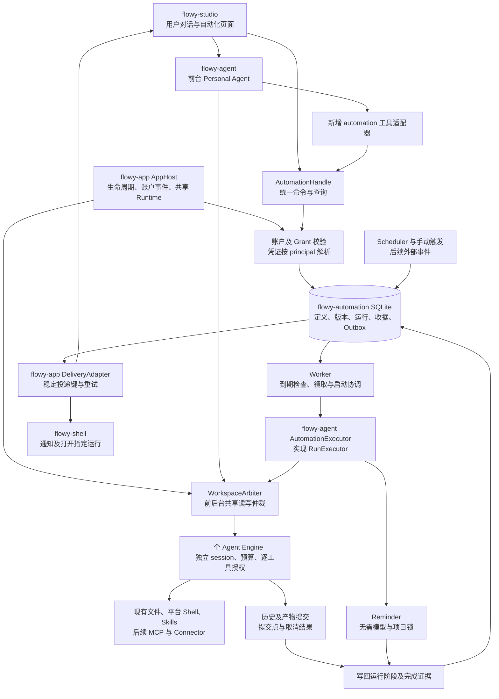

启动协调在 `flowy-agent` 的共享执行宿主中完成，前后台都经过相同工作区仲裁和执行容量检查。Reminder 直接产生持久结果，不调用模型，不获取项目锁。

### 2.2 Cargo 依赖

下图 A 指向 B 表示 A 依赖 B。`RunExecutor` 定义于 `flowy-automation`，由 `flowy-agent` 实现，避免反向 crate 依赖。

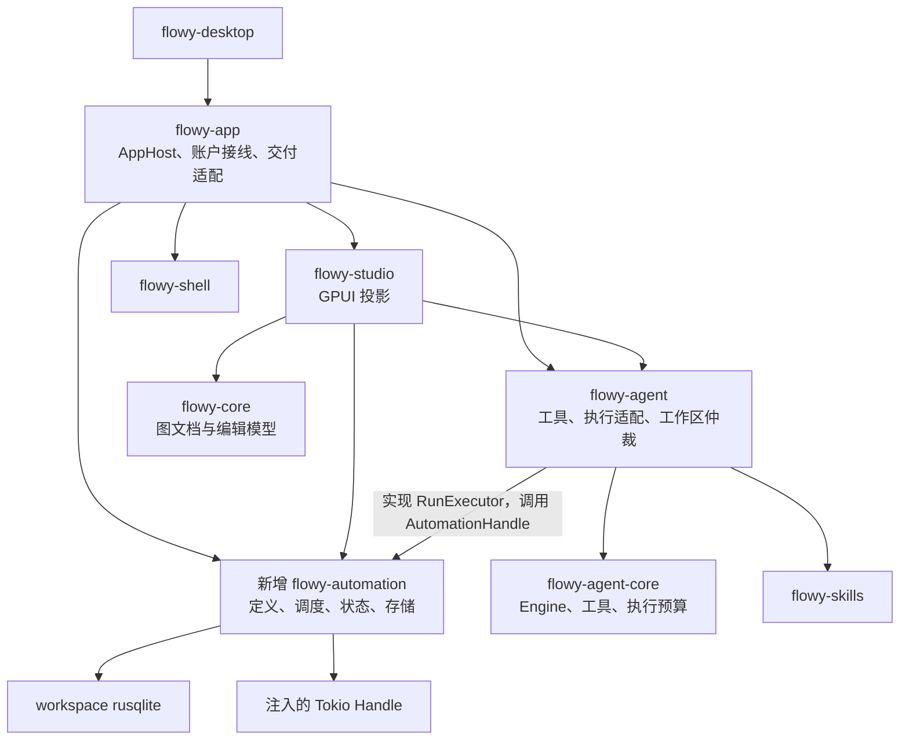

### 2.3 首版范围与不变量

首版支持 `AgentTask`、`Reminder`，以及手动、一次性、每日、每周触发。对话工具与管理页面同时接入。Interval、任意 Cron、外部事件、图执行器、独立 daemon 和云执行保留为后续阶段。

1. AppHost 在应用级创建一个共享 Agent Engine、一个调度所有者和受控 Runtime；StudioPanel 只接收句柄。
2. 对话创建成功必须以持久化收据为证据，模型不能仅凭生成配置宣称已保存。
3. 每次 Run 固定任务 revision、principal、来源、工作区、模型策略和能力请求；有效授权在执行前及每个工具调用时重验。
4. 保存的能力请求不会因切换账户、修改默认模型或当前项目而扩大。
5. 文件提交、运行终态、通知投递各有完成证据；通知失败不重新执行 Agent。
6. SQLite 和会话 JSON 没有共同事务，依靠稳定标识、提交证据和启动对账收敛。
7. 前后台写入同一工作区必须经过同一个仲裁器；单 session 的 RunFence 不替代资源仲裁。
8. 当前产品启动仍采用云账户和模型目录配置；本方案不通过环境变量或未接线的 BYOK 绕过账户策略。

## 3. 核心设计与执行契约

### 3.1 统一入口、数据与幂等

`AutomationHandle` 提供 `command(caller, request)`、`query(caller, request)`、`subscribe(caller)`。订阅仅通知失效或变化，重连后查询快照；后台模块不能依赖 GPUI 的事件泵推进状态。`start`、`shutdown` 由 AppHost 持有。

`CallerContext` 是宿主生成的类型，包含 principal、账户会话 generation、调用来源、宿主核准的 grant 引用及命令幂等键。LLM 参数不接受 `authorized=true` 或可伪造的 owner 字段。来源分为可信用户提交、UI 操作和已授权自动化派生调用。宿主在预先授予的自动化范围内核验命令；范围不覆盖时才保存待确认提案，用户已有明确委托时不强制重复确认。

命令幂等键由 principal、来源会话、submission、call_id 或稳定 UI request_id 构成，收据与修改在同一事务提交；再次处理同一命令返回相同结果。宿主请求 envelope 保存不可由模型修改的 issued_at、expires_at 和内容摘要，恢复同一请求沿用原 envelope；过期后拒绝执行，不能新造时间绕过过期收据。模型生成的新调用是新命令，语义重复需要另行判断。配置更新携带 `expected_revision`；已排队 Run 仍绑定不可变 revision，扩大授权不修改正在运行的快照。

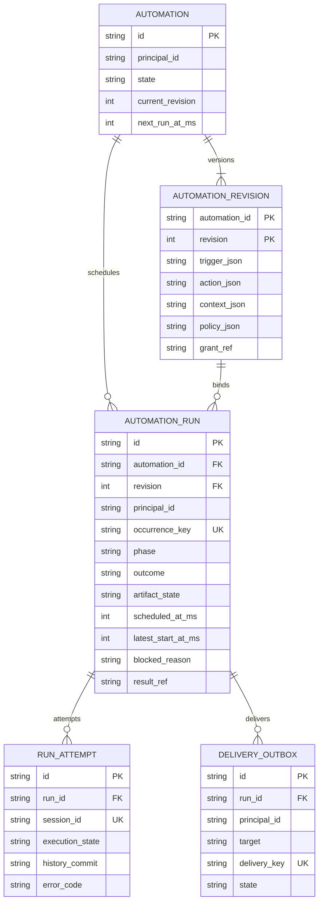

另有命令收据和清理计划表。授权与凭证属于宿主，以不含密钥的引用关联；数据库外键与查询必须校验账户归属。`AUTOMATION_REVISION` 的主键是 `(automation_id, revision)`，Run 引用整个复合键。`occurrence_key` 包含 automation_id、触发版本与原计划 UTC 时刻；手动执行使用命令 ID。重新入队复用原 key。

定义状态为 draft、enabled、paused、archived、suspended_storage；账户暂不可用属于执行依赖，不覆盖用户手动 paused 状态。所有表另存 created_at/updated_at、状态版本及审计时间；Run 保存 scheduled_at/latest_start_at、blocked_reason、next_recheck_at，Attempt 保存模型/工具计数、执行起点、截止时间、取消原因与提交引用。图示为实体关系摘要，实施 schema 必须包含这些恢复字段和索引。

| 配置 | 字段契约 |
| --- | --- |
| trigger | Manual、Once 或 Calendar；Calendar 保存 IANA 时区、每日/每周规则和 DST 策略 |
| action | AgentTask 的 prompt 与上下文摘要；Reminder 的提醒内容；不得把密钥写入 prompt |
| context | project/root、来源会话、必要资源引用、模型策略、技能 ID 与版本或内容摘要 |
| capabilities | 工具及资源请求、工作区访问模式、grant_ref；实际能力取当前有效授权交集 |
| policy | `overlap=skip`、misfire、最大迟到窗口、run budget、首版不自动重跑有副作用的失败 |
| delivery | 账户隔离的运行收件区及可选桌面通知；保存稳定 delivery_key |
| retention | Run、会话、工作目录与交付状态的保留期限和上限 |

每日/每周按本地日历时间计算，再保存 UTC 到期时刻；固定 Interval 和日历规则分别建模。DST 首版默认跳过不存在的本地时间，重复时间只取第一次，唯一 occurrence 使用最终选定的 UTC。UI 明示时区，默认取用户当前设置并固化到规则。

### 3.2 独立执行接口与完成证据

`RunExecutor` 是自动化与执行宿主之间的接口；以下类型是设计摘要，字段含义和成功条件构成接口契约，非可直接编译的代码。

| 类型或接口 | 必需输入或输出 |
| --- | --- |
| `RunSpec` | run_id、attempt_id、revision、principal、账户 generation、稳定 session_id、工作区、能力请求、模型与凭证引用、预算、latest_start_at |
| `RunExecutor::execute` | 输入 RunSpec、取消请求通道及阶段报告器；输出 RunCompletion；不得吞掉提交错误 |
| `RunProgress` | waiting_workspace、running、cancellation_requested、finalizing；携带 run/attempt 标识，便于幂等保存 |
| `RunCompletion` | execution_outcome、history_commit、artifact_state、提交或恢复引用、错误原因、结果引用 |
| `CancelDisposition` | accepted、too_late、already_terminal 或 storage_error；accepted 只表示请求受理 |
| `create_detached` | 创建不存在的 session 并持久绑定 run/attempt；存在则核对归属，绝不覆盖已有历史 |
| `start_detached` | 逐次 EngineConfig、来源、工作目录和预算；返回可等待完成结果，不修改 active |
| `reconcile_attempt` | 查询持久历史及产物提交证据，不启动模型，用于恢复与安全重试提交 |

`flowy-agent-core` 只使用通用执行来源与标识，不依赖 `flowy-automation` 类型。保留 `SessionOrigin::Home/Project/Unknown` 的现有含义，另加 `ExecutionSource::Automation { automation_id, run_id, attempt_id }`。Home 运行分配自己的目录，Project 运行绑定指定目录。

现有 `create_session_with_metadata` 内部使用 upsert，必须补 `create_if_absent`；`Engine::start_with_config` 可作为复用入口。现有 `retry_delivery` 依赖 UI 的 DeliveryFailed 投影，需抽取按稳定提交引用工作的宿主恢复接口，供 Worker 在无窗口时调用。

AutomationHandle 为轻量命令端；执行适配器不强持有 Runtime 整体，避免工具闭包、Agent 与 Runtime 之间形成 Arc 环。多窗口共享一个宿主，Agent 更新改为每订阅者独立的广播或版本快照，不能让多个面板争抢 `drain_updates`。

### 3.3 运行阶段、完成结果与取消

Run 的 `phase` 表示当前阶段；`outcome` 只在结算时填写。不要使用同一个 `failed` 同时表达模型失败、产物标记失败和系统通知失败。

| 维度 | 合法值 | 规则 |
| --- | --- | --- |
| Run phase | queued、blocked、waiting_workspace、running、cancelling、finalizing、interrupted、settled | settled 为不可逆终态；interrupted 为恢复待决状态 |
| Run outcome | succeeded、failed、cancelled、timed_out、budget_exceeded、skipped、expired、interrupted | 仅 settled 时存在；一次重试失败不覆盖此前 Attempt 记录 |
| Attempt execution_outcome | pending、completed、failed、cancelled、timed_out、budget_exceeded、interrupted | 表示模型或提醒动作的执行结果 |
| history_commit | not_started、committed、unknown | unknown 必须对账，不直接重新执行 |
| artifact_state | not_required、pending、committed、retryable_failed、abandoned | retryable_failed 留在 finalizing；abandoned 需要用户明确放弃未交付产物 |
| Outbox state | pending、retry_wait、suspended_account、delivered、suppressed、abandoned | 投递状态单独演进，不能让通知失败改变已结算的执行结果 |

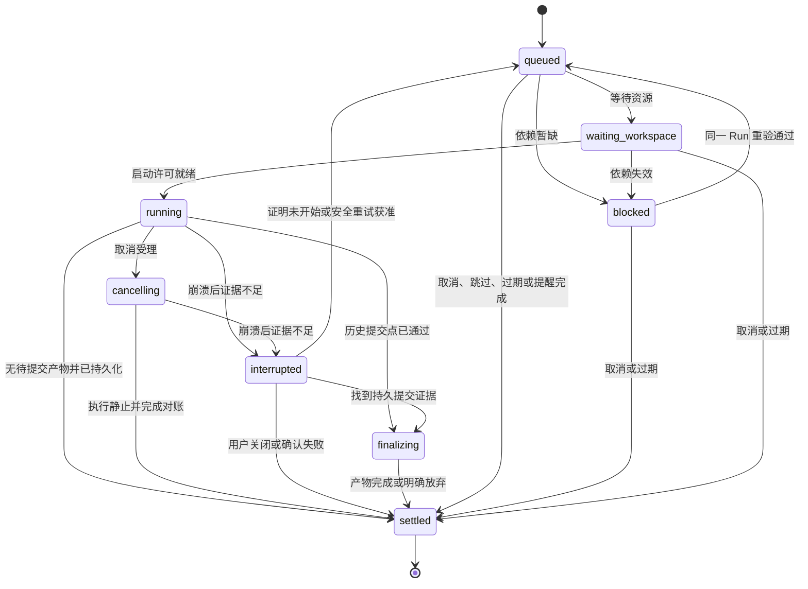

上图展示主要迁移，具体前置条件如下：

| 迁移或操作 | 前置条件与持久化动作 |
| --- | --- |
| queued → waiting_workspace | 依赖有效、未过 latest_start_at；仅登记启动候选，不占全局执行名额 |
| waiting_workspace → running | 原子获得工作区和执行容量，再验 principal/generation/预算；先保存 attempt 与 session 映射再启动 |
| 任一未开始阶段 → settled | 取消写 cancelled；迟到写 expired；重叠写 skipped；无模型或工具执行 |
| queued → settled，Reminder | 校验归属、启用状态及迟到窗口后，同一事务保存提醒结果、成功 outcome 和 Outbox；不创建 Agent session |
| running → cancelling | Engine 接受取消请求；保存取消原因，等待执行与工具静止后结算 |
| running → finalizing | 读取 Engine 的持久提交证据；不得依赖“阶段事件一定先写入 SQLite” |
| finalizing → finalizing | 标记失败或恢复重试；只重试同一产物提交，不创建新 Attempt |
| finalizing → settled | 产物全部提交；用户放弃则 outcome=failed、artifact_state=abandoned，并报告文件未交付 |
| interrupted → queued | 可证明模型/工具尚未开始，或经人工确认且满足安全重试要求；新 Attempt 保留原记录 |
| 任意终态投递 | SQLite 中事务写运行结算和 Outbox；同一 run/target 只有一个逻辑投递 |

成功条件：`execution_outcome=completed`，AgentTask 的历史已提交，且 `artifact_state` 为 `not_required` 或 `committed`。Reminder 无会话历史，使用 SQLite 中的持久提醒结果作为完成证据。模型失败时可结算 failed 并投递失败报告；不能声称未提交的文件已交付。

取消接口返回 `accepted` 仅表示发出了请求，UI 显示“正在停止”。Engine 返回 `too_late` 时保持 finalizing，直到提交结果到达。对已结算 Run 返回 `already_terminal`，不改写结果。所有取消回执携带相同 run_id 和可查询阶段；存储失败不冒充取消成功。

超时与调用预算用相同取消协议：记录 stop_reason，停止新增工作，调用 Engine 的取消入口；不得简单丢弃 `execute` future 或 abort Task。若取消时已越过提交点，继续提交，结果反映实际完成情况，并记录 deadline 已触达。工具尚未静止时，不释放其工作区写许可；宿主必须等待工具取消确认，或保守保留许可直到进程结束。

### 3.4 principal、授权、凭证与账户生命周期

`PrincipalId` 是带类型的稳定身份：云账户使用后端稳定 user_id；无稳定 ID 时不启用云账户后台执行。P0 创建的 Reminder 默认属于创建账户。预留 device-local principal 作为后续明确的本地提醒选项，不能调用账户模型、Connector 或读取其他账户上下文。迁移未知 owner 的任务时先隔离，不能在新账户登录后自动认领。

Automation、Run、Grant、命令收据、结果与 Outbox 均绑定 principal。`credential_ref` 至少绑定 principal、provider 和权限范围，由宿主在开始时解析；持久化及日志不含令牌。用配置快照固定任务行为，用当前账户与 grant 状态决定能否继续执行。请求权限 ∩ 当前有效 grant ∩ 宿主策略才是实际权限。

AppHost 维护账户会话 `generation`。登出、切换账户、授权撤销会推进 generation；旧执行请求、模型重试和后续工具调用必须重新校验。正常令牌刷新保留同一 principal，更新凭证引用；已经发出的网络请求无法撤回，取消协议只阻止后续工作并记录实际结果。

| 账户事件 | 必须完成的处理 |
| --- | --- |
| 启动，账户或目录尚未就绪 | 调度可创建到期 Run；执行进入 blocked，不调用 mock 或其他凭证 |
| 凭证到期、模型配置暂缺 | 停止新的账户模型请求；保存 reason，允许同一 principal 恢复依赖后重验 |
| 明确登出、切换 A → B | 先使 A 的执行授权失效并暂停领取，再取消 A 的可取消运行；B 不接管 A 的队列、结果或凭证 |
| A 正在 finalizing 时登出 | 仅完成本地历史及产物提交，不再访问账户模型或新工具；A 的结果通知暂存，不显示给 B |
| A 重新登录 | 先验证 A 的授权和模型，再按 Run 迟到规则恢复；绝不把旧 generation 当作有效会话 |
| 用户明确撤销持久 Grant | 保持撤销状态；重新登录不能自动恢复；需新的授权事件 |
| device-local Reminder | 按明确本地范围运行；如内容引用账户数据，必须仍归属该账户而不能标记为本地 |

数据库查询、订阅、通知点击和打开产物入口都检查 principal。对话明确委托可在既有范围内直接启用；扩大资源或持续执行范围时保存待确认配置。审批记录绑定命令内容摘要和 revision，确认后完成同一命令收据的合法状态迁移；不能因为幂等命中而永久停留在待审批，也不能执行确认后被替换的配置。

### 3.5 前后台工作区读写仲裁

`WorkspaceArbiter` 放在 `flowy-agent` 的共享执行宿主中。前台提交和自动化执行都经过它，不能只在后台 Worker 加锁。首版保守按整个 Run 的能力集合判断读写模式：

| 运行能力 | 仲裁方式 |
| --- | --- |
| 仅允许只读文件工具 | 工作区共享读许可 |
| 含 write_file、edit_file 或可写 Connector | 工作区独占写许可 |
| 含不能由宿主证明路径范围的通用 Shell | 设备级独占写许可，与全部宿主管理的工作区读写许可冲突；不按模型描述判断只读 |
| 不访问工作区的 Reminder | 无工作区许可 |

锁键使用规范化真实路径及平台大小写规则。同一物理目录的路径别名视为同一资源；父子目录范围重叠时也互斥，不能只按 project_id 相等判断。允许多个目录时，声明完整资源集合并按固定顺序原子申请，防止互锁。首版后台 Shell 默认关闭；明确授权启用时，未实现资源沙箱的 Shell 无论前后台都使用设备级写许可。显式授权本身不证明命令的路径约束，强隔离仍需对应沙箱；该仲裁只协调本宿主管理的任务，外部编辑器不受进程内许可控制。

候选任务在同一个短期启动协调区尝试取得完整工作区许可和执行容量；二者齐备才创建启动 ticket，失败则释放临时许可并排队。等待工作区的任务不长期占用全局并发槽。前台优先用于尚未启动的候选，后台使用有界防饥饿规则；首版后台并发默认 1，不同工作区可按容量并行。许可通过 RAII 管理，取消等待不泄漏资源。

许可覆盖模型可能继续写入的整个执行过程。只有工具已静止且 Engine 无后续工作才可释放；取消请求本身不是释放证明。出现崩溃疑似遗留 Shell 子进程时，不假定进程内锁仍提供保护；相关工作区进入待确认状态，确认旧写入者已停止后再恢复。独立 checkout 与变更回流留待确有需求时设计。

### 3.6 blocked 的恢复与迟到规则

blocked 只用于尚未开始模型/工具的 Run，保存 `blocked_reason`、时间和下次检查时间。执行中权限失效走取消/失败或 interrupted，不能重置成未开始并自动重跑。

| reason | 唤醒事件与再检查 |
| --- | --- |
| account_unavailable、credential_unavailable | 同一 principal 的登录或凭证恢复事件 |
| model_unavailable | 对应模型目录就绪；只使用任务允许的 fallback |
| approval_required | 原命令与 revision 对应的授权完成事件 |
| workspace_unavailable | 用户重选、目录可用事件或有退避的周期探测 |
| storage_unavailable | 存储恢复后重新读取权威状态；无法落盘时不启动 |

宿主事件只是唤醒提示，启动扫描及周期重扫防止漏事件。恢复顺序是：检查原 principal 与当前账户 → 当前 grant → 配置与资源 → latest_start_at → 同 Run CAS 重入 queued。身份不匹配继续隔离；明确撤权不自动恢复。重复事件不得新建 Run、Attempt 或重复写结果。

`latest_start_at = scheduled_at + max_lateness`，在创建 Run 时持久化。Once 提醒、日报等各自明示迟到窗口；窗口到期且未开始即 settled/expired。queued 和 waiting_workspace 也检查该窗口。Calendar 的 `run_once` 合并错过周期并保留所覆盖时段，`skip` 记录跳过；一个定义已有未结算 Run 时首版 `overlap=skip`，不得无限积压 blocked 任务。暂停只停止新的触发，现有 queued/blocked Run 可由用户按 ID 取消；删除定义归档时取消未开始 Run，正在执行的运行保留明确处理结果。

### 3.7 可执行预算与停止位置

预算属于 RunAttempt 的宿主状态，不依赖 LLM 遵守提示词。首版在 `TurnRequest/EngineConfig` 接入以下字段；值可由产品默认，但创建前展示并校验为正值：

```rust
// 设计契约，待在 agent-core 中接线。
pub struct RunBudget {
    pub max_execution_ms: u64,
    pub max_model_calls: u32,
    pub max_tool_calls: u32,
}
```

| 限额 | 计数与阻断位置 |
| --- | --- |
| 开始等待时间 | 用 latest_start_at 管理队列等待，不计入模型执行时限 |
| 总执行时限 | 在真正开始运行时计算截止时间，监视流和工具执行；恢复不能重新取得完整时长 |
| 模型调用次数 | 每次实际 provider 请求发送前预留，包括后续回合、重试和自动化内部附带的模型调用；超限不发送 |
| 工具调用次数 | 每个调用派发前计数；同一模型回合多个工具分别计数，超限不启动后续工具 |
| 预算触达 | 记录 budget_exceeded 或 timed_out 原因，并走 §3.3 取消及提交契约 |

`should_stop_after_turn` 等 loop hooks 与 provider 请求入口共同接线，不能只在工具 guard 检查。预算计数采用共享原子状态或宿主串行计数；循环异常继续尝试时仍不能越过 provider 入口检查。实际费用仅记录观测或估算；在 usage、定价与预留机制具备前，不承诺货币金额硬上限。

进入 finalizing 后，执行时限只留下触达记录，不截断已经成立的提交。提交重试采用有界退避，单次失败写 artifact_state=retryable_failed 后释放执行容量，继续保留可恢复证据，不创建新模型调用。只有确认没有工作区写入者后才释放工作区许可。首版不自动重跑有外部副作用的 interrupted 或失败 Attempt。

### 3.8 对话到执行及交付的时序

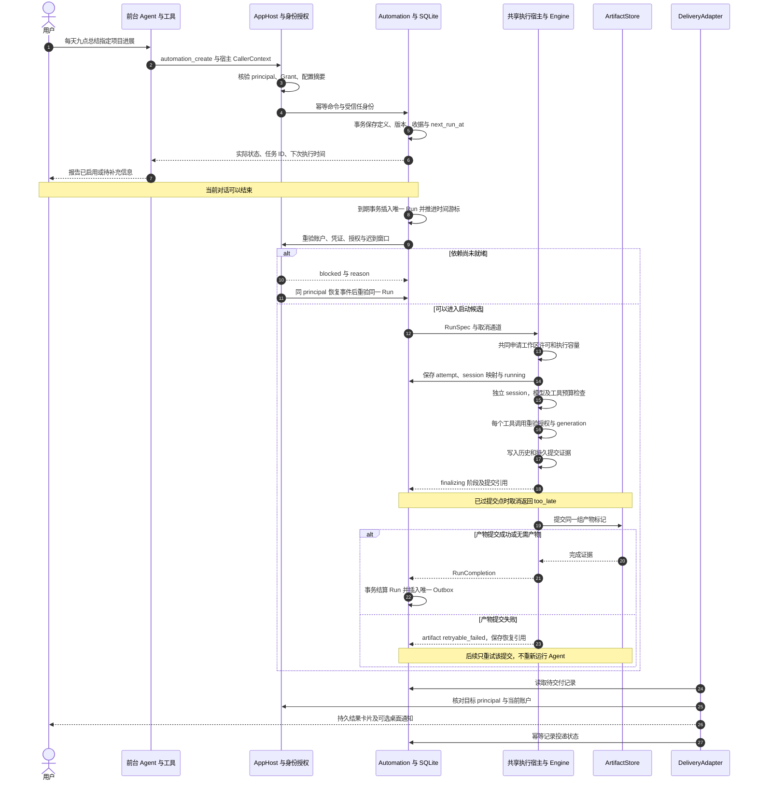

图中“无需产物”路径由执行宿主直接给出 `not_required` 证据，不实际调用 ArtifactStore。模型或工具失败时，同样保存失败结果并按失败消息类型入 Outbox。若依赖仍 blocked，不能继续执行图中启动分支；下次重验通过后才从该 Run 的候选阶段继续。

对话工具首版暴露：`automation_create/list/get/update/pause/resume/delete/run_now/history/cancel_run`；产物或通知失败后的 `automation_retry_delivery` 调用相同宿主恢复命令。放弃未提交文件属于明确用户命令，不能由失败重试自动决定。`run_now` 返回持久 run_id 后立即结束，不占着前台执行容量等待后台结果。

后台 Registry 不默认包含创建新自动化或修改管理配置的能力；已有持续委托确需授予时，附带来源链、深度与累计预算。Skills 提供执行指引及资源，定时与状态持久化仍属于自动化模块。条件触发后续以“时间或事件 + predicate”建模；图内 Condition 是流程分支，两者分开。

### 3.9 持久化、恢复对账与投递

数据继续位于现有 `store_root`：

- `automation/automations.sqlite3`：定义、不可变 revision、Run/Attempt、命令收据、Outbox、清理计划。
- `sessions/history.json`：由一个 Engine 持有的结构化历史，保留现有格式并追加兼容字段。
- `sessions/index.json`：聊天 UI 投影，不能作为执行完成的唯一证据。
- `artifacts/`：沿用现有 ArtifactStore 和提交/删除标记。

数据库访问在存储线程或受控 blocking 任务中执行；不在 GPUI 线程进行同步数据库 I/O。每个数据根只允许一个宿主持有调度和 Agent 存储所有权，启动使用进程级互斥；跨进程锁失败时连接或提示已有宿主，不再启动第二个 Engine。

关键写入顺序：

1. 事务校验自动化启用状态、触发版本与时间游标，写唯一 occurrence 和 Run，同时推进 next_run_at。内存 timer 只负责唤醒。
2. 任务获得启动许可后，先提交 attempt/session 映射及预算起点，再确保 session 存在；使用稳定 submission_id 启动模型。
3. 模型执行后以 Engine 历史提交和 ArtifactStore 标记作为事实源；阶段通知丢失不允许倒退提交点。
4. 以 CAS 更新匹配 run/attempt 的结算状态，并在同一 SQLite 事务内插入唯一 Outbox。
5. 投递成功只更新该 delivery_key；数据库回执失败不得重新执行模型。

启动顺序：取得唯一宿主所有权 → 打开数据库 → 完成 Agent 历史和产物的现有恢复 → 对账 Run → 恢复当前账户与模型 → 唤醒可执行任务。凭证初始化慢时可扫描到期任务并保存 blocked；存储或历史不可用时保守停止执行。

| 崩溃或错误位置 | 对账证据 | 恢复动作 |
| --- | --- | --- |
| 只有 queued/blocked，无 Attempt | SQLite 队列 | 重验依赖和迟到窗口后恢复原 Run |
| 已保存映射，session 不存在 | 映射完整且唯一宿主历史可正常读取 | 创建或重验该 session；历史损坏时不能据“找不到”认定未开始 |
| session 存在但无本次 submission | 历史完整、无开始证据、无旧执行主体 | 可确认未开始时恢复；不覆盖旧 session |
| 有 submission，无持久终态 | 状态为 Running/Stopped 或启动恢复已改投影 | phase=interrupted；不因 Stopped 或只读描述就自动重跑 |
| 有历史提交，产物标记未完成 | DeliveryCommit 及同组产物记录 | phase=finalizing，只调用原组提交恢复 |
| 产物已提交，SQLite 未结算 | 历史与产物完成证据 | CAS 结算并补唯一 Outbox，禁止再次调用模型 |
| 无产物，历史持久终态已完成 | 与 Attempt submission 对应的完整消息及完成证据 | 结算原 Run，补唯一 Outbox |
| Run 已结算，Outbox 未投递 | SQLite Outbox | 只重试通知，先检查 principal |
| 系统通知已发出，回执未保存 | 稳定 delivery_key | 允许至少一次重投并尽量由通知 tag 合并；不承诺操作系统恰好一次展示 |

运行阶段的取消、超时原因与预算用量尽可能先保存；证据不足时选择 interrupted，不猜测“没有副作用”。新的人工重试在未结算 Run 下创建新 Attempt；已结算的失败任务重跑创建带 `retry_of_run_id` 的新 Run，保留原终态。

无论正常唤醒、休眠恢复还是时钟变化，每次都比较当前 UTC 与持久 next_run_at，并在配置变更及定期扫描时重算等待。单次 Reminder 在事务内保存内容快照和成功结果，故崩溃后可从 SQLite 重建其 Outbox。模型或外部工具的副作用不具备 SQLite 事务保障，保持保守重试策略。

Outbox 唯一键至少包含 `principal/run_id/target/message_kind`，订阅或卡片引用 delivery_key，重复恢复只 upsert 同一逻辑卡片。后台结果默认进入独立运行收件区和结果会话，通过 source_session_id 关联创建对话，不插入另一个正在执行的 turn。A 账户的待投递项在 B 登录时进入 suspended_account，通知点击也重新验证身份。

### 3.10 首版历史保留与清理

自动化创建独立会话会增加整体 `history.json` 的序列化成本，保留策略从首版开始实施。建议默认保留最近 30 天且至多 500 个普通自动化会话/账户，以先触达者为清理候选；同时配置历史字节数、工作目录、产物和待投递记录的容量预算。具体默认容量属于产品配置，字段、正值校验与容量测试为 P0 必需。

自动清理只选择该 principal 的自动化来源会话。运行中、interrupted 待决、finalizing、未投递且仍需来源的数据，以及用户明确保留的结果均受保护；前台普通聊天不在自动化清理集合内。受保护数据也计入容量，达到硬配额时停止新运行并以已有定义的 suspended_storage 状态汇总原因，避免每次到期继续制造新 Run、日志或 Outbox。按事务推进及合并时间游标，恢复容量后仍按 misfire 规则处理。

清理按以下顺序执行，每步有稳定 deletion_plan_id，失败可重入：

1. 确认 Run 已结算、没有活跃 Attempt/提交/重试或受保护投递，保存清理计划；与新投递/打开来源操作协调。
2. 先保存最小 Run 摘要、时间、结果及 source_removed 标记；UI 可显示“详细记录已按保留策略清理”。
3. 通过现有会话及 ArtifactStore 删除协议清理关联历史、UI index 和未保留产物，禁止直接 unlink 正在被引用的产物。
4. 删除工作目录前核对归属，只能删除该自动化创建的私有目录；Project 的用户项目根目录绝不作为回收对象。
5. 确认跨存储清理完成，再完成计划并按配额回收详细 Run/Attempt、已终止 Outbox 和无引用 revision。

用户保留产物必须形成独立持久引用；若当前 ArtifactStore 不支持脱离来源会话保留，则整个相关会话视为受保护，不能强删。精简摘要、已交付 Outbox、清理计划和命令收据也设置保留或压缩上限，保持账户累计摘要和单调时间游标；收据过期后，过期请求只返回 REQUEST_EXPIRED，不重新当作新命令执行。自动触发永不倒退 next_run_at，历史清理不能造成旧 occurrence 重放。

### 3.11 本地生命周期与后续扩展

首版由应用级 AppHost 持有全部宿主模块，托盘下进程存活时继续调度；真正退出时停止领取，调用取消或收尾协议，有界等待并保存可恢复状态。已过提交点的运行不能伪装取消；未收敛的状态在下次启动对账。电脑关机时本地无法执行，启动与唤醒按迟到规则处理。

需要 GUI 退出后继续运行时，再增加唯一 headless host，GUI 经本地 IPC 调用它。Agent 历史、调度和执行均由该宿主拥有，桌面进程不再同时写同一组 JSON。云执行采用明确的远端执行适配器，并单独解决本地资源可达性和授权。

图执行器在后续通过同一个 RunExecutor 接入：`flowy-core` 增加有类型节点参数和版本，WorkflowCompiler 输出不可变执行计划，WorkflowExecutor 加入步骤记录和恢复点；长 Delay 持久化等待，不长期占用执行许可。

## 4. 关键决策、实施顺序与代码位置

### 4.1 决策与权衡

| 编号 | 决策点 | 选定方案 | 替代方案与取舍 |
| --- | --- | --- | --- |
| D1 | 自动化所有权 | 一个 `flowy-automation` 加应用级 AppHost | 将 timer 放在 StudioPanel 会随窗口消失；多个小基础设施 crate 使首版接线分散 |
| D2 | 对话入口 | 原生工具与 UI 共用 AutomationHandle | 先做管理页面再接对话无法覆盖 Personal Agent 的首版目标 |
| D3 | 首版动作 | AgentTask、Reminder | 可执行图需要节点参数、编译和恢复能力，放后续接入 |
| D4 | 执行适配 | 自动化定义 RunExecutor，agent 提供实现 | automation 直接依赖 agent 会与工具反向调用构成循环 |
| D5 | 数据存储 | 复用 rusqlite，保持 Agent 历史既有协议 | 全量迁移会话存储扩大本轮范围；用对账协议处理跨存储一致性 |
| D6 | 取消与交付 | 分离 phase、outcome、artifact 与 Outbox | 单一 status 无法表达已过提交点和通知失败 |
| D7 | 工作区并发 | 前后台共用保守读写仲裁 | 仅限制后台数量无法防止共享项目冲突；独立 checkout 需要变更回流 |
| D8 | 账户与权限 | 持久绑定 principal，逐次重验 grant | 默认配置切换不能撤销已捕获的凭证，也不能代表资源授权 |
| D9 | 首版可靠性 | 阻塞恢复、执行预算和保留策略同阶段实施 | 推迟这三项会导致冷启动挂起、不可控循环和累计历史成本 |
| D10 | 后台宿主 | 首版进程内，后续唯一 daemon | 同时启动两个 Engine 共享 JSON 破坏单一存储所有权 |

### 4.2 分阶段实现

P0 拆为依赖清晰的可验收步骤；直到全部完成才称为“首版自动化闭环”：

| 步骤 | 改动 | 完成条件 |
| --- | --- | --- |
| P0-A 共享执行宿主 | AppHost、runtime 注入、独立 session、账户 lifecycle、工作区仲裁、预算 | 前后台不同 session 可受控运行；TC-01、TC-06、TC-09、TC-12、TC-17 |
| P0-B 手动持久化运行 | 新 crate、SQLite schema/version、命令幂等、RunExecutor、对账 | 手动 Run 重启不丢失、不重复执行；TC-02、TC-03、TC-07、TC-08 |
| P0-C 对话工具 | automation 工具、CallerContext、授权/审批收据、版本检查 | 对话可完成创建、修改、启停与取消，均返回真实状态；TC-04、TC-05、TC-22 |
| P0-D 时间与恢复 | Once、每日/每周、misfire、blocked、迟到窗口、overlap | 冷启动依赖恢复、休眠、重复唤醒均按规则收敛；TC-15、TC-16、TC-21、TC-23 |
| P0-E UI、交付与保留 | 查询页面、运行卡片、通知路由、Outbox 重试、容量与清理 | 结果正确隔离、投递不重跑、历史有界；TC-10、TC-11、TC-19、TC-20、TC-24 |

P1 再加入 Interval、严格字段格式的 Cron、外部事件与 predicate、Connector/MCP、按工具幂等能力裁剪的安全重试，以及需要时的唯一 headless host。P2 加入可执行工作流和步骤级恢复。

### 4.3 建议目录与职责

```text
crates/flowy-automation/src/
  lib.rs              AutomationHandle 与生命周期
  model.rs            定义、版本、Run、Attempt、完成证据
  command.rs          命令、查询、身份引用与幂等收据
  service.rs          版本校验、合法状态转换
  store.rs            SQLite、事务、schema/version
  schedule.rs         日历规则、错过执行与唯一 occurrence
  worker.rs           队列领取、阻塞解除、状态持久化
  executor.rs         RunExecutor 与阶段/完成接口
  recovery.rs         启动对账与提交恢复协调
  retention.rs        容量检查、清理计划与摘要压缩

crates/flowy-agent/src/
  automation_tools.rs     ToolDefinition → AutomationHandle
  automation_executor.rs  RunExecutor → 独立 Engine 会话
  execution_host.rs       前后台共享启动容量与工作区许可
  workspace_arbiter.rs    路径规范化、读写与取消等待

crates/flowy-agent-core/src/
  engine.rs           独立会话、取消结果、提交证据
  loop_runner.rs      RunBudget、模型调用及回合停止
  tools/registry.rs   每次调用的权限及预算检查

crates/flowy-app/src/
  app_host.rs              宿主装配、账户事件与关闭收尾
  automation_delivery.rs   Outbox、通知及打开指定运行
```

账户校验由 AppHost 注入受信任快照和解析回调；不把认证 UI 或密钥存储塞进 automation。Trace 接入现有 `flowy-obs`，关联 principal 的脱敏标识、automation_id、revision、run_id、attempt_id、session_id、source_session_id、delivery_key。模型用量只记录允许的聚合字段，禁止记录凭证。

## 5. 验收标准与验证梯子

以下是待实现的验收矩阵，本次文档修订不代表这些测试已经通过。依赖模型的故障场景使用隔离的脚本化 stream 与测试目录，不向生产状态写入 mock 配置或回显兜底。

| 编号 | 场景 | 必须断言 |
| --- | --- | --- |
| TC-01 | 前台聊天期间创建独立运行 | active session、项目选择和当前 turn 不变，来源标识正确 |
| TC-02 | 创建成功后关闭并重启 | 定义、revision、触发规则与队列均恢复 |
| TC-03 | 重复提交同一命令，数据库已提交但响应丢失 | 返回同一收据、同一 automation_id/run_id；收据过期返回 REQUEST_EXPIRED |
| TC-04 | 用户明确委托与 Agent 自行提议分别创建 | 已授权委托可直接启用；缺授权提案不自行执行 |
| TC-05 | UI 与对话同时修改同一配置 | expected_revision 冲突可解释，不能静默覆盖 |
| TC-06 | 历史提交后挂住产物标记，再取消或超时 | 返回 too_late、保持 finalizing，不错误报告取消成功 |
| TC-07 | 在写映射、写 submission、历史提交及 SQLite 结算等处分别崩溃 | 按证据对账；不覆盖会话、不重复模型和外部工具 |
| TC-08 | 产物提交失败、通知失败分别重试 | 前者只重试提交，后者只重试投递；原 Attempt 不重跑 |
| TC-09 | 后台执行中登出 | 账户授权先失效、无新请求，已启动任务按取消/提交协议收尾 |
| TC-10 | A 的队列与通知待处理时切到 B | B 看不到 A 的私有结果；不使用 B 凭证运行 A 的任务 |
| TC-11 | 账户凭证刷新、重新登录、明确撤权 | 同主体可按规则恢复；撤销 Grant 不因登录重新生效 |
| TC-12 | 同一项目两个 session 尝试写入 | 前后台均经过独占许可，不发生宿主管理任务的并发写 |
| TC-13 | 路径别名、父子目录、不同项目与只读并发 | 重叠资源互斥；独立资源允许并发；未约束 Shell 走设备级写许可 |
| TC-14 | 取消等待资源的任务或执行中工具尚未退出 | 无执行槽泄漏；工具未静止时不放行冲突写任务 |
| TC-15 | 启动先无凭证/模型，稍后恢复且重复发就绪事件 | 同一 Run 从 blocked 重入，只开始一次；不调用 mock |
| TC-16 | blocked 或等待资源跨过 latest_start_at | 结算 expired，不再补跑过时提醒 |
| TC-17 | 模型连续产生工具调用及后续回合 | 达模型/工具调用上限后不再发送请求或派发新工具 |
| TC-18 | 执行 deadline 与 finalizing 同时触达 | 按提交点决定可否取消，终态和停止原因一致 |
| TC-19 | 超过历史年龄、数量与字节配额 | 仅清理可回收自动化历史，前台与保留结果可用；保护数据超额停止新运行 |
| TC-20 | 清理每一步后崩溃，产物有用户保留引用 | 清理可重入，摘要可解释，项目根目录和保留产物不被删除 |
| TC-21 | DST 重复/不存在时间、时区变更、系统时间回拨、休眠 | occurrence 唯一、规则明确、next_run_at 不产生重放 |
| TC-22 | 待确认命令被批准，或确认后配置被替换 | 同一有效内容合法推进收据；摘要/revision 不匹配需重新确认 |
| TC-23 | 重叠触发、暂停、取消与归档 | overlap=skip；暂停不假装取消；归档取消未开始 Run |
| TC-24 | 通知已发但回执失败，多窗口重连 | 持久卡片不重复；系统通知承认至少一次；每个窗口可查询完整状态 |

验证顺序：

1. `flowy-automation` 模块接口测试：状态转换、事务、幂等、时间、blocked、清理计划；注入时钟，无需真实等待。
2. `flowy-agent-core`：预算、取消提交点、持久完成证据；保留现有交付与取消回归测试。
3. `flowy-agent`：独立会话、共享工作区仲裁、脚本化执行、跨存储故障恢复。
4. `flowy-app`：账户切换、AppHost 生命周期、Outbox 交付及多窗口投影。
5. 分别运行受影响 crate 的 `cargo check -p <crate>` 和 `cargo test -p <crate>`；不并行执行 Cargo 构建/测试。
6. 全部改动稳定后再运行 `cargo fmt --check`、工作区检查及该 GPUI 工作区配置的质量门禁；文档更新检查 Mermaid 渲染和历史归档完整性。

本次交付为 V2 文档及配套图源。生产代码、schema 和运行时验收均在上述后续步骤实现。

---

<!-- FLOWY_ARCHIVE_START -->
## 附录 A：原始技术底稿与历史归档

> 归档说明：以下逐字保留 V1 原始架构文档。历史决策供追溯，当前执行契约以 V2 正文为准。原审查报告中的行号对应本目录 history/v1 下的独立快照。

<details>
<summary>展开 V1 架构原文</summary>

# Flowy Personal Agent 与自动化架构

状态：建议方案，尚未实现。基于 2026-11-25 的 flowy18_wip 实际代码。

目标：Personal Agent 在对话中主动选择并调用工具，创建、查询、修改、暂停、恢复、立即运行自动化；对话结束后，Rust 宿主根据持久化规则触发独立执行，并交付结果。

## 1. 核心决策

1. 对话工具和 Automation 页面同时作为首版入口，调用同一个 AutomationHandle。
2. 新增一个 flowy-automation crate；调度、排队、运行状态和恢复均在其内部。首版不拆分多个后台基础设施 crate。
3. 自动化首版支持 AgentTask 和 Reminder。AgentTask 保存提示词与明确上下文，无须先建设可执行工作流图。
4. 复用 flowy-agent-core::Engine。flowy-agent 增加不改变活动聊天选择的后台执行接口。
5. flowy-app 持有应用级 AppHost；StudioPanel 接收共享句柄。服务和 Tokio runtime 生命周期不依赖某个窗口。
6. 通过 flowy-automation 定义的 RunExecutor 接口注入执行能力。flowy-automation 不依赖 flowy-agent，避免 Rust crate 循环。
7. 用户已明确委托的任务可以直接保存并启用。Agent 自行提出的持续任务，在没有对应委托时保存提案。权限检查由 Rust 宿主执行。
8. 首版进程内运行；独立 daemon 和云执行均为后续扩展。

## 2. 当前实现与需要补齐的地方

| 位置 | 当前事实 | 本方案中的调整 |
| --- | --- | --- |
| flowy-studio/src/automation.rs | AutomationDraft 只有提示词和启动方式；发送按钮 disabled(true) | 接入管理句柄、列表、配置摘要、运行记录 |
| flowy-agent-core/src/tools/registry.rs | 已有 ToolDefinition、ToolRegistry、Policy、guards | 注册自动化原生工具；为每次运行构造带宿主上下文的策略 |
| 同上 | ApprovalRequired 目前被转成工具错误 | 增加宿主待确认记录与交互，确认后按同一命令收据重新提交 |
| flowy-agent/src/handle.rs | create_session 会切换 active；submit_chat 面向活动会话 | 增加 create_detached / start_detached；按 session_id 取消和查询 |
| flowy-agent-core/src/engine.rs | start_with_config 已接收显式 session、prompt 和逐次配置 | 作为后台执行的核心调用点，补充幂等创建会话接口 |
| flowy-agent-core/src/session.rs | SessionOrigin 是 Home / Project / Unknown | 保留原义，另加 ExecutionSource 和运行标识 |
| flowy-agent/src/publish_tool.rs | publish_file 明确要求 Home 归属及交付上下文 | 自动化产物沿用已有提交机制，并显式校验运行来源 |
| flowy-core/src/model.rs | 图节点目前只有种类、文案、位置等编辑数据 | 后续增加有类型执行参数及编译校验，届时接入 Workflow 动作 |
| flowy-agent/src/handle.rs | Harness 创建并拥有 Tokio runtime | 创建上移到 AppHost，向宿主模块注入共享 runtime Handle |
| flowy-shell/src/notify.rs | 当前通知接口专用于更新通知 | 增加自动化通知及按 run_id 路由的点击处理 |

首版不把现有图文档解释成已经可运行的流程，也不把图编辑器作为对话自动化的前置依赖。

## 3. 总体运行架构

下面的箭头表示运行时调用或数据流，不是 Cargo 依赖。标为“新增”的接口与模块均属于本方案；虚线节点为后续能力。

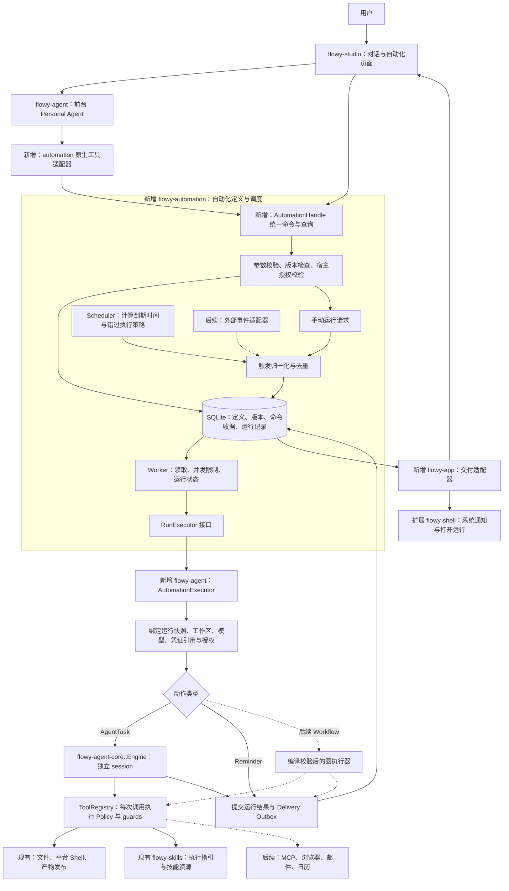

AppHost 负责装配图中各模块，持有服务及 runtime，在窗口重建时继续存活。Skills 为执行提供指引；模型从已注册能力中选择工具。后续 Connector 接入同一个工具执行接口。

## 4. Cargo 依赖与接口归属

下图中 A 指向 B 表示 A 依赖 B；标注“实现接口”表示 trait 的定义位于被依赖 crate。

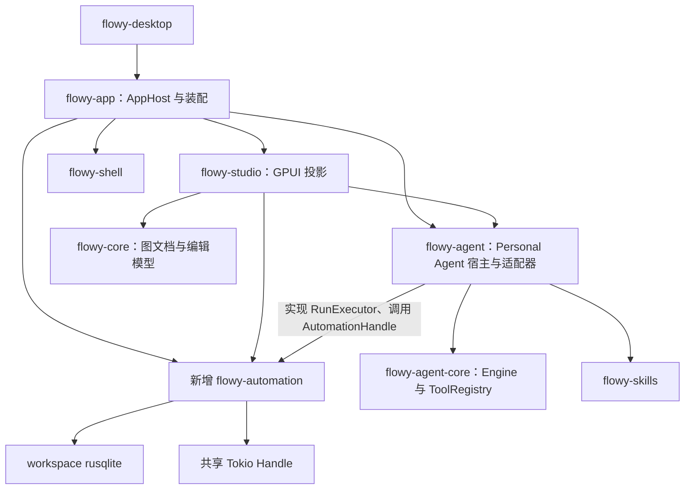

flowy-automation 的公开接口保持小而完整：

- command(caller, request) -> receipt：创建、修改、启停、删除、立即运行、取消运行。
- query(caller, request) -> snapshot：列表、详情、历史及状态。
- subscribe() -> changes：只用于提示 UI 刷新；重连后仍从 query 获取完整状态。
- start / shutdown：仅由 AppHost 调用，业务调用者拿不到生命周期控制权。

RunExecutor 也由 flowy-automation 定义，例如 execute(RunSpec, cancellation) -> RunOutcome。AutomationExecutor 在 flowy-agent 中实现；它复用同一个 Engine 与存储实例。

automation_create 等 ToolDefinition 留在 flowy-agent，不放进 flowy-agent-core。Core 只接收通用工具和逐次执行配置。

AutomationHandle 可是轻量命令发送端；不要让工具闭包持有 AutomationRuntime 整体。执行适配器使用显式生命周期或 Weak 引用，防止 Runtime、Agent、工具闭包之间产生 Arc 所有权环。

## 5. 对话管理与后台执行的完整时序

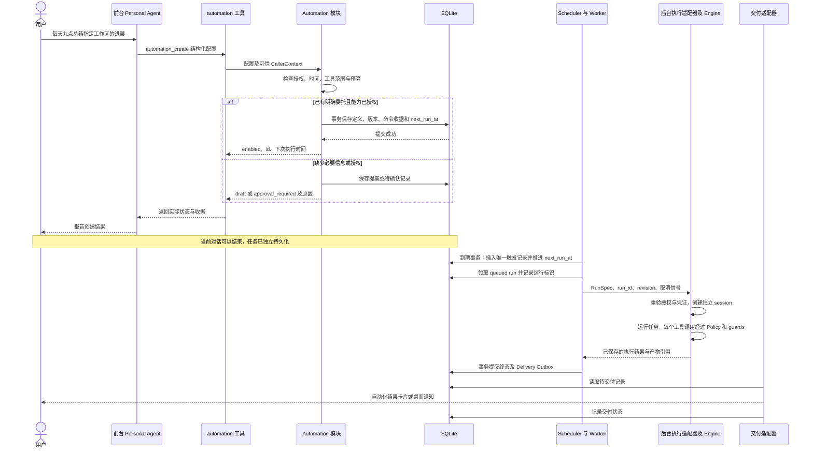

工具返回成功的前提是定义已落盘。模型不能在仅生成配置时宣称“已创建”。automation_run_now 只返回 run_id，任务交由后台 Worker 执行，避免当前对话占着执行名额等待另一个执行名额。

后台结果以自动化运行卡片交付，并可打开独立会话。source_session_id 可用于关联创建对话；默认不把新执行结果插入用户正在进行的另一个 turn。

## 6. 原生工具与主动性的边界

首版直接提供下列工具，避免必须打开 Automation 页面才能完成操作：

| 工具 | 行为 |
| --- | --- |
| automation_create | 创建并按宿主确认的授权状态启用，或保存提案 |
| automation_list | 查询定义和简要状态 |
| automation_get | 获取完整配置与当前 revision |
| automation_update | 按 expected_revision 修改配置 |
| automation_pause / automation_resume | 停止或恢复未来调度 |
| automation_delete | 停用并归档定义，保留运行历史 |
| automation_run_now | 插入待运行记录并返回 run_id |
| automation_history | 获取执行记录和结果引用 |
| automation_cancel_run | 取消某个 run，和暂停未来调度区分 |

工具较多时可以按用途分组发现，后端仍使用同一命令接口。首版无需增加通用 CLI 或 MCP Server 才能让自有 Agent 使用。

“主动”有三个层次：

1. 在当前对话中主动选择工具：模型依据用户目标选择查询、创建或修改。
2. 在已授权范围内主动执行：例如用户要求“每天九点总结”，宿主确认范围后可直接启用，不强制再点一次确认。
3. 在没有当前对话时主动运行：由已保存的时间规则或后续事件规则启动新的 Run。应用没有任何运行主体时，模型不会自行醒来。

若只是“现在帮我读这个文件”，使用当前会话的普通文件工具即可；只有持续执行、延后执行、保存为可复用任务等意图才创建 Automation。

Agent 自行建议“以后每天都检查”时，缺少对应持续委托则返回提案；已有持续委托覆盖该行为时按授权执行。CallerContext 由宿主注入，LLM 参数不能把自己标记为已授权。

## 7. 自动化定义、运行快照与状态

Automation 定义回答“以后做什么”，AutomationRun 回答“这一次实际发生了什么”。修改定义不改变已经排队或正在运行的快照。

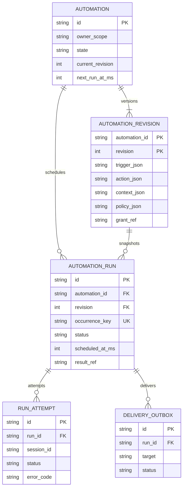

另有命令收据表，用于对话工具或 UI 重试时复用同一结果；授权记录由宿主拥有，以 grant_ref 引用，不把密钥放进定义。

命令幂等键由宿主稳定生成，可使用 owner_scope、source_session_id、submission_id 和 call_id 的组合。它用于去重同一个工具调用的传输或恢复重试；模型另外生成的新调用仍是新命令，不能据此声称能够识别全部语义重复。更新同时携带 expected_revision，避免 UI 与对话相互覆盖配置。

| 配置部分 | 内容 |
| --- | --- |
| trigger | Manual、Once、Calendar；后续 Interval、Cron、Event |
| action | 首版 AgentTask、Reminder；后续 ToolTask、Workflow |
| context | 工作区绑定、必要的任务摘要、引用的资源、来源对话、模型策略 |
| capabilities | 工具与资源范围的请求；有效权限须与宿主授权取交集 |
| policy | 超时、步数与费用预算、重叠策略、错过执行策略、失败策略 |
| delivery | 自动化运行收件区、桌面通知；后续经授权的外部渠道 |

Trigger 的时区属于规则本身；运行时刻以 UTC 保存。Calendar 表达每日/每周本地时间，单独定义夏令时重复与不存在时间的处理。固定 Interval 与日历时间分别建模。

条件触发应建模为“时间或事件 + predicate”。例如价格检查是定时获取数据后判断，或由可信报价事件携带数据后判断；不能只保存一句条件等待模型自行监听。图内 Condition 节点则是执行步骤中的分支，两者职责不同。

Run 生命周期建议为 queued → running → succeeded / failed / cancelled / timed_out；执行前暂缺凭证或授权可进入 blocked。崩溃中断的执行标为 interrupted，不能直接冒充成功或重新当作尚未开始。RunAttempt 保留每一次实际尝试；重跑不覆盖原始记录。

## 8. 独立执行、上下文与文件交付

给 flowy-agent 增加以下宿主能力，名字仅表达建议接口：

- create_detached(SessionSpec)：显式传入 session_id、来源和工作区，确保不存在才创建，不切换 active。
- start_detached(RunSpec)：逐次注入 EngineConfig、工具清单、模型、取消信号，返回可等待的结果。
- cancel_session(session_id)、session_status(session_id)：按目标会话操作。

现有 Engine::create_session_with_metadata 内部会 upsert，重复调用可能替换已有记录。因此恢复时不能把它当作幂等 ensure；需要 create_if_absent，已存在时核对运行标识并复用或报错。

SessionOrigin 的 Home / Project 表示产物与工作区归属，继续保留。另加 ExecutionSource::Conversation 或 Automation { automation_id, run_id, attempt_id }；core 类型只使用通用标识，不反向依赖 flowy-automation 的类型。

每次运行固定如下输入：定义 revision、工作区、必要上下文快照、模型策略及解析后的模型标识、技能引用、有效授权和凭证引用。凭证在执行前由宿主解析；不可在 JSON 或对话里保存 API key。模型不可用时按显式 fallback 策略或 blocked 处理。

Home 自动化使用自己明确分配的会话目录；项目自动化绑定指定 project。目录不可用时返回清晰状态，不静默切到当前项目。

后台 Registry 的有效权限为：自动化请求范围 ∩ 用户当前有效授权 ∩ 宿主策略。保留通用 Shell 时，单纯限制文件工具不能形成文件系统隔离；如需强隔离，必须给 Shell 增加对应沙箱或禁用其后台权限。

后台不默认授予 automation_create / update / run_now 等管理能力；确有用户委托时可以授予，并附带来源链、深度和总预算，防止自动化无界创建自动化。权限在工具执行入口生效。

交付文件沿用现有 ArtifactStore、publish_file 和 DeliveryCommit 机制。只有执行结果与产物提交均满足成功条件，才能对用户报告文件已交付。Project 产物沿用现有支持范围，不因新建 Automation 绕过限制。

## 9. 持久化调度与恢复规则

数据建议放在现有 store_root 下：

- automation/automations.sqlite3：自动化定义、不可变版本、运行记录、命令收据和交付 outbox。
- sessions/history.json：继续由现有唯一 Agent Engine 管理结构化历史。
- sessions/index.json：继续作为聊天 UI 投影。
- artifacts/：继续由现有 ArtifactStore 管理。

首版一个 AutomationRuntime、一个调度所有者。SQLite 在专用存储执行线程或受控 blocking 任务内访问，不在 GPUI 线程做数据库 I/O。

每个数据根确保一个进程拥有调度权，多窗口只共享句柄。定时等待仅负责唤醒：每次都对比持久化 next_run_at 与当前 UTC，并在配置变更、休眠恢复和定期重扫时重新检查，不能靠累计 tick 推算执行次数。

关键持久化步骤：

1. 到期时，在一个事务中记录唯一 occurrence、插入 queued run 并推进 next_run_at；重复唤醒复用 occurrence_key。
2. Worker 领取 run 前绑定定义快照、run_id 和 attempt_id；队列以数据库记录为准，内存通知仅用于唤醒。
3. 先保存运行与 session_id 映射，再确保会话存在，再开始模型执行。可由 run_id 与 attempt_id 确定稳定 session_id。
4. 不声称 SQLite 与会话 JSON 之间存在跨存储原子事务；启动时按映射和 session 状态对账。
5. 完成后，在一个数据库事务内提交运行终态和待交付 outbox；通知失败只重试交付，不重新执行任务。

对于自动补跑，首版建议 skip 与 run_once：后者合并错过周期为一次，并限制最大迟到时间。一次性提醒和日报可有不同迟到窗口。catch_up 留待明确需求后实现，并限制次数。

并发建议后台默认 1，前台保留执行容量；前台优先作用于尚未开始的候选任务。Worker 不占着执行名额等审批，也不持有数据库锁等待模型或外部工具。

已有外部副作用的 interrupted run 默认不自动重跑。只有能确认尚未开始，或相应工具提供幂等保障时，才允许自动重试。run 去重不等于邮件发送等外部行为恰好发生一次。

pause 只停止未来触发；cancel_run 取消指定运行；delete 停用并归档定义。更新定义和扩大授权不能悄悄改变已运行任务的快照。

应用退出时停止领取新任务、请求运行取消或收尾、保存状态并有界等待；下一次启动继续对账。前后台共同使用同一个 Engine 实例和唯一存储所有者，不创建两个 AgentHandle 同时写同一组历史文件。

## 10. 本地运行与后续 Daemon

首版由 AppHost 在 Flowy 进程内持有自动化模块。托盘下进程仍存活时可继续执行；真正退出后暂停本地执行。休眠恢复与重新启动时按持久化规则检查错过的任务。电脑关机时本地没有执行主体。

后续要支持 GUI 进程退出后运行，再增加 headless host。届时该进程成为 Agent 历史、调度与运行的唯一所有者；GUI 经本地 IPC 调用它。不能在桌面与 daemon 两边分别启动 Engine，共享同一组 JSON 文件。云执行是另一种执行适配器，同时需要明确本地目录和本地工具如何可达。

## 11. 分阶段实现与验收

### P0：对话式自动化完整闭环

- 新增 flowy-automation：定义、命令/查询、SQLite、RunExecutor、运行状态与 outbox。
- 应用级 AppHost 创建共享 AgentHandle，并注入 StudioPanel；补齐独立会话创建和执行。
- 对话立即接入 automation 工具；UI 接入相同句柄。
- 支持 AgentTask 和 Reminder，Manual、Once、每日/每周规则。
- 支持并发限制、超时、取消、启动对账、run_once、运行结果卡片。
- 已委托的任务可直接启用；对缺失授权返回明确状态。

验收：创建后结束对话并重启，定义仍存在；重复提交相同命令不会重复创建；后台执行不改变当前 active session；暂停未来触发与取消当前运行互不混淆；通知失败不重跑任务；无凭证时不使用 mock 回显冒充成功。

### P1：可靠性和触发扩展

- Interval、严格约定字段格式的 Cron、外部 Event 及 predicate。
- 连续失败策略、带上限的安全重试、运行保留与历史清理。
- Connector / MCP 工具按实际接入情况注册，权限与凭证统一注入。
- 若产品需要关 GUI 后运行，落地独立 headless host 与单一存储所有权。

### P2：可执行工作流

- flowy-core 增加类型化节点参数及版本。
- WorkflowCompiler 将文档校验为不可变可执行计划。
- WorkflowExecutor 通过相同 RunExecutor 和 ToolRegistry 执行，加入步骤记录与恢复点。
- 长 Delay 持久化为等待状态，不占用线程长期 sleep。

## 12. 源代码核对位置

仓库：C:/code/flowy/allo/flowy18_wip

- crates/flowy-studio/src/automation.rs:40、500：现有草稿与禁用的提交按钮。
- crates/flowy-agent/src/handle.rs:156、220、1064、1238、2690：宿主、runtime、活动会话、发送入口、工具注册。
- crates/flowy-agent-core/src/tools/registry.rs:90、116、221：策略、工具注册、待确认错误。
- crates/flowy-agent-core/src/engine.rs:227、255、432：会话创建、upsert 与逐次运行配置。
- crates/flowy-agent-core/src/session.rs:21、83：SessionOrigin 与持久化 SessionRecord。
- crates/flowy-agent/src/publish_tool.rs:75：Home 归属和交付条件。
- crates/flowy-core/src/model.rs:168：当前节点编辑模型。
- crates/flowy-shell/src/notify.rs:9：当前更新通知实现。

本文件是架构建议与图源，不代表生产功能已接线，也没有修改项目源码或数据库。

## 13. 建议的实现目录

```text
crates/flowy-automation/src/
  lib.rs          AutomationHandle 与生命周期入口
  model.rs        Automation、Revision、Run、RunSpec
  command.rs      命令、查询、CallerContext、收据
  service.rs      定义修改与状态转换
  store.rs        SQLite、事务、幂等与版本
  schedule.rs     日历规则、到期计算与补跑
  worker.rs       领取任务、并发与取消
  executor.rs     RunExecutor 接口
  recovery.rs     启动对账与中断恢复

crates/flowy-agent/src/
  automation_tools.rs      ToolDefinition → AutomationHandle
  automation_executor.rs   RunExecutor → 独立 Engine 会话

crates/flowy-app/src/
  app_host.rs              单一宿主、共享 runtime 与关闭收尾
  automation_delivery.rs   Outbox → UI、系统通知与打开运行
```

这些是建议的目标位置；实际拆文件随实现规模调整。Tracing 在现有 flowy-obs 管线中记录 automation_id、run_id、attempt_id、session_id 与 source_session_id，使对话命令、后台运行和交付能够关联。

</details>

## 附录 B：V1 审查报告原文

> 以下逐字保留审查发现及原修订建议；V2 的响应位置与验收映射见正文 §1。

<details>
<summary>展开 V1 审查报告原文</summary>

# 自动化架构计划审查

审查日期：2026-11-25。对象：同目录 personal-agent-automation-architecture.md。

结论：模块拆分、统一管理入口和独立执行会话的方向可行。当前计划仍缺少关键执行契约；建议先处理以下 3 项 P1，再补齐 3 项 P2。下列问题是计划中的实现缺口，不表示未实现的自动化功能已经造成生产故障。

## 1. [P1] 运行状态必须表达产物提交与取消的提交点

计划位置：257、279、298–300 行。代码证据：flowy-agent-core/src/engine.rs:374、684、703、715、744；现有 cancel_after_delivery_history_commit_cannot_undo_finalization 测试直接覆盖此行为。

计划将 Run 简化为 running → succeeded / failed / cancelled / timed_out，启动恢复按会话状态对账。但现有 Engine 先把会话写成 Completed，再提交 ArtifactStore 标记；这期间 request_cancel 返回 false，产物提交失败还可能返回 RunError::Storage。因而会话 Completed 不能单独证明任务已经完成全部交付，超时也不能无条件把 Run 改成 timed_out 或直接丢弃执行 future。

建议：RunOutcome 明确区分模型执行结果、历史提交、产物提交和通知交付。补充 finalizing 或等价阶段，以及 cancellation_requested / cancellation_rejected 的接口结果；交付重试调用既有 commit 恢复接口，不重新运行 Agent。启动对账需明确先恢复 Agent 产物提交，再根据完成证据更新 SQLite 和 Outbox。

验收：在历史提交后阻塞产物标记，取消和超时都不能错误报告已取消；此处崩溃后只恢复提交；产物提交失败不重复执行模型和外部工具。

## 2. [P1] 定义账户归属、退出和切换账户时的后台行为

计划位置：200–214、271、310 行。代码证据：flowy-app/src/app/mod.rs:365、1389；flowy-agent/src/handle.rs:1319。

计划已有 owner_scope 和凭证引用，但未定义它们如何绑定稳定的账户主体，也未覆盖登出。当前 sign_out 只调用 agent.stop() 停止活动会话，随后替换默认配置；执行中的逐次配置已经复制。新增 detached 会话后若直接沿用此流程，后台执行不会因为清空默认配置而自动停止。切换账户后也需要防止旧账户任务解析到新账户凭证。

建议：给 Automation、Run、Grant 和 credential_ref 明确相同的 principal 归属。AppHost 处理账户失效、退出和切换：停止领取相关任务、撤销对应后台授权、请求取消可取消的运行；已进入不可取消提交阶段的任务只完成提交。新账户登录不得自动接管旧任务。可离线执行的本地提醒单独定义账户依赖。

验收：后台执行期间登出、A 账户排队后切换 B 账户、凭证刷新或撤销，以及退出时正在 finalizing。

## 3. [P1] 并发控制需要覆盖相同工作区的前后台写入

计划位置：273–275、304 行。代码证据：flowy-agent-core/src/run_fence.rs（按 session 独占）；flowy-agent/src/handle.rs:1335（不同 session 可绑定同一个项目目录）。

后台并发为 1 且前台另有容量，会允许两个不同 session 同时修改同一项目。现有 RunFence 只保护单会话；ToolPolicy 和目录范围检查也不解决同一文件的写入冲突。前台改文件时后台执行整理或修复可能覆盖修改，Shell 也可能改变同一个 Git 索引。

建议：为前后台共同定义工作区并发规则。首版可让相同规范化工作区的写任务串行，明确只读任务可并行；允许通用 Shell 的任务保守按可写处理。等待工作区许可不得长期占用全局执行名额。若选择独立 checkout，说明修改回流及外部目录访问的规则。

验收：同一项目两个 session 并发写入被串行，不同项目可并发；取消等待中的任务不泄漏执行许可。

## 4. [P2] blocked 状态缺少重新入队与过期规则

计划位置：257、271、302 行。代码证据：flowy-app/src/app/mod.rs:372（启动先创建 disconnected_config，再由云目录配置可用模型）。

冷启动时任务可能先到期、凭证和模型稍后才就绪。计划允许进入 blocked，但未说明由何事件恢复、恢复同一个 Run 还是新建 Run，以及等待很久后是否仍可执行。若没有解除路径，任务会永久挂起；若直接创建新 Run，则可能与下一次日历触发重复。

建议：定义 blocked(reason) → queued 的条件与唤醒事件；凭证恢复、模型就绪、授权完成和目录恢复后重验并恢复同一个 Run。重验迟到窗口，过期进入明确的 skipped / expired 状态。

验收：启动先无配置再就绪只执行一次；跨过迟到窗口后不突然补跑旧提醒。

## 5. [P2] 预算字段需要执行位置和可验证的停止语义

计划位置：250、304、326 行。代码证据：flowy-agent-core/src/loop_runner.rs:51、140–158。

计划包含超时、步数和费用预算，但现有 TurnRequest 没有运行预算，should_stop_after_turn 等 hooks 也未接入。仅限制工具调用或在外层保存 budget 配置，不能阻止模型继续生成下一回合；取消或丢弃 future 又需要遵守第 1 项的提交语义。

建议：明确预算归属、计数点和停止点。首版至少执行总 deadline、模型调用次数与工具调用次数限制，并给出 budget_exceeded 的原因；费用限额在可获得 usage、计价和预留逻辑后再承诺为硬限制。

验收：不断返回工具调用的脚本化模型在上限停止；预算耗尽不再派发新工具；产物 finalizing 不被强行截断。

## 6. [P2] 历史保留应覆盖 Agent 会话，并前移到首版

计划位置：285–288、334 行。代码证据：flowy-agent-core/src/session.rs:107、151、166；flowy-agent-core/src/engine.rs:703。

每个 Run 产生独立会话，而当前 history.json 保存全部结构化历史，每次保存都序列化整个 SessionIndex；Engine 在持有互斥锁时调用保存。计划把清理放在后续阶段，而且只提到运行保留。持续积累的自动化会话会扩大前后台共同的保存成本；只清理 SQLite 运行行无法回收会话和产物，也会让关联记录失去来源。

建议：首版设定自动化会话保留数量或期限，并说明 Run、Session、工作目录、产物、Outbox 的清理顺序。未交付、运行中以及用户明确保留的结果不得被普通清理回收；已清理的来源在历史中可解释。无需为此立即全面迁移存储，但需要有界增长。

验收：产生超过保留上限的历史，清理后数据量有界，前台会话和保留产物仍可用。

## 后续修订顺序

1. 补执行与交付的状态转换表、取消结果、跨存储恢复对账表。
2. 补 principal、grant、credential 的绑定与账户生命周期。
3. 补前后台共享工作区仲裁。
4. 补 blocked、预算和历史保留的接口与验收。
5. 将现有 P0 拆成：独立执行入口 → 手动持久化运行 → 对话工具 → 时间触发与恢复 → UI 交付。

验证方式：阅读原计划并静态核对现有代码及已有回归测试。没有运行 Cargo 测试；没有修改原计划、架构图或项目源码。

</details>

<!-- SOURCE_ARCHITECTURE_END -->
