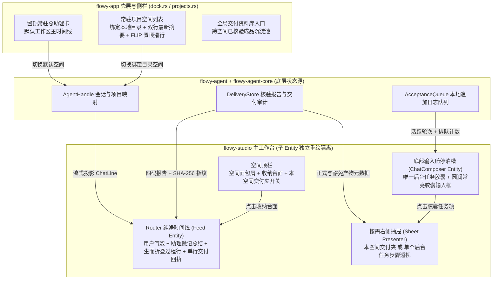
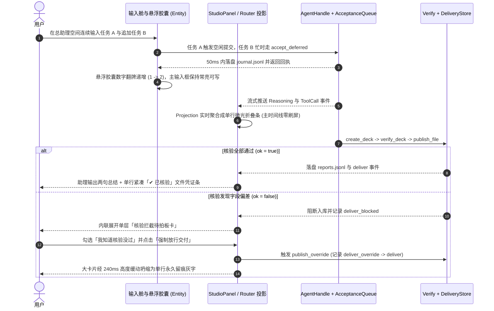
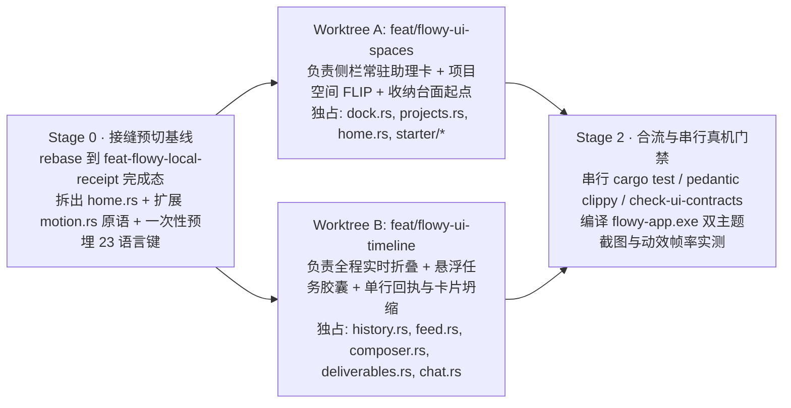

# Flowy Super Agent 界面交互与 GPUI 丝滑动效升级 · 技术方案

> **状态**：📋 计划（2026-11-25 架构与视觉交互定稿，待 `feat-flowy-local-receipt` 收尾合流后分叉并行实施）  
> **核心原则**：**台前常驻助理极简对话，幕后多任务与核验按需收纳；严守 `gpui-pre` 布局契约与 Quiet Kinetic 暖墨克制审美，以子 `Entity` 隔离、预测量插值与算术 FLIP 复现原生 120fps 丝滑动效。**

---

## 1. 背景与核心痛点 (Background & Pain Points)

### 1.1 业务背景

`flowy18_wip` 正在从传统的「单轮问答聊天界面」演进为基于 `pi-rust` 内核的 **Super Agent 交付型工作台**：用户面对的不是一次性聊天框，而是能够**全双工接待、后台并行推进多项任务（Works）、自动执行三层锚点核验并对交付文件背书**的常驻私人幕僚。

在底层能力（本地追加日志受理 `AcceptanceQueue`、`create_deck` / `verify_deck` / `verify_artifact` 四码核验、全类型交付硬门 `DeliveryStore`）逐步完备后，现有 `flowy-studio` 与 `flowy-app/dock` 的界面形态仍停留在早期 Chatbot 阶段，亟需一次符合人类直觉、极简克制且具备原生丝滑动效的体验升级。

### 1.2 现状与四大痛点

1. **P1 · 单任务标题悖论与侧栏列表冗余**：当前左侧边栏（`crates/flowy-app/src/app/dock.rs`）沿用「每次新提问生成一条会话标题」的传统模式，每行均挂着静态打勾图标。但在 Super Agent 模式下，同一个总控会话（Router）可同时并行受理「差旅汇总 + 周会汇报 + 拜访模板」多件独立事项，单一任务标题根本无法概括常驻助理会话；若同时暴露「会话列表」与「任务列表」又会造成严重概念重复。
2. **P2 · 主对话流被机器过程噪音淹没**：当前 `crates/flowy-studio/src/history.rs` 仅在整轮 `complete` 后才折叠成功工具行，**运行期间**的思考链（`Reasoning`）与工具调用（`ToolCall` / `ToolResult`）全部摊开在主时间线上；加之顶部横幅式排队提示，打断了人与总助理（Router）之间干净的高层沟通与总结阅读。
3. **P3 · 交付物与待人拍板呈现失焦**：右侧交付物抽屉（`crates/flowy-studio/src/deliverables.rs`）仍显示面向程序员的 `+added -removed` 行数统计（二进制 `.pptx` 仅显示 `—`）；已处理完毕的确认卡片长期占屏，缺少「通过即单行凭证、结案即坍缩留痕」的克制秩序。
4. **P4 · GPUI 动效底座未激活，缺少原生丝滑生命感**：`crates/flowy-studio/src/motion.rs` 虽已内置 IBM Carbon 精确三次贝塞尔采样器与错峰函数 `stagger()`，但全仓仅两处调用；展开折叠、队列计数变化、侧栏置顶重排、卡片结案切换均为生硬跳变，尚未发挥 GPU 原生渲染在微交互上的丝滑优势。

### 1.3 能力对比矩阵

| 体验维度 | 当前现状（`flowy18_wip` 基线） | 本方案目标终态（Super Agent 极简范式） |
| --- | --- | --- |
| **侧边栏信息架构** | 每次提问堆叠一条静态打勾会话行，无法表达单 Router 多任务并行 | **顶端置顶 1 张常驻总助理卡（默认区）+ 下方目录级常驻项目空间**；双行展示空间名与最新一句摘要，零碎标题堆积 |
| **助理身份与生命感** | 无身份锚点，运行状态仅靠底部文字跳秒 | 台前 **20px 温润墨感徽记 + 助理称呼**（用户侧不放冗余头像）；侧栏头像仅在 **`working` 或 `hover`** 时触发微呼吸 |
| **首页与长对话翻篇** | 独立静态模板走马灯页，常驻会话聊久后滚屏臃肿 | 顶栏提供轻量 **「收纳台面（Desk Fold）」**，一键归档早先屏面回到清爽意图起点，后台在跑任务与资料库不受影响 |
| **思考与工具过程** | 运行中全量摊开刷屏，整轮结束后才折叠 | **生而折叠（Live Collapse）**：从运行第 1 秒起即聚合成单行微光状态摘要，按需点击才平滑展开明细 |
| **后台并行与排队感知** | 页面顶部横幅常驻占高，视线与底部输入框割裂 | 输入框正上方停泊槽内**唯一一枚悬浮任务胶囊**（数字翻牌动画 + 点击弹出任务面板并可下钻单任务 `AlterEgo` 步骤），跑完自动隐去 |
| **交付凭证与审批卡** | 右侧抽屉显示代码行 diff，历史大卡片永久占屏 | 核验通过挂**单行紧凑文件凭证条**；仅核验未过内联露出单层确认卡，**拍板结案后自动平滑坍缩为单行系统灰字留痕** |
| **GPUI 丝滑动效体系** | 仅抽屉与示例卡两处基础位移，折叠与重排全靠瞬移 | 补齐**预测量高度缓动（GPUI 版 `AutoHeight`）、算术 `FLIP` 侧栏滑行、翻牌计数、条件微呼吸与 `MotionPolicy::Reduced` 总闸** |

---

## 2. 方案全景与架构设计 (Architecture & Topology)

### 2.1 端到端界面与状态流拓扑图



### 2.2 核心目标 vs. 明确的非目标

- **核心目标**：
  1. 建立**「常驻总助理（默认工作区）+ 常驻项目空间（项目工作区）」**双层零冗余侧边栏，彻底消除单任务会话标题悖论；
  2. 实现 **Router 主时间线极致减法**：全程默认折叠思考与工具步骤，以单枚底部胶囊统管后台并行/排队态势，结案卡片自动坍缩为单行留痕；
  3. 构建适配 `gpui-pre =0.3.14` + `gpui-kit =0.11.0` 的 **原生 120fps 丝滑动效原语集**，达到对标优秀现代桌面助理的顺滑质感；
  4. 通过预先切分模块接缝，支撑 **空间/起点线** 与 **对话/动效线** 双 Worktree 并行无冲突开发。
- **明确的非目标（本阶段坚决不做）**：
  1. **不破坏根工作区**：不修改仓库根 `crates/`、`ui/`、`apps/` 下的 Tauri/React 代码；
  2. **不引入具象卡通插画或打字探头彩蛋**：不做类似输入框上方探出卡通小人眨眼的玩具化装饰（如 Linger 的 `ComposerAgentPeek`），坚持 [根 DESIGN.md](../../../DESIGN.md) 的 **Quiet Kinetic 暖墨克制审美**；
  3. **不新增第三方 UI/动画外部依赖**：不修改精确锁定的 `gpui-pre` / `gpui-kit` 版本约束，全部动效基于 `gpui::Animation`、`PrepaintBounds` 与 `motion.rs` 自研组合子完成；
  4. **不触碰 V6 外部发送通道**：停在本地交付门、核验回执与资料库层。

### 2.3 架构与布局硬约束（Invariants）

1. **台前唯一发声人不变式**：主时间线内永远只有当前空间的助理（`Meta / Router` 视角）向用户做接单确认与总结汇报；后台任务状态一律聚合至底部胶囊与右侧按需透视面板。
2. **GPUI 四条防崩红线**（源自 [gpui-pre-and-kit.md](../gpui-pre-and-kit.md) 与 [DESIGN.md](../../DESIGN.md)）：
   - 严禁使用 `absolute().bottom().left()` 做主界面悬浮叠层（会退回文档流），底部任务胶囊采用**固定高度停泊槽 + `OverlayHost` 锚点浮层**；
   - 严禁读取 `window.viewport_size()` 计算主栏宽度，统一采用主栏 `flex_1().min_w_0()` + 抽屉固定 `w(px(320..360))`；
   - 凡紧贴圆角父容器边缘的不透明子块（如审批卡顶栏/底栏），必须显式携带同尺寸 `.rounded_t_xl()` / `.rounded_b_xl()`；
   - 多行/单行编辑器构造统一透传 `&mut Window`，程序化改值走渲染前排队，不依赖 `set_value` 触发 `InputEvent`。
3. **无障碍动效降级不变式**：所有位移、缩放、高度插值与循环呼吸动画必须读取 `ResolvedTheme` 的 `MotionPolicy`；在 `MotionPolicy::Reduced` 下立即切换为 0 位移瞬时/纯淡入模式。

---

## 3. 核心设计与模块规范 (Subsystem Design)

### 3.1 侧边栏与空间模型：置顶总助理 + 常驻项目空间（`flowy-app`）

借鉴 Linger（`AnotherMeCard` + `Rooms`）的常驻关系模型并结合本地文件工作流，重构 `crates/flowy-app/src/app/dock.rs`：

1. **置顶「Flowy 总助理」专属卡（默认工作区）**：
   - 固定位于侧边栏列表最顶端，绑定默认工作区主时间线（自动关联或惰性创建 `project_id == None` 的当前活跃主会话），**移除制造碎片的「重复新建空白聊天」心智**。
   - 左侧展示 **36×36px 圆角墨韵身份徽记**（读取个性化 `Profile` 名称与主题色），右下角配 `8px` 在线/运行状态点；右侧双行展示：**上行「总助理名称」+ 运行微旋环，下行实时截取最新一句对话纯文本摘要**。
2. **「项目空间（Project Spaces）」常驻分组**：
   - 每个已注册的 `Project`（绑定本地真实目录 `project.root`）在侧栏直接呈现为**一张双行空间行**（`min_h(px(52.))`），不再展开一串杂乱的子会话树：
     - 左侧：首字印章徽记（`32×32px`，`theme.soft()` 底色）；
     - 中间：上行项目名 + 置顶针 `Pin`，下行该项目空间主会话的最新一句回复摘要（无消息时显示短路径名）；
     - 右侧：后台运行微旋环 `✳` 或「待人拍板」琥珀圆点 `●`（一眼充当跨空间多任务雷达）。
3. **「收纳台面（Desk Fold）」翻篇机制**：
   - 顶栏右侧提供轻量文字/图标按钮「收纳台面」：点击后将当前屏幕对话归档至历史索引（可在空间归档记录与全局资料库随时检索），当前空间主舞台平滑切回清爽的**意图起点视图（原 Home 引导态）**，且正在后台执行的队列任务完全不受干扰。

### 3.2 对话时间线与渐进式收纳（`flowy-studio`）

重构 `history.rs`、`feed.rs`、`composer.rs` 与 `deliverables.rs`，实现四级渐进式信息披露：

1. **全程实时折叠（Live Collapse）**：
   - 修改 `Projection::build`（`history.rs`）：不再等待 `complete == true` 才折叠，从工具调用或 `Reasoning` 产生的**第 1 帧起**，即将同一轮次内连续的 `Reasoning`、`ToolCall`、非阻塞 `ToolResult` 聚合为**单行可展开状态胶囊**（运行中显示 `✳ 正在生成并核验 · 第 N 步 ▸`，完成后静默沉淀为 `已完成 N 步操作 · 4.2s ▸`）。
2. **唯一后台任务胶囊与单任务透视（Background Works Pill）**：
   - 移除页面顶部的横幅式排队栏，在 `ChatComposer` 输入框正上方设置 `28px` 停泊槽：当 `running_count + pending_receipts.len() > 0` 时，居中或左对齐浮现单枚药丸胶囊 `[ ✳ N 项后台任务运行/排队中 ▴ ]`；全部结案后平滑淡出。
   - 点击胶囊通过 `flowy_ui::popover` 弹出轻量任务清单（含运行中会话与本地 `journal.jsonl` 排队回执 `#尾号`）；点击任一条目可在右侧滑出该任务的步骤明细与独立停止操作。
3. **单行交付回执 vs. 结案坍缩待人卡**：
   - **核验通过 / 显式豁免产物**：在助理总结下方渲染紧凑的**单行文件回执条**（文件类型色标 + 文件名 + `✔ 已核验` 徽章 + 按需展开四码与 `sha256` 前 8 位指纹 + 打开交付夹按钮）。
   - **核验拦截待拍板卡（`ok = false`）**：唯一默认展开的单层细线卡片（聚合展示四码偏差 + 温和 L3 语义提示 + 默认未勾选的「我知道核验没过」复选框 + 强制放行按钮）。**一旦用户勾选并点击放行，卡片立即执行坍缩过渡，收拢为一行安静的永久审计灰字记录**，同时将产物归入空间交付夹。
4. **右侧按需「空间交付夹 / 任务透视抽屉」**：
   - 默认收起不占屏；废弃旧版 `+added -removed` 代码行统计，改为展示本空间正式/豁免/强制放行交付物卡片（文件大小、核验状态徽章、`sha256` 短指纹、预览与外部打开动作）。

### 3.3 多任务派发与卡片坍缩交互时序



### 3.4 GPUI 120fps 丝滑动效工程方案（Linger 动效拆解与原生映射）

对标 Linger（`globals.css`、`auto-height.tsx`、`use-nav-reorder-flip.ts`、`background-tasks-indicator.tsx`）的丝滑体感，结合 `gpui-pre` 渲染管线特性，在 `crates/flowy-studio/src/motion.rs` 与 `flowy-ui` 中建立 **6 项原生动效原语**：

| 序号 | 动效场景 | Linger (React/CSS) 原理解析 | Flowy GPUI (`gpui-pre` + `flowy-ui`) 原生实现机制 | 时长与曲线 |
| --- | --- | --- | --- | --- |
| **M1** | **折叠块平滑展开/收起（GPUI 版 `AutoHeight`）** | `ResizeObserver` 测高 + `height: 0 <-> h` 过渡，静止去 `overflow-hidden` | 自定义轻量包装器在 `Element::prepaint` 经 `window.layout_bounds` 缓存子块自然高度 `measured_h`；切换时带 `.overflow_hidden()` 对 `.h(px(measured_h * t)).opacity(t)` 插值 | `MODERATE` (240ms) + `out_quint(0, 0, 0.2, 1)` |
| **M2** | **待人拍板卡结案坍缩（Settled Card Collapse）** | `AnimatePresence mode="wait"` 先收高淡出卡片，再淡入单行通知 | 状态机设 `Settling { started_at }` 过渡态：前 200ms 将卡片高度与透明度收至 `0`，随后切为单行 `SettledNotice` 播放 150ms 显影 | 200ms `exit()` → 150ms `entrance()` |
| **M3** | **侧边栏置顶重排滑行（算术 `FLIP`）** | `getBoundingClientRect` 算前后帧 `deltaY`，施加 `translateY(delta -> 0)` | 侧栏空间行高恒定（`ROW_STRIDE = 56px`），无需 DOM 测量，直接由前后索引差算得 `delta_y = (old_idx - new_idx) * 56.0`，通过 `.relative().top(px(delta_y * (1.0 - d)))` 平滑归位 | `SLOW` (320ms) + `cubic_bezier(0.16, 1, 0.3, 1)` |
| **M4** | **胶囊计数翻牌与浮现（Rolling Pill Counter）** | CSS 弹簧曲线 + 数字纵向位移淡入 | 胶囊以 `("bg-pill-count", total_count as u64)` 为动画键，计数变化时数字执行 `6px` 向上滑入与微弹性落定；胶囊整体在 `28px` 停泊槽内 `opacity + 6px` 进退 | `FAST` (150ms) + `damped_pop()`（≤4% 微超调） |
| **M5** | **常驻头像条件生命感（Conditional Liveness）** | `animate={!inactive && (hovered \|\| working)}` 仅在活跃或悬停时微动 | 复用 `dock.rs` 每行 `hovered` 状态与会话 `is_busy`：仅在满足条件时挂载 `Animation::new(2200ms).repeat()` 的正弦微呼吸透明度/2px 轻浮，空闲失焦时零动画零重绘 | `2200ms` 对称正弦呼吸（仅活跃/悬停） |
| **M6** | **高频重绘边界隔离（120fps 帧率保障）** | `memo(MessageRow)` + 局部状态订阅 | 延续 Zed `agent_ui` 模式：底部胶囊与输入框归 `Entity<ChatComposer>`，时间线归 `Entity<Feed>`，侧栏悬停归行级 `use_keyed_state`；胶囊旋转环只重绘 `12px` 局部节点，绝不触发整屏重排 | 全程 0 全局轮询 Timer |

### 3.5 核心数据结构与状态机契约

```rust
// crates/flowy-studio/src/motion.rs 扩展契约
/// 对应 Linger --app-out-quint: 快速起势、长尾柔停，适合高度展开与面板落定
pub fn out_quint() -> impl Fn(f32) -> f32 + 'static {
    cubic_bezier(0.0, 0.0, 0.2, 1.0)
}

/// 对应侧栏 FLIP 滑行曲线: cubic-bezier(0.16, 1, 0.3, 1)
pub fn flip_glide() -> impl Fn(f32) -> f32 + 'static {
    cubic_bezier(0.16, 1.0, 0.3, 1.0)
}

/// 受 MotionPolicy 管控的位移缩放因子：Reduced 模式下强制返回 0.0
pub const fn travel_scale(policy: flowy_ui::MotionPolicy) -> f32 {
    match policy {
        flowy_ui::MotionPolicy::Reduced => 0.0,
        flowy_ui::MotionPolicy::Full => 1.0,
    }
}
```

```rust
// 空间视图与卡片坍缩展示态模型（UI 投影层，不污染持久化日志格式）
#[derive(Clone, Debug, PartialEq, Eq)]
pub struct SpaceSummaryRow {
    pub space_id: SpaceId,          // ChiefDefault 或 Project(String)
    pub title: String,              // "Flowy 总助理" 或 项目名
    pub subtitle_preview: String,   // 最新一句纯文本摘要或目录短路径
    pub pinned: bool,
    pub running_works: usize,       // 活跃轮次 + 待领取回执数
    pub needs_attention: bool,      // 存在未决核验拦截卡或错误
}

#[derive(Clone, Copy, Debug, PartialEq, Eq)]
pub enum ApprovalCardPhase {
    OpenActionable,                 // 待用户勾选与拍板
    Collapsing { seq: u64 },        // 拍板后 200ms 高度收拢过渡态
    SettledLine,                    // 已坍缩为单行永久留痕灰字
}
```

| 状态对象 | 初始态 | 触发动作 | 目标态 | 视觉与持久化约束 |
| --- | --- | --- | --- | --- |
| **过程折叠组 (`Fold`)** | `CollapsedLive`（运行首帧即收起） | 用户点击状态行 | `ExpandedLive` / `ExpandedDone` | 轮次完成后保持紧凑单行；若内含未捕获工具错误则自动标示错误微标 |
| **后台任务胶囊** | `Hidden`（`count == 0`） | 任一轮次启动或 `accept_deferred` 入队 | `FloatingIdle` ↔ `PopoverOpen` | `count` 归零后播放 `150ms` 退出淡隐，Popover 借 `OverlayHost` 定位 |
| **核验拦截待人卡** | `OpenActionable` | 勾选确认并点击强制放行 | `Collapsing` → `SettledLine` | 重新打开会话从 `events.jsonl` 读到 `deliver_override` 时直接渲染 `SettledLine` |
| **空间台面状态** | `ActiveTimeline` | 点击顶栏「收纳台面」 | `FreshDesk`（极简意图起点） | 后台队列照常排水执行；用户发新消息立即自动切回 `ActiveTimeline` |

### 3.6 双 Worktree 零冲突并行开发方案

待 `.agents/worktrees/feat-flowy-local-receipt` 最后一阶段提交落定后，本分支基于其最新 HEAD 完成 rebase，并按严格文件白名单拆出两路独立 Worktree 并行推进：



---

## 4. 关键决策与权衡矩阵 (Decision & Trade-off Matrix)

| 编号 | 决策点 | 选定方案 | 放弃的替代方案与理由 |
| --- | --- | --- | --- |
| **D1** | 侧边栏与 Router/Work 映射关系 | **顶端置顶 1 张常驻总助理卡 + 下方目录级常驻项目空间（双行最新摘要）**，具体子任务收进底部胶囊与资料库 | ❌ 每次提问新建一条单任务标题会话：无法承载单 Router 多任务并行语义，产生大量碎片历史；❌ 同时展示会话列表与 Work 列表：造成严重入口冗余与用户认知分裂 |
| **D2** | 长对话上下文清理方式 | **提供顶栏「收纳台面（Desk Fold）」一键归档屏面、原地恢复清爽起点** | ❌ 完全禁止翻篇（原版 Linger 模式）：长期使用后滚屏沉重、产生上下文淤积焦虑；❌ 强迫到处点「+ 新建对话」：破坏唯一常驻私人助理的连续陪伴感 |
| **D3** | 助理与用户头像策略 | **用户侧零头像（右对齐胶囊气泡）+ 助理侧 20px 温润墨感身份徽记（侧栏头像仅在 `working/hover` 微呼吸）** | ❌ 左右双圆写实/卡通大头像 + 输入框探头小人（`ComposerAgentPeek`）：社交群聊与玩具感过重，削弱商业汇报与数据核验的专业信赖度 |
| **D4** | 思考链与工具调用展示时机 | **生而折叠（运行第 1 秒起即聚合为单行微光摘要，点击平滑展开）** | ❌ 运行中全量摊开、跑完再收起（现行 `history.rs` 做法）：多步工具执行期间屏幕剧烈跳动刷屏，掩盖 Router 的自然语言沟通 |
| **D5** | 底部悬浮胶囊的 GPUI 布局实现 | **输入框上方 `28px` 固定停泊槽 + `flowy_ui::popover` (`OverlayHost`) 弹出详情** | ❌ 直接写 `div().absolute().bottom().left()`：`gpui-pre` 中绝对定位不可靠会退回文档流；❌ 动态插入高横幅推挤输入框：导致用户正在打字的输入框上下跳动 |
| **D6** | `gpui-kit` 组件与样式边界 | **复用 `gpui-kit` 输入底座与测试查询原语，视觉外观 100% 走 `flowy-ui` `ResolvedTheme` 封装** | ❌ 直接混用 `gpui_kit::component` 默认外观控件：圆角、边框与暖墨色板不一致，破坏产品级视觉统一性 |
| **D7** | 并行实施前置基线策略 | **先在 `main` 派生的 `feat/flowy-super-ui` 冻结设计文档；写业务代码前先 rebase 到 `feat-flowy-local-receipt` 完成态** | ❌ 直接在裸 `main` 上重写 `feed.rs` / `panel.rs` / 23 个 `locales/*.json`：既缺失核验与队列真实数据源，又会与 `feat-flowy-local-receipt` 产生上千行合并冲突 |

---

## 5. 验收标准与验证矩阵 (Acceptance Criteria & Ladder)

### 5.1 验收用例表 (Acceptance Criteria)

| 编号 | 验收场景 | 操作路径 | 可断言验收结果 |
| --- | --- | --- | --- |
| **TC-UI-01** | 常驻总助理与项目空间互斥渲染 | 启动客户端观察左侧栏，切换「Flowy 总助理」与已注册项目空间 | 顶端固定显示唯一总助理卡（无重复新建会话刷屏），项目空间显示名称、置顶状态与最新一句摘要；两者无重复条目 |
| **TC-UI-02** | 收纳台面翻篇不中断后台任务 | 在总助理空间发起慢任务并追加 1 条排队消息，点击顶栏「收纳台面」 | 主舞台平滑切换为清爽意图起点视图，底部悬浮胶囊仍保留运行与排队计数，后台任务正常完成入库 |
| **TC-UI-03** | 运行中思考与工具实时单行折叠 | 触发包含 `Reasoning` + `create_deck` + `verify_deck` 的轮次 | 运行期间主时间线仅展示 1 行动态阶段摘要，不摊开工具原始文本；点击该行可经高度缓动平滑展开/收起明细 |
| **TC-UI-04** | 底部唯一胶囊翻牌计数与单任务透视 | 任务执行中连续发送 2 条追加指令，点击底部胶囊并点选任一条目 | 输入框位置零跳动，胶囊计数播放翻牌递增动画；弹出面板列出运行项与 `#尾号` 排队项，点选可在右侧抽屉查看步骤 |
| **TC-UI-05** | 核验通过单行凭证 vs 未过拦截卡 | 分别构造核验 `ok=true` 与 `ok=false`（`VALUE_MISMATCH`）的 PPT 交付 | `ok=true` 仅渲染单行「✔ 已核验」紧凑凭证条；`ok=false` 默认展开单层拦截卡，未勾选复选框时放行按钮禁用 |
| **TC-UI-06** | 待人拍板卡结案自动坍缩 | 在 `TC-UI-05` 拦截卡中勾选确认并点击「强制放行交付」，随后重启面板 | 点击后卡片经高度缓动收拢为单行永久留痕灰字；重开客户端后该处直接渲染为单行留痕态且资料库带强制放行徽标 |
| **TC-UI-07** | 侧栏置顶 `FLIP` 滑行与头像条件呼吸 | 点击第 2 个项目空间的置顶按钮；观察空闲态与运行态头像动画 | 置顶空间平滑滑行至列表顶部而非瞬移；仅运行中或鼠标悬停的空间头像有微呼吸动画，静止空间零重绘 |
| **TC-UI-08** | `MotionPolicy::Reduced` 无障碍降级 | 将主题动效策略切换为 `Reduced`，重跑上述展开、胶囊与置顶操作 | 所有位移与高度过渡立即降级为 0 位移直达态，无循环闪烁动画，功能可正常操作 |
| **TC-UI-09** | 23 语言字典全量对称与亮暗双主题 | 切换 `zh-CN` / `en` 及 Light / Dark 主题检查全部新增表面 | `every_locale_has_the_same_keys` 单测通过；暖纸白与暖墨黑双主题下对比度 ≥ 4.5:1，圆角边缘无直角溢出 |

### 5.2 统一验证梯子 (Verification Ladder)

代码实施阶段在 `flowy18_wip/` 目录下**严格串行**执行以下验证链（禁止并发启动多个 `cargo` 进程争抢 `build.noindex` 锁）：

```powershell
# 1. 核心动效与投影单测（含新增曲线单调性、实时折叠、卡片坍缩状态机与 23 语言对齐）
cargo test -p flowy-i18n
cargo test -p flowy-ui
cargo test -p flowy-studio
cargo test -p flowy-app

# 2. 全目标 Pedantic Clippy 与格式门禁（与 CI flowy18-ui.yml 严格一致）
cargo clippy -p flowy-ui -p flowy-studio -p flowy-app -p flowy-i18n -p flowy-agent --all-targets -- -D warnings
rustfmt --edition 2024 --check <全部改动 .rs 文件>

# 3. UI 契约脚本检查
bun scripts/check-ui-contracts.mjs

# 4. 桌面二进制构建与真机 UIA + 亮暗双主题截图闭环（构建前先结束运行实例）
Get-Process flowy-app -ErrorAction SilentlyContinue | Stop-Process -Force
cargo build -p flowy-desktop --bin flowy-app
```

---

## 附录：原始技术底稿与历史归档 (Historical & Technical Reference Archive)

> **归档说明**：以下完整保留本方案定稿过程中的架构问答演进记录、戒指老爷爷 `reverse-teardown` 反向拆解结论，以及对本地 `linger` 仓库源码（`simplexai-labs/linger`）逐文件核对的技术对照表，供后续子 Agent 开发与设计审计追溯。

---

### A.1 核心设计演进脉络记录（2026-11-25 架构对齐纪要）

1. **从 Chatbot 列表走向 Super Agent 常驻空间**：
   - 初始设想曾尝试在传统会话列表上叠加状态点，但在推演「一个 Router 同时并行推进多项异构任务」时暴露根本矛盾：单一任务标题（如《Q3华东销售汇报》）无法定义承载多项并行任务的 Router 会话，而同时展示会话列表与 Work 列表又会导致严重的界面冗余。
   - 经确立「台前常驻总助理（`Meta / Router`）+ 幕后并行分身（`AlterEgo / Work`）」双层模型后，左侧栏彻底放弃“一次性提问标题流”，收敛为**「顶端置顶 1 张个人总助理卡（默认工作区）+ 下方绑定本地文件夹的常驻项目空间」**，并通过顶栏「收纳台面」化解长期单流聊天的滚屏淤积感。
2. **从信息平铺走向极致减法（Distill & Progressive Disclosure）**：
   - 对标 `Orchestrator + N Agents` 极简界面、Antigravity 与 Codex 的信息密度：主对话流作为直面用户的唯一沟通渠道，不需要摊开思考过程、工具中间产物或冗长状态横幅，只需保留**用户意图、助理简短接单/最终汇报总结、单行可核验文件凭证，以及唯一例外需人工干预的待拍板卡**。
   - 其余一切过程信息（思考链、工具步骤、后台并行任务、本地排队回执、SHA-256 指纹明细）全部收纳进「单行实时折叠条」与「底部唯一悬浮任务胶囊」内，点开才看。

### A.2 优秀范例反向拆解（`reverse-teardown` 提炼的四条极简准则）

1. **主线零机器噪音**：Router 时间线只承载「人的意图、Router 的汇报总结、最终交付物单行回执、必须人拍板的待人卡」，其余一律折叠。
2. **生而折叠，而非完后折叠**：思考（`Reasoning`）与工具（`ToolCall` / `ToolResult`）在流式进行中就收纳为单行状态行，跑完静默凝结为一行灰字摘要，点开才看明细。
3. **单一胶囊收纳后台态**：砍掉页面顶部的排队横幅与输入框内的说教式说明，统一收进输入框上方的唯一悬浮胶囊，配合常亮可写的圆润输入框传递全双工直觉。
4. **结案即坍缩**：需要人工拍板的拦截/审批卡片，在未决时单层清晰呈现；一旦人工做出决定，立即坍缩为单行灰字系统记录，保持时间线长期清爽。

### A.3 本地 `linger` 源码关键实现对照档案

核对路径基准：`D:/workSpace/git_clone_test/linger`

| 借鉴模块 | Linger 源码文件位置 | 核心机制摘录 | Flowy (`flowy18_wip`) 取舍与转化结论 |
| --- | --- | --- | --- |
| **前台 `Meta` 与后台 `AlterEgo` 分工** | `docs/task-delegation.md` | 每个 Room 仅 1 个 `Meta` 对人说话；每项后台任务派生独立 `AlterEgo`（最多 10 并行），`AlterEgo` 不读闲聊、不对人发问，只向 `Meta` 交报告 | **核心采纳**：映射为每个常驻空间 1 条主对话流 + 后台多轮次/队列并行收拢于底部胶囊 |
| **置顶主助理卡与双行空间行** | `apps/web/src/features/rooms/room-secondary-navigation.tsx` | `AnotherMeCard` 固定置顶；列表行 `min-h-14` 含头像、名称、置顶针、`latest_message` 纯文本摘要；`ActorAvatar` 设 `animate={!inactive && (hovered \|\| working)}` | **采纳结构与条件动画，改良头像审美**：采用暖墨几何/首字印章徽记替代卡通插画，新增顶栏「收纳台面」翻篇能力 |
| **底部悬浮后台任务胶囊** | `apps/web/src/features/rooms/chat/background-tasks-indicator.tsx` | `h-0` 浮层居中悬于输入框上方，展示旋转细环 + 运行数量，点击弹出 `360px` 任务列表，再点单行打开子任务步骤视图；0 任务时完全卸载 | **完整采纳交互，适配 GPUI 布局**：改用 `28px` 固定停泊槽 + `flowy_ui::popover` 锚点浮层，规避 `gpui-pre` 的 `absolute` 退化陷阱 |
| **决断卡结案自动坍缩** | `apps/web/src/features/rooms/chat/message-row.tsx` | `settledCardNotice`：未决时渲染完整 `ConversationMessageRow` 卡片，决断完成后经 `200ms` 收高淡出并切换为 `180ms` 淡入的单行系统通知 | **完整采纳**：用于核验未过强制放行（Override）卡片确认后的单行永久审计留痕切换 |
| **自适应高度过渡与侧栏 FLIP** | `apps/web/src/components/ui/auto-height.tsx`、`features/rooms/use-nav-reorder-flip.ts`、`app/globals.css` | `ResizeObserver` + `280ms cubic-bezier(0, 0, 0.2, 1)` 高度缓动；置顶重排用 `450ms cubic-bezier(0.16, 1, 0.3, 1)` 补间 `deltaY`；暖白浓墨 `--town-*` 色板 | **转化为原生 GPUI 原语**：基于 `Element::prepaint` 预测量高度插值与等高行算术 `delta_y` 偏移，零 DOM 开销实现 120fps 同级丝滑度 |
| **输入框打字探头小人彩蛋** | `apps/web/src/features/rooms/chat/composer-agent-peek.tsx` | 连续打字满 `2500ms` 且超 12 字时从输入框上沿升起最多 3 个卡通头像随机眨眼，发送时点头缩回 | **明确舍弃**：与 Flowy 严肃可核验交付工作台及 `Quiet Kinetic` 克制美学不符，不予引入 |
