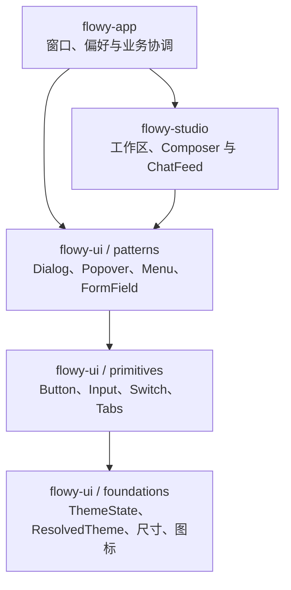
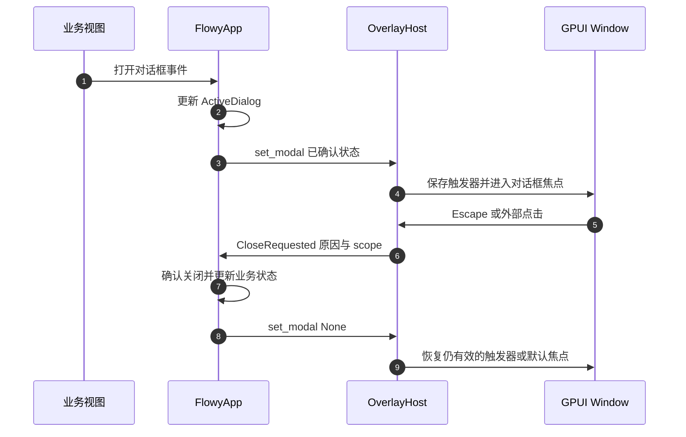

# Flowy 1.8 UI 系统 · 架构、修改与验收规范

> **状态**：🔧 实施中的架构基线；自动化与视觉验证分开记录。
> **日期**：2026-11-17。
> **核心原则**：窗口持有主题和弹层服务，组件提供完整的视觉、键盘和无障碍契约；业务模块提供真实数据与事件。

## 1. 背景与核心痛点

本规范适用于 `flowy18_wip` 的 Rust + GPUI 桌面界面，不适用于主工程的 React SPA。目标是保留当前品牌与页面结构，将重复交互收进公共 UI 模块，同时支持浅色、深色、密度、字号和 23 种语言。

修改前的三类问题：

1. 色板通过进程全局 `Atomic*` 保存，由 render 写入；主题颜色可随意拼接，组件测试覆盖不到错误的前景与背景组合。
2. 共享按钮虽然有键盘及 AccessKit 测试，业务仍大量通过裸 `div().on_click()` 实现操作；输入锁定仅改变透明度。
3. 弹层各自维护 open 标志、坐标和关闭逻辑；`.occlude()` 只遮挡鼠标，不能隔离键盘焦点；积分展示读取固定的 `2500` 和固定拆分。

| 能力 | 修改前 | 本规范的目标 |
|---|---|---|
| 主题 | 全局状态，render 更新 | 窗口级 Entity，渲染读取不可变快照 |
| 控件 | 页面自定角色、状态与样式 | 公共控件共享状态、键盘与名称契约 |
| 弹层 | 多布尔值、固定坐标 | 单一业务对话框状态，集中焦点和测量定位 |
| 余额 | 正常运行时假值 | 显式 Loading / Ready / Unavailable / Error |
| 聊天 | 全量构建、计时触发整体更新 | 可变高度 Feed 与独立工作状态更新 |
| 验证 | 主工程检查不能覆盖 GPUI | 子 workspace 的测试、扫描和平台验收 |

UIArc 是设计与交互参考，不引入 React、Radix、Motion，也不复制其源代码或素材：

- [组件组织](https://uiarc.dev/docs/introduction)
- [主题分层](https://uiarc.dev/docs/theming)
- [按钮状态](https://uiarc.dev/components/button)
- [菜单行为](https://uiarc.dev/components/dropdown-menu)

## 2. 方案全景与边界



### 2.1 目标与非目标

- 目标：完成现有 UI 的统一迁移、真实控件状态、弹层焦点管理和双主题适配。
- 目标：保留现有 preferences 的序列化语义、会话与草稿、后台状态及登录保护规则。
- 非目标：新增支付、账户服务、后端接口、Agent 协议或整体页面视觉改版。
- 非目标：用 UI 重构处理已有 macOS 上游补丁的来源问题；它属于独立构建前置。

### 2.2 架构不变量

- `UiContext` 由窗口创建，含 `Entity<ThemeState>` 与 `Entity<OverlayHost>`；不进入 preferences 文件。
- `ThemeState` 是主题配置的单一来源；业务视图可以缓存并观察 `ResolvedTheme`，但 render 不改变主题。
- 公共 UI 不发请求、不保存偏好、不创建账户数据，不导入 App 或 Studio。
- 标识符不使用翻译标签；换语言、换主题不重建输入 Entity 或焦点身份。
- `ActiveDialog` 是主对话框的业务状态；OverlayHost 只保存呈现与焦点元数据。
- 演示数据仅存在于 examples 与 tests；未知余额不等于真实零余额。

## 3. 核心设计与接口规范

### 3.1 主题和尺寸

```rust
pub struct UiContext {
    pub theme: Entity<ThemeState>,
    pub overlays: Entity<OverlayHost>,
}

pub struct ThemeOptions {
    pub mode: ThemeMode,
    pub accent: Accent,
    pub density: Density,
    pub font_size: u8,
}
```

窗口创建时先加载 preferences，以实际 `WindowAppearance` 解析 Auto，再构造 App 和 Studio。主题改变通过 Entity 通知订阅视图，Subscription 随视图保存。`ThemeMode` 移入 UI crate，由 preferences 重导出，继续使用 `light/dark/auto`。

颜色角色包括表面、内容、控件、边界、焦点和遮罩。控件通过 `ControlColors` 获取背景、前景和边框，不能组合任意 accent 与 on-ink。scrim 始终使用独立 token；深色模式不从文字 ink 推导遮罩。

默认字号 14，用户范围 12–16。间距采用离散档位，控件尺寸使用 Small / Medium / Large 与密度配方。控件采用最小高度，允许语言换行和字号增长。图标继承所在控件的文字颜色。

MotionPolicy 默认 Reduced；UI 组件不得用位移动效阻碍焦点或点击反馈。GPUI 的 reduce-motion 标志不会自动读取系统偏好，平台桥接需独立验证，不能宣称已经接入。

### 3.2 基础控件

```rust
Button::new("save", localized_save)
    .loading(saving)
    .disabled(!valid)
    .render(&theme, on_save);

TextField::new("name", localized_name, existing_state)
    .mode(InputMode::ReadOnly)
    .render(&theme, cx);
```

| 组件 | 契约 |
|---|---|
| Button / IconButton | 稳定 ID、可访问名称、变体、尺寸、禁用、加载及回调 |
| TextField / text_input / text_area | 使用已有 EditableTextState；本地化标签；编辑、只读和禁用分离 |
| Switch / Radio / Tabs / Disclosure | 受控值、状态变更回调、选中或展开语义、键盘行为 |
| FormField / SettingsRow | 标签、帮助、错误和内容布局；业务负责校验规则 |
| Notice / EmptyState | 内容、状态和可选操作；不虚构数据或调用服务 |

loading 保留焦点并禁止重复激活。disabled 不进入 Tab 路径。只读通过 `.accepts_input(false)` 实现，仍可选择和复制。低层 text_input/text_area 适用于现有编辑器配方，调用者必须附加名称及真实状态，不得仅降低 opacity。

`interactive()` 用于组合自定义操作表面，提供共同的角色、Tab、焦点及可访问名称；它不代替显式的 disabled/loading 处理。普通布局容器不需要原子包装。

### 3.3 弹层与焦点生命周期



| 生命周期 | 前置条件 | 结果 |
|---|---|---|
| 无对话框 → 打开 | App 确认 ActiveDialog | Host 保存弱焦点引用，建立当前 scope |
| 打开 → 子菜单 | 当前业务允许选择 | 保存菜单触发器，最上层键盘路径进入菜单 |
| 子菜单 → 关闭 | App 接受 CloseRequested | 回到菜单触发器，主对话框保持打开 |
| 对话框 → 请求关闭 | Escape、外部点击或业务动作 | 发出请求；Host 不直接删除业务状态 |
| 对话框 → 已关闭 | App 将 ActiveDialog 改为 None | 移除呈现，恢复触发器或宿主默认目标 |
| 触发器被移除 | 锚点不再出现在布局中 | 发出 AnchorRemoved，业务移除对应浮层 |

`modal_layer()` 提供全窗口遮罩、模糊、居中与外部点击关闭；`dialog()` 提供 Dialog 角色、模态语义、稳定的根 FocusHandle、鼠标遮挡和面板内事件截断。业务层只提供卡片内容，不再重复 scrim 配方。Tab / Shift+Tab 根据 GPUI 已绘制的焦点路径在当前根内循环；空内容回到根容器。背景子树隐藏于无障碍树，背景业务快捷键也必须由宿主拒绝。仅使用 `.occlude()` 或 `.tab_group()` 不满足模态要求。

`anchor_trigger()` 在 prepaint 保存实际窗口边界；`popover()` 使用 anchored + deferred 层、窗口边缘余量与 RTL 方向定位。菜单不得使用页面固定 top/left 坐标。Menu 提供方向键、Home / End；Select 显式暴露选择状态。

焦点恢复使用弱引用，并核对当前 scope，防止旧 deferred 回调覆盖快速打开的新对话框。GPUI 的 `InputPreference::CharacterInput` 优先于关闭和导航快捷键；原生 IME 仍需要平台冒烟验证。

### 3.4 业务数据与聊天更新

- 余额组件只接收 `CreditsViewState`。当前服务不可用时为 Unavailable；Ready 的真实零值显示 `0`，不与未知混同。
- 删除正常运行时 `2500`、`DAILY_GRANT` 和固定余额拆分，不新增后端接入。
- Feed、Composer、工作耗时使用独立更新单元；Feed 使用可变高度 ListState，按会话保存滚动状态。
- 后台会话更新不能切换当前页面；草稿、消息展开、存储错误持续显示等原有语义继续保留。
- 登录仅迁移控件交互；OTP 请求、冷却、generation 防旧响应规则保持原有业务语义。

### 3.5 颜色与直接点击的例外

源扫描器采用文件及函数/元素 ID 的精确清单，不通过整个目录放行。

| 例外 | 允许原因 |
|---|---|
| Gallery 的 poster、thumb、idea_stage 与视频 transport | 媒体和插画本身的 authored tint、黑色遮罩、白色媒体图标 |
| Invite 的 social_row、envelope | 固定品牌色和信封插画素材 |
| Login 的 wire_card、wire_dot、wire_line | 登录蓝图插画，不承载普通控件状态 |
| 指定的 layer、panel、card ID | 遮罩关闭或阻止点击传播；操作按钮不得列入 |

普通控件新增 rgb/rgba 必须改用主题 token。新增例外要说明具体视觉用途，不能仅为了通过检查扩大文件级豁免。

## 4. 关键决策与权衡

| 编号 | 决策 | 放弃的替代方案与原因 |
|---|---|---|
| D1 | 现有 flowy-ui 内分模块 | 多个原子 crate 增加依赖与公开接口，当前没有独立发布需要 |
| D2 | 窗口级 ThemeState + 不可变快照 | 全局 Atomic 会让多窗口、预览和测试共享隐式状态 |
| D3 | 受控 ActiveDialog + Host 呈现 | 两份 open 状态和手动清理多个业务布尔值容易分歧 |
| D4 | 实测锚点 + GPUI anchored | 固定 top/left 无法随滚动、字号、语言和密度变化 |
| D5 | 在原生输入上封装真实状态 | 重写编辑器容易损失 IME、选择、粘贴与 AccessKit 能力 |
| D6 | 余额 Unavailable 为默认 | 演示值或零余额会伪造账户事实 |
| D7 | 专属 GPUI 测试与源码扫描 | 主工程 bun run check 面向 React，不构成本子工程验收 |
| D8 | 依赖补丁单独修复 | 删除 patch 或复制未审核 vendored 来源无法证明干净构建可复现 |

## 5. 验收标准与验证矩阵

### 5.1 自动化用例

| 编号 | 路径 | 断言 |
|---|---|---|
| TC-01 | Light / Dark / Auto，两个窗口 | 首帧与切换正确，窗口主题互不污染 |
| TC-02 | 双主题 × 全 accent | 普通文字配对达到 4.5:1，关键非文本达到 3:1 |
| TC-03 | Button 鼠标、Enter、Space、禁用与加载 | 统一激活，无重复提交，loading 保留焦点 |
| TC-04 | Dialog Tab / Shift+Tab / Escape | 焦点不进入背景；Escape 发请求，业务确认后关闭 |
| TC-05 | 子菜单与恢复 | 先关闭子菜单，主 Dialog 不丢失，恢复有效触发器 |
| TC-06 | 触发器测量、滚动和 RTL | 浮层跟随锚点；消失时请求关闭 |
| TC-07 | ReadOnly / Disabled 与输入 | 真正禁止修改；只读保留选择与复制 |
| TC-08 | 长会话 | 1,000 条不同高度内容仅构建可见与预加载项，保留滚动和展开 |
| TC-09 | 后台会话、存储错误、登录回归 | 保留现有业务测试与错误恢复语义 |
| TC-10 | 23 locale | 键集合一致；中文、英文、阿拉伯语无键名泄漏 |
| TC-11 | 未知、错误和真实零余额 | 状态互不混同，正常运行时无固定余额 |
| TC-12 | 源码扫描器 | 正反 fixture 覆盖注释/字符串、嵌套 child、例外与普通控件 |

### 5.2 验证梯子

在本目录的父目录 `flowy18_wip` 中执行，Cargo 命令串行运行：

```powershell
bun scripts/check-ui-contracts.mjs --self-test
bun scripts/check-ui-contracts.mjs
cargo test -p flowy-ui --locked
cargo test -p flowy-i18n --locked
cargo test -p flowy-studio --locked
cargo test -p flowy-app --locked
cargo check -p flowy-desktop --locked
cargo fmt --all -- --check
cargo clippy -p flowy-ui -p flowy-studio -p flowy-app -p flowy-i18n --all-targets --locked -- -D warnings
```

组件展示入口：`cargo run -p flowy-ui --example catalog --locked`。examples 不是正常产品入口，其中演示数据不允许导入生产模块。

源码扫描检查明确的全局主题、旧 token、假余额、普通 UI 原始颜色，以及裸 div 自身的连续方法链点击。它会跳过 child/closure 中的嵌套表达式，并包含正反 fixture；它不是 Rust 编译器或完整控制流分析器，不能替代控件和业务回归测试。

同一源码门禁直接解析 locale JSON，以 `zh-CN` 为键集合基准，检查所有字典的键一致性和非空字符串值。该检查不依赖 Cargo 或本机补丁，避免原生构建阻碍同时掩盖文案缺失。

### 5.3 手工视觉与平台验收

以下为验收要求，不能因编译通过而自动标记完成：

- 窗口：960×640、1280×820、1920×1080。
- Windows 缩放：100%、150%、200%。
- 浅色与深色、字号 12/14/16、三档密度。
- 中文、英文、阿拉伯语整页布局与键盘路径。
- Windows 与 macOS 原生窗口、焦点、IME、粘贴及系统主题冒烟。
- 对话框滚动内容、固定操作区、菜单窗口边缘、输入锁定及错误恢复。

已经留存旧运行中二进制的浅色窗口截图 `.scratch/ui-baseline/before-light.jpg`。它只用于修改前视觉对照，不是新代码验收证据：捕获图像为 1283×851，中文、浅色；系统缩放、字号、密度及旧二进制对应提交未完成绑定，因此其余组合继续标为待验收。后续正式截图必须记录平台、窗口尺寸、缩放、主题、语言、字号、密度及对应提交。

### 5.4 已有基线与阻碍

| 项目 | 已观察结果 |
|---|---|
| 修改前 flowy-ui 基线 | 4 项测试通过：按钮键盘/鼠标/禁用、AccessKit、两组文字对比度 |
| 修改后 flowy-ui 阶段检查 | 16 项测试通过，包括 ModalLayer 外部点击隔离；后续控件改动仍需最终重跑，不代表平台视觉完成 |
| 修改后 flowy-app 阶段检查 | 18 项测试通过，保留已有后台状态及存储错误回归 |
| 修改后 flowy-studio 阶段检查 | 5 项测试通过，包括 1,000 行懒加载、会话滚动、流式行身份/滚动锚点、主题/草稿及余额状态；GPUI 的 TestTextSystem 固定为单行，原生换行高度由平台视觉矩阵验证 |
| locale 阶段检查 | 首次测试发现旧字典中 11 种语言缺少 `notice.session_storage_failed`；已补齐。源码解析确认 23 字典均为 423 键，Cargo 最终重跑单独记录 |
| 源码扫描 | 18 项正反 fixture 及当前生产扫描通过，包含独立 locale JSON 检查 |
| 单包 clippy、最终检查 | 以实施者最终运行记录为准，不将阶段通过扩展为最终通过 |
| 聚合严格 clippy | 实施时运行上述 `cargo clippy ... -- -D warnings` 被既有 `flowy-net`、`dsh-rs`、`flowy-ota` 的未使用导入/死代码警告阻断；这些依赖不属于本次 UI 修改，未添加 allow 或降低严格门禁 |
| 干净检出构建 | 已确认阻碍：Cargo.toml 的 gpui_ce_macos path 指向未跟踪的 `.scratch/gpui_ce_macos-0.3.0` |
| Windows/macOS 完整视觉矩阵 | 待执行，不能用 headless 或 mock-window 测试替代 |

专属 CI 自动运行源码/locale 门禁，并通过独立的 dependency-readiness job 检查现有 path patch 的 manifest 是否被跟踪。缺失时，该 inventory job 在日志与 workflow summary 中明确报告 **BLOCKED — Windows build/tests skipped automatically**；它的成功状态仅表示依赖盘点完成，不表示原生构建或测试通过。Windows job 的跳过状态必须与源码门禁分开评估，不能作为完整验收。

当可复现 patch 来源在独立修改中被跟踪后，Windows job 自动执行全部测试和检查。`workflow_dispatch` 可手动执行 Windows job；缺失来源时仍由相同 preflight 明确失败。此安排保留可运行的自动源码门禁，同时不让一个已知不具备构建输入的 job 在每个 UI PR 上伪装执行，也不移除或绕过补丁。

聚合严格 clippy 的依赖警告也属于独立待闭环项。`cargo clippy -p flowy-ui --all-targets --locked -- -D warnings` 可单独验证基础 UI crate；对受上述依赖影响的 package 可运行 `cargo clippy -p <package> --all-targets --locked --no-deps` 以定位本包问题，但该命令仅提供补充诊断，不能作为聚合严格门禁通过的证据。最终记录必须分别列出“UI 检查结果”“依赖警告阻断”“平台视觉待验收”。

### 5.5 最终验收记录的填写规则

- 每次最终运行记录命令、对应提交、退出码与测试数量，不使用过时的 `.scratch` 日志代替重跑结果。
- 干净检出构建、依赖严格 clippy、Windows 视觉矩阵、macOS 冒烟分别填写状态；某一项通过不得推导其余项通过。
- 缺少系统或设备条件的验收保留“待执行”和具体原因，不填通过，也不以 mock-window 测试替代原生 IME、缩放或平台窗口行为。
- 阶段测试数量是实施过程证据。最终交付时在本节追加最终结果，保留上方记录以追溯首次失败和修复。

---

## 附录：原始技术底稿与历史归档

> **归档说明**：这是新增文档，没有替换或删改既有技术方案。以下保留本轮代码审查与已确认 GPUI 接口的原始依据，供后续核对；示例中的旧代码是历史证据，不是生产实现建议。

### A. 修改前的原始代码依据

```rust
static DARK: AtomicBool = AtomicBool::new(false);
static ACCENT: AtomicU8 = AtomicU8::new(0);
static DENSITY: AtomicU8 = AtomicU8::new(0);

pub fn install(dark: bool, accent: Accent, density: Density) {
    DARK.store(dark, Ordering::Relaxed);
    ACCENT.store(accent as u8, Ordering::Relaxed);
    DENSITY.store(density as u8, Ordering::Relaxed);
}
```

```rust
credits: 2500,
```

```rust
const DAILY_GRANT: u32 = 300;
```

```rust
if locked { field.opacity(0.7) } else { field }
```

审查统计原始记录：`flowy-app` 和 `flowy-studio` 合计有 101 处直接 `.on_click()`，共享按钮只有 2 处调用。点击数量包含遮罩等非按钮，不能直接作为缺陷数量。业务层 `space()` 仅使用 6 次，Studio 没有接入。

错误颜色配对原始记录：头像使用 accent 背景与 on_ink 前景；浅色橙色配白字约 3.56:1，深色紫色配深字约 2.66:1。原 fill/on_fill 测试不覆盖这种跨角色配对。

### B. GPUI 0.3.0 已确认能力

- `Context::observe(&Entity<W>, callback) -> Subscription` 可用于主题通知，Subscription 必须保存。
- `.occlude()` 文档定义为阻止鼠标到达后方元素。
- `.tab_group()` 只改变 Tab 顺序分组，不提供模态焦点隔离。
- `window.focus_next/prev` 遍历整个窗口已绘制的 tab stops。
- `FocusHandle::contains_focused` 可判断当前焦点是否属于指定根。
- `EditableTextElement::accepts_input(false)` 让原生编辑器保留选择和复制，并向 AccessKit 暴露 read-only。
- `anchored().position(...).snap_to_window_with_margin(...)` 可定位浮层；`on_prepaint` 提供触发器真实 bounds。
- `App::reduce_motion` 有公开读写接口，但库文档说明应用需自行接入系统设置。

### C. 构建依赖原始记录

```toml
[patch.crates-io]
gpui_ce_macos = { path = ".scratch/gpui_ce_macos-0.3.0" }
```

修改开始时 `git ls-files flowy18_wip/.scratch` 无输出，`git status --short` 显示 `.scratch/` 和 `build.noindex/` 为未跟踪目录。本轮不将它们当作 UI 交付资产，也不删除现有补丁。

### D. 首次严格 clippy 的原始阻碍

2026-11-17 执行聚合 `cargo clippy -p flowy-ui -p flowy-studio -p flowy-app -p flowy-i18n --all-targets --locked -- -D warnings` 时，日志同时包含新增 UI 的待修复 lint 与既有依赖问题。新增 UI lint 由本次修改负责修复；依赖问题未通过全局 allow 或 cap-lints 掩盖。

原始依赖错误包括：

```text
crates/flowy-net/src/proxy.rs:
  parse_scutil_proxy / enabled_proxy_url / non_empty is never used
crates/dsh-rs/src/core/mod.rs、session/mod.rs、llm/mod.rs:
  unused imports，以及多个现有 dead_code 项
crates/flowy-ota/src/updater.rs、install_gate.rs:
  unused import / dead_code
```

`dsh-rs` 还报告既有 `result_large_err`、`unnecessary_min_or_max` 和 `module_inception`。这些记录说明聚合命令为何不能被标记通过，不构成本轮扩大修改 Agent 引擎或更新安装逻辑的授权。
